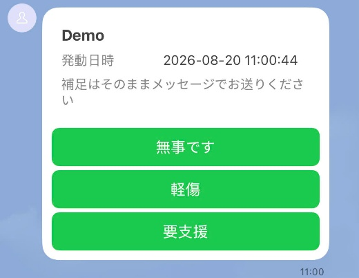
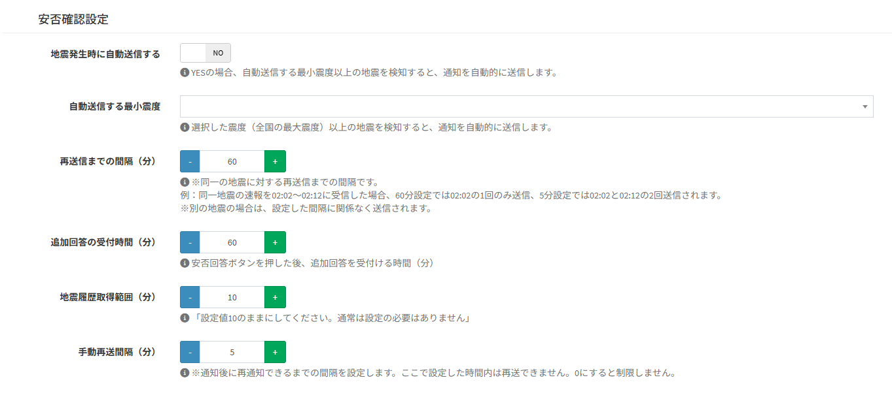
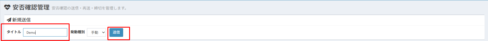
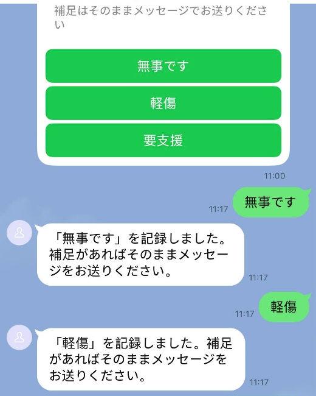
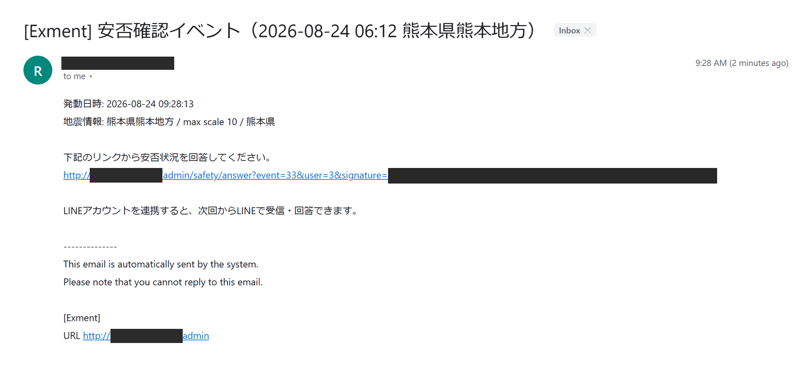
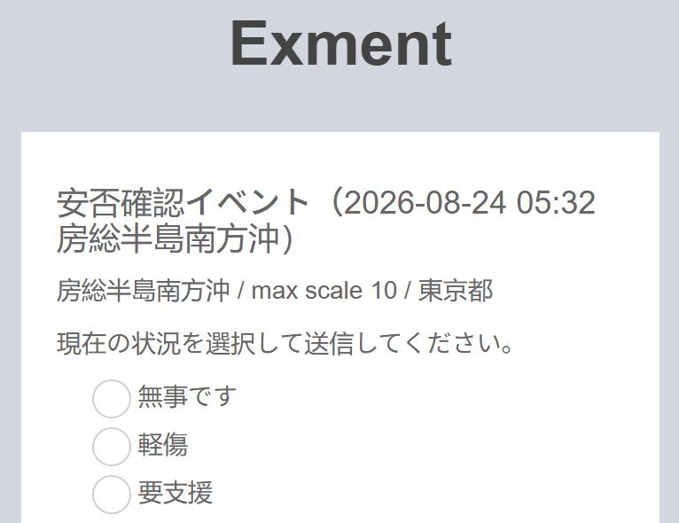
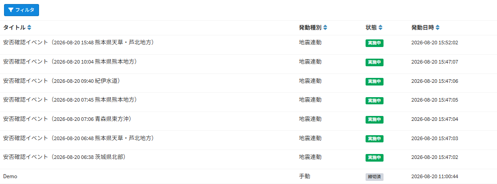
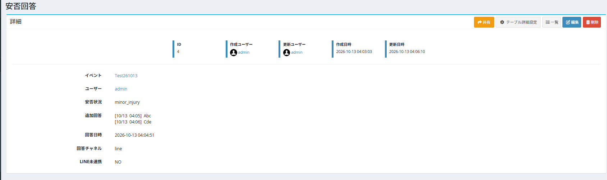
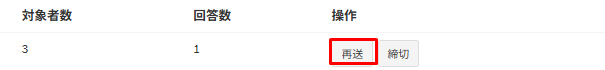
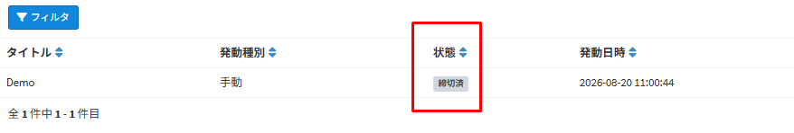

# Sicherheitsabfrage
Mit dieser Funktion fragen Sie in einem Notfall wie einem Erdbeben oder Taifun über LINE und E-Mail, ob die Mitarbeiter in Sicherheit sind.  
Ein Administrator sendet die Abfrage von einer Seite aus. Sie kann auch automatisch gesendet werden, wenn ein Erdbeben mit mindestens der eingestellten seismischen Intensität auftritt.  
Den Stand der Antworten sehen Sie auf der Verwaltungsseite der Sicherheitsabfrage und in der Tabelle der Antworten.  
※Die Sicherheitsabfrage gibt es ab v7.0.0.

Der Weg bis zur Nutzung sieht so aus.

1. Treffen Sie die [Vorbereitungen](/de/safety_check?id=Vorbereitungen) (LINE, E-Mail, Aufgabenplanung).
2. Nehmen Sie die [Einstellungen zur Sicherheitsabfrage](/de/safety_check?id=Einstellungen-zur-Sicherheitsabfrage) vor (zum Beispiel, ob bei Erdbeben automatisch gesendet wird).
3. [Senden Sie die Sicherheitsabfrage](/de/safety_check?id=Sicherheitsabfrage-senden).
4. Die Mitarbeiter [antworten](/de/safety_check?id=Antworten).
5. [Prüfen Sie den Stand der Antworten](/de/safety_check?id=Stand-der-Antworten-prüfen) und nutzen Sie bei Bedarf [Erneut senden und Abschließen](/de/safety_check?id=Erneut-senden-und-Abschließen).

## So funktioniert die Sicherheitsabfrage
- Bei jedem Senden einer Sicherheitsabfrage entsteht ein Datensatz in „Sicherheitsabfrage-Ereignisse“.
- Gleichzeitig entsteht für jeden Benutzer ein Datensatz in „Antworten zur Sicherheitsabfrage“ mit dem Antwortstatus „not_answered“ (nicht beantwortet).
- An die einzelnen Benutzer wird auf den folgenden Wegen gesendet. Wer LINE und E-Mail erhält, kann über einen der beiden Wege antworten.

| Sendeweg | An wen gesendet wird | Wie geantwortet wird |
| --- | --- | --- |
| LINE | Benutzer, die ihr [LINE-Konto verknüpft](/de/line) haben | Schaltflächen „Unversehrt“, „Leicht verletzt“ und „Benötige Hilfe“ auf der Karte |
| E-Mail | Benutzer mit eingetragener E-Mail-Adresse (auch Benutzer mit verknüpftem LINE-Konto) | Antwortseite, die über den Link in der E-Mail geöffnet wird (ohne Anmeldung) |

※An Benutzer ohne verknüpftes LINE-Konto und ohne eingetragene E-Mail-Adresse wird nicht gesendet.

### Auslöseart
Die Sicherheitsabfrage hat die folgenden Auslösearten.

| Auslöseart | Inhalt |
| --- | --- |
| Manuell | Ein Administrator sendet von der Verwaltungsseite der Sicherheitsabfrage. Geeignet für viele Notfälle wie Erdbeben, Taifun oder Brand. |
| Übung | Wird genauso gesendet wie „Manuell“. Vor dem Titel der gesendeten Nachricht steht „[Übung]“. |
| Automatisch (JMA-Erdbeben) | Wird automatisch gesendet, wenn ein Erdbeben mit mindestens der eingestellten seismischen Intensität auftritt. |

## Vorbereitungen
Welche Vorbereitungen nötig sind, hängt von der Nutzung ab.

| Nutzung | Nötige Vorbereitung |
| --- | --- |
| **Senden über LINE** | Richten Sie die [LINE-Anbindung](/de/line) ein (offizielles LINE-Konto vorbereiten, „LINE-Einstellungen“ in den Systemeinstellungen, Webhook einstellen) und lassen Sie die Benutzer ihr LINE-Konto verknüpfen. |
| **Senden per E-Mail** | Nehmen Sie die [Einstellungen für den E-Mail-Versand](/de/mailsend_setting) vor. Lesen Sie außerdem [Einstellungen für E-Mails](/de/safety_check?id=Einstellungen-für-E-Mails). |
| **Automatisches Senden bei Erdbeben** | Die [Aufgabenplanung](/de/additional_task_schedule) muss eingerichtet sein. Außerdem muss der Server von Exment die API erreichen, die Erdbebeninformationen liefert (https://api.p2pquake.net). |

※Die Verwaltungsseite der Sicherheitsabfrage können nur Benutzer mit der Berechtigung eines Systemadministrators nutzen.

## Installation
Die Tabellen und Menüs der Sicherheitsabfrage werden bei der Installation und beim Update von Exment automatisch angelegt.  
In einer vorhandenen Umgebung führen Sie nach der Anleitung zum [Update](/de/update) „php artisan exment:update“ aus.

Folgendes wird angelegt.

| Art | Name | Inhalt |
| --- | --- | --- |
| Tabelle | Sicherheitsabfrage-Ereignisse | Bei jedem Senden einer Sicherheitsabfrage entsteht ein Datensatz. |
| Tabelle | Antworten zur Sicherheitsabfrage | Pro Sicherheitsabfrage und Benutzer entsteht ein Datensatz. |
| Menü | Sicherheitsabfrage | Die Seite zum Senden, erneuten Senden und Abschließen von Sicherheitsabfragen. |
| Benachrichtigungsvorlage | E-Mail zur Sicherheitsabfrage | Die Vorlage für die E-Mail der Sicherheitsabfrage. |
| LINE-Flex-Vorlage | Sicherheitsabfrage | Der Flex-Schlüssel ist „safety_check“. Der Inhalt der LINE-Karte der Sicherheitsabfrage ist fest. Wenn Sie diese Vorlage bearbeiten, ändert sich die Karte nicht. Wählen Sie die Vorlage nicht in Benachrichtigungseinstellungen aus und bearbeiten oder löschen Sie sie nicht. |

※Wenn nichts angelegt wird, führen Sie „php artisan exment:patchdata line_safety_check“ aus.

## Einstellungen zur Sicherheitsabfrage
1. Klicken Sie im linken Menü auf „Administratoreinstellungen“ → „Systemeinstellungen“ und wechseln Sie mit der Schaltfläche oben rechts zu [Detaileinstellungen].
2. Stellen Sie unter „Einstellungen zur Sicherheitsabfrage“ (unter „LINE-Einstellungen“) die folgenden Felder ein und klicken Sie auf [Speichern].

| Feld | Inhalt |
| --- | --- |
| Bei Erdbeben automatisch senden | Bei YES wird die Sicherheitsabfrage automatisch gesendet, wenn ein Erdbeben mit mindestens der „Minimalen seismischen Intensität für automatisches Senden“ auftritt. Bei NO kann nur von der Verwaltungsseite der Sicherheitsabfrage gesendet werden. Anfangswert: NO |
| Minimale seismische Intensität für automatisches Senden | Wählen Sie die Intensität, ab der automatisch gesendet wird: Shindo 4, Shindo 5 schwach, Shindo 5 stark, Shindo 6 schwach, Shindo 6 stark oder Shindo 7. Entscheidend ist die landesweit höchste Intensität der Erdbebenmeldung. Eine Eingrenzung nach Region ist nicht möglich. Anfangswert: Shindo 5 schwach |
| Intervall bis zum erneuten Senden (Minuten) | Die Zeit (in Minuten), in der für dasselbe Erdbeben nicht erneut automatisch gesendet wird. Zu einem Erdbeben erscheinen mehrere Meldungen, zum Beispiel Eilmeldung, Einzelheiten und Korrektur. Für Meldungen, die innerhalb dieser Zeit nach dem Senden zum selben Erdbeben eintreffen, wird nicht gesendet. Bei einem anderen Erdbeben wird unabhängig von dieser Zeit gesendet. Anfangswert: 60 |
| Zeitfenster für zusätzliche Antworten (Minuten) | Die Zeit (in Minuten), in der Nachrichten, die nach dem Drücken einer Antwortschaltfläche in LINE gesendet werden, als „Zusätzliche Antwort“ erfasst werden. Mit jeder zusätzlichen Antwort verlängert sich das Zeitfenster. Anfangswert: 60 |
| Zeitraum des Erdbebenverlaufs (Minuten) | Für Erdbebenmeldungen, deren Veröffentlichung länger als diese Zeit (in Minuten) zurückliegt, wird nicht automatisch gesendet. Das verhindert, dass direkt nach dem Einschalten der Funktion oder nach einem Stillstand der Aufgabenplanung für vergangene Erdbeben auf einmal gesendet wird. Lassen Sie den Wert normalerweise bei „10“. Anfangswert: 10 |
| Intervall für manuelles erneutes Senden (Minuten) | Die Zeit (in Minuten), die nach [Erneut senden] vergehen muss, bis das nächste [Erneut senden] möglich ist. Bei 0 gibt es keine Begrenzung. Anfangswert: 5 |

※Wenn Sie in einem Zahlenfeld außer „Intervall für manuelles erneutes Senden (Minuten)“ 0 oder nichts speichern, gilt der Anfangswert.

## Einstellungen für E-Mails

### Antwortlink
In der E-Mail der Sicherheitsabfrage steht ein Link, der die Antwortseite öffnet (der Antwortlink). Beachten Sie die folgenden zwei Punkte.

- **Die URL muss für die Mitarbeiter erreichbar sein**: Der Antwortlink wird aus der URL von Exment gebildet.
    - Beim automatischen Senden bei Erdbeben wird „APP_URL“ aus der Datei „.env“ verwendet. Stellen Sie in „APP_URL“ eine URL ein, die die Mitarbeiter auch von außerhalb des Unternehmens erreichen.
    - Auch wenn Sie von der Seite aus senden, öffnen Sie Exment dazu mit einer URL, die die Mitarbeiter erreichen.
- **Wenn Sie „APP_KEY“ ändern, werden bereits gesendete Links ungültig**: Der Antwortlink hat eine Signatur, die mit „APP_KEY“ aus der Datei „.env“ erzeugt wird. Wenn Sie „APP_KEY“ nach dem Senden der E-Mails geändert haben, senden Sie mit [Erneut senden] neue Links.

### E-Mail-Vorlage
Betreff und Text der E-Mail ändern Sie in der [Benachrichtigungsvorlage](/de/mail) „E-Mail zur Sicherheitsabfrage“. Die Anfangswerte sind wie folgt.

~~~
Betreff:
[${system:site_name}] ${safety_title}

Text:
${safety_body}

Bitte teilen Sie uns über den folgenden Link mit, wie es Ihnen geht.
${answer_url}

Wenn Sie Ihr LINE-Konto verknüpfen, können Sie künftig über LINE empfangen und antworten.
~~~

| Variable | Inhalt |
| --- | --- |
| ${safety_title} | Der Titel der Sicherheitsabfrage. Bei einer Übung steht „[Übung]“ davor. |
| ${safety_body} | Der Zeitpunkt der Auslösung und die Erdbebeninformationen (bei „Automatisch (JMA-Erdbeben)“). |
| ${answer_url} | Der Antwortlink. |

※Wenn Sie „${answer_url}“ aus dem Text löschen, kann niemand mehr über die E-Mail antworten. Lassen Sie es unbedingt stehen.

## Sicherheitsabfrage senden

### Die Seite öffnen
Klicken Sie im linken Menü auf „Administratoreinstellungen“ → „Sicherheitsabfrage“ (in v7.0 steht der Punkt ganz oben im linken Menü). Die Seite lässt sich auch über die folgende URL öffnen.

~~~
http(s)://(URL von Exment)/safety_check
~~~

> ※Die URL gilt für die Standardeinstellung ohne „/admin“ (Websites, die ab v7.2.1 neu installiert wurden). Wenn `ADMIN_ROUTE_PREFIX` in der `.env` einen Wert hat (bei Websites aus älteren Versionen ist es „admin“), hängen Sie diesen Wert an die URL der Website an (Beispiel: `http(s)://(URL von Exment)/admin/safety_check`). Einzelheiten stehen unter [„admin“ in der URL ändern oder entfernen](/de/additional_prefix).

### Manuell oder als Übung senden
1. Geben Sie unter „Neu senden“ bei „Titel“ den Titel der Sicherheitsabfrage ein (Beispiel: Taifun Nr. 15 Sicherheitsabfrage).
2. Wählen Sie bei „Auslöseart“ entweder „Manuell“ oder „Übung“.
3. Klicken Sie auf [Senden]. Es erscheint „Der Versand der Sicherheitsabfrage wurde gestartet.“, und in der Liste kommt eine Sicherheitsabfrage mit dem Status „Läuft“ dazu.
4. Gesendet wird, nachdem die Seite angezeigt wurde. Wenn der Versand fertig ist, werden „Anzahl gesendet“ und „Anzahl Empfänger“ in der Liste aktualisiert. Laden Sie die Seite neu, um das zu prüfen.

- **Auch eine „Übung“ wird an alle Benutzer gesendet**. Sie zählt auch bei der Zahl der LINE-Nachrichten mit.
- **Klicken Sie nicht mehrmals auf [Senden]**. Bis der vorherige Versand desselben Benutzers fertig ist (höchstens 10 Minuten), kann keine neue Sicherheitsabfrage gesendet werden. Wenn „Ein Versand läuft bereits. Bitte warten Sie einen Moment und laden Sie die Seite neu.“ erscheint, wird der vorherige Versand noch verarbeitet. Warten Sie einen Moment und laden Sie die Seite neu.
- Bei vielen Benutzern kann es dauern, bis der Versand fertig ist.

**Wenn Sie die verzögerte Ausführung der Benachrichtigungen (Queue) verwenden**

- Der Versandvorgang selbst läuft ohne Queue-Worker.
- Wenn die [verzögerte Ausführung der Benachrichtigungen](/de/additional_queue) eingerichtet ist, läuft die Zustellung über LINE und E-Mail in der Queue. Deshalb muss ein Queue-Worker laufen.
- In der Queue werden fehlgeschlagene Nachrichten automatisch erneut gesendet (höchstens 3 Versuche, den ersten Versand mitgezählt). Bei LINE wird nur dann erneut gesendet, wenn der Fehler an einer Überlastung der LINE-Server (HTTP 429) oder an einem Serverfehler (HTTP 5xx) lag.

### Bei Erdbeben automatisch senden
Wenn Sie in den „Einstellungen zur Sicherheitsabfrage“ den Punkt „Bei Erdbeben automatisch senden“ auf YES stellen, holt Exment jede Minute die Erdbebeninformationen der japanischen Wetterbehörde (JMA) von der API von P2P Earthquake Information.  
Wenn eine Erdbebenmeldung alle folgenden Bedingungen erfüllt, wird automatisch eine Sicherheitsabfrage mit der Auslöseart „Automatisch (JMA-Erdbeben)“ gesendet.

- Die landesweit höchste Intensität ist mindestens die „Minimale seismische Intensität für automatisches Senden“
- Seit der Veröffentlichung der Erdbebenmeldung ist der „Zeitraum des Erdbebenverlaufs (Minuten)“ noch nicht vergangen
- Für dasselbe Erdbeben wurde innerhalb des „Intervalls bis zum erneuten Senden (Minuten)“ noch nicht gesendet

- Der Titel einer automatisch gesendeten Sicherheitsabfrage lautet „Sicherheitsabfrage-Ereignisse ((Zeitpunkt des Erdbebens) (Epizentrum))“.
- Wenn aufgrund einer Meldung gesendet wurde, bei der das Epizentrum noch nicht feststand (Eilmeldung zur Intensität), steht als Epizentrum „Epizentrum wird ermittelt“. Sobald eine spätere Meldung das Epizentrum festlegt, wird der Titel aktualisiert (es wird nicht erneut gesendet).

※Für das automatische Senden muss die [Aufgabenplanung](/de/additional_task_schedule) eingerichtet sein. Die Aufgabenplanung führt jede Minute den Befehl „exment:safetywatch“ aus.

## Antworten
So antworten die Benutzer. Verwenden Sie diesen Abschnitt als Anleitung für die Mitarbeiter.

### Über LINE antworten
Benutzer mit verknüpftem LINE-Konto erhalten eine Karte mit den Schaltflächen „Unversehrt“, „Leicht verletzt“ und „Benötige Hilfe“.

- **Antworten**: Drücken Sie eine der Schaltflächen. Sie erhalten eine Antwort wie „„Unversehrt“ wurde erfasst. Wenn Sie weitere Angaben haben, senden Sie diese bitte einfach als Nachricht.“
- **Die Antwort ändern**: Drücken Sie noch einmal eine andere Schaltfläche. Erfasst wird die zuletzt gedrückte Schaltfläche.
- **Die Lage ergänzen**: Senden Sie nach dem Drücken der Schaltfläche eine Nachricht. Sie erhalten die Antwort „Zusätzliche Antwort hinzugefügt.“, und die Nachricht wird als „Zusätzliche Antwort“ erfasst.

※Senden Sie eine zusätzliche Antwort innerhalb des „Zeitfensters für zusätzliche Antworten (Minuten)“ (Anfangswert: 60 Minuten), gerechnet ab dem Drücken der Schaltfläche oder ab der letzten zusätzlichen Antwort. Wenn das Zeitfenster vorbei ist, drücken Sie die Schaltfläche noch einmal und senden Sie dann.

### Per E-Mail antworten
Benutzer mit eingetragener E-Mail-Adresse erhalten eine E-Mail mit dem Antwortlink.

1. Klicken Sie auf den Link in der E-Mail. Die Antwortseite öffnet sich ohne Anmeldung.
2. Wählen Sie Ihren aktuellen Zustand („Unversehrt“, „Leicht verletzt“, „Benötige Hilfe“), geben Sie bei Bedarf „Zusätzliche Antwort (optional)“ ein und klicken Sie auf [Absenden].

3. Wenn „Ihre Antwort wurde erfasst“ erscheint, ist die Antwort abgeschlossen.

- Wenn Sie denselben Link noch einmal öffnen, sehen Sie Ihre aktuelle Antwort. Bis die Sicherheitsabfrage abgeschlossen wird, können Sie die Antwort ändern.
- Der Antwortlink hat kein Ablaufdatum. Wenn die Sicherheitsabfrage abgeschlossen ist, kann nicht mehr geantwortet werden.
- **Leiten Sie die E-Mail der Sicherheitsabfrage nicht an andere weiter**. Wer den Link kennt, kann als dieser Benutzer antworten.
- Auch wenn der [IP-Filter](/de/additional_ip_filter) eingerichtet ist, lässt sich die Antwortseite von außerhalb des Unternehmens öffnen.

Auf der Antwortseite können die folgenden Meldungen erscheinen.

| Meldung | Inhalt |
| --- | --- |
| Diese Sicherheitsabfrage wurde abgeschlossen. | Die Sicherheitsabfrage ist abgeschlossen. Es kann nicht mehr geantwortet werden. |
| Dieser Link ist ungültig. Bitte wenden Sie sich an Ihren Administrator. | Der Link ist nicht richtig. Die Meldung erscheint, wenn ein Teil des Links fehlt oder wenn „APP_KEY“ nach dem Senden der E-Mail geändert wurde. |

## Stand der Antworten prüfen

### Verwaltungsseite der Sicherheitsabfrage
In der Liste auf der Verwaltungsseite der Sicherheitsabfrage sehen Sie den Stand jeder Sicherheitsabfrage.

| Spalte | Inhalt |
| --- | --- |
| Titel | Der Titel der Sicherheitsabfrage. |
| Auslöseart | „Manuell“, „Übung“ oder „Automatisch (JMA-Erdbeben)“. |
| Status | „Läuft“ oder „Abgeschlossen“. |
| Ausgelöst am | Datum und Uhrzeit, zu denen die Sicherheitsabfrage gesendet wurde. |
| Anzahl gesendet | Die Zahl der Benutzer, an die beim ersten Versand mindestens über LINE oder per E-Mail gesendet wurde. [Erneut senden] ändert sie nicht. |
| Anzahl Empfänger | Die Zahl der Benutzer, für die die Sicherheitsabfrage gilt. |
| Anzahl Antworten | Die Zahl der Benutzer, die geantwortet haben. |
| Aktion | Die Schaltflächen [Erneut senden] und [Abschließen]. Bei abgeschlossenen Sicherheitsabfragen erscheinen sie nicht. |

### Tabelle der Antworten
Die Antworten der einzelnen Benutzer sehen Sie in der Tabelle „Antworten zur Sicherheitsabfrage“.  
Diese Tabelle steht nicht im linken Menü. Rufen Sie die folgende URL auf.

~~~
http(s)://(URL von Exment)/data/safety_check_answer
~~~

| Spalte | Inhalt |
| --- | --- |
| Ereignis | Die Sicherheitsabfrage, zu der die Antwort gehört. |
| Benutzer | Der Benutzer, der antwortet. |
| Antwortstatus | „not_answered“ (nicht beantwortet), „safe“ (Unversehrt), „minor_injury“ (Leicht verletzt) oder „need_help“ (Benötige Hilfe). |
| Zusätzliche Antwort | Der Inhalt der zusätzlichen Antworten. Jede Nachricht wird mit Sendezeit (Monat/Tag Stunde:Minute) angehängt. |
| Beantwortet am | Datum und Uhrzeit der letzten Antwort. |
| Antwortkanal | Der Weg, über den geantwortet wurde: „line“ oder „mail“. |
| LINE nicht verknüpft | YES, wenn das LINE-Konto beim Senden nicht verknüpft war. |

※Auch wenn „LINE nicht verknüpft“ auf YES steht, kann der Benutzer per E-Mail geantwortet haben. Um die Benutzer zu finden, an die weder über LINE noch per E-Mail gesendet wurde, suchen Sie die Benutzer, bei denen „LINE nicht verknüpft“ auf YES steht und keine E-Mail-Adresse eingetragen ist.

#### Beispiele für Ansichten
Mit [benutzerdefinierten Ansichten](/de/view) für die Tabelle der Antworten behalten Sie den Stand leichter im Blick.

- **Liste der Personen ohne Antwort**: Erstellen Sie eine Ansicht (Listenansicht) und stellen Sie unter „Filter der Ansicht“ die Bedingung ein, dass „Antwortstatus“ gleich „not_answered“ ist. Mit einer weiteren Bedingung für „Ereignis“ grenzen Sie auf eine bestimmte Sicherheitsabfrage ein.
- **Zahl der Personen je Antwortstatus**: Erstellen Sie eine Auswertungsansicht, gruppieren Sie nach „Antwortstatus“ und zeigen Sie die Anzahl an.

## Erneut senden und Abschließen
In der Liste auf der Verwaltungsseite der Sicherheitsabfrage können Sie für jede Sicherheitsabfrage [Erneut senden] und [Abschließen] ausführen.

### Erneut senden
Klicken Sie auf [Erneut senden] und im Bestätigungsdialog auf [Bestätigen]. Es erscheint „Der erneute Versand wurde gestartet.“

- LINE-Nachricht und E-Mail werden **nur an Benutzer gesendet, die noch nicht geantwortet haben**. An Benutzer, die geantwortet haben, wird nicht gesendet.
- Auch an Benutzer, die nach dem ersten Versand hinzugekommen sind, wird gesendet. „Anzahl Empfänger“ wird aktualisiert.
- Auch das erneute Senden läuft, nachdem die Seite angezeigt wurde.

- Bis seit dem letzten [Erneut senden] das „Intervall für manuelles erneutes Senden (Minuten)“ (Anfangswert: 5 Minuten) vergangen ist, können Sie nicht erneut senden. Es erscheint eine Meldung wie „Bitte warten Sie zwischen zwei erneuten Sendungen mindestens 5 Minuten.“
- „Anzahl gesendet“ bleibt beim Wert des ersten Versands. Den neuesten Stand der Antworten sehen Sie unter „Anzahl Antworten“ und in der Tabelle der Antworten.

### Abschließen
Klicken Sie auf [Abschließen] und im Bestätigungsdialog auf [Bestätigen].  
Der Status wird „Abgeschlossen“. Danach kann weder über LINE noch per E-Mail geantwortet werden. Bereits erfasste Antworten bleiben erhalten.

- **Eine abgeschlossene Sicherheitsabfrage lässt sich nicht wieder auf „Läuft“ stellen**. Wenn Sie noch einmal abfragen möchten, senden Sie eine neue Sicherheitsabfrage.
- Wer nach dem Abschließen eine Schaltfläche in LINE drückt oder den Link in der E-Mail öffnet, sieht „Diese Sicherheitsabfrage wurde abgeschlossen.“

## Wenn etwas nicht funktioniert
| Symptom | Häufige Ursachen | Abhilfe |
| --- | --- | --- |
| Auf der Verwaltungsseite der Sicherheitsabfrage erscheint „Die Tabellen für die Sicherheitsabfrage fehlen oder sind unvollständig.“ | Das Update oder das Anlegen der Tabellen der Sicherheitsabfrage ist nicht abgeschlossen | Führen Sie „php artisan migrate“ aus. Wenn die Meldung weiterhin erscheint, führen Sie „php artisan exment:patchdata line_safety_check“ aus. |
| Bei einem Erdbeben wird nicht automatisch gesendet | • „Bei Erdbeben automatisch senden“ steht auf NO • Die Aufgabenplanung läuft nicht • Die landesweit höchste Intensität liegt unter der „Minimalen seismischen Intensität für automatisches Senden“ • Die Erdbebenmeldung ist älter als der „Zeitraum des Erdbebenverlaufs (Minuten)“ | Prüfen Sie die Einstellungen und die [Aufgabenplanung](/de/additional_task_schedule). Suchen Sie in „storage/logs/laravel.log“ nach Einträgen mit „safety check“. |
| Auch einige Zeit nach dem Senden werden „Anzahl gesendet“ und „Anzahl Empfänger“ in der Liste nicht aktualisiert | • Der Versand ist noch nicht fertig • Beim Versand ist ein Fehler aufgetreten | Warten Sie einen Moment und laden Sie die Seite neu. Wenn sich nichts ändert, suchen Sie in „storage/logs/laravel.log“ nach Einträgen mit „safety check“, zum Beispiel „safety check send failed“ oder „safety check LINE dispatch failed“. |
| Die E-Mail kommt nicht an | • Die Einstellungen für den E-Mail-Versand sind nicht richtig • Beim Benutzer ist keine E-Mail-Adresse eingetragen | Prüfen Sie in den Systemeinstellungen mit „Test-E-Mail senden“, ob E-Mails gesendet werden können. Suchen Sie in „storage/logs/laravel.log“ nach Einträgen mit „safety check mail“. |
| Beim Öffnen des Links in der E-Mail erscheint „Dieser Link ist ungültig.“ | • „APP_KEY“ wurde nach dem Senden der E-Mail geändert • Ein Teil des Links fehlt | Senden Sie mit [Erneut senden] neue Links. |
| Der Link in der E-Mail lässt sich nicht öffnen | Die URL des Antwortlinks ist von außerhalb des Unternehmens nicht erreichbar (localhost, interne IP-Adresse usw.) | Prüfen Sie den Abschnitt [Antwortlink](/de/safety_check?id=Antwortlink) und senden Sie mit [Erneut senden] neue Links. |
| Auf eine Nachricht in LINE kommt die Antwort „Ungültiger Befehl.“ | • Die Antwortschaltfläche wurde nicht gedrückt • Das „Zeitfenster für zusätzliche Antworten (Minuten)“ ist vorbei • Die Sicherheitsabfrage ist abgeschlossen | Drücken Sie die Antwortschaltfläche und senden Sie danach die Nachricht. Zusätzliche Antworten können auch auf der Antwortseite der E-Mail eingegeben werden. |
