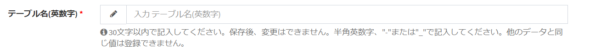
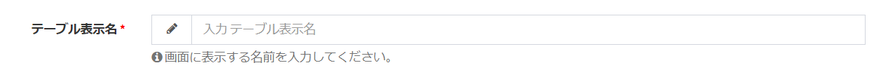
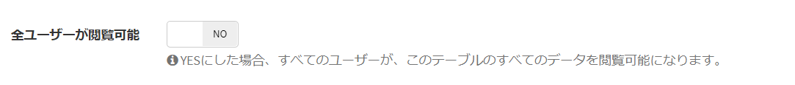
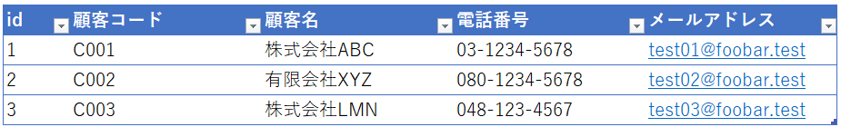

# Einstellungen der benutzerdefinierten Tabelle
In Exment verwalten Sie Daten in „benutzerdefinierten Tabellen“. Für alles, was Sie verwalten möchten, zum Beispiel Kunden, Angebote oder Aufgaben, legen Sie eine Tabelle an.  
Diese Seite erklärt, wie Sie Tabellen anlegen, ändern und löschen, und die Einstellungen je Tabelle (Funktionen für die Daten, Berechtigungen usw.).

- Wenn Sie zum ersten Mal eine Tabelle anlegen: Lesen Sie unten „Neu anlegen“ → „Die Einstellungsfelder im Einzelnen“ → „Speichern“.
- Einstellungen, die mehrere Spalten nutzen, zum Beispiel die Prüfung auf Duplikate oder der Text der Suchvorschläge: Lesen Sie unten „Erweiterte Einstellungen“.

## Liste
Klicken Sie im Menü auf „Benutzerdefinierte Tabelle“.  
Die Liste der vorhandenen benutzerdefinierten Tabellen erscheint.  

※„Grundinformationen“, „Benutzer“, „Organisation“, „Benachrichtigungsvorlage“, „E-Mail-Sendeverlauf“, „Ankündigungen“  
Diese Tabellen sind seit der Installation von Exment vorhanden.  
Auch Tabellen, die mit einer Vorlage importiert wurden, stehen in dieser Liste.  

## Neu anlegen

- Klicken Sie oben rechts in der Liste auf die Schaltfläche [Neu].
  
  
- Der Bildschirm zum Anlegen einer Tabelle erscheint. Füllen Sie die nötigen Felder aus. Die Erklärung der Felder steht unten unter „Die Einstellungsfelder im Einzelnen“.

## Die Einstellungsfelder im Einzelnen

#### Tabellenname (alphanumerisch) ※Pflichtfeld
- Der Name der Tabelle. (Beispiele: user , information , estimate )  
- Der hier festgelegte Name wird zum Beispiel in der URL verwendet, unter der die Tabelle geöffnet wird. (Beispiel: http(s)://(URL von Exment)/data/user)  
- Erlaubt sind lateinische Buchstaben und Ziffern halber Breite sowie die Zeichen "-" und "_".
- Ein Tabellenname, den eine andere Tabelle schon verwendet, ist nicht möglich.  
- Der Tabellenname darf höchstens 30 Zeichen lang sein und muss mit einem Buchstaben beginnen.  
- Er lässt sich nur beim Anlegen der Tabelle festlegen. Nach dem Speichern lässt er sich nicht ändern.  

> ※Die URL gilt für die Standardeinstellung ohne „/admin“ (Websites, die ab v7.2.1 neu installiert wurden). Wenn `ADMIN_ROUTE_PREFIX` in `.env` einen Wert hat (bei Websites aus früheren Versionen ist es „admin“), hängen Sie diesen Wert an die URL der Website an (Beispiel: `http(s)://(URL von Exment)/admin/oauth/token`). Einzelheiten stehen unter [„admin“ in der URL ändern oder entfernen](/de/additional_prefix).

#### Anzeigename der Tabelle ※Pflichtfeld
- Der Name, der auf dem Bildschirm angezeigt wird. Auch Japanisch ist möglich. (Beispiele: Benutzer , Ankündigungen , Angebot )  

  

#### Beschreibung
- Eine Beschreibung der Tabelle.

- Die eingegebene Beschreibung erscheint wie im Bild unten im Datenbildschirm rechts neben dem Anzeigenamen der Tabelle.  

#### Anzeigereihenfolge
- Die Reihenfolge in der Liste der Einstellungen der benutzerdefinierten Tabellen.  
- Geben Sie die Zahl in Zeichen halber Breite ein oder wählen Sie sie mit den Schaltflächen [－] und [＋] links und rechts.

#### Farbe
- Sie legen die Farbe der Tabelle fest. Diese Farbe wird zum Beispiel bei den Suchvorschlägen verwendet.

- Ein Klick auf die aktuelle Farbe öffnet den Bildschirm zur Farbwahl.

#### Symbol
- Sie legen das Symbol der Tabelle fest. Dieses Symbol erscheint im Menü und in den Suchergebnissen.  

- Ein Klick auf das aktuelle Symbol öffnet den Bildschirm zur Symbolwahl.

#### Durchsuchbar
- Sie legen fest, ob diese Tabelle bei der [Suche](/de/search) über die Suchleiste durchsucht wird. Der Standardwert ist YES.  
Wählen Sie NO, wenn die Tabelle nicht in den Suchergebnissen erscheinen soll, zum Beispiel bei Tabellen, die verborgen bleiben sollen.

#### ID als Bezeichnung verwenden
- Bei den Suchvorschlägen in der Suchleiste können Sie die ID der Daten vor die Bezeichnung setzen. Einzelheiten stehen unter [Einstellungen der Überschriftenspalten](/de/table?id=Einstellungen-der-Überschriftenspalten). Der Standardwert ist NO.  

#### Nur einen Datensatz speichern
- Wählen Sie YES für eine Tabelle, in der nicht viele Datensätze, sondern nur 1 Datensatz gespeichert werden kann. Der Standardwert ist NO.  

#### Anhänge verwenden
- Wählen Sie YES, wenn zu den Daten der Tabelle [Anhänge](/de/data_details) hochgeladen werden können sollen. Der Standardwert ist YES.  

#### Kommentare verwenden
- Wählen Sie YES, wenn zu den Daten der Tabelle [Kommentare](/de/data_details) geschrieben werden können sollen. Der Standardwert ist YES.  

#### Änderungsverlauf verwenden
- Wählen Sie YES, wenn als Revision (Verlauf) festgehalten werden soll, wer die Daten mit welchem Inhalt aktualisiert hat. Der Standardwert ist YES.  

#### Anzahl der Versionen im Änderungsverlauf
- Wenn „Änderungsverlauf verwenden“ auf YES steht, geben Sie als ganze Zahl ein, wie viele Einträge des Änderungsverlaufs (Versionen) bleiben.  
Bei „200“ wird mit der 201. Aktualisierung der Eintrag der 1. Aktualisierung gelöscht. Der Standardwert ist 100.  

#### Listenanzeige optimieren
- Bei YES wird der Bildschirm der Datenliste zuerst angezeigt, und die Zeilen werden danach automatisch geladen. Bei Tabellen mit vielen Einträgen oder Spalten verkürzt das die Zeit, bis der Bildschirm der Liste erscheint. Der Standardwert ist NO.
- Mit dieser Einstellung werden die Zeilen später gezeichnet. Sie verringert nicht die Abfragen an die Datenbank.
- Die Einstellung wirkt, wenn Sie die Datenliste neu öffnen.

※Nutzbar ab v7.1.0.

#### Alle Benutzer können bearbeiten

> Für einen Überblick über die Berechtigungen der Tabellen lesen Sie bitte zuerst die Seite [Überblick über Rollen und Berechtigungen in Exment](/de/permission).

- Bei YES können alle Benutzer alle Daten dieser Tabelle bearbeiten. Sie müssen dann keine Berechtigungen je Benutzer vergeben. Der Standardwert ist NO.  

#### Alle Benutzer können anzeigen

> Für einen Überblick über die Berechtigungen der Tabellen lesen Sie bitte zuerst die Seite [Überblick über Rollen und Berechtigungen in Exment](/de/permission).

- Bei YES können alle Benutzer alle Daten dieser Tabelle anzeigen. Sie müssen dann keine Berechtigungen je Benutzer vergeben. Der Standardwert ist NO.  

※Bei der Installation von Exment steht nur bei der Tabelle „Ankündigungen“ „Alle Benutzer können anzeigen“ von Anfang an auf YES. So können alle Benutzer die Ankündigungen lesen.  
Bearbeiten können die Ankündigungen dagegen nur Administratoren.

#### Alle Benutzer können referenzieren

> Für einen Überblick über die Berechtigungen der Tabellen lesen Sie bitte zuerst die Seite [Überblick über Rollen und Berechtigungen in Exment](/de/permission).

- Bei YES können alle Benutzer alle Daten dieser Tabelle referenzieren. Sie müssen dann keine Berechtigungen je Benutzer vergeben. Der Standardwert ist NO.  

※Wenn nur „Alle Benutzer können referenzieren“ auf YES steht, lässt sich die Tabelle nicht im Menü oder in der Liste zeigen, aber andere Tabellen können auf sie verweisen.  

Beispiel: Die Tabelle „Umsatzsteuer“ müssen allgemeine Benutzer nicht als Liste sehen, aber sie müssen „Umsatzsteuer“ als Auswahl wählen können. Bei solchen Tabellen setzen Sie „Alle Benutzer können referenzieren“ auf YES.  

#### Mit Berechtigungen der übergeordneten Daten anzeigbar

> Für einen Überblick über die Berechtigungen der Tabellen lesen Sie bitte zuerst die Seite [Überblick über Rollen und Berechtigungen in Exment](/de/permission).

- Bei YES können die Daten mit den Berechtigungen der übergeordneten Daten (1:n) angezeigt werden. Sie brauchen aber für diese Tabelle selbst eine Berechtigung wie die Leseberechtigung der Zuständigen. Der Standardwert ist NO.  

※ Diese Option erscheint nur bei Kindtabellen einer 1:n-Relation.  

※ Auch mit der Bearbeitungsberechtigung für die übergeordneten Daten können Sie die Kinddaten nicht bearbeiten. Sie können sie nur anzeigen.  

#### Bearbeitungsberechtigung für übergeordnete Daten erforderlich

> Für einen Überblick über die Berechtigungen der Tabellen lesen Sie bitte zuerst die Seite [Überblick über Rollen und Berechtigungen in Exment](/de/permission).

- Bei YES brauchen Sie zum Bearbeiten der Daten dieser Tabelle die Bearbeitungsberechtigung für die übergeordneten Daten (1:n). Der Standardwert ist YES.  

※ Diese Option erscheint nur bei Kindtabellen einer 1:n-Relation.  

#### Zum Menü hinzufügen
- Bei YES wird die Tabelle zusammen mit dem Speichern ins Menü aufgenommen. Der Standardwert ist NO.  

※Dieses Feld erscheint nur beim Anlegen einer Tabelle. Wenn Sie nach dem Hinzufügen die Einstellungen des Menüs ändern möchten, tun Sie das im Bildschirm [Menü](/de/menu).  

#### Übergeordnetes Zielmenü
- Dieses Feld erscheint, wenn „Zum Menü hinzufügen“ auf YES steht. Wählen Sie den Namen des Menüs, unter dem der neue Menüpunkt stehen soll.  

Beispiel: Wenn Sie beim Anlegen der Tabelle „Handbuch“ als übergeordnetes Menü „Administratoreinstellungen“ wählen, entsteht wie im Bild der Menüpunkt der Tabelle „Handbuch“ ganz unten in „Administratoreinstellungen“.

#### Zu Benachrichtigungen hinzufügen
- Bei YES wird zusammen mit dem Speichern der Tabelle eine Benachrichtigungseinstellung hinzugefügt. Sie sendet beim Anlegen, Aktualisieren und Teilen von Daten und bei Kommentaren eine systeminterne Benachrichtigung an die berechtigten Benutzer.  

※Dieses Feld erscheint nur beim Anlegen einer Tabelle. Wenn Sie nach dem Hinzufügen die Einstellungen der Benachrichtigung ändern möchten, tun Sie das im Bildschirm [Benachrichtigung](/de/notify).  

## Speichern
- Wenn Sie auf die Schaltfläche [Absenden] klicken, werden die Einstellungen gespeichert, und die Tabelle entsteht mit diesem Inhalt.

- Nach dem Anlegen einer neuen Tabelle wechselt der Bildschirm nach dem Speichern zur [Liste der benutzerdefinierten Spalten](/de/column).  
Legen Sie anschließend die benutzerdefinierten Spalten an.

## Bearbeiten
- Klicken Sie in der Liste der benutzerdefinierten Tabellen bei der Tabelle, die Sie ändern möchten, auf die Schaltfläche [Bearbeiten].  
Der Bearbeitungsbildschirm erscheint, und Sie können die Einstellungen ändern.  

## Löschen
- Wenn Sie eine Tabelle löschen möchten, öffnen Sie zuerst wie oben unter „Bearbeiten“ den Bearbeitungsbildschirm.

- Klicken Sie dann oben rechts im Bearbeitungsbildschirm auf die Schaltfläche [Löschen].  

  

- Ein Bestätigungsbildschirm wie im Bild unten erscheint. Wenn Sie in das Textfeld delete me eingeben und auf die Schaltfläche [Bestätigen] klicken, wird die Tabelle gelöscht.  
**※Tabellen der folgenden Arten lassen sich aber nicht löschen. • Tabellen, die vom System installiert wurden • Tabellen, die in einer Relation als Kind eingestellt sind**

## Erweiterte Einstellungen
Hier nehmen Sie Einstellungen vor, die mehrere Spalten einer Tabelle nutzen (Prüfung auf Duplikate, Vergleich von Spalten, Überschriften, automatisches Teilen von Daten usw.).

- Klicken Sie in der Liste der benutzerdefinierten Tabellen bei der gewünschten Tabelle auf die Schaltfläche [Erweiterte Einstellungen].  

- Der Einstellungsbildschirm erscheint.

  

### Einstellungen für zusammengesetzte eindeutige Schlüssel
Wenn Sie mehrere Spalten zusammen zu einem eindeutigen Schlüssel machen (eine Kombination, die keine Duplikate erlaubt), verhindern Sie, dass beim Anlegen von Daten dieselbe Kombination von Werten doppelt gespeichert wird.  

- Wählen Sie 2 bis 3 Spalten, deren Kombination nicht doppelt vorkommen darf.
- Beim Anlegen von Daten gibt es einen Fehler, wenn in allen gewählten Spalten die neuen Werte mit schon gespeicherten Werten übereinstimmen.  

Beispiel: Wenn Sie wie im Bild unten „Nächster Termin“ und „Name“ zum eindeutigen Schlüssel machen, verhindern Sie, dass derselbe Name mehrmals für denselben nächsten Termin gespeichert wird.  

※Wenn Sie Duplikate nur in 1 Spalte verhindern möchten, setzen Sie in den [Einstellungen der benutzerdefinierten Spalten](/de/column) bei dieser Spalte „Eindeutig“ auf YES.

※ Bei einer 1:N-Relation (siehe [Relationseinstellungen von Exment](/de/relation)) können Sie beim zusammengesetzten eindeutigen Schlüssel einer Kindtabelle auch die Elterntabelle als einen der Schlüssel wählen.  
Dann wird nur innerhalb derselben Elterndaten auf Duplikate geprüft.

### 2 Spalten vergleichen
Beim Anlegen und Aktualisieren von Daten werden 2 Spalten verglichen. Gespeichert werden kann nur, wenn die Spaltenwerte die eingestellte Bedingung erfüllen. Sonst erscheint eine Fehlermeldung.  
Das ist zum Beispiel in den folgenden Fällen nützlich.  

- Speichern nur, wenn das „Startdatum“ nicht nach dem „Enddatum“ liegt.
-  Speichern nur, wenn der Wert „X“ größer oder gleich dem Wert „Y“ ist.
- Speichern nur, wenn „Zuständiger“ und „Prüfer“ verschieden sind.

    

#### Umgang mit leeren Werten
Wenn ein Feld oder beide Felder leer sind, hängt das Ergebnis von der gewählten Bedingung ab.  
Hier steht "true" für den Fall, dass gespeichert werden kann, und "false" für den Fall eines Fehlers.

- **A und B stimmen überein** : true, wenn beide Werte leer sind. false, wenn nur einer leer ist.
- **A und B stimmen nicht überein** : true, wenn nur einer der Werte leer ist. false, wenn beide leer sind.
- **Alles andere** : Immer true. Denn Datums- und Zahlenwerte lassen sich normalerweise nicht vergleichen, wenn der Wert leer ist.  
Wenn Felder nicht leer bleiben dürfen, machen Sie sie in den Einstellungen der benutzerdefinierten Spalten oder des benutzerdefinierten Formulars zu Pflichtfeldern.

#### Umgang je Spaltentyp
- Größenvergleiche (A ist größer als B, A ist kleiner als B, A ist größer oder gleich B, A ist kleiner oder gleich B) sind nur bei den folgenden Spaltentypen möglich.
    - Ganzzahl
    - Dezimalzahl
    - Währung
    - Datum
    - Uhrzeit
    - Datum und Uhrzeit

- Ein Größenvergleich bei anderen Spaltentypen ergibt immer true.

- Wenn die Spaltentypen nicht zusammenpassen, ist kein Größenvergleich möglich (zum Beispiel „Ganzzahl“ und „Datum und Uhrzeit“). Eigentlich müsste das beim Speichern dieser Einstellung einen Fehler geben.  
Derzeit wird das beim Speichern aber nicht geprüft. Wählen Sie 2 Spalten mit passenden Typen.

#### Sonstiges
- Für Vergleiche mit 3 oder mehr Spalten, Vergleiche mit besonderen Bedingungen, Vergleiche mit Werten anderer Tabellen usw. erstellen Sie eine [Validierung als Plugin](/de/plugin_quickstart_validate).

### Einstellungen der Überschriftenspalten
Hier legen Sie fest, aus den Werten welcher Spalten der Text (die Überschrift) gebildet wird, der in den Vorschlägen der Suchleiste und in Auswahllisten erscheint.  
  
Angenommen, es gibt eine Tabelle „Kundeninformationen“ wie unten.  
Die Tabelle Kundeninformationen hat Spalten wie „Kundencode“, „Kundenname“, „Telefonnummer“ und „E-Mail-Adresse“.  
    

Wenn Sie ein Suchwort in die Suchleiste eingeben, erscheinen Suchvorschläge.  
Diese Vorschläge sollen so aussehen:  
„(Kundencode) (Kundenname)“  
    
  
Dann tragen Sie im Bildschirm der erweiterten Einstellungen der benutzerdefinierten Tabelle die Spalten für die Überschrift wie folgt ein.  
  
  
Mit diesem Eintrag erscheinen die Vorschläge wie folgt, wenn Sie in die Suchleiste oben auf der Seite etwas eingeben.  
Die Zeichenfolge des Vorschlags folgt der Reihenfolge, in der die Spalten im Bildschirm der erweiterten Einstellungen von oben eingetragen sind.  
  
  
Wenn auch die „E-Mail-Adresse“ erscheinen soll, fügen Sie die Spalte „E-Mail-Adresse“ hinzu.  
  
  
  
Außerdem gibt es in den Einstellungen der benutzerdefinierten Tabelle das Feld „ID als Bezeichnung verwenden“.
  
Bei YES wird vor die Bezeichnung der Text „#(id)“ gesetzt.  
  

#### Sonstiges
- Wenn diese Einstellungen der Überschriftenspalten nicht eingetragen sind, wird der Wert der 1. Spalte der Einstellungen der benutzerdefinierten Spalten angezeigt.
- Wenn der Wert der 1. Spalte der Einstellungen der benutzerdefinierten Spalten leer ist, wird die ID angezeigt.
- Die ID lässt sich nur an den Anfang der Bezeichnung setzen. An andere Stellen nicht.  

### Einstellungen für automatisches Teilen von Daten

> Zur Datenfreigabe lesen Sie bitte zuerst die Seite [Überblick über Rollen und Berechtigungen in Exment](/de/permission).

Beim Speichern von Daten können die Daten automatisch mit den Organisationen und Benutzern geteilt werden, die in den Spaltenwerten stehen.  
Das ist zum Beispiel in den folgenden Fällen nützlich.  

- Beim Anlegen von Daten „Vertragsinformationen“ bekommt der Benutzer, der in der Spalte „Hauptzuständiger“ steht, automatisch die Bearbeitungsberechtigung.  
- Beim Aktualisieren von Daten „Vertragsinformationen“ bekommt die Organisation, die in der Spalte „Beteiligte Organisation“ steht, automatisch die Leseberechtigung.  
- Beim Anlegen von Daten „Aufgabenverwaltung“ bekommt der Benutzer, der in der Spalte „Zuständiger“ steht, automatisch die Bearbeitungsberechtigung.  

※Dafür braucht die benutzerdefinierte Tabelle vorher eine Spalte vom Spaltentyp „Benutzer“ oder „Organisation“.

#### Beispiel  
Angenommen, in der Tabelle „Kundenverwaltung“ sind die Spalten so definiert.

Sie stellen ein: „Bei „Erstellt“ bekommt der Benutzer, der in der Spalte „Zuständiger“ steht, die Berechtigung „Bearbeiten““.

Wenn danach ein Datensatz mit dem Benutzer „user1“ als Zuständigem neu angelegt wird,

wird dieser Datensatz mit dem Benutzer „user1“ mit Bearbeitungsberechtigung geteilt.

#### Einstellung

- ##### Auslöser
Der Zeitpunkt, zu dem die Daten geteilt werden.  
Sie können „Erstellt“ oder „Aktualisiert“ wählen.  

- ##### Zielspalte
Der Benutzer oder die Organisation, mit denen die Daten geteilt werden.

- ##### Zielberechtigung
Sie wählen, ob mit Bearbeitungsberechtigung oder mit Leseberechtigung geteilt wird.

#### Synchronisierung der Freigabe
In der Anfangseinstellung bleibt beim Auslöser „Aktualisiert“ die Freigabe für die vorher eingetragenen Benutzer und Organisationen bestehen, auch wenn Sie die Benutzer und Organisationen der Zielspalte ändern.  

Wenn Sie die Einstellung ändern, werden beim Aktualisieren der Daten alle Benutzer und Organisationen aus der Freigabe entfernt, außer den „Benutzern und Organisationen, die in der Spalte stehen“ und dem „Benutzer, der aktualisiert hat“.

Setzen Sie dafür in den Optionseinstellungen „Einstellungen für automatisches Teilen beim Aktualisieren synchronisieren“ auf YES.

### Vorgänge über die Oberfläche sperren

Diese Einstellung nutzen Sie, wenn das Anlegen, Bearbeiten und Löschen von Daten oder der Import und Export nicht über die Oberfläche möglich sein sollen.  
Mit der Einstellung erscheinen die entsprechenden Schaltflächen nicht mehr.  

- Das Feld „Über die Oberfläche nicht änderbar“ erscheint.

  

- Beispiel: wenn „Export“ ausgeblendet ist

  

  

### Anzeigeposition der Systemwerte

Sie legen fest, an welcher Stelle die Systemwerte im Bildschirm zum Bearbeiten der Daten und im Detailbildschirm der Daten stehen.  
Sie können „An Systemeinstellungen anpassen“, „Oben anzeigen“, „Unten anzeigen“ oder „Ausblenden“ wählen. (Der Anfangswert ist „An Systemeinstellungen anpassen“)  
※Die Anzeigeposition für das ganze System ändern Sie in den Systemeinstellungen.  

  

### Seitenwechsel beim Klicken auf eine Zeile

Sie legen fest, welcher Bildschirm sich öffnet, wenn Sie in der Datenliste auf eine Zeile klicken.  
Sie können „Standard übernehmen“, „Datenbearbeitung“, „Datendetails“ oder „Kein Seitenwechsel“ wählen. (Der Anfangswert ist „Standard übernehmen“)  
※Der Standard für das ganze System ist „Datendetails“. Er lässt sich aber mit Einstellungswerten in .env ändern (`EXMENT_GRIDROW_SELECT_EDIT`, `EXMENT_GRIDROW_SELECT_DISABLED`. [Einstellungswerte](/de/config)).  

  

### Einstellungen des Überschriftenformats
> Diese Einstellung erscheint nur, wenn der [Expertenmodus](/de/additional_expert) aktiviert ist.

Mit Parametervariablen legen Sie den Wert, der in der Überschrift erscheint, in freier Form fest.  

- Aktivieren Sie den Expertenmodus und öffnen Sie den Bildschirm der erweiterten Einstellungen.

- Das Feld „Formatzeichenfolge“ erscheint.  

  

- Um in den Daten gespeicherte Werte in der Überschrift zu zeigen, verwenden Sie [Parametervariablen](/de/params).  
Beispiel: Bei den Benutzerinformationen soll „Benutzername&lt;admin@admin.admin&gt;“ angezeigt werden  
${value:user_name}&lt;${value:email}&gt;  
  

- Mit dieser Eingabe legen Sie fest, welche Felder in der Überschrift erscheinen.  
  

#### Sonstiges
- Wenn diese Einstellungen des Überschriftenformats gesetzt sind, sind die „Einstellungen der Überschriftenspalten“ unwirksam.
