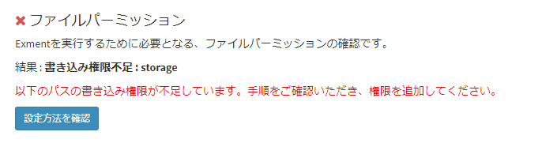

# Häufige Fragen und Fehlerbehebung
Diese Seite fasst häufige Fragen zur Installation, Aktualisierung und Bedienung von Exment zusammen und zeigt, was Sie bei Problemen tun können.  
Wenn ein Fehler auftritt, prüfen Sie zuerst unten unter „Protokolldatei“ den Inhalt des Fehlers und lesen Sie dann den passenden Abschnitt.  
Der Inhalt wird laufend aktualisiert.  

## Protokolldatei
Wenn ein Fehler oder Ähnliches auftritt, wird der Inhalt in die Protokolldatei geschrieben.  
Die Protokolldatei liegt, ausgehend vom Stammordner des Exment-Projekts, an der folgenden Stelle.  
/storage/logs/laravel.log


## Installation und Aktualisierung

### Bei Dateien und Ordnern tritt Permission Denied auf
Bei der einfachen Installation oder beim Schreiben in die Protokolldatei kann ein Berechtigungsfehler auftreten.  
Außerdem kann bei der Prüfung der Systemanforderungen der folgende Fehler angezeigt werden.  

  

Möglicherweise reichen die Rechte des Benutzers nicht aus, der den Webserver ausführt (apache, www-data usw.).  
Geben Sie diesem Benutzer Schreibrechte für die folgenden Ordner im Projektordner von Exment.  

- storage
- bootstrap/cache

Bei der „[einfachen Installation](/de/quickstart)“, die über den Web-Bildschirm läuft, braucht derselbe Benutzer zusätzlich Schreibrechte für die folgenden Ordner.  
※Das ist nur bei der Installation nötig. Wenn Sie die Rechte strenger einstellen möchten, entfernen Sie nach der einfachen Installation die Schreibrechte für die Ordner.

- .env
- app
- config
- public

### composer require oder der Aktualisierungs-Batch bricht mittendrin ab
Wenn Sie bei der Installation unter Linux den Befehl composer require oder den Aktualisierungs-Batch ausführen, kann Folgendes angezeigt werden.  

```
# Muster 1
Killed

# Muster 2
mmap() failed: [12] Cannot allocate memory
PHP Fatal error:  Out of memory (allocated XXXXX) (tried to allocate XXXXX bytes) in phar:///usr/local/bin/composer/src/Composer/Console/Application.php on line 82

# Muster 3
Fatal error: Allowed memory size of XXXXXXXX bytes exhausted
```

Das ist ein Fehler wegen zu wenig Arbeitsspeicher.  
Eine der beiden folgenden Maßnahmen kann das Problem lösen.

#### swap anlegen
Legen Sie mit den folgenden Befehlen swap an (einen Bereich, in dem die Festplatte anstelle des Arbeitsspeichers verwendet wird, wenn dieser nicht ausreicht) und führen Sie dann die Installation oder Aktualisierung noch einmal aus.  
※Stellen Sie den Befehlen je nach Umgebung "sudo" voran.

~~~
dd if=/dev/zero of=/swapfile bs=2M count=2048
chmod 600 /swapfile
mkswap /swapfile
swapon /swapfile
~~~

#### Speicherobergrenze ändern
Führen Sie Folgendes aus.

- Ändern Sie memory_limit in der Datei php.ini.

```
memory_limit=000M #je nach Bedarf einen größeren Wert als jetzt einstellen
memory_limit=-1 #oder diese Angabe. Der Speicher kann dann unbegrenzt verwendet werden; stellen Sie das auf eigene Verantwortung ein
```

- Die Umgebungsvariable von composer setzen (wenn das Problem bei der Aktualisierung auftritt, fügen Sie sie dem Batch hinzu)

```
COMPOSER_MEMORY_LIMIT=-1 composer update
```


### Bei der manuellen Installation oder Aktualisierung tritt ein composer-Fehler auf

Bei der manuellen Installation oder Aktualisierung kann ein Fehler wie der folgende auftreten.

```
Installation failed, reverting ./composer.json to its original content.

  [RuntimeException]
  Could not load package XXX/XXX in http://repo.packagist.org: [UnexpectedValueException] Could not parse version constraint ~4.*: Invalid version string "~4.*"
```

In diesem Fall kann eine neuere Version von composer das Problem lösen. Aktualisieren Sie composer auf die neueste Version.  
**※Die Art der Aktualisierung ist offenbar je nach Umgebung verschieden. Versuchen Sie die Aktualisierung von composer mit einem der Punkte (1) bis (3) unten.**


#### (1) Den folgenden Befehl ausführen

```
composer selfupdate
```

#### (2) Den folgenden Befehl ausführen

```
composer self-update
```

#### (3) Wenn die Aktualisierung mit keinem der beiden gelingt, die folgenden Schritte ausführen

- ##### composer entfernen
Entfernen Sie zunächst das bereits installierte composer.

```
# Unter Linux und Mac
which composer
# Unter Windows
where composer
#Beispiel für das Ergebnis : /usr/bin/composer
###Den folgenden Befehl ausführen
rm /usr/bin/composer
```

- ##### composer neu installieren
Installieren Sie composer mit den folgenden Anleitungen neu.
    - [Offizielle Website](https://getcomposer.org/download/)
    - [Anleitung für Windows](https://weblabo.oscasierra.net/php-composer-windows-install/)
    - [Anleitung für Linux](https://weblabo.oscasierra.net/php-composer-centos-install/)
    - [Anleitung für Mac](https://weblabo.oscasierra.net/php-composer-macos-homebrew-install/)

### Beim Ausführen des Befehls composer update tritt der Fehler "LogicException Invalid key supplied " auf  
Wenn Sie den Befehl composer update ausführen, kann ein Fehler wie der folgende auftreten.

```
   LogicException	
	
  Invalid key supplied	
	
  at vendor/league/oauth2-server/src/CryptKey.php:67	
     63▕             if (!$this->isValidKey($this->keyContents, $this->passPhrase ?? '')) {	
     64▕                 throw new LogicException('Unable to read key from file ' . $keyPath);	
     65▕             }	
     66▕         } else {	
  ➜  67▕             throw new LogicException('Invalid key supplied');	
     68▕         }	
     69▕	
     70▕         if ($keyPermissionsCheck === true) {	
     71▕             // Verify the permissions of the key	
	
      +17 vendor frames	
	
  18  [internal]:0	
      Illuminate\Foundation\Application::Illuminate\Foundation\{closure}()	
      +5 vendor frames	
	
  24  artisan:35	
      Illuminate\Foundation\Console\Kernel::handle()	
```

#### Deaktivieren Sie in diesem Fall mit den folgenden Befehlen die API-Nutzung und erstellen Sie dann die Schlüssel von Laravel.

```
# Die API-Nutzung deaktivieren.
UPDATE `systems` SET `system_value` = '0' WHERE `systems`.`system_name` = 'api_available';

# Die Schlüssel von Laravel erstellen
php artisan passport:keys	

# Die API-Nutzung aktivieren.
UPDATE `systems` SET `system_value` = '1' WHERE `systems`.`system_name` = 'api_available';
```

### Beim Ausführen des Aktualisierungs-Batch oder des Befehls composer require tritt der Fehler "require ext-gd ", "require ext-sodium " oder "require ext-zip " auf
Wenn Sie den Aktualisierungs-Batch oder den Befehl composer require ausführen, kann Folgendes angezeigt werden.
```
  Problem 1
    - phpoffice/phpspreadsheet[1.23.0, ..., 1.29.0] require ext-gd * -> it is missing from your system. Install or enable PHP's gd extension.
```
```
  Problem 1
    - lcobucci/jwt[5.0.0, ..., 5.3.0] require ext-sodium * -> it is missing from your system. Install or enable PHP's sodium extension.
```
```
  Problem 1
    - exceedone/exment[v5.0.0, ..., v5.0.11] require phpoffice/phpspreadsheet ^1.23.0 -> satisfiable by phpoffice/phpspreadsheet[1.23.0, ..., 1.29.0].
    - phpoffice/phpspreadsheet[1.23.0, ..., 1.29.0] require ext-zip * -> it is missing from your system. Install or enable PHP's zip extension.
    - Root composer.json requires exceedone/exment ^5.0 -> satisfiable by exceedone/exment[v5.0.0, ..., v5.0.11].
```
Aktivieren Sie in diesem Fall die angezeigte PHP-Erweiterung (php extension).
#### Unter Linux
~~~
# Ubuntu server
sudo apt-get install php8.2-gd php8.2-zip

# Centos server
sudo yum install gd gd-devel php-gd php-pecl-zip.x86_64
~~~

#### Unter Mac/Windows

##### (1) Den Pfad der Datei php.ini ermitteln

~~~
# Führen Sie den folgenden Befehl aus. Der Pfad der Datei php.ini steht in der Zeile „Loaded Configuration File“.

php --ini
~~~

##### (2) Die Datei php.ini ändern

~~~
# Bei der folgenden Zeile das Kommentarzeichen entfernen
extension=gd

# Bei der folgenden Zeile das Kommentarzeichen entfernen
extension=sodium

# Bei der folgenden Zeile das Kommentarzeichen entfernen
extension=zip
~~~


### Nach der ersten Installation tritt beim Aufruf der Verwaltungsseite der Fehler „SQLSTATE[HY000][202] Permission denied“ auf
Wenn Apache auf MySQL zugreift, kann eine Einstellung von SELinux (einer Sicherheitsfunktion von Linux) nötig sein.  
Wenn dieser Fehler auftritt, führen Sie bitte den folgenden Befehl aus.

~~~
sudo setsebool -P httpd_can_network_connect_db=1
~~~


### Bei der Aktualisierung tritt bei „Migrating: 2019_08_19_000000_create_failed_jobs_table“ ein Fehler auf
Während die Aktualisierung die Datenbank ändert, kann eine Meldung wie die folgende erscheinen.  
~~~
Migrating: 2019_08_19_000000_create_failed_jobs_table  
SQLSTATE[42S01]: Base table or view already exists: 1050 Table 'failed_jobs' already exists。  
~~~

Gehen Sie in diesem Fall in der folgenden Reihenfolge vor.

1. Löschen Sie die Datei „2019_08_19_000000_create_failed_jobs_table“ im Ordner „Installationsordner\database\migrations“.
2. Führen Sie die Aktualisierung noch einmal aus.


### Auf einem Mietserver wird bei Befehlen wie „composer require“ die Meldung „Killed“ angezeigt
Das passiert gelegentlich, wenn der Arbeitsspeicher stark belastet ist (es passiert nicht immer).  
Wenn diese Meldung erscheint, stellen Sie dem Befehl „nice -n 20“ voran und führen Sie composer so aus. Der Befehl läuft dann mit niedrigerer Priorität.

~~~
nice -n 20 composer .....
~~~

※Auch bei dieser Ausführung kann „Killed“ erneut angezeigt werden. Wir bitten um Ihr Verständnis.


### So setzen Sie den Pfad zu composer
So setzen Sie den Pfad zu composer (so stellen Sie ein, wo composer liegt).  

#### Einstellungswert hinzufügen
- Stellen Sie nach [dieser Anleitung](/de/config) unter „Composer-Pfad“ den Pfad zu composer ein.

```
# Beispiel: den folgenden Befehl ausführen
which composer
#Beispiel für die Ausgabe: /usr/local/bin/composer

# Den folgenden Wert in .env eintragen
EXMENT_COMPOSER_PATH=/usr/local/bin/composer
```

- Damit ist der Pfad zu composer gesetzt.


### Wartungsmodus aufheben
Bei der Wiederherstellung der Datenbank ist Exment während der Wiederherstellung im Wartungsmodus.  
Nach dem Ende der Wiederherstellung wird der Wartungsmodus automatisch aufgehoben. Wenn er aus irgendeinem Grund nicht aufgehoben wurde, heben Sie ihn mit den folgenden Schritten von Hand auf.

- Führen Sie im Stammordner des Projekts den folgenden Befehl aus.  

```
php artisan up
```


## Sicherung und Wiederherstellung

### Sicherung oder Wiederherstellung schlägt fehl
Auf der Sicherungsseite oder beim Befehl kann eine Meldung wie die folgende angezeigt werden.

  

Oder auf der Installationsseite erscheint eine Anzeige wie die folgende.
  

Wenn dieser Fehler angezeigt wird, fehlen möglicherweise Einstellungen, die für Sicherung und Wiederherstellung nötig sind.  
Prüfen Sie die 2 folgenden Punkte.

#### mysql-client ist auf dem Webserver nicht installiert oder der Pfad ist nicht gesetzt  
Für Sicherung und Wiederherstellung führt Exment die folgenden Befehle auf dem Webserver aus.  

- Befehl mysql
- Befehl mysqldump  

**Wenn die Befehle nicht installiert sind**, installieren Sie die Befehle mysql und mysqldump.  
Die Art der Installation hängt von der Umgebung ab.  
Beispiel: [Amazon Linux 2](http://tech-wiki.pomme-verte.net/?p=793)  

**Wenn der Pfad nicht gesetzt ist** (wenn der Benutzer, unter dem der Webserver läuft, die Befehle mysql und mysqldump nicht findet), sorgen Sie auf die folgende Weise dafür, dass die Befehle mit dem vollständigen Pfad ausgeführt werden können.  
※Einzelheiten zur Änderung der Einstellung finden Sie [hier](/de/config).  

- Die env-Datei öffnen.  
- Den folgenden Eintrag hinzufügen.  

```
EXMENT_MYSQL_BIN_DIR=(Pfad zu dem Ordner, in dem die ausführbare Datei "mysql" liegt)
#Beispiel
EXMENT_MYSQL_BIN_DIR=/usr/bin
```
※Wenn Sie den Pfad wie in „EXMENT_MYSQL_BIN_DIR="C:\MySQL\bin"“ in doppelte Anführungszeichen setzen, wird er in manchen Umgebungen nicht richtig erkannt. Wir empfehlen, ihn wie in „EXMENT_MYSQL_BIN_DIR=C:\MySQL\bin“ ohne Anführungszeichen zu schreiben.

#### In php.ini "safe_mode=Off" hinzufügen
※safe_mode ist eine Einstellung, die es seit PHP 5.4 nicht mehr gibt. Im heutigen Exment (PHP 8.2 oder höher) ist dieser Schritt nicht nötig. Prüfen Sie ihn nur, wenn Sie eine alte Umgebung verwenden.  

Damit die Befehle mysql und mysqldump vom Server aus ausgeführt werden können, muss safe_mode auf Off stehen.  
Führen Sie Folgendes aus.

- Die Datei php.ini öffnen.
- Den folgenden Inhalt hinzufügen.

```
safe_mode=Off
```

## Sonstiges
### Das Senden sehr vieler Eingabefelder schlägt fehl
Zurzeit kann es auf einigen Einstellungsseiten vorkommen, dass eine Seite mit sehr vielen Eingabefeldern nicht richtig funktioniert.

- Ursache: Der Fehler tritt auf, wenn die tatsächlichen POST-Werte den PHP-Einstellungswert „max_input_vars (Obergrenze der Werte, die auf einmal per POST gesendet werden können)“ überschreiten.
- Abhilfe: Nehmen Sie die [Änderung der PHP-Einstellungswerte](/de/additional_php_ini) vor und ändern Sie den Parameterwert.
  
Wir haben festgestellt, dass der Fehler zurzeit vor allem bei den folgenden Funktionen auftritt.

- In den Verwendungseinstellungen des Workflows, wenn es viele Tabellen und Workflows gibt
- Auf der Seite „Einstellungen für benutzerdefinierte Formulare“, wenn sehr viele Spalten eingetragen werden
- Auf der Eingabeseite für benutzerdefinierte Daten, wenn es sehr viele Felder gibt

### Bei der Dokumentausgabe mit einer Excel-Vorlage schlägt die Ausgabe von Bildern fehl
Wenn Sie mit der Plugin-Funktion von Exment (Dokumentausgabe oder Export) ein Dokument mit einer Excel-Vorlage ausgeben, die Bilder enthält, kann es vorkommen, dass die erstellte Datei keine Bilder enthält.  
Das kann von der Version der verwendeten Bibliothek „PhpSpreadSheet“ abhängen. Führen Sie die folgenden Schritte aus.  

※Die folgenden Schritte gelten, wenn Sie Exment v4.x oder älter (PHP7.X) verwenden. In Exment v7.0.0 wird PhpSpreadSheet 1.29 oder höher automatisch installiert; die folgenden Schritte sind dann nicht nötig.

#### Wenn die PHP-Version 7.3 oder 7.4 ist
Mit 1.22.0, der derzeit (2022/02/25) neuesten Version von PhpSpreadSheet, tritt dieses Problem nicht mehr auf.  
Ändern Sie PhpSpreadSheet mit dem folgenden Schritt auf 1.22.0.  

```
composer require phpoffice/phpspreadsheet=~1.22.0
```

#### Wenn die PHP-Version 7.2 ist
PhpSpreadSheet 1.22.0 unterstützt PHP 7.2 nicht.  
Aktualisieren Sie deshalb bitte PHP auf Version 7.3 oder höher.
