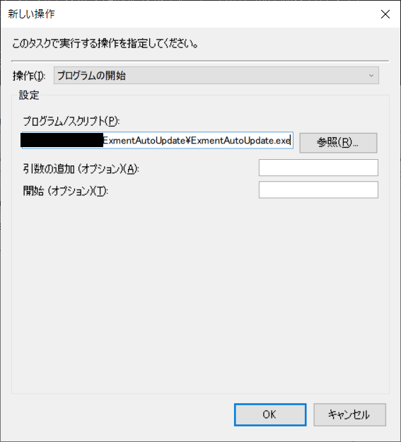

# (Für Fortgeschrittene) Automatisches Update
Mit dieser Einstellung wird Exment automatisch aktualisiert, wenn eine neue Version erscheint.  
Sie registrieren auf dem Server eine Verarbeitung, die jeden Tag zu einer festen Zeit läuft (eine regelmäßige Update-Verarbeitung).

- Wie das normale Update geht und bis zu welcher Version aktualisiert wird, lesen Sie unter [Update](/de/update).

## Funktionsweise des automatischen Updates
Die registrierte Verarbeitung macht jedes Mal Folgendes.

- Sie führt die Web-API aus und holt die Angaben zur neuesten Version von Exment (1)
- Sie holt die Version des installierten Exment (2)
- Wenn (1) neuer ist als (2), führt sie das Update-Skript aus
- Wenn (2) eine Version ist, die mit „dev“ beginnt, wird kein Update ausgeführt

## Einrichtung
Die Schritte sind bei Linux und Windows verschieden.

| Server | Wo Sie nachsehen | Was Sie verwenden |
|---|---|---|
| Linux (einschließlich Sakura Internet und XServer) | Einrichtung (Linux) | Update-Skript, ExmentAutoUpdate.bash, jq, cron |
| Windows | Einrichtung (Windows) | Update-Skript, ExmentAutoUpdate.exe, Aufgabenplanung |

### Einrichtung (Linux)
**(1) Das Update-Skript ablegen**

Laden Sie das [Update-Skript](/de/update) herunter und legen Sie es in den Projektordner von Exment.  
Laden Sie je nach Umgebung die folgende Datei herunter.

- Bei Sakura Internet : ExmentUpdateLinuxSakura.sh
- Bei XServer : ExmentUpdateLinuxXserver.sh
- In allen anderen Fällen : ExmentUpdateLinux.sh

> Die Shell-Datei für das Update wurde aktualisiert. Bitte sehen Sie unter [Update](/de/update) nach und tauschen Sie die Datei aus.  
Prüfen Sie, ob in der 2. Zeile der Shell-Datei die Version „v1.1.0“ oder höher steht.

**(2) Das Skript für die Update-Prüfung herunterladen**

Führen Sie die folgenden Befehle im Stammverzeichnis des Exment-Projekts aus.

~~~
wget https://exment.net/downloads/cmd/ExmentAutoUpdate.bash
chmod 775 ExmentAutoUpdate.bash
~~~

**(3) „jq“ installieren**

Es wird die Bibliothek „jq“ verwendet. Prüfen Sie mit dem folgenden Befehl, ob der Befehl „jq“ installiert ist.

```
jq --help
```

- Wenn eine Meldung wie „Befehl nicht gefunden“ erscheint, ist der Befehl jq nicht installiert.  
Installieren Sie den Befehl jq so, wie es in der [offiziellen Dokumentation](https://stedolan.github.io/jq/download/) steht.

**(4) Den Ort von composer in das Update-Skript schreiben**

Suchen Sie den Pfad von composer. Führen Sie den folgenden Befehl in einem beliebigen Pfad aus und kopieren Sie das Ergebnis.

```
which composer
# Beispiel für das Ergebnis
# /home/xxx/usr/local/bin/composer
```

Bearbeiten Sie die heruntergeladene Datei ExmentUpdateLinux.sh (oder ExmentUpdateLinuxSakura.sh, ExmentUpdateLinuxXserver.sh).  
Ändern Sie den Wert von composer_path in der Datei auf das Ergebnis von „which composer“.

```
# composer_path=''
# Wie folgt ändern
composer_path='/home/xxx/usr/local/bin/composer'
```

**(5) In cron registrieren**

Führen Sie den folgenden Befehl aus.

~~~
crontab -e
~~~

Der Bildschirm für die Cron-Einstellungen erscheint. Schreiben Sie den folgenden Inhalt hinein.

~~~

###Den folgenden Eintrag hinzufügen
(Minute der Ausführung) (Stunde der Ausführung) * * * cd /(Stammverzeichnis von Exment); bash ExmentAutoUpdate.bash
# Beispiel: Exment unter dem Pfad /var/www/exment jeden Tag um 3:00 ausführen
0 3 * * * cd /var/www/exment; bash ExmentAutoUpdate.bash >> storage/logs/ExmentAutoUpdate.log  2>&1
~~~


#### Bei XServer zusätzlich Folgendes ausführen

- Führen Sie den folgenden Befehl aus und suchen Sie den HOME-Pfad.

```
echo $HOME
# Beispiel für das Ergebnis
# /home/xxx
```

- Bearbeiten Sie danach die heruntergeladene Datei ExmentUpdateLinuxXserver.sh.  
Ändern Sie den Wert von home_path auf das Ergebnis von „echo $HOME“.

```
# home_path=''
# Wie folgt ändern. Am Ende kein „/“ anhängen
home_path='/home/xxx'
```


#### Einrichtung abgeschlossen
- Damit läuft ExmentAutoUpdate.bash jeden Tag zu einer festen Zeit. Wenn es eine neuere Version gibt, wird automatisch aktualisiert.
- Das Ausführungsprotokoll des automatischen Updates bleibt in storage/logs/ExmentAutoUpdate.log erhalten.


### Einrichtung (Windows)
**(1) Das Update-Skript und das Programm für das automatische Update ablegen**

1. Laden Sie das [Update-Skript ExmentUpdateWindows.bat](https://exment.net/downloads/cmd/ExmentUpdateWindows.bat) herunter und legen Sie es in den Projektordner von Exment.

2. Laden Sie [hier](https://exment.net/downloads/cmd/ExmentAutoUpdateWindows.zip) die zip-Datei des Programms für das automatische Update herunter.

3. Entpacken Sie die heruntergeladene zip-Datei und legen Sie den ganzen Ordner "ExmentAutoUpdateWindows" in den Projektordner von Exment.

```
# Ordnerstruktur (Ausschnitt)
- app
- bootstrap
- config
- ExmentUpdateWindows.bat
- ExmentAutoUpdateWindows
    - ExmentAutoUpdate.exe
    - ExmentAutoUpdate.exe.config
    - Newtonsoft.Json.dll
```

**(2) In der Aufgabenplanung registrieren**

1. Geben Sie im Menü von Windows „task“ ein und starten Sie die Aufgabenplanung.  


2. Klicken Sie in der Aufgabenplanung auf „Aufgabe erstellen“.  


3. Stellen Sie auf der Registerkarte „Allgemein“ Folgendes ein. (Der „Name“ ist beliebig.)  


4. Klicken Sie auf die Registerkarte „Trigger“. Erstellen Sie einen Trigger.  
    (1) Klicken Sie auf die Schaltfläche „Neu“.  
    Geben Sie danach Folgendes ein.  
    - Aufgabe starten: Nach einem Zeitplan
    - Start: die Uhrzeit der Ausführung am Startdatum
    - Wiederholung: 1 Tag
    - Häkchen bei „Aktiviert“  
    Klicken Sie zum Schluss auf „OK“.  


5. Klicken Sie auf der Registerkarte „Aktionen“ auf die Schaltfläche „Neu“.  
Geben Sie danach Folgendes ein.
    - Aktion: Programm starten
    - Programm/Skript: der Pfad bis zur abgelegten Datei „ExmentAutoUpdate.exe“

    

6. Bei einem Notebook entfernen Sie auf der Registerkarte „Bedingungen“ das Häkchen bei „Aufgabe nur starten, falls Computer im Netzbetrieb ausgeführt wird“.  


7. Wenn Sie bis hierher alles eingestellt haben, klicken Sie auf OK.  
Danach erscheint ein Bildschirm für die Anmeldeinformationen des Benutzers. Geben Sie das Passwort ein.  


8. Wählen Sie nach der Einstellung in der „Aufgabenplanungsbibliothek“ die erstellte Aufgabe und klicken Sie auf „Ausführen“.  


Damit ist die Einrichtung abgeschlossen.


#### Einrichtung abgeschlossen
- Damit läuft ExmentAutoUpdate.exe jeden Tag zu einer festen Zeit. Wenn es eine neuere Version gibt, wird automatisch aktualisiert.

