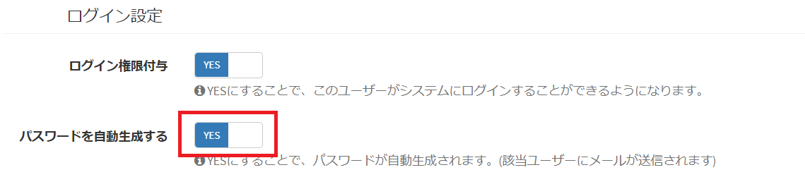

# Benutzer und Login-Benutzer
Diese Seite erklärt die Bildschirme, in denen Sie Benutzer und Login-Benutzer verwalten.

| Was Sie tun möchten | Wo Sie nachsehen |
|---|---|
| Benutzer hinzufügen, bearbeiten, löschen | „Benutzer verwalten“ |
| Einem Benutzer die Anmeldung ermöglichen, das Passwort festlegen | „Login-Benutzer verwalten“ |
| Für viele Benutzer die Anmeldung auf einmal einstellen | „Login-Benutzer-Informationen auf einmal importieren“ |
| Benutzer die eigenen Informationen ansehen und ändern lassen | „Eigene Informationen durch den Login-Benutzer anzeigen und bearbeiten“ |

## Begriffe
### Benutzer
Personen wie die Mitarbeiter, die zur eigenen Firma oder Organisation gehören.  
Auch Personen, die dieses System nicht verwenden, können als Benutzer hinzugefügt werden.  
Benutzercode und E-Mail-Adresse sind Pflicht.  
Benutzer können mit den Daten anderer Tabellen verknüpft werden. Ein Benutzer allein kann sich aber noch nicht am System anmelden.

### Login-Benutzer
Die Benutzer, die sich an Exment anmelden können.  
Weil die Benutzerinformationen ein Passwort bekommen, können sie sich im Anmeldebildschirm von Exment anmelden und Daten speichern, ansehen usw.  

#### Schritte zum Einstellen von Benutzern und Login-Benutzern

Der Ablauf, bis die Anmeldung an Exment möglich ist, steht im Bild oben.  
① Im Bildschirm der Benutzerverwaltung speichern Sie Benutzercode, Benutzername und E-Mail-Adresse des Benutzers.  
② Im Bildschirm der Login-Benutzer-Verwaltung stellen Sie das Passwort des in ① gespeicherten Benutzers ein.  
Damit kann sich der gespeicherte Benutzer an Exment anmelden.  

> Wenn bei der Anmeldung das Passwort eine festgelegte Anzahl von Malen falsch eingegeben wird, kann sich dieser Benutzer eine Zeit lang nicht anmelden.  

## Benutzer verwalten
Hier steht, wie Sie die Informationen aller Benutzer verwalten.  

### Liste anzeigen
Klicken Sie im linken Menü auf „Benutzer“.  
Oder öffnen Sie die folgende URL.  
Damit erscheint die Liste der Benutzer.
http(s)://(URL von Exment)/data/user  
Es erscheint die Liste der Benutzer, die jetzt im System gespeichert sind.

> ※ Diese URL gilt für die Standardeinstellung ohne „/admin“ (Sites, die mit v7.2.1 oder später neu installiert wurden). Wenn `ADMIN_ROUTE_PREFIX` in der `.env` einen Wert hat (bei Sites, die mit einer früheren Version installiert wurden: „admin“), hängen Sie diesen Wert an die URL der Site an (Beispiel: `http(s)://(URL von Exment)/admin/data/user`). Einzelheiten finden Sie unter [„admin“ in der URL ändern oder entfernen](/de/additional_prefix).

### Benutzer neu hinzufügen
- Klicken Sie in der Liste „Benutzer“ oben rechts auf der Seite auf die Schaltfläche [Neu].

- Der Bildschirm zum Hinzufügen erscheint. Geben Sie das Nötige ein.

#### Zugehörige Organisationen
Wenn der Benutzer zu Organisationen gehören soll, wählen Sie sie unter „Verfügbare Daten“ und verschieben Sie sie nach „Ausgewählte Daten“.  
※ Wenn keine Organisation angelegt ist, erscheint dieses Feld nicht.

#### Rollengruppen-Einstellungen
Wenn der Benutzer Rollengruppen bekommen soll, wählen Sie sie unter „Verfügbare Daten“ und verschieben Sie sie nach „Ausgewählte Daten“.

#### Anmeldeeinstellungen
Wenn Sie „Anmeldeberechtigung erteilen“ auf YES stellen, können Sie den Benutzer als Login-Benutzer anlegen.  
Wie Sie das einstellen, finden Sie unten unter [Login-Benutzer verwalten](/de/user?id=Login-Benutzer-verwalten).

### Speichern
Wenn Sie die Einstellungen eingegeben haben, klicken Sie auf [Absenden].

### Bearbeiten
Um einen Benutzer zu bearbeiten, klicken Sie in seiner Zeile auf den Link [Bearbeiten].  

### Löschen
Um einen Benutzer zu löschen, klicken Sie in seiner Zeile auf den Link [Löschen].  

## Login-Benutzer verwalten
Für die Benutzer, die im Bildschirm oben angelegt wurden, verwalten Sie hier die Login-Benutzer.  
Sie können ein Passwort hinzufügen, ein Passwort neu ausgeben, die Anmeldeberechtigung löschen usw.  

### Bildschirm anzeigen
Klicken Sie im linken Menü auf „Login-Benutzer“.  
Oder öffnen Sie die folgende URL.  
Damit erscheint der Bildschirm der Login-Benutzer-Einstellungen.
http(s)://(URL von Exment)/loginuser  
Es erscheinen die Benutzer, die jetzt im System gespeichert sind, und ihre Anmeldeinformationen.  

### Anmeldeinformationen hinzufügen
Klicken Sie in der Zeile des Benutzers, dem Sie Anmeldeinformationen hinzufügen möchten, auf den Link [Bearbeiten].  

- Der Bildschirm zum Bearbeiten der Anmeldeinformationen erscheint.  
  
Um die Anmeldeberechtigung hinzuzufügen, stellen Sie „Anmeldeberechtigung erteilen“ auf YES.  
Bei YES erscheint das Feld „Passwort automatisch generieren“.

#### Passwort automatisch generieren
Bei YES wird das Passwort beim Hinzufügen der Anmeldeberechtigung automatisch erstellt.  
Danach wird automatisch eine E-Mail mit dem Passwort an die E-Mail-Adresse des Benutzers gesendet.  
**※ Für diese Funktion sind die [E-Mail-Einstellungen](/de/system_setting) nötig.**  
  
Bei NO erscheinen ein Textfeld zur Eingabe des Passworts und das Feld „Benutzerinformationen per E-Mail senden“.

#### Passwort eingeben
Erscheint, wenn „Passwort automatisch generieren“ auf NO steht.  
Geben Sie das Passwort des Login-Benutzers ein.  

#### Benutzerinformationen per E-Mail senden
Erscheint, wenn „Passwort automatisch generieren“ auf NO steht.  
Wenn dieses Feld auf YES steht, wird eine E-Mail mit dem Passwort an die E-Mail-Adresse des Benutzers gesendet.  
**※ Für diese Funktion sind die [E-Mail-Einstellungen](/de/system_setting) nötig.**

#### Passwortänderung bei der ersten Anmeldung
Bei YES erscheint beim ersten Anmelden des Benutzers der Bildschirm zum Ändern des Passworts.  
Das gilt für neu gespeicherte Benutzer und für Benutzer, deren Passwort zurückgesetzt wurde.

### Anmeldeberechtigung löschen
Löscht die Anmeldeberechtigung.  
Klicken Sie in der Liste beim Benutzer, dessen Spalte „Login-Benutzer-Einstellungen“ auf „YES“ steht, auf den Link [Bearbeiten].  
  

Stellen Sie „Anmeldeberechtigung erteilen“ auf NO.  
  
Klicken Sie danach auf [Absenden].  

### Login-Benutzer-Informationen auf einmal importieren
Sie können Login-Benutzer-Informationen auf einmal importieren.  
Sie müssen die Anmeldung dann nicht für jeden Benutzer einzeln im Benutzerbildschirm einstellen, sondern stellen sie auf einmal ein.

Der Ablauf ist wie folgt.

1. Die Benutzer speichern („Benutzerinformationen speichern“)  
2. Die Login-Benutzer-Informationen exportieren („Login-Benutzer-Informationen ausgeben“)  
3. Die exportierte Datei bearbeiten („Importdatei erstellen“)  
4. Importieren („Import“)

#### Benutzerinformationen speichern
Fügen Sie zuerst die Benutzer, die Anmeldeinformationen bekommen sollen, im Bildschirm [Benutzer verwalten](/de/user?id=Benutzer-verwalten) hinzu.

#### Login-Benutzer-Informationen ausgeben
- Klicken Sie im linken Menü auf „Login-Benutzer“.  
Oder öffnen Sie die folgende URL.  
Damit erscheint der Bildschirm der Login-Benutzer-Einstellungen.
http(s)://(URL von Exment)/loginuser  
Es erscheinen die Benutzer, die jetzt im System gespeichert sind, und ihre Anmeldeinformationen.  

- Klicken Sie oben rechts im Bildschirm auf die Schaltfläche „Import/Export“.  
Klicken Sie danach auf „Export“.

  

- Die gespeicherten Benutzerinformationen und die Login-Benutzer-Informationen dieser Benutzer werden ausgegeben.

  

#### Inhalt der Spalten
- id  
Die id des Benutzers. Ändern Sie diesen Wert für den späteren Import nicht.  

- Benutzername, Benutzercode, E-Mail  
Die Benutzerinformationen.  
※ Auch wenn Sie diese Werte für den späteren Import ändern, werden die Benutzerinformationen nicht geändert. Ändern Sie Benutzerinformationen im Bildschirm „Benutzer“.

- Anmeldeberechtigung erteilen  
Ob der Benutzer die Standard-Anmeldeinformationen von Exment hat. Bei 1 hat er Anmeldeinformationen.

- Passwort automatisch generieren, Passwort, Benutzerinformationen per E-Mail senden  
Beim Export sind die Werte leer. Sie werden beim Import verwendet.

#### Importdatei erstellen
Sie bearbeiten die oben exportierte Datei und erstellen daraus die Importdatei.  
Geben Sie in den Spalten Folgendes ein.

- Anmeldeberechtigung erteilen  
    - Wenn der Benutzer die Standard-Anmeldeberechtigung von Exment bekommen soll, geben Sie 1 ein.  
    - Wenn der Benutzer schon eine Anmeldeberechtigung hat und sie behalten soll, lassen Sie 1 stehen.  
    - Wenn Sie einem Benutzer, der schon eine Anmeldeberechtigung hat, die Anmeldeberechtigung löschen möchten, geben Sie 0 ein.

- Passwort automatisch generieren  
Wenn das Passwort des Benutzers automatisch erstellt werden soll, geben Sie 1 ein.  
Bei einem Benutzer, der schon eine Anmeldeberechtigung hat, wird das Passwort zurückgesetzt.

- Passwort  
Wenn Sie das Passwort des Benutzers selbst festlegen möchten, geben Sie die Zeichenfolge des Passworts ein.  
Bei einem Benutzer, der schon eine Anmeldeberechtigung hat, wird das Passwort zurückgesetzt.

- Benutzerinformationen per E-Mail senden  
Wenn das Passwort per E-Mail gesendet werden soll, sobald Anmeldeinformationen neu vergeben oder das Passwort geändert wurde, geben Sie 1 ein.

#### Import
- Klicken Sie im Bildschirm der Login-Benutzer-Einstellungen oben rechts auf die Schaltfläche „Import/Export“.  
Klicken Sie danach auf „Import“.

  

- Laden Sie die erstellte Importdatei hoch.

- Die Anmeldeinformationen werden vergeben.

## Eigene Informationen durch den Login-Benutzer anzeigen und bearbeiten
Für einen Benutzer sind Informationen wie „Benutzercode“, „Benutzername“, „E-Mail“, „Avatar“ und „Passwort“ gespeichert.

- „Avatar“ und „Passwort“ kann der Login-Benutzer von Anfang an selbst anzeigen und ändern.  
- „Benutzercode“, „Benutzername“, „E-Mail“ und „andere neu angelegte Spalten“ kann der Login-Benutzer selbst ansehen und bearbeiten, wenn die folgende Einstellung gesetzt ist.  

#### Einstellung der benutzerdefinierten Spalte: Eigene Informationen anzeigen / bearbeiten

In den Einstellungen der benutzerdefinierten Spalten der Benutzertabelle können Sie „Eigene Informationen anzeigen / bearbeiten“ einstellen.  
Zur Wahl stehen 3 Arten: „Nicht anzeigen“, „Nur anzeigen“ und „Bearbeitbar“.  
Was der Login-Benutzer jeweils tun kann, steht im Folgenden.

##### Nicht anzeigen
Der Login-Benutzer kann die gespeicherten Informationen nicht anzeigen.  

##### Nur anzeigen
Der Login-Benutzer kann die gespeicherten Informationen anzeigen, aber nicht bearbeiten.  

##### Bearbeitbar
Der Login-Benutzer kann die gespeicherten Informationen anzeigen und bearbeiten.
> Wenn Optionen wie „Nur einmal eingeben“ eingestellt sind, haben diese Vorrang.

#### Anzeigen und Bearbeiten im Bildschirm des Login-Benutzers

Klicken Sie oben rechts im Bildschirm von Exment auf den Namen des Login-Benutzers und dann auf [Einstellungen].  

Es erscheinen die Informationen, die der Login-Benutzer anzeigen kann.  
Spalten, in die eine Eingabe möglich ist, kann der Benutzer selbst bearbeiten und speichern.    

※ Im Beispiel des Bildes ist „Benutzercode“ auf „Nur anzeigen“ gestellt, „Benutzername“ und „E-Mail“ auf „Bearbeitbar“.
