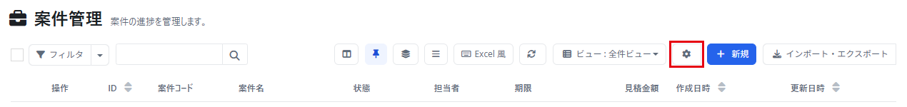
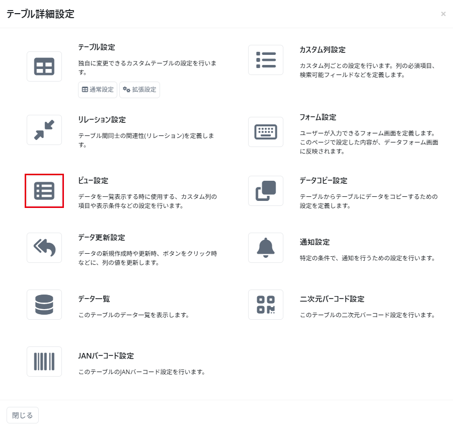
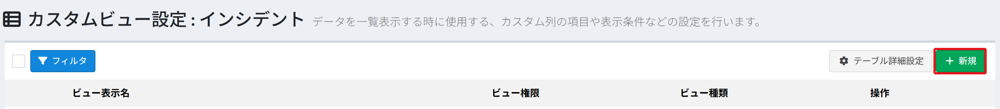
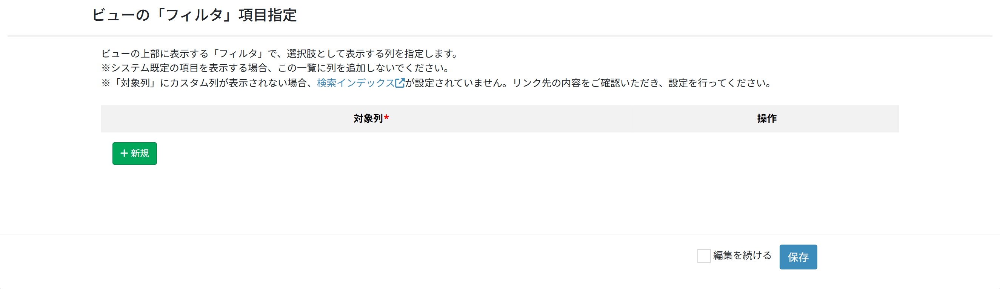
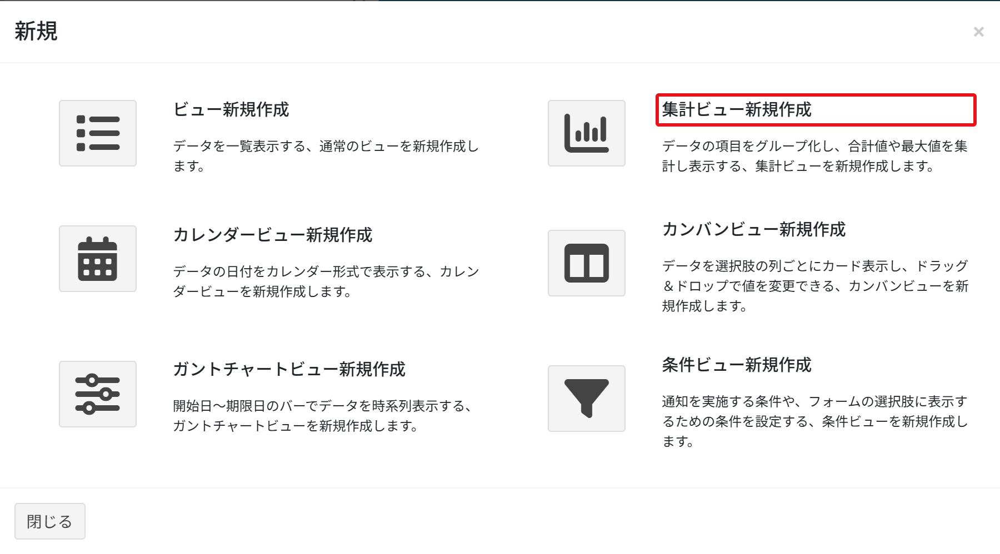
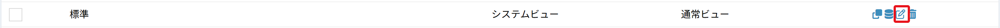
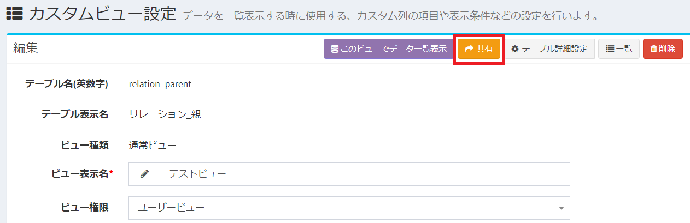

# Benutzerdefinierte Ansichten
Eine Ansicht legt fest, wie die [Datenliste](/de/data_grid) aussieht. Jede Ansicht bestimmt, welche Spalten erscheinen, welche Daten herausgefiltert werden und in welcher Reihenfolge sie stehen.  
Diese Seite erklärt die Arten von Ansichten, das Anlegen einer Ansicht und die Einstellungen.

Der Ablauf der Einstellung ist wie folgt.

1. Die Liste der Ansichten öffnen („Seite öffnen“)  
2. Mit [Neu] die Art der Ansicht wählen, die Sie anlegen möchten („Neue Ansicht hinzufügen“)  
3. Die Einstellungen eingeben und mit [Absenden] speichern

## Arten von Ansichten
Zurzeit gibt es die folgenden Arten.

| Art | Verwendung |
|---|---|
| Ansicht (normale Ansicht) | Daten als Liste ansehen |
| Auswertungsansicht | Summen, Anzahlen usw. je Gruppe ansehen |
| Kalenderansicht | Daten in Kalenderform ansehen |
| Kanban-Ansicht | Daten als Karten ansehen, in einer Spalte je Zustand |
| Gantt-Diagramm-Ansicht | Daten als Balken vom Startdatum bis zum Fälligkeitsdatum ansehen |
| Ansicht aller Daten | Eine Ansicht in der Form der normalen Ansicht, die das System automatisch anlegt |
| Bedingungsansicht | Wird nur zum Filtern verwendet, zum Beispiel in den Bedingungen einer Benachrichtigung |

### Ansicht (normale Ansicht)

Das ist die gewöhnliche Ansicht: eine Datenliste.  
Sie zeigt die gespeicherten Daten als Liste.

### Auswertungsansicht

Sie fasst die gespeicherten Daten in Gruppen zusammen und zeigt Auswertungswerte wie Summe, Anzahl und Maximum.  
Im Dashboard kann sie als Diagramm gezeigt werden.

### Kalenderansicht

Sie zeigt die gespeicherten Daten in Kalenderform.

### Kanban-Ansicht

Sie zeigt die gespeicherten Daten als Karten, in einer Spalte je Zustand.  
Wenn Sie eine Karte in eine andere Spalte ziehen, ändert sich der Wert dieses Feldes.  
Einzelheiten finden Sie unter [Kanban-Ansicht](/de/view_kanban).

### Gantt-Diagramm-Ansicht
Sie zeigt die gespeicherten Daten in zeitlicher Reihenfolge, jeweils als Balken vom Startdatum bis zum Fälligkeitsdatum (Enddatum).  
Einzelheiten finden Sie unter [Gantt-Diagramm-Ansicht](/de/view_gantt).

### Ansicht aller Daten
Sie ist im Grunde gleich wie die normale Ansicht, unterscheidet sich aber in diesen Punkten.  
- Das System legt sie automatisch an.  
- Es wird nur eine angelegt. Benutzer können keine neue anlegen und sie nicht löschen.  
- Sie wird verwendet, wenn der Bildschirm der [Suche](/de/search) eine Liste zeigt.  
- Sie wird verwendet, wenn aus einer Auswertungsansicht die Einzeldaten gezeigt werden.

### Bedingungsansicht
Eine Ansicht, die nur zum Filtern verwendet wird. Sie wird für die Bedingungen einer [Benachrichtigung](/de/notify) verwendet und für das Filtern, wenn die Spalteneinstellung einer benutzerdefinierten Spalte „Auswahl (aus Tabelle)“ ist.  
- Sie hat keine Einstellung für Anzeigespalten.  
- Sie erscheint nicht in der Datenliste.  
- Nur Administratoren können sie einstellen. Allgemeine Benutzer können das nicht.

## Seite öffnen
- Setzen Sie in der Liste der benutzerdefinierten Tabellen genau ein Häkchen bei der Tabelle, die Sie einstellen möchten, und klicken Sie oben rechts auf „Tabellen-Detaileinstellungen“.  
  
- Oder wählen Sie die Tabelle im Menü und klicken Sie dann ebenso oben rechts auf „Tabellen-Detaileinstellungen“.  
※ Die Tabelle muss dafür vorher in das Menü aufgenommen sein.  
  
- Klicken Sie im Bildschirm der Tabellen-Detaileinstellungen auf das Symbol für die Ansichtseinstellungen.  

- Damit erscheint die Liste der Ansichten dieser benutzerdefinierten Tabelle.  

## Neue Ansicht hinzufügen
- Klicken Sie im Bildschirm „Einstellungen der benutzerdefinierten Ansicht“ oben rechts auf die Schaltfläche [Neu].

Klicken Sie im Dialog auf die Schaltfläche der Art, die Sie anlegen möchten.  
  
- Der Bildschirm zum Hinzufügen einer Ansicht erscheint. Geben Sie das Nötige ein.

## Einstellungen der Ansicht
#### Anzeigename der Ansicht
Geben Sie den Namen der Ansicht ein.  

#### Berechtigung der Ansicht
Legen Sie fest, wer diese Ansicht verwenden kann: Systemansicht oder Benutzeransicht.

- Systemansicht  
Nur Systemadministratoren können sie einstellen.  
Alle Benutzer mit Zugriffsrecht auf die Tabelle können diese Ansicht verwenden.

- Benutzeransicht  
Diese Ansicht kann auch einstellen, wer kein Systemadministrator ist.  
Nur der Benutzer, der sie angelegt hat, kann sie verwenden.

※ Eine Systemansicht kann später nicht in eine Benutzeransicht geändert werden.  
**Eine Benutzeransicht, die ein Systemadministrator angelegt hat,** kann später in eine Systemansicht geändert werden.  
※ Wenn Sie die Einstellung [Benutzeransicht deaktivieren](/de/config) setzen, können allgemeine Benutzer keine Ansichten mehr anlegen.

#### Einträge pro Seite
Wählen Sie, wie viele Daten die Datenliste auf einer Seite zeigt.

#### Standard
Wenn es mehrere Ansichten gibt, erscheint beim Öffnen der Datenliste zuerst die Ansicht, die auf „YES“ steht.  
※ Auch eine Ansicht mit „NO“ kann gezeigt werden, wenn man sie in der Liste der Ansichten wählt.  
※ „Standard“ kann in einer benutzerdefinierten Tabelle nur bei einer Ansicht auf „YES“ stehen.  
Wenn Sie zwei oder mehr Ansichten auf „YES“ setzen, wechseln alle außer der zuletzt gesetzten auf „NO“.

#### Infobox der Ansicht verwenden
Mit [YES] können Sie über der Ansicht eine Infobox zeigen.  
Geben Sie Titel und Text ein. So können Sie den Inhalt der Arbeit oder eine Nachricht an die Benutzer zeigen.

#### Anzeigespalten auswählen
Die Einstellung der Spalten, die in der Ansicht erscheinen.  
Die hier eingestellten Spalten erscheinen in der Datenliste usw.

##### Zielspalte
Die Spalte, die in der Ansicht erscheint.  
  
##### Alias-Anzeigename  
Die Spalte erscheint in der Ansicht mit dem Namen, den Sie hier eingeben.  

##### Darstellungsvorlage für Zellen  
Wählen Sie, wie die Spalte in dieser Ansicht aussieht.  
※ Dies hat Vorrang vor den Einstellungen der benutzerdefinierten Spalte. Einzelheiten finden Sie unter [Darstellungsvorlagen](/de/cell_style_preset).  

##### Schaltfläche [↓]  
Verschiebt die Spalte in der Ansicht nach rechts.  

##### Schaltfläche [↑]  
Verschiebt die Spalte in der Ansicht nach links.  

##### Schaltfläche [Löschen]  
Löscht die Anzeige in der Ansicht.

##### Schaltfläche [Neu]  
Fügt eine neue Anzeigespalte der Ansicht hinzu.

#### Filter der Ansicht
Die Bedingungen, mit denen die Daten der Ansicht gefiltert werden.  
Fügen Sie Bedingungen hinzu, wenn Sie zum Beispiel „nur Daten in einem Zeitraum zeigen“ oder „nur Daten mit einem bestimmten Status zeigen“ möchten.  
※ Unabhängig von dieser Einstellung wird so gefiltert, dass nur Daten erscheinen, für die der angemeldete Benutzer eine Berechtigung hat. Daten ohne Berechtigung erscheinen nicht, egal was hier eingestellt ist.

>Wenn der Spaltentyp der Bedingung „Auswahl (aus Tabelle)“ ist, können Sie den Text, der als Wert der Bedingung erscheint, in den [Einstellungen der Überschriftenspalten](/de/table) ändern.

##### Zielspalte
Die Spalte, die für die Filterbedingung verwendet wird.  
  
##### Filterbedingung
Wählen Sie den Inhalt der Bedingung.  
Einzelheiten finden Sie unter [Über die Filterbedingungen](/de/view?id=Über-die-Filterbedingungen).  

##### Wert der Filterbedingung
Geben Sie den Wert ein, mit dem verglichen wird.  
  
##### Schaltfläche [Löschen]
Löscht die Anzeigebedingung der Ansicht.
  
##### Schaltfläche [Neu]
Fügt eine neue Anzeigebedingung der Ansicht hinzu.

#####   Verknüpfung der Bedingungen
Mit „Alle Bedingungen erfüllt“ erscheinen die Daten, die alle Bedingungen erfüllen.  
Mit „Eine der Bedingungen erfüllt“ erscheinen die Daten, die mindestens eine Bedingung erfüllen.

#####   Bedingung umkehren
Wenn Sie bei „Bedingung umkehren“ ein Häkchen setzen, erscheinen die Daten, die die Bedingungen nicht erfüllen.  
※ In Auswertungsansichten kann die Umkehrung nicht verwendet werden.

#### Über die Filterbedingungen
Je nach Typ der unter „Zielspalte“ gewählten Spalte („Datum“, „Benutzer“ usw.) ändern sich die wählbaren Bedingungen.  
Hier stehen nur die Filterbedingungen, die eine Erklärung brauchen.

##### Wenn der Typ der Zielspalte „Datum“ ist
- Ab dem Datum vor X Tagen  
- Ab dem Datum in X Tagen  
- Bis zum Datum vor X Tagen  
- Bis zum Datum in X Tagen  
Die Daten erscheinen in der Ansicht, wenn ihr Datum in diesem Bereich liegt.  

Beispiel: Das aktuelle Datum ist der 15.1., und als Wert ist „8“ gespeichert  

##### Wenn der Typ der Zielspalte „Benutzer“ ist
- Entspricht Login-Benutzer  
Die Daten erscheinen in der Ansicht, wenn ihr Wert gleich dem angemeldeten Benutzer ist.  

- Entspricht nicht Login-Benutzer    
Die Daten erscheinen in der Ansicht, wenn ihr Wert nicht gleich dem angemeldeten Benutzer ist.  

#### Daten sortieren
Stellen Sie die Sortierung (Anzeigereihenfolge) der Daten in der Ansicht ein.

 
##### Zielspalte  
Die Spalte, nach der sortiert wird.  

##### Sortieren  
Legt fest, ob „Aufsteigend“ (kleinste zuerst) oder „Absteigend“ (größte zuerst) sortiert wird.  

##### Schaltfläche [↓]  
Senkt die Priorität in der Sortierreihenfolge.  

##### Schaltfläche [↑]  
Erhöht die Priorität in der Sortierreihenfolge.  

##### Schaltfläche [Löschen]  
Löscht die Sortierung der Ansicht.  

##### Schaltfläche [Neu]
Fügt eine neue Sortierung hinzu.

#### Filterfelder der Ansicht festlegen

Legen Sie fest, welche Spalten der „Filter“ über der Ansicht zur Auswahl zeigt.
  

##### Zielspalte  
Die Spalte, die im „Filter“ erscheint.  

##### Schaltfläche [↓]  
Verschiebt das Feld im „Filter“ nach unten.  

##### Schaltfläche [↑]  
Verschiebt das Feld im „Filter“ nach oben.  

##### Schaltfläche [Löschen]  
Löscht das Feld aus dem „Filter“ der Ansicht.  

##### Schaltfläche [Neu]
Fügt eine neue Spalte für den „Filter“ der Ansicht hinzu.  

## Neue Auswertungsansicht hinzufügen
- Klicken Sie im Bildschirm „Einstellungen der benutzerdefinierten Ansicht“ oben rechts unter [Neu] auf „Neue Auswertungsansicht“.

- Der Bildschirm zum Hinzufügen einer Auswertungsansicht erscheint. Geben Sie das Nötige ein.

## Einstellungen der Auswertungsansicht

#### Anzeigename der Ansicht, Berechtigung der Ansicht, Standard
Dieselben Einstellungen wie oben unter [Einstellungen der Ansicht](/de/view?id=Einstellungen-der-Ansicht).

#### Gruppierungsspalten auswählen
Die Daten werden nach den Werten der hier gewählten Spalten in Gruppen zusammengefasst und ausgewertet.  
Wenn Sie mehrere Spalten einstellen, wird je Kombination dieser Felder getrennt ausgewertet.

##### Zielspalte  
Die Spalte, nach der gruppiert wird.  

- Beispiel 1: Wenn Sie zwei Zielspalten einstellen, wird wie im Bild nach der Kombination der zwei Spalten gruppiert und ausgewertet.  
※ „Umsatz“ ist keine Gruppierungsspalte, sondern als Summenspalte eingestellt.

  

- Beispiel 2: Wenn nur die Spalte „Verkaufsmonat“ Gruppierungsspalte ist, werden die Daten, die in Beispiel 1 auch nach der Spalte „Mitarbeitername“ getrennt waren, in Gruppen nach einer Spalte zusammengefasst und ausgewertet.  

  

##### Alias-Anzeigename
Die Spalte erscheint in der Ansicht mit dem Namen, den Sie hier eingeben.  

##### Spaltentyp
Nur wenn der Spaltentyp der Zielspalte „Datum“ oder „Datum und Uhrzeit“ ist, können Sie aus Folgendem wählen.  
„Jahr“ „Jahr-Monat“ „Jahr-Monat-Tag“ „Monat“ „Tag“ „Wochentag“  
Die Zielspalte wird nach der hier gewählten Datumseinheit gruppiert.  
※ Die Bilder der Beispiele 1 bis 3 zeigen die Anzeige, wenn der Spaltentyp des Verkaufsmonats „Jahr-Monat“ ist.

##### Sortierreihenfolge
Die Einstellung der Reihenfolge, in der die Auswertungsansicht die Daten zeigt.  
Sie legen die Rangfolge der Spalten fest: Nach den Werten welcher Spalte wird zuerst sortiert?  
Die Nummern werden über „Gruppierungsspalten auswählen“ und „Summenspalten auswählen“ zusammen vergeben.  

- Beispiel 3: Das obige Beispiel 2 zeigt die Anzeige, wenn in der Sortierreihenfolge die Spalte „Verkaufsmonat“ 1 und „Umsatz“ 2 ist. Wenn „Verkaufsmonat“ 2 und „Umsatz“ 1 ist, haben wie im Bild unten die Werte der Spalte „Umsatz“ Vorrang.  

  

##### Sortieren  
Stellen Sie ein, ob die Zielspalte mit den kleinsten oder den größten Werten zuerst sortiert wird.  
Wählen Sie „Aufsteigend“ (kleinste zuerst) oder „Absteigend“ (größte zuerst).  

- Beispiel 4: Das obige Beispiel 3 zeigt die Anzeige, wenn „Umsatz“ absteigend sortiert ist. Aufsteigend sieht es aus wie im Bild unten.  

  

##### Schaltfläche [Pfeil]
Stellt die Reihenfolge der Spalten in der Auswertungsansicht ein.  
Je weiter oben ein Feld unter „Gruppierungsspalten auswählen“ steht, desto weiter links erscheint es in der Auswertungsansicht.  

##### Schaltfläche [Löschen]  
Löscht die Gruppierungsspalte der Ansicht.

##### Schaltfläche [Neu]  
Fügt eine neue Gruppierungsspalte der Ansicht hinzu.

#### Summenspalten auswählen
Die Werte der hier gewählten Spalten werden ausgewertet.  

##### Zielspalte  
Die Spalte, deren Werte ausgewertet werden.  

##### Summentyp  
„Summe“ „Anzahl“ „Minimum“ „Maximum“  
Wählen Sie einen dieser 4 Summentypen. Das Ergebnis der gewählten Auswertung erscheint in der Zielspalte der Ansicht.

##### Alias-Anzeigename  
Die Spalte erscheint in der Ansicht mit dem Namen, den Sie hier eingeben.  

##### Schaltfläche [Löschen]  
Löscht die Summenspalte der Ansicht.
  
##### Schaltfläche [Neu]  
Fügt eine neue Summenspalte der Ansicht hinzu.

#### Filter der Ansicht
Die Bedingungen, mit denen die Daten der Ansicht gefiltert werden.  
Fügen Sie Bedingungen hinzu, wenn Sie zum Beispiel „nur Daten in einem Zeitraum zeigen“ oder „nur Daten mit einem bestimmten Status zeigen“ möchten.  
※ Unabhängig von dieser Einstellung wird so gefiltert, dass nur Daten erscheinen, für die der angemeldete Benutzer eine Berechtigung hat. Daten ohne Berechtigung erscheinen nicht, egal was hier eingestellt ist.

>Wenn der Spaltentyp der Bedingung „Auswahl (aus Tabelle)“ ist, können Sie den Text, der als Wert der Bedingung erscheint, in den [Einstellungen der Überschriftenspalten](/de/table) ändern.

##### Zielspalte  
Die Spalte, die für die Filterbedingung verwendet wird.  
  
##### Filterbedingung  
Wählen Sie den Inhalt der Bedingung.  
Einzelheiten finden Sie unter [Über die Filterbedingungen](/de/view?id=Über-die-Filterbedingungen).  
  
##### Wert der Filterbedingung  
Geben Sie den Wert ein, mit dem verglichen wird.  
  
##### Schaltfläche [Löschen]  
Löscht die Anzeigebedingung der Ansicht.
  
##### Schaltfläche [Neu]  
Fügt eine neue Anzeigebedingung der Ansicht hinzu.

## Neue Kalenderansicht hinzufügen

- Klicken Sie im Bildschirm „Einstellungen der benutzerdefinierten Ansicht“ oben rechts unter [Neu] auf „Neue Kalenderansicht“.

- Der Bildschirm zum Hinzufügen einer Kalenderansicht erscheint. Geben Sie das Nötige ein.

## Einstellungen der Kalenderansicht

#### Anzeigename der Ansicht, Berechtigung der Ansicht, Standard
Dieselben Einstellungen wie oben unter [Einstellungen der Ansicht](/de/view?id=Einstellungen-der-Ansicht).

#### Anzeigespalten auswählen
Die Einstellung der Spalten, die in der Ansicht erscheinen.  
In der Kalenderansicht können Sie Startdatum und Enddatum einstellen. Dann erscheinen die Daten der Datumsspalten als Zeitraum.  
※ Wenn die Daten nur an einem Tag erscheinen sollen, geben Sie nur das Startdatum an.

##### Startdatum  
Stellen Sie die Spalte ein, die das Startdatum des Zeitraums ist.  
※ Ohne Enddatum erscheinen die Daten nur an einem Tag: am Tag der Spalte, die als Startdatum eingestellt ist.

##### Enddatum  
Stellen Sie die Spalte ein, die das Enddatum des Zeitraums ist.

##### Anzeigefarbe  
Stellt die Hintergrundfarbe der Daten in der Ansicht ein.

##### Schriftfarbe  
Stellt die Schriftfarbe der Daten in der Ansicht ein.

##### Schaltfläche [Löschen]  
Löscht die Anzeige in der Ansicht.

##### Schaltfläche [Neu]  
Fügt eine neue Anzeigespalte der Ansicht hinzu.

#### Filter der Ansicht
Die Bedingungen, mit denen die Daten der Ansicht gefiltert werden.  
Fügen Sie Bedingungen hinzu, wenn Sie zum Beispiel „nur Daten in einem Zeitraum zeigen“ oder „nur Daten mit einem bestimmten Status zeigen“ möchten.  
※ Unabhängig von dieser Einstellung wird so gefiltert, dass nur Daten erscheinen, für die der angemeldete Benutzer eine Berechtigung hat. Daten ohne Berechtigung erscheinen nicht, egal was hier eingestellt ist.

>Wenn der Spaltentyp der Bedingung „Auswahl (aus Tabelle)“ ist, können Sie den Text, der als Wert der Bedingung erscheint, in den [Einstellungen der Überschriftenspalten](/de/table) ändern.

##### Zielspalte  
Die Spalte, die für die Filterbedingung verwendet wird.  
  
##### Filterbedingung  
Wählen Sie den Inhalt der Bedingung.  
Einzelheiten finden Sie unter [Über die Filterbedingungen](/de/view?id=Über-die-Filterbedingungen).  
  
##### Wert der Filterbedingung  
Geben Sie den Wert ein, mit dem verglichen wird.  
  
##### Schaltfläche [Löschen]  
Löscht die Anzeigebedingung der Ansicht.
  
##### Schaltfläche [Neu]  
Fügt eine neue Anzeigebedingung der Ansicht hinzu.

#### Überschriften in der Kalenderansicht
Wie im Beispiel des Bildes erscheint in der Kalenderansicht beim Datum der Daten eine Überschrift.  

- Es erscheint die Überschrift, die in den [Einstellungen der Überschriftenspalten](/de/table) eingestellt ist.

- Wenn als Startdatum unter „Anzeigespalten auswählen“ eine benutzerdefinierte Spalte vom Typ „Datum und Uhrzeit“ eingestellt ist, steht außerdem die Uhrzeit der Daten am Anfang der Überschrift.  

## Speichern
Wenn Sie die Einstellungen eingegeben haben, klicken Sie auf [Absenden].

## Vorschau
Wenn Sie im Bildschirm zum Anlegen oder Bearbeiten einer Ansicht oben rechts auf die Schaltfläche [Vorschau] klicken, sehen Sie in einem anderen Fenster, wie die Daten mit den gerade eingegebenen Einstellungen aussehen (Datenliste, Kanban, Gantt-Diagramm).  
So können Sie das Aussehen prüfen, bevor Sie die Einstellungen speichern.

- Die Schaltfläche [Vorschau] erscheint bei der normalen Ansicht, der Ansicht aller Daten, der Kanban-Ansicht und der Gantt-Diagramm-Ansicht. Bei Auswertungsansicht, Kalenderansicht, Bedingungsansicht usw. erscheint sie nicht.  
- Die Vorschau speichert die Einstellungen nicht. Um die Anzeige nach einer Änderung zu erneuern, klicken Sie im ursprünglichen Bildschirm noch einmal auf die Schaltfläche [Vorschau].  
- Zeilen unter „Anzeigespalten auswählen“, „Filter der Ansicht“ und „Daten sortieren“, in denen keine Zielspalte oder Bedingung gewählt ist, werden in der Vorschau nicht berücksichtigt. In diesem Fall erscheint im Vorschaubildschirm: „○ Zeile(n) der Ansichtseinstellungen (Ansichtsspalten, Anzeigefilter, Sortierungen) werden in dieser Vorschau nicht berücksichtigt, da ihre Zielspalte oder Filterbedingung noch nicht gewählt ist.“

## Bearbeiten
Um eine Ansicht zu bearbeiten, klicken Sie in ihrer Zeile auf den Link [Bearbeiten].  

## Löschen
Um eine Ansicht zu löschen, klicken Sie in ihrer Zeile auf den Link [Löschen].  

## Benutzerdefinierte Ansicht kopieren
Wenn Sie auf den Link [Kopie von Ansicht] klicken, wird eine Ansicht mit denselben Einstellungen angelegt, bei der nur der Anzeigename der Ansicht leer ist.

## Datenliste anzeigen
Wenn Sie auf die Schaltfläche [Daten in dieser Ansicht auflisten] klicken, erscheint die Datenliste mit den Einstellungen dieser Ansicht.

## Benutzerdefinierte Ansicht teilen
Sie teilen eine angelegte benutzerdefinierte Ansicht mit anderen Benutzern und Organisationen.  
※ Teilen können Sie nur eine „Benutzeransicht“. (Eine „Systemansicht“ ist von Anfang an für alle Benutzer mit Berechtigung offen.)  
※ Als Ziel können Sie Benutzer oder Organisationen wählen, die Zugriffsrecht auf die Tabelle haben.  

#### So teilen Sie
1. Klicken Sie im Bearbeitungsbildschirm der benutzerdefinierten Ansicht auf die Schaltfläche „Teilen“.  
※ Beim neuen Anlegen erscheint diese Schaltfläche nicht.  

2. Der Dialog zum Teilen der benutzerdefinierten Ansicht erscheint.  

3. Fügen Sie die Benutzer oder Organisationen hinzu, mit denen Sie teilen möchten, und klicken Sie auf „Absenden“. Damit ist die Ansicht geteilt.  

