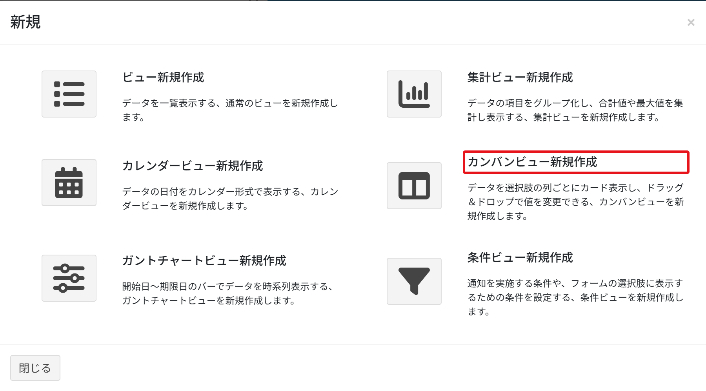
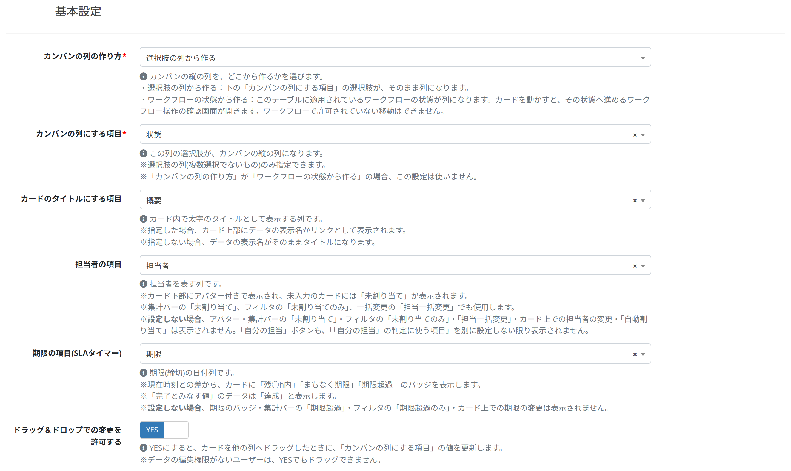
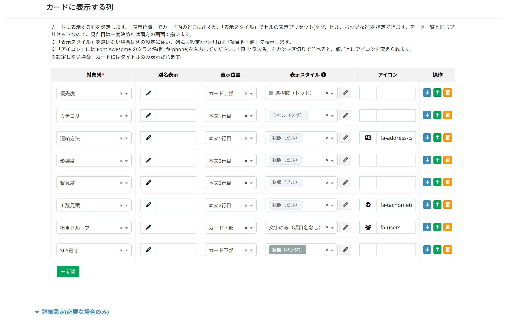
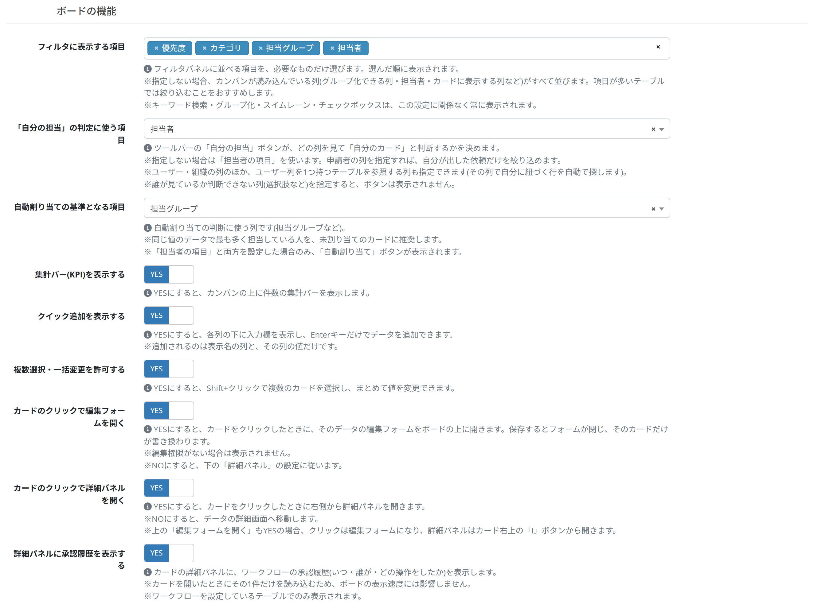
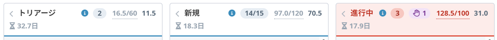
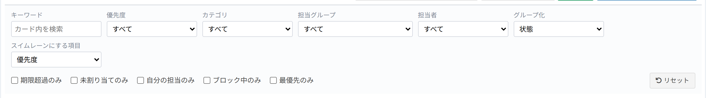
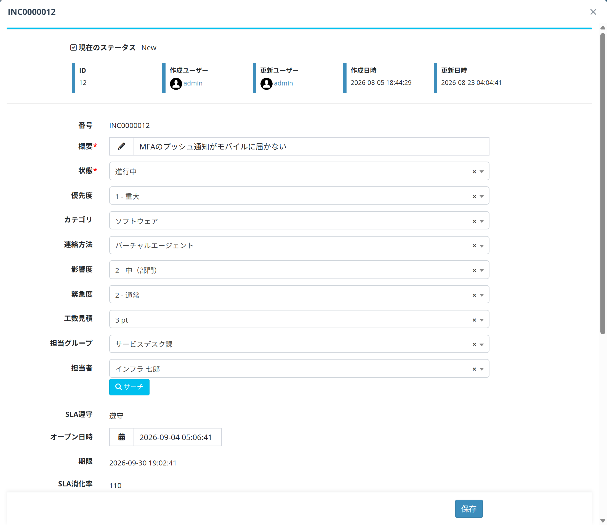
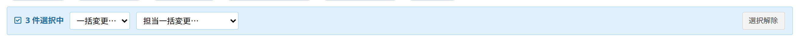
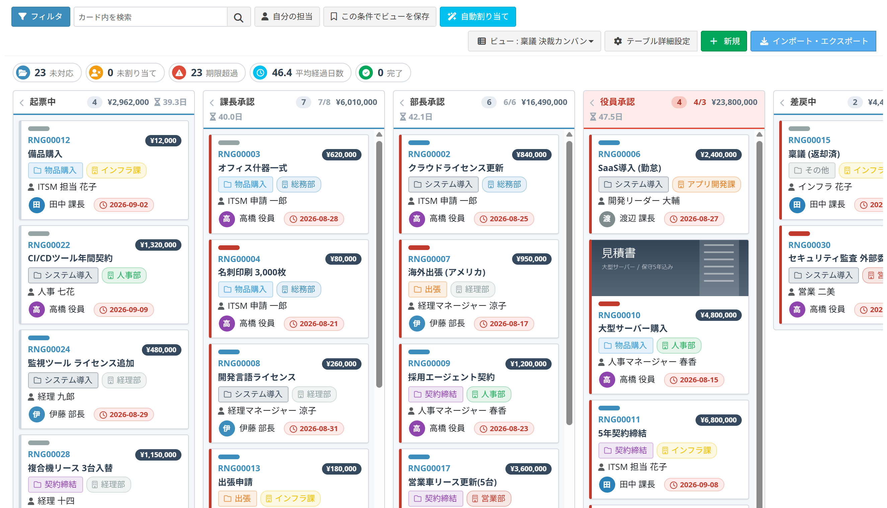

# Kanban-Ansicht

Diese Ansicht zeigt die Daten als Karten, in einer „Spalte je Zustand“. Den Zustand ändern Sie per Drag & Drop.

## Was ist die Kanban-Ansicht

Kanban ist eine Methode, bei der jede Aufgabe eine Karte ist. Die Karten stehen in Spalten für die Arbeitsschritte, zum Beispiel „Offen“, „In Arbeit“ und „Erledigt“.  
Man sieht auf einen Blick, welche Aufgabe in welchem Schritt stehen geblieben ist. Um den Zustand weiterzuführen, schiebt man die Karte einfach in die nächste Spalte.

Mit der Kanban-Ansicht von Exment können Sie Folgendes tun.

- Eine Auswahlspalte (Zustand, Priorität usw.) oder die Status eines Workflows direkt als senkrechte Spalten verwenden
- Eine Karte ziehen und damit den Wert dieses Feldes aktualisieren
- Auf der Karte die zuständige Person, die Frist, Labels, einen Fortschrittsbalken usw. zeigen
- Im Spaltenkopf die Anzahl, die Summe der Beträge und die durchschnittliche Verweildauer je Spalte zeigen
- Auf eine Karte klicken und das Bearbeitungsformular über dem Board öffnen

## Neue Ansicht hinzufügen

1. Öffnen Sie den Bildschirm „Einstellungen der benutzerdefinierten Ansicht“ (siehe [Benutzerdefinierte Ansichten](/de/view)).
2. Klicken Sie oben rechts auf die Schaltfläche [Neu].
3. Wählen Sie im Dialog „Neue Kanban-Ansicht“.

## Grundeinstellungen

#### Wie die Spalten des Boards gebildet werden
Wählen Sie, woraus die senkrechten Spalten des Kanban-Boards gebildet werden.

| Auswahl | Inhalt |
| --- | --- |
| Aus den Werten einer Auswahlspalte | Die Auswahlwerte von „Spalte für die Kanban-Spuren“ (unten) werden direkt zu Spalten. |
| Aus den Status des Workflows | Die Status des Workflows, der auf diese Tabelle angewendet ist, werden zu Spalten. Wenn Sie eine Karte verschieben, öffnet sich der Bestätigungsbildschirm der Workflow-Aktion, die zu diesem Status führt. Verschiebungen, die der Workflow nicht erlaubt, sind nicht möglich. |

※ In Tabellen ohne Workflow erscheint dieses Feld nicht.

#### Spalte für die Kanban-Spuren
Die Auswahlwerte dieser Spalte werden zu den senkrechten Spalten des Kanban-Boards.  
※ Sie können nur Auswahlspalten angeben (keine mit Mehrfachauswahl).  
※ Wenn „Wie die Spalten des Boards gebildet werden“ auf „Aus den Status des Workflows“ steht, wird diese Einstellung nicht verwendet.

#### Spalte für den Kartentitel
Die Spalte, die auf der Karte als fetter Titel erscheint.  
※ Wenn Sie sie angeben, erscheint oben auf der Karte der Anzeigename der Daten als Link.  
※ Wenn Sie sie nicht angeben, ist der Anzeigename der Daten selbst der Titel.

#### Spalte für die zuständige Person
Die Spalte für die zuständige Person. Sie erscheint unten auf der Karte mit Avatar. Auf Karten ohne Eingabe steht „Nicht zugewiesen“.  
Sie wird auch für „Nicht zugewiesen“ in der Übersichtsleiste, für „Nur nicht zugewiesene“ im Filter und für „Massenzuweisung“ bei der Massenänderung verwendet.

※ Ohne diese Einstellung erscheinen nicht: der Avatar, „Nicht zugewiesen“ in der Übersichtsleiste, „Nur nicht zugewiesene“ im Filter, „Massenzuweisung“, das Ändern der zuständigen Person auf der Karte und „Automatisch zuweisen“.

#### Spalte für die Frist (SLA-Timer)
Die Datumsspalte für die Frist (den Termin). Aus dem Abstand zur aktuellen Zeit zeigt die Karte ein Badge: „Noch ○ Std.“, „Bald fällig“ oder „Überfällig“.  
※ Daten mit einem Wert aus „Als erledigt geltende Werte“ zeigen „Eingehalten“.  
※ Ohne diese Einstellung erscheinen nicht: das Badge der Frist, „Überfällig“ in der Übersichtsleiste, „Nur überfällige“ im Filter und das Ändern der Frist auf der Karte.

#### Ändern der Werte per Drag & Drop erlauben
Bei YES wird der Wert von „Spalte für die Kanban-Spuren“ aktualisiert, wenn Sie eine Karte in eine andere Spalte ziehen.  
※ Benutzer ohne Bearbeitungsrecht für die Daten können auch bei YES nicht ziehen.

## Auf der Karte angezeigte Spalten

Stellen Sie die Felder ein, die auf der Karte stehen. Ohne Einstellung zeigt die Karte nur den Titel.

| Feld | Inhalt |
| --- | --- |
| Zielspalte | Die Spalte, die auf der Karte erscheint |
| Alias-Anzeigename | Eingeben, wenn Sie den Namen auf der Karte ändern möchten |
| Position | Wo auf der Karte sie erscheint |
| Stil | Wie sie aussieht |
| Symbol | Klassenname von Font Awesome (Beispiel: fa-phone) |

### Position

| Auswahl | Ort der Anzeige |
| --- | --- |
| Kartenkopf | Über dem Titel |
| Inhalt Zeile 1 | Unter dem Titel, 1. Zeile |
| Inhalt Zeile 2 | Unter dem Titel, 2. Zeile |
| Kartenfuß | Ganz unten auf der Karte |

### Stil

Sie wählen aus denselben „Darstellungsvorlagen für Zellen“ wie in der Datenliste. Wenn Sie das Aussehen einmal festlegen, ist die Anzeige in der Liste und im Kanban gleich.

| Einstellung | Anzeige auf der Karte |
| --- | --- |
| Eine Vorlage wählen | Die Anzeige hat das Aussehen dieser Vorlage (Tag, Pille, Badge, Punkt, Avatar usw.). **Dies hat Vorrang vor der Einstellung der Spalte** |
| Nicht ausgewählt | Es gilt die „Darstellungsvorlage“ der Spalte oder die Anzeigeeinstellung der Spalte |
| Beides nicht eingestellt | Die Anzeige hat die Form „Feldname: Wert“ |

Für die Farbe je Wert gilt unverändert die Einstellung der Spalte. Die Vorlage legt nur die Form fest. Deshalb können Sie dieselbe Vorlage für jede Spalte verwenden.

Mit der Stift-Schaltfläche können Sie Vorlagen neu anlegen und bearbeiten. Einzelheiten finden Sie unter [Darstellungsvorlagen für Zellen](/de/cell_style_preset).

> Auch „Felder, die keine Spalten sind“, zum Beispiel der Workflow-Status oder das Erstellungsdatum, können mit einer Vorlage im selben Aussehen gezeigt werden. Die Farbe je Wert ist aber eine Einstellung der Spalte und gilt für diese Felder nicht.

### Symbol
Geben Sie einen Klassennamen von Font Awesome ein (Beispiel: fa-phone). Auch wenn die Vorlage ein Symbol enthält, hat die Angabe hier Vorrang.  
Wenn Sie das Symbol je Auswahlwert ändern möchten, geben Sie „Wert:Klassenname“ durch Kommas getrennt ein.  
Beispiel: `phone:fa-phone,mail:fa-envelope,chat:fa-comments`

## Erweiterte Einstellungen (optional)

Das Kanban-Board funktioniert auch mit den Anfangswerten. Stellen Sie hier nur etwas ein, wenn Sie es brauchen.

### Karteneinstellungen

#### Spalte für das Titelbild
Die Bildspalte, die oben auf der Karte als Titelbild erscheint.  
※ Daten ohne Bild erscheinen ohne Titelbild. Wenn mehrere Bilder gespeichert sind, wird das erste verwendet.

#### Darstellung des Titelbilds
„Füllen (Überstand wird abgeschnitten)“ füllt den Rahmen ganz und schneidet ab, was übersteht.  
„Ganzes Bild einpassen (mit Rändern)“ zeigt das ganze Bild, mit Rändern.

#### Spalte für die farbigen Labels
Die Auswahlspalte, die oben auf der Karte als farbige Labels erscheint. Auch Spalten mit Mehrfachauswahl können Sie angeben.  
※ Solange „Im Filterbereich angezeigte Spalten“ nicht angegeben ist, wird die angegebene Spalte auch dem Filter hinzugefügt.

#### Darstellung der Labels
„Chip mit Text“ ist ein kleines Label mit Text. „Nur Farbbalken“ ist ein schmaler Balken nur mit Farbe.

#### Spalte für das Eck-Badge
Die Spalte, die oben rechts auf der Karte als kleines Badge erscheint (Anzahl, Punkte, Nummer usw.). Bei Daten mit leerem Wert erscheint es nicht.

#### Als Fortschrittsbalken dargestellte Zahlenspalte / Wert, der den Fortschrittsbalken füllt
Unter dem Titel der Karte erscheint ein Fortschrittsbalken.  
0 % bis 49 % ist blau, 50 % bis 99 % orange, 100 % grün.  
„Wert, der den Fortschrittsbalken füllt“ ist der Wert, bei dem der Balken 100 % erreicht (ohne Eingabe 100).

#### Spalte, ab der die vergangenen Tage gezählt werden / Farbstufen nach Alter
Die Datumsspalte, ab der die vergangenen Tage berechnet werden (Eingangsdatum usw.). Je nach vergangenen Tagen ändert sich die Farbe am linken Rand der Karte.  
Bei „Farbstufen nach Alter“ geben Sie die drei Tageszahlen, bei denen die Farbe wechselt, aufsteigend und durch Kommas getrennt ein.  
Beispiel: `1,2,3` → nach 1 Tag gelb, nach 2 Tagen orange, ab 3 Tagen rot.  
Beispiel: `3,7,14` → für lange Arbeitsschritte.  
Ohne Änderung gilt `1,2,3`.

#### So viele Stunden vor der Frist warnen
Karten, bei denen bis zur Frist weniger als diese Zeit bleibt, werden „Bald fällig“ (gelb).  
Beispiel: 2 (Stunden) bei Anfragen, 48 (= 2 Tage) bei Lieferterminen in Tagen. Ohne Eingabe gelten 2 Stunden.

### Spalten des Boards

#### Spalte für Swimlanes
Das Kanban-Board wird je Wert dieser Spalte waagerecht unterteilt. Ohne Angabe erscheint es ohne Unterteilung.

#### Im Spaltenkopf summierte Spalte
Unter dem Spaltenkopf erscheint die Summe dieses Zahlenfeldes.  
Beispiel: Wenn Sie den Betrag wählen, sehen Sie wie bei „Genehmigung Vorstand ¥34,700,000“ auf einen Blick, welcher Betrag in dieser Spalte steht.  
※ Nur zur Anzeige. Es hat keinen Einfluss auf das WIP-Limit.

#### Durchschnittliche Verweildauer (Tage) pro Spalte anzeigen
Unter dem Spaltenkopf erscheint, wie viele Tage die Karten dieser Spalte im Durchschnitt dort bleiben. So sehen Sie, in welchem Schritt sich die Arbeit staut (Engpass).  
※ Bei einem Workflow wird ab dem „Zeitpunkt, zu dem der Status erreicht wurde“ gezählt, sonst ab dem „Zeitpunkt der letzten Aktualisierung“.

#### WIP-Limit pro Spalte
Stellen Sie je Spalte ein, wie viele Karten sie gleichzeitig höchstens haben darf. Bei einer Spalte über dem Limit wird der Spaltenkopf rot.

| Feld | Inhalt |
| --- | --- |
| Zielspalte | Die Spalte, für die das Limit gilt (aus den Auswahlwerten der Tabelle wählen) |
| Limit | Wie viele Karten gleichzeitig in dieser Spalte stehen dürfen (1 bis 999. Beim Hinzufügen einer Zeile 5) |

#### WIP-Limit zählen nach (Zahlenspalte)
Das WIP-Limit zählt dann nicht die „Anzahl“, sondern die Summe dieses Zahlenfeldes.  
Beispiel: Wenn Sie die Menge wählen, zeigt der Spaltenkopf die Summe und das Limit, zum Beispiel „1550/1200“.  
※ Sie können nur Felder mit Ganzzahl, Dezimalzahl oder Währung angeben.

#### Verschieben in eine volle Spalte

| Auswahl | Verhalten |
| --- | --- |
| Erlauben (nur roter Spaltenkopf) | Wie bisher. Der Spaltenkopf wird nur rot, das Verschieben ist möglich. |
| Vorher nachfragen | Eine Bestätigungsmeldung erscheint. Bei OK wird verschoben. |
| Nicht erlauben | Eine Spalte, die das Limit erreicht hat, wird beim Ziehen grau. Das Verschieben ist nicht möglich. |

※ Für Karten mit einem Wert aus „Als dringend geltende Werte“ gilt diese Einschränkung nicht. Sie werden aber mitgezählt.

#### Spaltenregeln
Im Spaltenkopf erscheinen die Regeln dieser Spalte. Wenn Sie die Maus auf das Zeichen setzen, erscheint der Inhalt.  
Beispiel: Wenn bei der Spalte „Im Test“ steht „Weiter, wenn alle Punkte der Testspezifikation OK sind“, sehen alle die Bedingung für den nächsten Schritt.

#### Als erledigt geltende Werte
Wählen Sie aus den Auswahlwerten der Tabelle die Kanban-Spalten, die als „erledigt“ gelten.  
Bei den Daten der gewählten Spalten wird die Frist nicht mehr gezählt, und sie zählen in der Übersichtsleiste zu „Erledigt“.  
※ Wenn die Spalten aus einem Workflow gebildet werden, gelten die Status, die als „abgeschlossen“ eingestellt sind, automatisch als erledigt. Eine Angabe hier ist dann nicht nötig.

#### Als blockiert geltende Werte
Wählen Sie die Werte, die für „stehende Arbeit“ stehen. Karten mit einem gewählten Wert bekommen einen roten Rahmen und ein Fahnenzeichen. In der Übersichtsleiste und im Filter kommt „Blockiert“ hinzu.

#### Als dringend geltende Werte
Wählen Sie die Werte, die für „eingeschobene Vorgänge mit höchster Priorität“ stehen. Karten mit einem gewählten Wert bekommen einen auffälligen Rahmen. Wenn die Swimlanes nach diesem Wert geteilt sind, steht diese Lane fest ganz oben.  
※ Wenn viele Werte dringend sind, verliert das seinen Sinn. Beschränken Sie sich auf einen oder zwei.

#### Auszublendende Board-Spalten
Die Spalten der gewählten Werte erscheinen nicht auf dem Board.  
Beispiel: Wenn Sie „Erledigt“ und „Abgebrochen“ wählen, verschwindet die beendete Arbeit, und das Board zeigt nur die laufende Arbeit.  
※ Die Daten ausgeblendeter Spalten werden nicht geladen. Bei Tabellen mit vielen Daten wird die Anzeige allein dadurch deutlich schneller.

### Funktionen des Boards

| Feld | Inhalt |
| --- | --- |
| Spalte, die die Schaltfläche „Meine“ auswertet | Legt fest, anhand welcher Spalte die Schaltfläche „Meine Karten“ der Symbolleiste „meine Karten“ erkennt. Ohne Angabe wird „Spalte für die zuständige Person“ verwendet. |
| Von der automatischen Zuweisung verwendete Spalte | Die Spalte, die für die Entscheidung der automatischen Zuweisung verwendet wird (zuständige Gruppe usw.). Für nicht zugewiesene Karten wird die Person empfohlen, die bei Daten mit demselben Wert am häufigsten zuständig ist (siehe „Automatisch zuweisen“ unten). |
| Im Filterbereich angezeigte Spalten | Die Felder, die im Filterbereich stehen. Sie erscheinen in der gewählten Reihenfolge. Ohne Angabe erscheinen alle Spalten, die das Board lädt. |
| Übersichtsleiste (KPI) anzeigen | Zeigt über dem Kanban-Board eine Übersichtsleiste mit Anzahlen. |
| Schnellerfassung anzeigen | Zeigt unter jeder Spalte ein Eingabefeld. Daten können nur mit der Enter-Taste hinzugefügt werden. |
| Mehrfachauswahl und Massenänderung erlauben | Mit Umschalt + Klick wählen Sie mehrere Karten und ändern ihre Werte zusammen. |
| Beim Klick auf eine Karte das Bearbeitungsformular öffnen | Beim Klick auf eine Karte öffnet sich das Bearbeitungsformular dieser Daten über dem Board. |
| Beim Klick auf eine Karte einen Detailbereich öffnen | Beim Klick auf eine Karte öffnet sich von rechts der Detailbereich. |
| Genehmigungsverlauf im Detailbereich anzeigen | Zeigt im Detailbereich der Karte den Genehmigungsverlauf des Workflows. Nur in Tabellen mit Workflow wählbar. |

※ In einer neu angelegten Ansicht stehen Übersichtsleiste, Schnellerfassung, Mehrfachauswahl, Bearbeitungsformular, Detailbereich und Genehmigungsverlauf alle auf YES.

※ Wenn sowohl „Bearbeitungsformular öffnen“ als auch „Detailbereich öffnen“ auf YES stehen, öffnet der Klick das Bearbeitungsformular. Den Detailbereich öffnen Sie dann mit der Schaltfläche „i“ oben rechts auf der Karte.  
※ Wenn beide auf NO stehen, führt der Klick zum Detailbildschirm der Daten.

### Lademenge

#### Geladene Karten pro Spalte
Die Anzahl der Karten, die je Spalte zuerst geladen werden (0 bis 500. In einer neuen Ansicht 0).  
Bei 0 (ohne Eingabe) wird für das ganze Board bis zur „Maximalen Anzeigeanzahl“ geladen.  
Wenn Sie zum Beispiel 50 eingeben, werden je Spalte 50 Karten geladen, und unter der Spalte erscheint die Schaltfläche [Mehr laden].

※ Anzahl, Summe, durchschnittliche Verweildauer und Übersichtsleiste sind richtige Werte: Sie werden nicht aus den geladenen Karten, sondern aus der ganzen Datenbank berechnet.  
※ Wenn wegen eines Filters, eines Stichworts usw. nur die geladenen Karten ausgewertet werden, erscheint: „Es werden nur die ○ bereits geladenen Karten angezeigt (von ○). …“  
※ **Bei mehreren tausend Daten empfehlen wir dieses Verfahren.** Es ist nicht an die Obergrenze von „Maximale Anzeigeanzahl“ gebunden.

#### Maximale Anzeigeanzahl
Die größte Anzahl an Daten, die das Kanban-Board zeigt (1 bis 2000). Bei vielen Daten wird die Anzeige langsam.  
In einer neuen Ansicht gilt 300 oder, wenn der Umgebungsschlüssel `EXMENT_KANBAN_MAX_SIZE_COUNT` gesetzt ist, dessen Wert.

## Das Board verwenden

### Aufbau des Bildschirms

#### Symbolleiste

| Schaltfläche | Inhalt |
| --- | --- |
| Filter | Öffnet den Filterbereich |
| In Karten suchen | Filtert die Karten nach einem Stichwort |
| Meine Karten | Zeigt nur die Karten, für die Sie zuständig sind |
| Als Ansicht speichern | Legt mit den aktuellen Filterbedingungen eine neue Ansicht an |
| Automatisch zuweisen | Weist den nicht zugewiesenen Karten auf dem Bildschirm, bei denen die Konfidenz hoch ist, eine zuständige Person zu (siehe unten) |

#### Automatisch zuweisen

[Automatisch zuweisen] empfiehlt nicht nur, sondern **schreibt** die zuständige Person.

- Nicht zugewiesene Karten auf dem Bildschirm mit einer Konfidenz von 85 % oder mehr bekommen sofort eine zuständige Person.
- Die anderen Karten bleiben nicht zugewiesen. Auf der Karte erscheint die empfohlene Person mit dem Anteil. Im Detailbereich erscheinen „Nur Vorschlag (bitte manuell bestätigen)“ und die Schaltfläche [Diese Person zuweisen].
- Karten, die durch einen Filter oder durch „In Karten suchen“ ausgeblendet sind, und Karten in Spalten, die als erledigt gelten, sind ausgenommen.
- Das Ergebnis erscheint als „N automatisch zugewiesen (Konfidenz 85 Prozent oder mehr) / M nur Vorschläge“.

#### Übersichtsleiste (KPI)

Sie zeigt höchstens 6 Zahlen. Jede erscheint nur, wenn die passende Einstellung gesetzt ist.

| Zahl | Bedingung für die Anzeige |
| --- | --- |
| Offen | Erscheint immer |
| Nicht zugewiesen | „Spalte für die zuständige Person“ ist eingestellt |
| Überfällig | „Spalte für die Frist (SLA-Timer)“ ist eingestellt |
| Durchschn. vergangene Tage | „Spalte, ab der die vergangenen Tage gezählt werden“ ist eingestellt |
| Blockiert | „Als blockiert geltende Werte“ ist eingestellt |
| Erledigt | „Als erledigt geltende Werte“ ist eingestellt (bei einem Workflow-Board: die als abgeschlossen eingestellten Status) |

※ Wenn je Spalte geladen wird, kann „Blockiert“ als „mindestens diese Anzahl“ erscheinen, zum Beispiel „≥8“.  
※ Wenn Sie filtern möchten, verwenden Sie die Häkchen unter [Filter], zum Beispiel „Nur überfällige“ oder „Nur nicht zugewiesene“.

#### Spaltenkopf

Von links stehen dort: „‹“ zum Einklappen der Spalte, der Spaltenname, das Zeichen für die Regel, die Anzahl, die Anzahl der blockierten Karten, WIP, die Summe und die durchschnittliche Verweildauer.

- Die Anzahl ist die Zahl der gezeigten Karten. Wenn je Spalte geladen wird und noch Karten übrig sind, steht dort „gezeigt/gesamt“ (Beispiel: 14/15).
- WIP („geladen/Limit“) ist eine eigene Anzeige neben der Anzahl. Sie erscheint nur bei Spalten mit WIP-Limit.
- Die Anzahl der blockierten Karten erscheint nur bei Spalten, die blockierte Karten haben.
- Summe und durchschnittliche Verweildauer erscheinen, wenn sie in den Einstellungen der Ansicht eingeschaltet sind, und nur bei Spalten mit Karten.

#### Karte

Je nach Einstellung erscheinen Labels, Nummer, Priorität, vergangene Tage, Titel, Fortschrittsbalken, die einzelnen Felder, die zuständige Person und die Frist.

### Karten verschieben

Wenn Sie eine Karte in eine andere Spalte ziehen, wird der Wert von „Spalte für die Kanban-Spuren“ aktualisiert.  
Nach der Aktualisierung erscheint unten im Bildschirm [Rückgängig]. Damit nehmen Sie die letzte Verschiebung zurück.

※ Ohne Bearbeitungsrecht können Sie nicht ziehen.  
※ Bei Spalten aus einem Workflow öffnet sich der Bestätigungsbildschirm der Workflow-Aktion.

### Filter

Mit einem Klick auf [Filter] öffnet sich der Filterbereich.

- Sie können nach den Werten der einzelnen Felder filtern
- „Gruppieren nach“ und „Spalte für Swimlanes“ können Sie in diesem Bereich vorübergehend umschalten
- Es gibt Häkchen zum Filtern. Jedes erscheint nur, wenn es verwendbar ist
  - „Nur überfällige“ … „Spalte für die Frist (SLA-Timer)“ ist eingestellt
  - „Nur nicht zugewiesene“ … „Spalte für die zuständige Person“ ist eingestellt
  - „Nur mir zugewiesene“ … die Spalte für die Erkennung von „Meine Karten“ ist eine Benutzerspalte, und das Board kann „mich“ erkennen
  - „Nur blockierte“ … „Als blockiert geltende Werte“ ist eingestellt
  - „Nur dringende“ … „Als dringend geltende Werte“ ist eingestellt
- [Zurücksetzen] leert den Inhalt des Bereichs

Wenn Sie im gefilterten Zustand auf [Als Ansicht speichern] klicken, können Sie eine neue Ansicht mit diesen Bedingungen anlegen.

### Bearbeitungsformular

Wenn „Beim Klick auf eine Karte das Bearbeitungsformular öffnen“ auf YES steht, öffnet ein Klick auf die Karte das Bearbeitungsformular über dem Board.

- Beim Speichern schließt sich das Formular, und **nur diese Karte** wird neu geschrieben. Das ganze Board wird nicht neu geladen.
- Bei einem Eingabefehler bleibt das Formular offen, und neben dem Feld erscheint eine Meldung.
- Mit der Esc-Taste schließen Sie es.

### Detailbereich

Mit der Schaltfläche „i“ oben rechts auf der Karte (oder mit einem Klick auf die Karte, wenn nur der Detailbereich aktiv ist) öffnet sich von rechts der Detailbereich.

- Neben den Feldern aus „Auf der Karte angezeigte Spalten“ sehen Sie die Spalte für die Kanban-Spuren, das Titelbild, den Titel, den Fortschrittsbalken, die Labels und das Eck-Badge
- Mit der Auswahl [Verschieben nach] ändern Sie die Spalte ohne Ziehen
- Mit [Datensatz öffnen] gehen Sie zum normalen Detailbildschirm

Auf einem Board „Aus den Status des Workflows“ erscheinen die Schaltflächen der ausführbaren Workflow-Aktionen und (wenn „Genehmigungsverlauf im Detailbereich anzeigen“ auf YES steht) der Genehmigungsverlauf. Auf diesem Board erscheint [Verschieben nach] nicht.  
Auf einem Board aus einer Auswahlspalte erscheinen Workflow-Aktionen und Genehmigungsverlauf nicht, auch wenn die Tabelle einen Workflow hat.

### Mehrfachauswahl und Massenänderung

Wenn „Mehrfachauswahl und Massenänderung erlauben“ auf YES steht, wählen Sie mit **Umschalt + Klick** (oder Strg + Klick) mehrere Karten.

- Mit [Massenänderung…] ändern Sie die Spalte (Zustand usw.) der gewählten Karten zusammen
- Mit [Massenzuweisung…] ändern Sie die zuständige Person zusammen
- Mit [Auswahl aufheben] heben Sie die Auswahl auf

### Schnellerfassung

Wenn „Schnellerfassung anzeigen“ auf YES steht, erscheint ganz unten in jeder Spalte ein Eingabefeld.  
Sie geben nur den Titel ein und drücken die Enter-Taste. Damit werden neue Daten mit dem Wert dieser Spalte gespeichert.

※ Gespeichert werden nur die Spalte des Anzeigenamens und der Wert dieser Spalte (Zustand usw.). Die anderen Felder bearbeiten Sie später.

## Spalten aus einem Workflow bilden

Wenn Sie unter „Wie die Spalten des Boards gebildet werden“ die Auswahl „Aus den Status des Workflows“ wählen, werden die Status des Workflows, der auf die Tabelle angewendet ist, direkt zu Spalten.

- Wenn Sie eine Karte verschieben, öffnet sich der Bestätigungsbildschirm der Workflow-Aktion, die zu diesem Status führt
- Verschiebungen, die der Workflow nicht erlaubt, sind nicht möglich
- Status, die als „abgeschlossen“ eingestellt sind, gelten automatisch als erledigt

Bei Anträgen und Genehmigungen können Sie je Spalte die Anzahl und den Betrag der wartenden Vorgänge zeigen. So sehen Sie sofort, wo die Genehmigung steht.

## Wenn Sie viele Daten haben

Für Tabellen mit mehr als einigen tausend Daten empfehlen wir die folgenden Einstellungen.

1. **Bei „Geladene Karten pro Spalte“ etwa 50 einstellen**  
   Es wird je Spalte nach und nach geladen. Mit [Mehr laden] holen Sie nur so viel dazu, wie Sie brauchen. Anzahl und Summe sind die richtigen Werte der ganzen Datenbank, nicht nur der geladenen Karten.
2. **Mit „Auszublendende Board-Spalten“ die erledigten Spalten weglassen**  
   Schon dadurch, dass beendete Arbeit nicht geladen wird, wird die Anzeige deutlich schneller.
3. **Mit „Filter der Ansicht“ die Daten eingrenzen**  
   Sie verkleinern den Bereich, der überhaupt geladen wird, zum Beispiel nach Zeitraum oder zuständiger Abteilung.

## Verwandte Themen

- [Benutzerdefinierte Ansichten](/de/view)
- [Werkzeuge der Datenliste](/de/data_grid_tools)
- [Workflow-Einstellungen](/de/workflow_setting)
- [Flow-Designer](/de/workflow_design)
