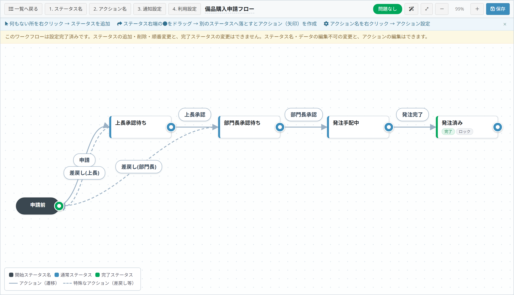
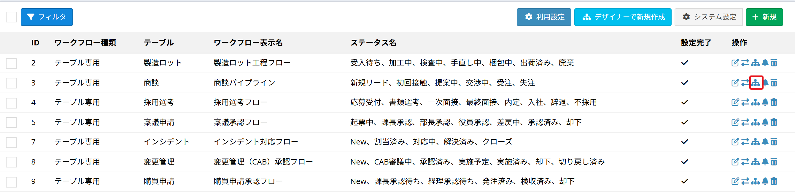
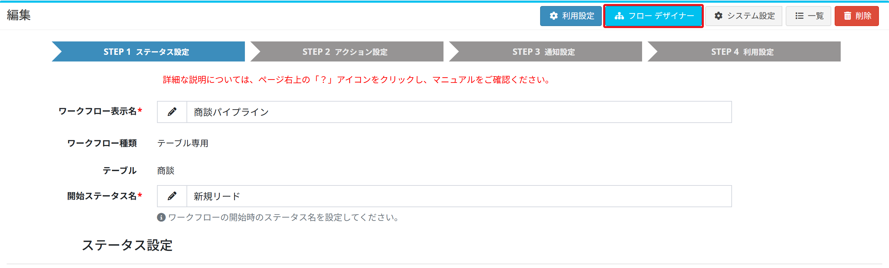
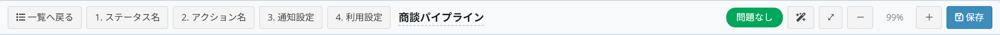
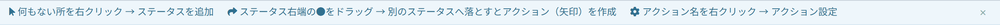
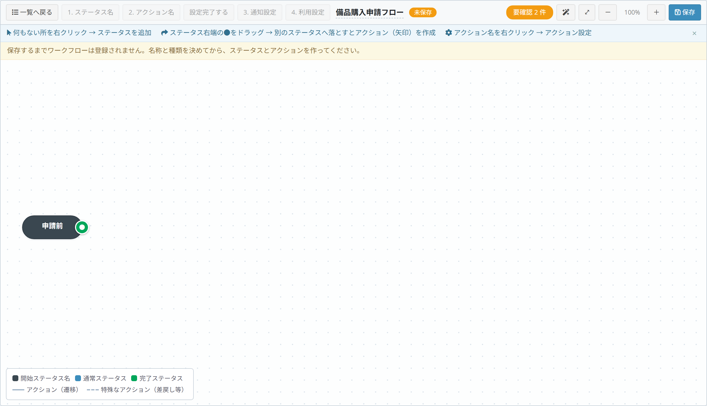
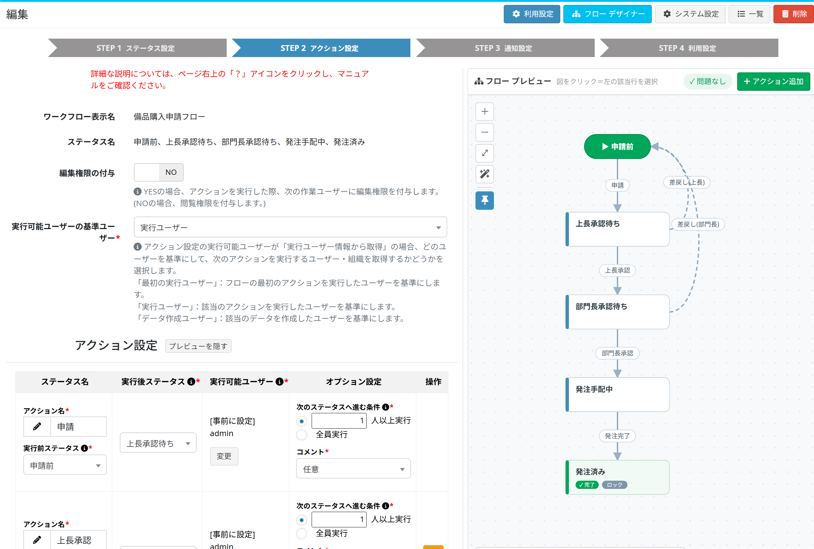

# Ablauf-Designer

Auf dieser Seite können Sie die Status (Zustände) und Aktionen (Bedienungen) eines Workflows direkt im Ablaufdiagramm erstellen und bearbeiten.

## Was ist der Ablauf-Designer?

In den [Workflow-Einstellungen](/de/workflow_setting) stellen Sie die Status in der Tabelle von „Schritt 1“ und die Aktionen in der Tabelle von „Schritt 2“ ein.  
Wenn Sie nur mit den Tabellen arbeiten, sind folgende Punkte schwer zu erkennen.

- Von welchem Status es zu welchem Status weitergeht
- Ob es einen Status gibt, der eine Sackgasse ist
- Ob die Wege für Zurückweisungen richtig verbunden sind

Im Ablauf-Designer erstellen und bearbeiten Sie diesen Inhalt, **während Sie ihn als Diagramm sehen**.

- Gespeichert wird am selben Ort wie in Schritt 1 und Schritt 2. Was Sie im Designer erstellen, erscheint unverändert in den Tabellen von Schritt 1 und 2
- Sie können auf jeder der beiden Seiten einstellen. Sie können auch im Diagramm erstellen und feine Bedingungen in der Tabelle anpassen

## Seite öffnen

### 1. Einen vorhandenen Workflow im Diagramm bearbeiten

Klicken Sie in der Liste der Workflow-Einstellungen in der betreffenden Zeile auf das Symbol [Ablauf-Designer].

Auch auf den Seiten von Schritt 1 und Schritt 2 öffnen Sie ihn oben rechts mit der Schaltfläche [Ablauf-Designer].

### 2. Einen neuen Workflow aus dem Diagramm erstellen

Klicken Sie in der Liste der Workflow-Einstellungen oben rechts auf die Schaltfläche [Mit Designer erstellen].

## Aufbau der Seite

### Symbolleiste

| Punkt | Inhalt |
| --- | --- |
| Zurück zur Liste | Kehrt zur Liste der Workflow-Einstellungen zurück |
| 1. Statusname / 2. Aktionsname | Wechselt zu den Einstellseiten in Tabellenform (Schritt 1, Schritt 2) |
| Einstellung abschließen | Schließt die Einstellung des Workflows ab. Die Schaltfläche steht rechts von „2. Aktionsname“ und erscheint nach dem Abschließen nicht mehr. Einzelheiten finden Sie unter [Workflow-Einstellungen](/de/workflow_setting) |
| 3. Benachrichtigungseinstellungen / 4. Verwendungseinstellungen | Nach dem Abschließen der Einstellung verfügbar |
| (Name des Workflows) | Der Name des Workflows, den Sie bearbeiten |
| Keine Probleme / ○ Punkt(e) zu prüfen | Das Ergebnis der Eingabeprüfung. Mit einem Klick sehen Sie den Inhalt |
| Automatisch anordnen | Ordnet die Positionen der Knoten automatisch neu an |
| ⤢ (Einpassen) | Zeigt das Diagramm so an, dass es ganz zu sehen ist |
| - / + | Ändert den Anzeigemaßstab |
| Speichern | Speichert die Änderungen |

### Hinweise zur Bedienung

Oben auf der Seite stehen immer die wichtigsten Bedienschritte.

### Legende

| Anzeige | Bedeutung |
| --- | --- |
| Schwarzer Knoten | Startstatus |
| Blauer Knoten | Normaler Status |
| Grüner Knoten | Abschlussstatus |
| Pfeil mit durchgezogener Linie | Aktion (Bedienung, die zum nächsten Status führt) |
| Pfeil mit gestrichelter Linie | Sonderaktion (Bedienung wie eine Zurückweisung, die nicht zu den Bearbeitern zählt) |

Die Marken „Fertig“ und „Gesperrt“ an einem Knoten bedeuten Abschlussstatus bzw. Daten nicht bearbeitbar.

## Grundlegende Bedienung

### Status hinzufügen

Klicken Sie im Diagramm **mit der rechten Maustaste auf eine leere Fläche** und wählen Sie [Status hinzufügen].

| Punkt | Inhalt |
| --- | --- |
| Status hinzufügen | Erstellt an der angeklickten Stelle einen neuen Status |
| Automatisch anordnen | Ordnet die Positionen der Knoten automatisch neu an |
| Einpassen | Zeigt das Diagramm so an, dass es ganz zu sehen ist |

### Aktion (Pfeil) erstellen

**Ziehen Sie den Punkt ● am rechten Rand** eines Status und lassen Sie ihn über einem anderen Status los.  
Es entsteht eine Aktion (ein Pfeil), die die 2 Status verbindet.

Wenn Sie über einer leeren Fläche loslassen, können Sie „Neuen Status erstellen und verbinden“ wählen. So erstellen Sie den Status und die Aktion in einem Zug.

### Einstellungen einer Aktion ändern

Klicken Sie **mit der rechten Maustaste auf den Aktionsnamen** und wählen Sie [Aktionseinstellungen].

| Punkt | Inhalt |
| --- | --- |
| Aktionseinstellungen | Hier stellen Sie den Aktionsnamen, die ausführenden Benutzer und die Optionen ein |
| Aktion löschen | Löscht diesen Pfeil (diese Aktion) |

### Einstellungen eines Status ändern

Mit einem **Rechtsklick auf einen Status** können Sie den Statusnamen ändern, den Status als Abschlussstatus festlegen und ihn löschen.

※ Ein Status, in dem sich Daten befinden, kann nicht gelöscht werden. Beim Versuch erscheint „In Verwendung, kann nicht gelöscht werden“.  
※ Der Startstatus kann nicht gelöscht werden. Sie können nur seinen Namen ändern.

### Anordnung des Diagramms ordnen

- Knoten können Sie durch Ziehen frei bewegen
- Mit [Automatisch anordnen] werden sie automatisch so angeordnet, dass der Ablauf von links nach rechts verläuft
- Mit [⤢ (Einpassen)] wird der Maßstab so gewählt, dass das ganze Diagramm auf die Seite passt

### Speichern

Klicken Sie oben rechts auf die Schaltfläche [Speichern].  
Bis zum Speichern stehen die Änderungen nicht in der Datenbank. Wenn es nicht gespeicherte Änderungen gibt, steht in der Symbolleiste „Nicht gespeichert“.

※ Wenn Sie die Seite ohne Speichern verlassen möchten, erscheint eine Rückfrage.  
※ Wenn eine andere Person denselben Workflow vorher aktualisiert hat, erscheint „Dieser Workflow wurde an anderer Stelle aktualisiert“. Laden Sie die Seite neu und speichern Sie dann noch einmal.

## Zu prüfen (Eingabeprüfung)

Rechts in der Symbolleiste steht immer das Ergebnis der Eingabeprüfung.

- Ohne Probleme: grün „Keine Probleme“
- Mit Problemen: orange „○ Punkt(e) zu prüfen“

Mit einem Klick erscheint der Inhalt als Liste. Mit einem weiteren Klick springen Sie zur betreffenden Stelle.

Die wichtigsten Prüfungen sind folgende.

| Meldung | Bedeutung |
| --- | --- |
| Der Workflow-Name ist leer. So kann nicht gespeichert werden. | Ohne Namen kann nicht gespeichert werden |
| Der Workflow-Name ist länger als 30 Zeichen. So kann nicht gespeichert werden. | Der Name darf höchstens 30 Zeichen haben |
| Bitte wählen Sie den Workflow-Typ. / Bitte wählen Sie die Zieltabelle. | Wählen Sie den Workflow-Typ und bei „Nur Tabelle“ die Zieltabelle |
| Der Name des Startstatus ist leer. So kann nicht gespeichert werden. | Geben Sie den Namen des Startstatus ein |
| Es gibt keine Aktion, die bei „○○“ beginnt. | Vom Startstatus führt kein Pfeil weiter |
| Es gibt keinen Status. / Es gibt keine Aktion. | Fügen Sie mindestens 1 Status und 1 Aktion hinzu |
| Bitte legen Sie mindestens einen Abschlussstatus fest. | Es muss genau 1 Abschlussstatus geben |
| Keine Aktion führt zu „○○“. | Es gibt einen Status, der von nirgendwo erreicht wird |
| Von „○○“ geht keine Aktion aus, und es ist kein Abschlussstatus. | Es gibt einen Status, der eine Sackgasse ist |
| Für die Aktion „○○“ ist kein Status vor der Ausführung / nach der Ausführung festgelegt. | Wählen Sie beide Status, vor und nach der Aktion |
| Die Aktion „○○“ verweist auf einen gelöschten Status. | Ein Pfeil zeigt auf einen Status, den es nicht gibt |
| Es gibt eine Zeile ohne Aktionsnamen. So kann nicht gespeichert werden. | Jede Aktion braucht einen Namen |
| Der Aktionsname von „○○“ ist länger als 30 Zeichen. | Der Aktionsname darf höchstens 30 Zeichen haben |
| Die Aktion „○○“ hat vor und nach der Ausführung denselben Status. So kann nicht gespeichert werden. | Ein Pfeil zurück zum selben Status ist nicht möglich |
| Für die Aktion „○○“ sind keine ausführenden Benutzer festgelegt. So kann nicht gespeichert werden. | Legen Sie fest, wer die Aktion ausführen kann |
| Die Personenanzahl unter „Bedingung für den Wechsel zum nächsten Status“ der Aktion „○○“ muss eine Zahl von 0 bis 10 sein. | Korrigieren Sie die Personenanzahl |

Zu den ausführenden Benutzern einer Aktion erscheint auch in diesen Fällen eine Meldung: wenn „Sonderaktion“ und „Auswahl durch den Ausführenden der vorherigen Aktion“ kombiniert sind; wenn bei der ersten Aktion „Auswahl durch den Ausführenden der vorherigen Aktion“ oder etwas anderes als „Vorab festlegen“ angegeben ist; wenn bei demselben Status vorher „Auswahl durch den Ausführenden der vorherigen Aktion“ zusammen mit einer anderen Einstellung verwendet wird.

„Keine Aktion führt zu …“ und „Von … geht keine Aktion aus …“ sind Warnungen. Sie verhindern das Speichern nicht. Alle anderen Meldungen verhindern das Speichern.

## Mit Designer erstellen

Wenn Sie die Seite über [Mit Designer erstellen] öffnen, erscheint zuerst der Dialog „Grundinformationen“.

| Punkt | Inhalt |
| --- | --- |
| Anzeigename des Workflows | Der Name des Workflows (höchstens 30 Zeichen) |
| Workflow-Typ | „Allgemein“ oder „Nur Tabelle“ |
| Tabelle | Die Zieltabelle des Workflows. Nur beim Typ „Nur Tabelle“ einzugeben |
| Name des Startstatus | Der Name des ersten Status (zum Beispiel „In Erstellung“ oder „Vor dem Antrag“) |

Nach der Eingabe und [Speichern] erscheint der Startstatus links im Diagramm.

Danach fügen Sie mit einem Rechtsklick Status hinzu und verbinden sie durch Ziehen des Punkts ● mit Aktionen.

> **Der Workflow wird erst beim Speichern registriert.**  
> Wenn Sie Status und Aktionen erstellen und speichern, wird [Einstellung abschließen] in der Symbolleiste anklickbar. Dann können Sie zu Schritt 3 (Benachrichtigungseinstellungen) und Schritt 4 (Verwendungseinstellungen) weitergehen.

## Die „Ablaufvorschau“ in Schritt 2

Auch auf der Seite von Schritt 2 (Aktionseinstellungen) steht rechts ein Ablaufdiagramm.

- Wenn Sie die Tabelle bearbeiten, wird das Diagramm sofort aktualisiert
- Wenn Sie im Diagramm auf eine Aktion klicken, wird links in der Tabelle die zugehörige Zeile ausgewählt
- Mit [+ Aktion hinzufügen] fügen Sie der Tabelle eine Zeile hinzu
- [○ Punkt(e) zu prüfen] ist dieselbe Eingabeprüfung wie im Designer

### Anordnung speichern (Schaltfläche mit der Stecknadel)

Schaltet um, ob die Anordnung der bewegten Knoten festgehalten wird.

- Wenn Sie die Seite speichern, während die Stecknadel gedrückt ist, wird die jetzige Anordnung festgehalten. Beim nächsten Öffnen sehen Sie dieselbe Anordnung
- Ist sie nicht gedrückt, wird die Anordnung nicht gespeichert. Das Diagramm wird jedes Mal automatisch angeordnet

### Vorschau ausblenden

Wenn Sie das Diagramm nicht brauchen, blenden Sie es mit [Vorschau ausblenden] aus. Dann haben die Eingabefelder der Tabelle mehr Platz.

## Hinweise

#### Einen Workflow mit abgeschlossener Einstellung bearbeiten
Bei einem Workflow, für den [Einstellung abschließen] ausgeführt wurde, sind die Status wie in Schritt 1 festgelegt.

- Status hinzufügen, löschen und umsortieren sowie den Abschlussstatus ändern ist nicht möglich. [Status hinzufügen] und [Status löschen] im Kontextmenü zeigen „Gesperrt, da die Einstellung abgeschlossen ist“ und lassen sich nicht wählen.
- Den Statusnamen, „Daten nicht bearbeitbar“ und alle Aktionen können Sie weiterhin bearbeiten.

Unabhängig davon gilt: **Ein Status, der von Daten im Antrag oder im Verlauf verwendet wird, kann auch vor dem Abschließen der Einstellung nicht gelöscht werden.**

#### Abschlussstatus
Bei einem Workflow vor dem Abschließen der Einstellung gibt es **genau 1** Abschlussstatus.

- Es kann nur 1 Abschlussstatus festgelegt werden. Gibt es mehrere, entfernen Sie alle bis auf 1 und speichern Sie dann.
- Auch ohne Abschlussstatus kann nicht gespeichert werden.
- Auch beim Speichern auf der Seite von Schritt 1 wird nur der 1 Status in der letzten Zeile der Tabelle zum Abschlussstatus.

Ein Workflow mit abgeschlossener Einstellung kann mehrere Abschlussstatus haben, zum Beispiel wenn er aus einer Vorlage stammt. Diese bleiben dann unverändert erhalten und lassen sich im Ablauf-Designer nicht ändern.

#### Filterbedingungen (Verzweigungen)
Die Filterbedingungen einer Aktion stellen Sie auf der Seite von Schritt 2 ein.  
Auch wenn Sie im Ablauf-Designer speichern, gehen eingestellte Bedingungen nicht verloren. Im Diagramm erscheinen die Verzweigungen als „Bedingung 1“ und „Bedingung 2“.

## Verwandte Themen

- [Workflow-Einstellungen](/de/workflow_setting)
- [Workflow-Beispiele](/de/workflow_example)
- [Workflow ausführen](/de/workflow_execution)
- [Kanban-Ansicht](/de/view_kanban)
