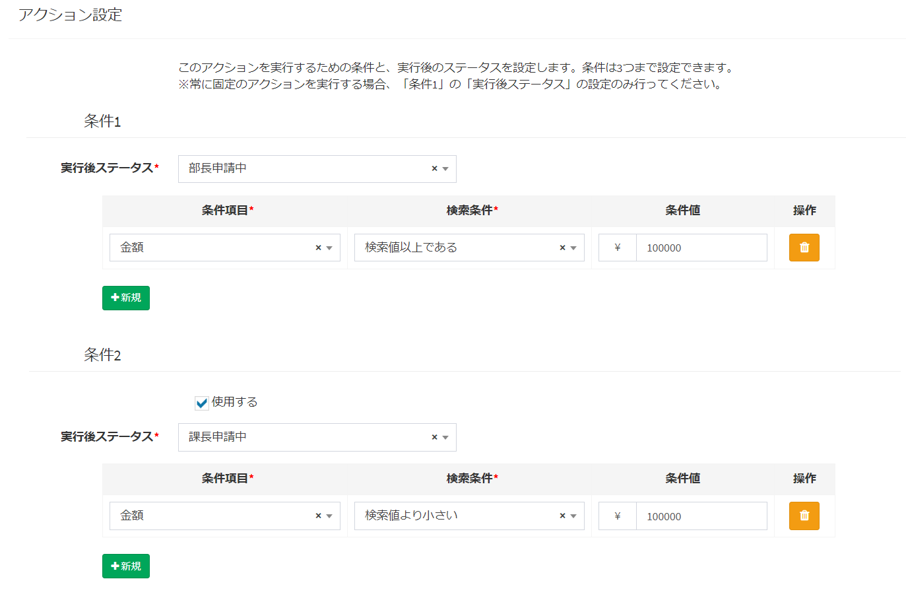
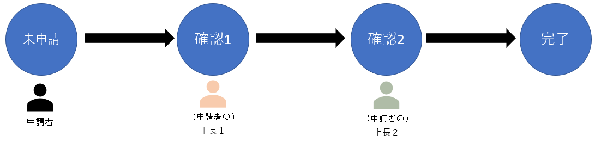
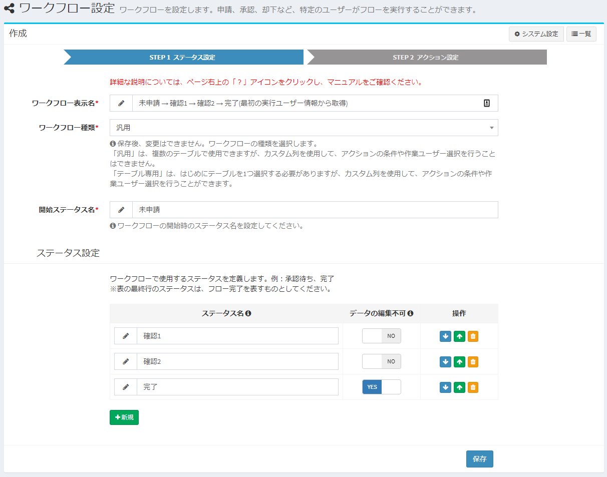
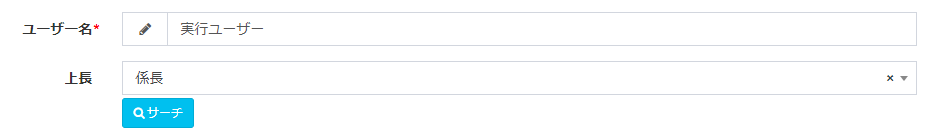
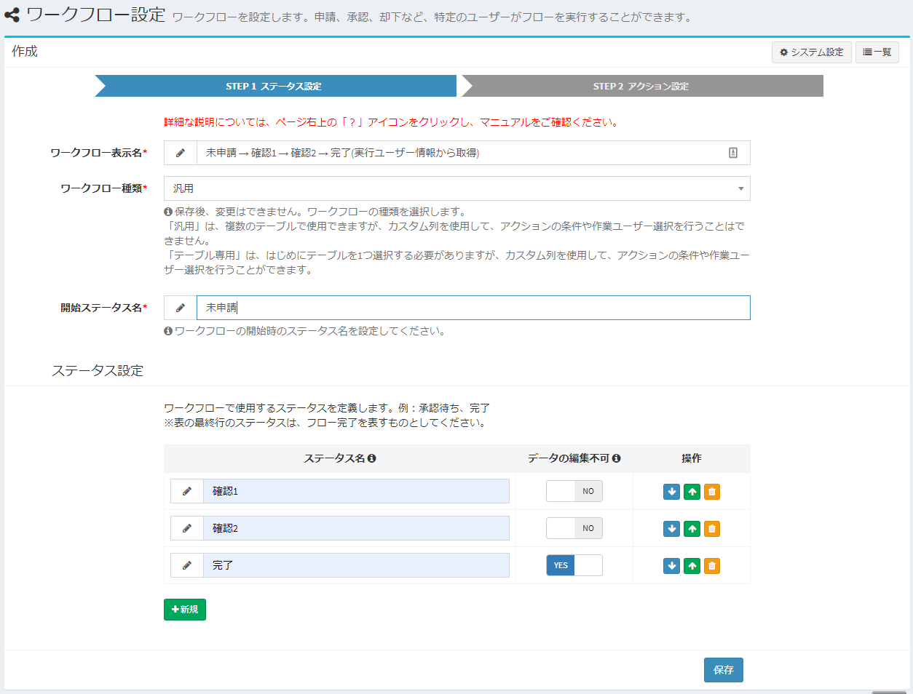

# Workflow-Beispiele
Hier finden Sie Beispiele für Workflow-Einstellungen. Wählen Sie das Beispiel, das Ihrem gewünschten Ablauf am nächsten kommt, und geben Sie die Werte genauso ein.  
Was die einzelnen Punkte bedeuten, lesen Sie unter [Workflow-Einstellungen](/de/workflow_setting).

| Gewünschter Ablauf | Beispiel |
|---|---|
| Ein einfacher Ablauf: nur beantragen und genehmigen oder ablehnen | [Antrag → Genehmigung/Ablehnung](/de/workflow_example?id=example1) |
| Je nach Betrag der beantragten Daten genehmigt eine andere Person (Aktion) | [Antrag → Genehmigung durch Bereichsleiter oder Abteilungsleiter/Ablehnung](/de/workflow_example?id=example2) |
| In 2 Stufen prüfen. Beide Prüfer werden aus den Vorgesetzten-Spalten des Antragstellers bestimmt | [Nicht beantragt → Prüfung 1 → Prüfung 2 → Abgeschlossen (aus Informationen des ersten ausführenden Benutzers ermitteln)](/de/workflow_example?id=example4) |
| In 2 Stufen prüfen. Der 2. Prüfer ist der Vorgesetzte der Person, die als 1. geprüft hat | [Nicht beantragt → Prüfung 1 → Prüfung 2 → Abgeschlossen (aus Informationen des ausführenden Benutzers ermitteln)](/de/workflow_example?id=example5) |
| Daten sperren (nicht bearbeitbar, nicht löschbar) | [Daten sperren](/de/workflow_example?id=example3) |

<h2 id="example1"><a href="#/de/workflow_example?id=example1" data-id="example1" class="anchor">Antrag → Genehmigung/Ablehnung</a></h2>

So richten Sie einen einfachen Ablauf ein: Daten beantragen und genehmigen oder ablehnen.  

  
- Der Benutzer stellt bei der Verwaltung einen Antrag
- Die Verwaltung genehmigt den Antrag oder lehnt ihn ab
- Genehmigte Daten können danach nicht mehr geändert werden

### Schritt 1: Statuseinstellungen

  

- **Anzeigename des Workflows**: beliebiger Name

- **Workflow-Typ**: „Allgemein“

- **Name des Startstatus**: „Nicht ausgeführt“

- **Status, Zeile 1**  
Statusname: „Beantragt“  
Daten nicht bearbeitbar: „YES“  

- **Status, Zeile 2**  
Statusname: „Abgeschlossen“  
Daten nicht bearbeitbar: „YES“  

### Schritt 2: Aktionseinstellungen

  

- **Aktionseinstellungen, Zeile 1**  
Aktionsname: „Antrag“  
Status vorher: „Nicht ausgeführt“  
Aktionseinstellungen > Status nachher: „Beantragt“  
Ausführende Benutzer: „Erstellt von“  
Optionseinstellungen > Bedingung für den Wechsel zum nächsten Status: „1 oder mehr Personen führen aus“  
Optionseinstellungen > Kommentar: „Optional“  

- **Aktionseinstellungen, Zeile 2**  
Aktionsname: „Genehmigung“  
Status vorher: „Beantragt“  
Aktionseinstellungen > Status nachher: „Abgeschlossen“  
Ausführende Benutzer: „Verwaltungsgruppe“ ※ Legen Sie vorher die Organisation „Verwaltungsgruppe“ an  
Optionseinstellungen > Bedingung für den Wechsel zum nächsten Status: „2 oder mehr Personen führen aus“  
Optionseinstellungen > Kommentar: „Optional“  
Optionseinstellungen > Sonderaktion: kein Häkchen  

- **Aktionseinstellungen, Zeile 3**  
Aktionsname: „Ablehnung“  
Status vorher: „Beantragt“  
Aktionseinstellungen > Status nachher: „Nicht ausgeführt“  
Ausführende Benutzer: „Verwaltungsgruppe“ ※ Legen Sie vorher die Organisation „Verwaltungsgruppe“ an  
Optionseinstellungen > Bedingung für den Wechsel zum nächsten Status: „1 oder mehr Personen führen aus“  
Optionseinstellungen > Kommentar: „Erforderlich“  
Optionseinstellungen > Sonderaktion: Häkchen gesetzt  

<h2 id="example2"><a href="#/de/workflow_example?id=example2" data-id="example2" class="anchor">Antrag → Genehmigung durch Bereichsleiter oder Abteilungsleiter/Ablehnung</a></h2>

So richten Sie es ein, wenn Aktion und Verantwortlicher vom Betrag der beantragten Daten abhängen sollen.    

  
- Der Benutzer beantragt Spesen
- Wenn der „Betrag“ der Antragsdaten 100.000 Yen oder mehr beträgt, geht der Antrag automatisch an den Bereichsleiter, unter 100.000 Yen an den Abteilungsleiter
- Der Bereichsleiter oder der Abteilungsleiter genehmigt den Antrag oder lehnt ihn ab
- Genehmigte Daten können danach nicht mehr geändert werden

### Schritt 1: Statuseinstellungen

  

- **Anzeigename des Workflows**: beliebiger Name

- **Workflow-Typ**: „Nur Tabelle“

- **Tabelle**: die Tabelle wählen, in der der Workflow ausgeführt wird

- **Name des Startstatus**: „Nicht beantragt“

- **Status, Zeile 1**  
Statusname: „Antrag beim Bereichsleiter“  
Daten nicht bearbeitbar: „YES“  

- **Status, Zeile 2**  
Statusname: „Antrag beim Abteilungsleiter“  
Daten nicht bearbeitbar: „YES“  

- **Status, Zeile 3**  
Statusname: „Abgeschlossen“  
Daten nicht bearbeitbar: „YES“  

### Schritt 2: Aktionseinstellungen

  

- **Aktionseinstellungen, Zeile 1**  
Aktionsname: „Antrag“  
Status vorher: „Nicht beantragt“  
Aktionseinstellungen > Status nachher: siehe Bild unten  

  
>Wenn der Spaltentyp der Bedingung „Auswahl (aus Tabelle)“ ist, können Sie den Text, der als Bedingungswert angezeigt wird, in den [Einstellungen der Überschriftenspalten](/de/table) ändern.

Ausführende Benutzer: „Erstellt von“  
Optionseinstellungen > Bedingung für den Wechsel zum nächsten Status: „1 oder mehr Personen führen aus“  
Optionseinstellungen > Kommentar: „Optional“  

- **Aktionseinstellungen, Zeile 2**  
Aktionsname: „Genehmigung“  
Status vorher: „Antrag beim Bereichsleiter“  
Aktionseinstellungen > Status nachher: „Abgeschlossen“  
Ausführende Benutzer: „Bereichsleiter“ ※ Legen Sie vorher die Organisation „Bereichsleiter“ an  
Optionseinstellungen > Bedingung für den Wechsel zum nächsten Status: „1 oder mehr Personen führen aus“  
Optionseinstellungen > Kommentar: „Optional“  
Optionseinstellungen > Sonderaktion: kein Häkchen  

- **Aktionseinstellungen, Zeile 3**  
Aktionsname: „Genehmigung“  
Status vorher: „Antrag beim Abteilungsleiter“  
Aktionseinstellungen > Status nachher: „Abgeschlossen“  
Ausführende Benutzer: „Abteilungsleiter“ ※ Legen Sie vorher die Organisation „Abteilungsleiter“ an  
Optionseinstellungen > Bedingung für den Wechsel zum nächsten Status: „1 oder mehr Personen führen aus“  
Optionseinstellungen > Kommentar: „Optional“  
Optionseinstellungen > Sonderaktion: kein Häkchen  

- **Aktionseinstellungen, Zeile 4**  
Aktionsname: „Ablehnung“  
Status vorher: „Antrag beim Bereichsleiter“  
Aktionseinstellungen > Status nachher: „Nicht beantragt“  
Ausführende Benutzer: „Bereichsleiter“ ※ Legen Sie vorher die Organisation „Bereichsleiter“ an  
Optionseinstellungen > Bedingung für den Wechsel zum nächsten Status: „1 oder mehr Personen führen aus“  
Optionseinstellungen > Kommentar: „Erforderlich“  
Optionseinstellungen > Sonderaktion: Häkchen gesetzt  

- **Aktionseinstellungen, Zeile 5**  
Aktionsname: „Ablehnung“  
Status vorher: „Antrag beim Abteilungsleiter“  
Aktionseinstellungen > Status nachher: „Nicht beantragt“  
Ausführende Benutzer: „Abteilungsleiter“ ※ Legen Sie vorher die Organisation „Abteilungsleiter“ an  
Optionseinstellungen > Bedingung für den Wechsel zum nächsten Status: „1 oder mehr Personen führen aus“  
Optionseinstellungen > Kommentar: „Erforderlich“  
Optionseinstellungen > Sonderaktion: Häkchen gesetzt  

<h2 id="example4"><a href="#/de/workflow_example?id=example4" data-id="example4" class="anchor">Nicht beantragt → Prüfung 1 → Prüfung 2 → Abgeschlossen (aus Informationen des ersten ausführenden Benutzers ermitteln)</a></h2>

So richten Sie den Ablauf „Nicht beantragt → Prüfung 1 → Prüfung 2 → Abgeschlossen“ ein. Die ausführenden Benutzer der Aktionen werden „aus Informationen des ersten ausführenden Benutzers ermittelt“.   

  
- Die Aktion „Prüfung 1“ kann der Benutzer ausführen, der beim Antragsteller (dem ersten ausführenden Benutzer des Ablaufs) in der Spalte „Vorgesetzter 1“ steht
- Die Aktion „Prüfung 2“ kann der Benutzer ausführen, der beim Antragsteller (dem ersten ausführenden Benutzer des Ablaufs) in der Spalte „Vorgesetzter 2“ steht

### Schritt 0: Spalten der Benutzertabelle einstellen

Fügen Sie zuerst in den Einstellungen der benutzerdefinierten Spalten der Tabelle „Benutzer“ die folgenden Spalten hinzu.

  

- Spalte 1:
    - Spaltenname (alphanumerisch): „boss1“
    - Anzeigename der Spalte: „Vorgesetzter 1“
    - Suchindex: YES
    - Spaltentyp: Benutzer

- Spalte 2:
    - Spaltenname (alphanumerisch): „boss2“
    - Anzeigename der Spalte: „Vorgesetzter 2“
    - Suchindex: YES
    - Spaltentyp: Benutzer
  
Bearbeiten Sie danach die Daten der einzelnen Benutzer und tragen Sie die Spalten „Vorgesetzter 1“ und „Vorgesetzter 2“ ein.

  

※ Wenn beim Benutzer „Ausführender Benutzer“ die Daten wie oben eingetragen sind, läuft der Workflow wie folgt ab.

  

### Schritt 1: Statuseinstellungen

- **Anzeigename des Workflows**: beliebiger Name

- **Workflow-Typ**: „Allgemein“

- **Name des Startstatus**: „Nicht beantragt“

- **Status, Zeile 1**  
Statusname: „Prüfung 1“  
Daten nicht bearbeitbar: „NO“  

- **Status, Zeile 2**  
Statusname: „Prüfung 2“  
Daten nicht bearbeitbar: „NO“  

- **Status, Zeile 3**  
Statusname: „Abgeschlossen“  
Daten nicht bearbeitbar: „YES“  

### Schritt 2: Aktionseinstellungen

  

- **Gemeinsame Einstellungen**  
Bezugsbenutzer für ausführende Benutzer: „Erster ausführender Benutzer“  

- **Aktionseinstellungen, Zeile 1**  
Aktionsname: „Aktion 1“  
Status vorher: „Nicht beantragt“  
Status nachher: Prüfung 1  
Ausführende Benutzer: „Erstellt von“  
Optionseinstellungen > Bedingung für den Wechsel zum nächsten Status: „1 oder mehr Personen führen aus“  
Optionseinstellungen > Kommentar: „Optional“  

- **Aktionseinstellungen, Zeile 2**  
Aktionsname: „Aktion 2“  
Status vorher: „Prüfung 1“  
Status nachher: „Prüfung 2“  
Ausführende Benutzer: (Aus Informationen des ausführenden Benutzers ermitteln) Vorgesetzter 1  
Optionseinstellungen > Bedingung für den Wechsel zum nächsten Status: „1 oder mehr Personen führen aus“  
Optionseinstellungen > Kommentar: „Optional“  
Optionseinstellungen > Sonderaktion: kein Häkchen  

- **Aktionseinstellungen, Zeile 3**  
Aktionsname: „Aktion 3“  
Status vorher: „Prüfung 2“  
Status nachher: „Abgeschlossen“  
Ausführende Benutzer: (Aus Informationen des ausführenden Benutzers ermitteln) Vorgesetzter 2  
Optionseinstellungen > Bedingung für den Wechsel zum nächsten Status: „1 oder mehr Personen führen aus“  
Optionseinstellungen > Kommentar: „Optional“  
Optionseinstellungen > Sonderaktion: kein Häkchen  

#### Zur Information: der Dialog nach einem Klick auf die Schaltfläche „Ändern“ bei „Ausführende Benutzer“

  

<h2 id="example5"><a href="#/de/workflow_example?id=example5" data-id="example5" class="anchor">Nicht beantragt → Prüfung 1 → Prüfung 2 → Abgeschlossen (aus Informationen des ausführenden Benutzers ermitteln)</a></h2>

So richten Sie den Ablauf „Nicht beantragt → Prüfung 1 → Prüfung 2 → Abgeschlossen“ ein. Die ausführenden Benutzer der Aktionen werden „aus Informationen des ausführenden Benutzers ermittelt“.   

  
- Die Aktion „Prüfung 1“ kann der Benutzer ausführen, der beim Antragsteller (dem ersten ausführenden Benutzer des Ablaufs) in der Spalte „Vorgesetzter“ steht
- Die Aktion „Prüfung 2“ kann der Benutzer ausführen, der bei dem Benutzer, der die Aktion „Prüfung 1“ ausgeführt hat, in der Spalte „Vorgesetzter“ steht

### Schritt 0: Spalten der Benutzertabelle einstellen

Fügen Sie zuerst in den Einstellungen der benutzerdefinierten Spalten der Tabelle „Benutzer“ die folgende Spalte hinzu.

  

- Spalte:
    - Spaltenname (alphanumerisch): „boss“
    - Anzeigename der Spalte: „Vorgesetzter“
    - Suchindex: YES
    - Spaltentyp: Benutzer

  
Bearbeiten Sie danach die Daten der einzelnen Benutzer und tragen Sie die Spalte „Vorgesetzter“ ein.  
Stellen Sie zuerst die Daten des ersten Benutzers „Ausführender Benutzer“ wie folgt ein.

  

Stellen Sie außerdem die Daten des Benutzers „Gruppenleiter“ wie folgt ein.

  

※ Wenn die Daten wie oben eingetragen sind, läuft der Workflow wie folgt ab.

  

### Schritt 1: Statuseinstellungen

- **Anzeigename des Workflows**: beliebiger Name

- **Workflow-Typ**: „Allgemein“

- **Name des Startstatus**: „Nicht beantragt“

- **Status, Zeile 1**  
Statusname: „Prüfung 1“  
Daten nicht bearbeitbar: „NO“  

- **Status, Zeile 2**  
Statusname: „Prüfung 2“  
Daten nicht bearbeitbar: „NO“  

- **Status, Zeile 3**  
Statusname: „Abgeschlossen“  
Daten nicht bearbeitbar: „YES“  

### Schritt 2: Aktionseinstellungen

  

- **Gemeinsame Einstellungen**  
Bezugsbenutzer für ausführende Benutzer: „Ausführender Benutzer“  

- **Aktionseinstellungen, Zeile 1**  
Aktionsname: „Aktion 1“  
Status vorher: „Nicht beantragt“  
Status nachher: Prüfung 1  
Ausführende Benutzer: „Erstellt von“  
Optionseinstellungen > Bedingung für den Wechsel zum nächsten Status: „1 oder mehr Personen führen aus“  
Optionseinstellungen > Kommentar: „Optional“  

- **Aktionseinstellungen, Zeile 2**  
Aktionsname: „Aktion 2“  
Status vorher: „Prüfung 1“  
Status nachher: „Prüfung 2“  
Ausführende Benutzer: (Aus Informationen des ausführenden Benutzers ermitteln) Vorgesetzter  
Optionseinstellungen > Bedingung für den Wechsel zum nächsten Status: „1 oder mehr Personen führen aus“  
Optionseinstellungen > Kommentar: „Optional“  
Optionseinstellungen > Sonderaktion: kein Häkchen  

- **Aktionseinstellungen, Zeile 3**  
Aktionsname: „Aktion 3“  
Status vorher: „Prüfung 2“  
Status nachher: „Abgeschlossen“  
Ausführende Benutzer: (Aus Informationen des ausführenden Benutzers ermitteln) Vorgesetzter  
Optionseinstellungen > Bedingung für den Wechsel zum nächsten Status: „1 oder mehr Personen führen aus“  
Optionseinstellungen > Kommentar: „Optional“  
Optionseinstellungen > Sonderaktion: kein Häkchen  

#### Zur Information: der Dialog nach einem Klick auf die Schaltfläche „Ändern“ bei „Ausführende Benutzer“

  

<h2 id="example3"><a href="#/de/workflow_example?id=example3" data-id="example3" class="anchor">Daten sperren</a></h2>

So richten Sie es ein, wenn bestimmte Daten gesperrt werden sollen (nicht bearbeitbar, nicht löschbar).  

  
- Der Ersteller sperrt die Daten oder hebt die Sperre auf
- Gesperrte Daten können nicht geändert werden, bis die Sperre aufgehoben ist

### Schritt 1: Statuseinstellungen

  

- **Anzeigename des Workflows**: beliebiger Name

- **Workflow-Typ**: „Allgemein“

- **Name des Startstatus**: „Nicht ausgeführt“

- **Status, Zeile 1**  
Statusname: „Gesperrt“  
Daten nicht bearbeitbar: „YES“  

### Schritt 2: Aktionseinstellungen

  

- **Aktionseinstellungen, Zeile 1**  
Aktionsname: „Sperren“  
Status vorher: „Nicht ausgeführt“  
Aktionseinstellungen > Status nachher: „Gesperrt“  
Ausführende Benutzer: „Erstellt von“  
Optionseinstellungen > Bedingung für den Wechsel zum nächsten Status: „1 oder mehr Personen führen aus“  
Optionseinstellungen > Kommentar: „Optional“  

- **Aktionseinstellungen, Zeile 2**  
Aktionsname: „Sperre aufheben“  
Status vorher: „Gesperrt“  
Aktionseinstellungen > Status nachher: „Nicht ausgeführt“  
Ausführende Benutzer: „Erstellt von“  
Optionseinstellungen > Bedingung für den Wechsel zum nächsten Status: „1 oder mehr Personen führen aus“  
Optionseinstellungen > Kommentar: „Optional“  
Optionseinstellungen > Sonderaktion: Häkchen gesetzt  

