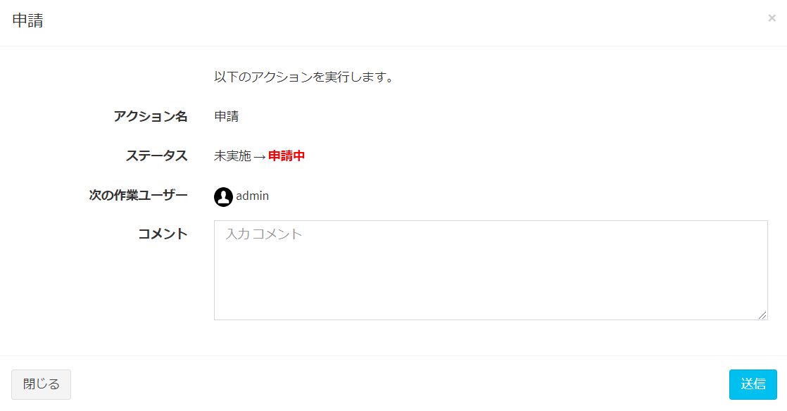

# Workflow ausführen
So führt ein Benutzer die Aktionen eines Workflows aus (Antrag, Genehmigung usw.).  
Vorher muss der Administrator die [Workflow-Einstellungen](/de/workflow_setting) vornehmen.

## Workflow durchführen
1. Wenn Sie Daten öffnen, sehen Sie den aktuellen Status und die Bearbeiter (Benutzer und Organisationen), die die nächste Aktion ausführen.
  

2. Wenn der Login-Benutzer die Berechtigung für die nächste Aktion hat, erscheinen oben rechts auf der Seite die Aktionsschaltflächen.  
  

3. Nach einem Klick auf eine Schaltfläche erscheint der Dialog zur Bestätigung der Aktion.  
  

   - Aktionsname  
   Der Name der Aktion, die Sie jetzt ausführen.  

   - Status  
   Der Status vor und nach dem Ausführen dieser Aktion.  

   - Nächste Bearbeiter  
   Die Bearbeiter (Benutzer und Organisationen) nach dem Ausführen dieser Aktion.  

   - Kommentar  
   Geben Sie einen Kommentar zur Aktion ein.  

4. Wenn der Inhalt stimmt, klicken Sie auf [Absenden]. Die Aktion wird ausgeführt.

5. Nach dem Ausführen der Aktion ändern sich „Aktueller Status“ und „Aktuelle Bearbeiter“.  
※ Je nach Workflow-Einstellung erscheint bei „Aktueller Status“ ein Schlosssymbol. Dann sind die Daten gesperrt und können nicht bearbeitet oder gelöscht werden.

  

※ Ab v7.1.0 können Sie die Aktion auch für mehrere Daten, die Sie in der Datenliste angehakt haben, auf einmal ausführen. Einzelheiten finden Sie unter [Werkzeuge der Datenliste](/de/data_grid_tools).

## Offene Aufgaben prüfen
Die Daten, bei denen Sie selbst eine Aktion ausführen müssen, sehen Sie für alle Tabellen zusammen über das Symbol der offenen Aufgaben oben rechts auf der Seite oder auf der Seite „Offene Aufgaben“.  
Einzelheiten finden Sie unter [Offene Aufgaben](/de/workflow_task).

## Workflow-Daten zurücksetzen

Die Daten eines laufenden Workflows können Sie zurücksetzen. Führen Sie das aus, wenn sich ein Workflow aus irgendeinem Grund nicht mehr fortsetzen lässt.  
Das Zurücksetzen erfolgt per Befehl. Führen Sie im Stammverzeichnis des Projekts den folgenden Befehl aus.

~~~
php artisan exment:workflow-clear (Tabellenname) (ID)

# Beispiel: den Workflow-Fortschritt der Daten mit Tabellenname "estimate" und ID "6" zurücksetzen
php artisan exment:workflow-clear estimate 6

# Beispiel: den Workflow-Fortschritt der Daten mit Tabellenname "syusseki" und ID "600" zurücksetzen
php artisan exment:workflow-clear syusseki 600
~~~
