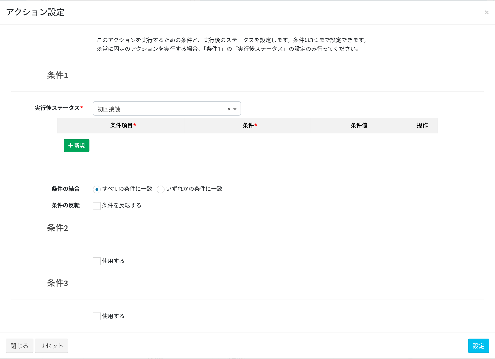
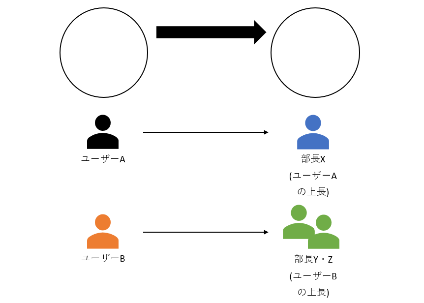
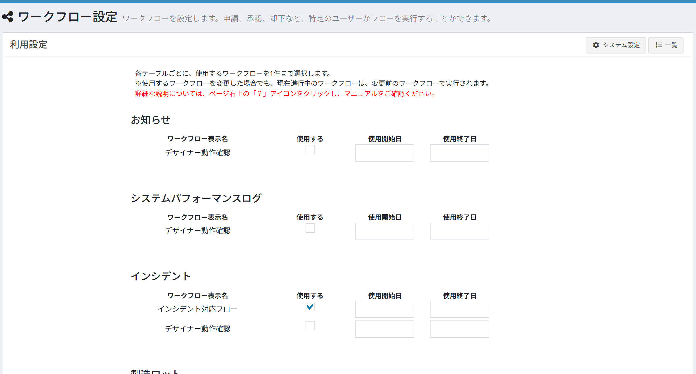

# Workflow-Einstellungen
Auf dieser Seite legen Sie einen „Workflow“ für Antrag, Genehmigung usw. an und machen ihn in Tabellen nutzbar. Die Einstellung nimmt der Systemadministrator vor.

Der Ablauf der Einstellung ist wie folgt.

1. **Schritt 1: Statuseinstellungen**: Sie legen Zustände wie „Nicht beantragt“, „Wartet auf Genehmigung“ und „Abgeschlossen“ fest.
2. **Schritt 2: Aktionseinstellungen**: Sie legen Bedienungen wie „Antrag“ und „Genehmigung“ fest und wer sie ausführen kann.
3. **Einstellung abschließen**: Sie schließen die Einstellung des Workflows ab. Danach können Sie keine Status mehr hinzufügen, löschen oder umsortieren.
4. **Schritt 3: Benachrichtigungseinstellungen**: Sie legen die Benachrichtigungen fest, die beim Ausführen des Workflows gesendet werden.
5. **Schritt 4: Verwendungseinstellungen**: Sie legen fest, in welcher Tabelle der Workflow verwendet wird.

※ Status und Aktionen können Sie auch direkt im Ablaufdiagramm erstellen und bearbeiten. Einzelheiten finden Sie unter [Ablauf-Designer](/de/workflow_design).

## Was ist ein Workflow?
Ein Workflow ist „der Ablauf einer Reihe von Arbeitsschritten“.  
Viele Arbeiten haben einen Ablauf: Wer beginnt, wer entscheidet oder bearbeitet, und wie wird abgeschlossen.  
Wenn Sie in Exment einen Workflow einrichten, können Sie zum Beispiel den folgenden Ablauf ausführen.

  
- Der Benutzer beantragt bei der Verwaltung Spesen
- Die Verwaltung genehmigt den Spesenantrag oder lehnt ihn ab
- Genehmigte Spesen können danach nicht mehr geändert werden

## Glossar
Die Begriffe, die der Workflow von Exment verwendet.

  

##### Workflow  
Der gesamte Ablauf der Arbeit, zum Beispiel Antrag und Genehmigung.  

##### Status  
Der aktuelle Zustand des Workflows.  
Beispiel: Nicht beantragt, Wartet auf Genehmigung, Abgeschlossen  

##### Aktion  
Eine Bedienung, die ein Benutzer ausführt. Durch sie wechselt ein Status in einen anderen Status.  
Beispiel: Antrag, Genehmigung, Ablehnung, Zurückweisung

##### Bearbeiter  
Der Benutzer, der mit der nächsten Aktion an der Reihe ist.

## Listenseite anzeigen
Der Systemadministrator klickt im Menü auf „Administratoreinstellungen > Workflow“.  
Die Liste der gespeicherten Workflows erscheint.

## Neu erstellen

1. Klicken Sie auf der Listenseite oben rechts auf die Schaltfläche [Neu].
2. Die Seite „Schritt 1: Statuseinstellungen“ zum Erstellen eines Workflows erscheint. Geben Sie die nötigen Angaben ein.

### Schritt 1: Statuseinstellungen
Hier legen Sie die Status des Workflows fest.

  

#### Anzeigename des Workflows ※Pflicht
- Der Name des Workflows, der auf den Seiten angezeigt wird. (Beispiel: Genehmigungsablauf)  

#### Workflow-Typ ※Pflicht
- Der Typ des Workflows, den Sie erstellen. Wählen Sie „Allgemein“ oder „Nur Tabelle“.  
※ Nach dem Erstellen lässt sich der Typ nicht mehr ändern.  
##### Allgemein  
Der Workflow kann in mehreren Tabellen verwendet werden.  
Wählen Sie diesen Typ, wenn Sie nur übliche Status und Aktionen wie „Antrag“, „Genehmigung“ und „Ablehnung“ verwenden möchten.  
##### Nur Tabelle  
Der Workflow kann nur in der Tabelle verwendet werden, die Sie beim Erstellen gewählt haben. Dafür können Sie mit den benutzerdefinierten Spalten dieser Tabelle das Ziel einer Aktion ändern.  
Beispiel: In der Tabelle „Spesenabrechnung“ wird die Aktion „Genehmigung durch den Bereichsleiter“ ausgeführt, wenn die benutzerdefinierte Spalte „Betrag“ 100.000 Yen oder mehr beträgt, und die Aktion „Genehmigung durch den Abteilungsleiter“, wenn sie unter 100.000 Yen liegt.

#### Name des Startstatus ※Pflicht
- Hier legen Sie den Namen des Status fest, in dem der Workflow noch nicht ausgeführt wurde.

#### Statuseinstellungen
- Hier definieren Sie die Einstellungen des Workflows und die Status, die verwendet werden.  
※ Der Status in der letzten Zeile der Tabelle muss den Abschluss des Ablaufs bedeuten.
##### Statusname  
Der Name des Status.
##### Daten nicht bearbeitbar  
Legt fest, ob die betreffenden Daten in diesem Status nicht bearbeitet werden können. Wenn die Daten nicht bearbeitet werden sollen, wählen Sie JA.  
Beispiel: Bei „Nicht beantragt“ dürfen die Daten bearbeitet und gelöscht werden, bei „Beantragt“ und „Abgeschlossen“ aber nicht. In diesem Fall stellen Sie „Beantragt“ und „Abgeschlossen“ auf JA.

### Schritt 2: Aktionseinstellungen

  
#### Anzeigename des Workflows  
Hier steht der Anzeigename, den Sie in den Statuseinstellungen festgelegt haben.
#### Statusname  
Hier stehen die Statusnamen, die Sie in den Statuseinstellungen festgelegt haben.
#### Bearbeitungsberechtigung erteilen  
Beim Ausführen des Workflows können Sie den „nächsten Bearbeitern“ die Bearbeitungsberechtigung geben.
#### Bezugsbenutzer für ausführende Benutzer ※Pflicht  
Legt den Benutzer fest, der als Bezug dient, wenn die ausführenden Benutzer einer Aktion „Aus Informationen des ausführenden Benutzers ermitteln“ sind. Zur Wahl stehen „Erster ausführender Benutzer“, „Ausführender Benutzer“ und „Ersteller der Daten“.

#### Aktionseinstellungen
- Hier legen Sie die Aktionen fest, die im Workflow ausgeführt werden.  
##### Aktionsname  
Der Name der Aktion.
##### Status vorher  
Legt den Status fest, in dem die Aktion ausgeführt werden kann.  
Beispiel: Wenn der Status vorher „Nicht ausgeführt“ ist, kann die Aktion bei allen Daten ausgeführt werden, deren Status „Nicht ausgeführt“ ist.  
##### Aktionseinstellungen  
Legt fest, welche Aktion ausgeführt werden kann. Mit der Schaltfläche [Ändern] ändern Sie die Einstellung.  
Der Inhalt der Einstellung hängt vom Workflow-Typ ab.  

  ※ Beim Workflow-Typ „Allgemein“:  
    Sie legen den Status nach dem Ausführen dieser Aktion fest. Wählen Sie einen anderen Status als den „Status vorher“.

  ※ Beim Workflow-Typ „Nur Tabelle“:  
Sie legen die Bedingungen für das Ausführen der Aktion und den Status danach fest. Sie können bis zu 3 Kombinationen aus Bedingung und Status festlegen.

> Wenn der Spaltentyp der Bedingung „Auswahl (aus Tabelle)“ ist, können Sie den Text, der als Bedingungswert angezeigt wird, in den [Einstellungen der Überschriftenspalten](/de/table) ändern.

#### Ausführende Benutzer  

Hier wählen Sie die Benutzer, Organisationen usw., die diese Aktion ausführen können. Mit der Schaltfläche [Ändern] ändern Sie die Einstellung.
  

##### Ausführende Benutzer: Auswahl durch den Ausführenden der vorherigen Aktion
Der Benutzer, der die Aktion ausführt, wählt jedes Mal selbst, an welche Benutzer und Organisationen es weitergeht.  
  

##### Ausführende Benutzer: Vorab festlegen
Der Administrator legt im Voraus fest, an welche Benutzer und Organisationen es weitergeht. Der Ablauf folgt dieser Einstellung.  
  

**■ Einstellpunkte**

- Benutzer  
Die angegebenen Benutzer können die Aktion ausführen.  

- Organisation  
Die Benutzer der angegebenen Organisation können die Aktion ausführen.  

- Benutzerdefinierte Spalte  
Die Benutzer oder Organisationen, die in der benutzerdefinierten Spalte der betreffenden Daten stehen, können die Aktion ausführen. Diese Funktion gibt es nur bei „Nur Tabelle“.  

- System > Erstellt von  
Der Benutzer, der die benutzerdefinierten Daten erstellt hat, kann die Aktion ausführen.

##### Ausführende Benutzer: Aus Informationen des ausführenden Benutzers ermitteln
Das Ziel wird aus den Daten des Benutzers bestimmt, der den Workflow ausführt. Es wird der Wert einer Benutzer- oder Organisationsspalte gelesen, die bei diesem Benutzer eingetragen ist (zum Beispiel der Vorgesetzte), und die Aktion geht an diese Benutzer und Organisationen.

- Beispiel 1: Wenn der Vorgesetzte von Benutzer A „Leiter X“ ist, geht die Aktion an Leiter X
- Beispiel 2: Wenn die Vorgesetzten von Benutzer B „Leiter Y“ und „Leiter Z“ sind, geht die Aktion an Leiter Y und Leiter Z
  

※ Für diese Funktion muss der Systemadministrator vorher in der Tabelle „Benutzer“ Spalten mit dem Spaltentyp „Benutzer“ oder „Organisation“ hinzufügen. Außerdem muss bei diesen Spalten „Suchindex“ auf JA stehen.

**■ Bezugsbenutzer**

Der Benutzer, der als Bezug dient, wenn die ausführenden Benutzer ermittelt werden. Er wird [pro Workflow festgelegt](/de/workflow_setting?id=Bezugsbenutzer-für-ausführende-Benutzer-Pflicht).  

- „Erster ausführender Benutzer“: Bezug ist der Benutzer, der die erste Aktion des Ablaufs ausgeführt hat.  
- „Ausführender Benutzer“: Bezug ist der Benutzer, der die betreffende Aktion ausgeführt hat.  
- „Ersteller der Daten“: Bezug ist der Benutzer, der die Daten erstellt hat.  

> Wie sich das Verhalten je nach Bezugsbenutzer unterscheidet, sehen Sie unter [Workflow-Beispiele](/de/workflow_example).

**■ Benutzerdefinierte Spalte**

Zur Auswahl stehen die Spalten „Benutzer“ und „Organisation“ der Benutzertabelle. Beim Ausführen der Aktion können die Benutzer oder Organisationen, die beim Bezugsbenutzer in dieser Spalte stehen, die nächste Aktion ausführen.  

#### Optionseinstellungen > Bedingung für den Wechsel zum nächsten Status  
Legt fest, wie viele Personen diese Aktion ausführen müssen, damit zum nächsten Status gewechselt wird.  
※ Normalerweise geht der Ablauf weiter, wenn 1 Person die Aktion ausführt. Ändern Sie diesen Wert, wenn zum Beispiel gelten soll: „nur weiter zum nächsten Status, wenn 3 oder mehr Personen genehmigt haben“ oder „nur weiter zum nächsten Status, wenn alle Benutzer der Verwaltungsorganisation genehmigt haben“.  

#### Optionseinstellungen > Kommentar  
Legt fest, ob beim Ausführen der Aktion ein Kommentar eingegeben werden kann.  
Zur Wahl stehen „Erforderlich“, „Optional“ und „Nicht verwenden“.  
※ Bei Aktionen mit „Erforderlich“ erscheint auf der Benachrichtigungskarte von [LINE](/de/line) keine Schaltfläche. Sie können nicht aus LINE ausgeführt werden.

#### Optionseinstellungen > Sonderaktion  
Wenn Sie das Häkchen setzen, zählen die „ausführenden Benutzer“ dieser Aktion nicht zu den aktuellen Bearbeitern.  
(Aktuelle Bearbeiter sind die Benutzer, die im jetzigen Status irgendeine Workflow-Aktion ausführen können.)  
Setzen Sie das Häkchen zum Beispiel bei Aktionen, mit denen der Administrator ausnahmsweise genehmigt.  
※ Wenn ein Bearbeiter nur einer „Sonderaktion“ zugewiesen ist, erhält dieser Benutzer keine Benachrichtigung. Er erscheint auch nicht unter „Aktuelle Bearbeiter“.

※ Der wichtigste Zweck: Mit einer solchen Aktion setzt der Administrator einen laufenden Workflow an den Anfang zurück oder bringt den Ablauf ausnahmsweise bis zum Abschluss.

#### Unterschied zu normalen Aktionen
| Überblick | Normal | Sonderaktion |
| ---- | ---- | ---- |
| Einstellung der ausführenden Benutzer | Keine Einschränkung | Nur „Vorab festlegen“ |
| Benachrichtigung an die betreffenden Benutzer | Wird gesendet | Wird nicht gesendet |
| Anzeige unter „Aktuelle Bearbeiter“ | Wird angezeigt | Wird nicht angezeigt |
| Anzeige unter [Offene Aufgaben](/de/workflow_task) | Wird angezeigt | Wird nicht angezeigt |

### Einstellung abschließen
Wenn Sie sowohl die Statuseinstellungen als auch die Aktionseinstellungen vorgenommen haben, erscheint oben rechts auf der Seite die Schaltfläche „Einstellung abschließen“.  

  

Mit einem Klick schließen Sie die Einstellung des Workflows ab.  
※ Nach dem Abschließen ist Folgendes nicht mehr möglich. 
- Status hinzufügen, löschen, umsortieren

### Schritt 3: Benachrichtigungseinstellungen
Schritt 3 und Schritt 4 erscheinen, nachdem Sie [Einstellung abschließen] ausgeführt haben.  
Hier legen Sie die Benachrichtigungen fest, die beim Ausführen des Workflows gesendet werden. Die Einstellpunkte finden Sie unter [Benachrichtigungen und E-Mail-Versand einstellen](/de/notify).

### Schritt 4: Verwendungseinstellungen
Hier legen Sie fest, welcher Workflow in welcher Tabelle ausgeführt wird.  
  

- Pro Tabelle erscheinen die Workflows vom Typ „Allgemein“ und die nur für diese Tabelle erstellten Workflows, soweit sie den Zustand „Einstellung abgeschlossen“ haben.

- Um einen Workflow zu verwenden, setzen Sie das Häkchen bei „Verwenden“.  

- Um Workflows nach Datum zu wechseln, tragen Sie unter „Verwendungsbeginn“ und „Verwendungsende“ ein Datum ein. Achten Sie darauf, dass sich die Zeiträume nicht überschneiden, und speichern Sie.

Damit ist die Einstellung des Workflows fertig.  
Wie Sie einen Workflow tatsächlich ausführen, lesen Sie unter [Workflow ausführen](/de/workflow_execution).

### Workflow löschen
Registrierte Workflow-Einstellungen können Sie löschen.  
Wenn Sie eine Workflow-Einstellung löschen, die bereits verwendet wird, beachten Sie bitte Folgendes.

- Die Workflow-Einstellung lässt sich nicht wiederherstellen.
- Laufende Workflows werden ungültig.
- **Auch wenn in den Statuseinstellungen „Daten nicht bearbeitbar“ auf JA steht, werden gesperrte Daten wieder bearbeitbar.**

  

### Weitere Einzelheiten

- Wenn bei „Ausführende Benutzer: Aus Informationen des ausführenden Benutzers ermitteln“ und „Bezugsbenutzer für ausführende Benutzer: Ausführender Benutzer“ unter „Optionseinstellungen > Bedingung für den Wechsel zum nächsten Status“ 2 oder mehr Personen eingestellt sind, werden die nächsten Bearbeiter ausgehend vom Benutzer ermittelt, der zuletzt ausgeführt hat.  
Beispiel: Wenn die „Bedingung für den Wechsel zum nächsten Status“ 3 Personen ist, dient nur der 3. ausführende Benutzer als Bezug für „die Benutzer, die die nächste Aktion ausführen“. Die Daten des 1. und 2. Benutzers werden nicht gelesen.

- Bei Aktionen mit demselben „Status vorher“ können „Ausführende Benutzer: Vorab festlegen“ und „Ausführende Benutzer: Auswahl durch den Ausführenden der vorherigen Aktion“ nicht gleichzeitig eingestellt werden. (Außer wenn „Ausführende Benutzer: Vorab festlegen“ eine „Sonderaktion“ ist.)

- Bei Aktionen mit demselben „Status vorher“ können „Ausführende Benutzer: Aus Informationen des ausführenden Benutzers ermitteln“ und „Ausführende Benutzer: Auswahl durch den Ausführenden der vorherigen Aktion“ nicht gleichzeitig eingestellt werden. (Außer wenn „Ausführende Benutzer: Aus Informationen des ausführenden Benutzers ermitteln“ eine „Sonderaktion“ ist.)

