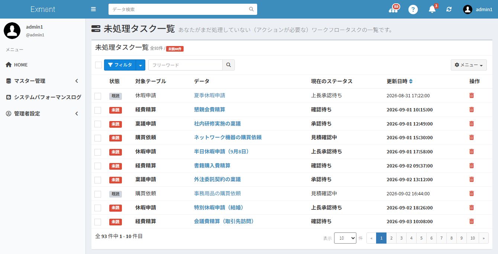
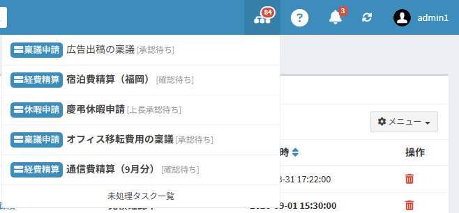
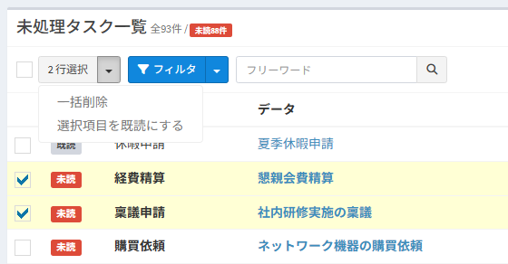
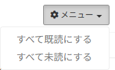
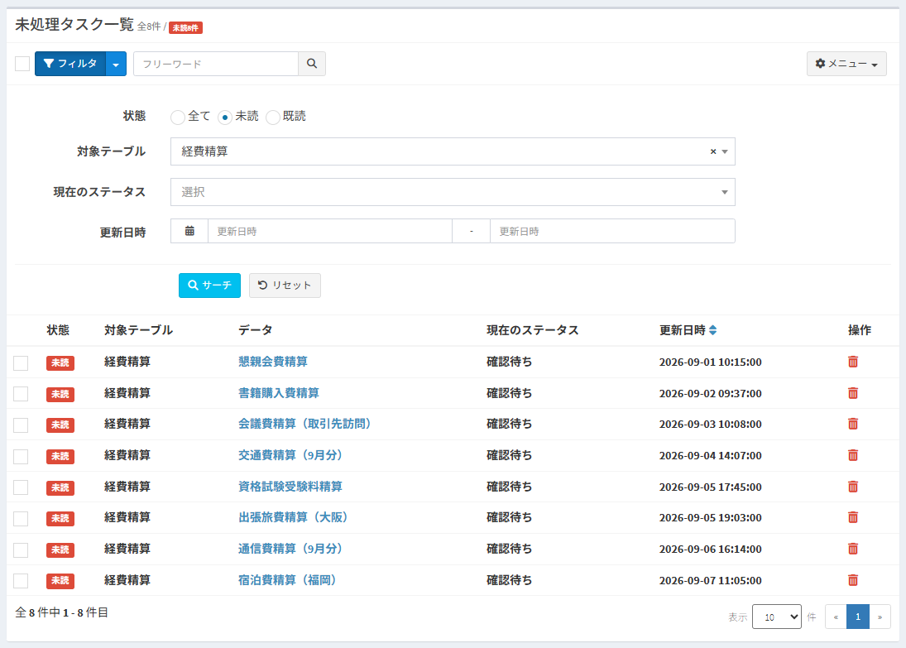
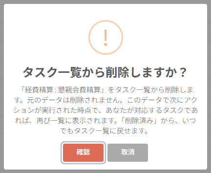
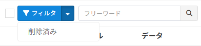
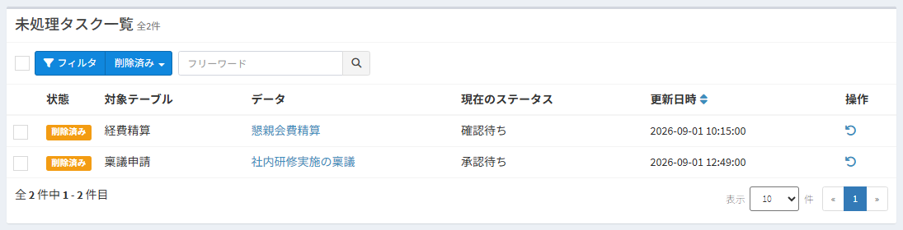

# Offene Aufgaben

Diese Seite zeigt die Workflow-Daten (Aufgaben), bei denen der Login-Benutzer eine Aktion ausführen muss, aus allen Tabellen zusammen.  
Auch über das Symbol oben rechts auf der Seite können Sie die offenen Aufgaben jederzeit prüfen.

## Was sind offene Aufgaben?

Wer mit Workflows arbeitet, kennt diese Situationen.

- Man weiß erst, in welcher Tabelle Daten auf eine Genehmigung warten, wenn man die Tabellen einzeln öffnet
- Man bemerkt nicht, dass ein Antrag angekommen ist, und die Bearbeitung bleibt stehen

Die Liste der offenen Aufgaben zeigt die **Daten, bei denen der Login-Benutzer jetzt eine Aktion ausführen kann**, tabellenübergreifend in 1 Liste.  
Wenn Sie einen Eintrag der Liste öffnen, gelangen Sie zur Detailseite der Daten und können die Aktion direkt ausführen.

### Daten, die in der Liste erscheinen

Als Aufgabe erscheinen Daten, die alle folgenden Bedingungen erfüllen.

- Es sind Daten eines Workflows mit abgeschlossener Einstellung, der auf „Verwenden“ gestellt ist
- Der Login-Benutzer oder eine Organisation, zu der er gehört, ist Bearbeiter des aktuellen Status
- Auf der Detailseite der Daten erscheint die Schaltfläche einer Aktion, die der Login-Benutzer ausführen kann
  - Daten, die die Bedingungen der Aktionseinstellungen nicht erfüllen, erscheinen nicht
  - Bei Aktionen, deren „Bedingung für den Wechsel zum nächsten Status“ 2 oder mehr Personen ist, erscheinen die Daten nicht, wenn der Login-Benutzer die Aktion schon ausgeführt hat
  - „Sonderaktionen“ zählen nicht als Aufgabe
- Der Login-Benutzer hat die Berechtigung, die Daten zu sehen

※ In der Liste stehen nur die eigenen Aufgaben des Login-Benutzers. Auch ein Systemadministrator sieht die Aufgaben anderer Benutzer nicht.  
※ Daten im Startstatus (zum Beispiel noch nicht beantragte Daten) erscheinen als Aufgabe bei den Benutzern, die die erste Aktion (zum Beispiel den Antrag) ausführen können.  
※ Auch wenn das „Verwendungsende“ des Workflows überschritten ist, erscheinen bereits laufende Daten bis zum Abschluss als Aufgabe.

## Seite öffnen

### Über das Symbol oben rechts öffnen

Nach der Anmeldung erscheint oben rechts auf der Seite das Symbol der offenen Aufgaben.  
Die rote Zahl ist die Anzahl der Aufgaben, die Sie noch nicht geöffnet haben (ungelesen).

Mit einem Klick auf das Symbol erscheinen bis zu 5 Aufgaben, die neuesten nach Aktualisierungsdatum zuerst.

- Ungelesene Aufgaben stehen in Fettschrift
- Mit einem Klick auf eine Aufgabe öffnet sich die Detailseite der Daten. Die Aufgabe gilt dann als gelesen
- Mit einem Klick auf „Offene Aufgaben“ ganz unten öffnet sich die Listenseite
- Wenn es keine Aufgaben gibt, steht dort „Sie haben keine offenen Aufgaben.“

※ Die Zahl am Symbol wird alle 5 Minuten automatisch aktualisiert. Wenn Sie in der Liste der offenen Aufgaben oder über das Symbol etwas tun (Aufgabe öffnen, als gelesen markieren, aus der Liste entfernen usw.), wird sie sofort aktualisiert. Andere Änderungen (zum Beispiel wenn ein anderer Benutzer eine Aktion ausführt) erscheinen bei der nächsten automatischen Aktualisierung. Den Abstand der Aktualisierung können Sie in den [Einstellwerten](/de/config) ändern.  
※ Wenn die Zahl der ungelesenen Aufgaben steigt, wackelt das Symbol als Hinweis.

### Über die URL öffnen

Sie können die Seite auch über die folgende URL aufrufen.

~~~
http(s)://(URL von Exment)/workflow_task
~~~

> ※ Die URL gilt für die Standardeinstellung ohne „/admin“ (Websites, die ab v7.2.1 neu installiert wurden). Wenn `ADMIN_ROUTE_PREFIX` in der `.env` einen Wert hat (bei Websites aus früheren Versionen „admin“), fügen Sie diesen Wert hinter der URL der Website ein (Beispiel: `http(s)://(URL von Exment)/admin/workflow_task`). Einzelheiten finden Sie unter [„admin“ in der URL ändern oder entfernen](/de/additional_prefix).

Um die Seite ins linke Menü aufzunehmen, stellen Sie unter [Menü](/de/menu) den Menütyp „Benutzerdefinierte URL“ und als URI „workflow_task“ ein.

## Aufbau der Seite

### Anzahl

Rechts von der Überschrift der Liste steht die Anzahl.

| Anzeige | Inhalt |
| --- | --- |
| Insgesamt ○ | Die Anzahl der Aufgaben in der Liste. Beim Filtern die Anzahl, die den Bedingungen entspricht |
| ○ ungelesen | Die Anzahl der Aufgaben, die Sie noch nicht geöffnet haben |
| ○ entfernt | Die Anzahl der Aufgaben, die Sie aus der Liste entfernt haben. Wird ab 1 Aufgabe angezeigt. Mit einem Klick erscheint die [Liste der entfernten Aufgaben](/de/workflow_task?id=Entfernte-Aufgaben-in-die-Liste-zurückholen) |

### Spalten der Liste

| Spalte | Inhalt |
| --- | --- |
| (Kontrollkästchen) | Hier wählen Sie die Aufgaben für eine gemeinsame Bedienung |
| Zustand | „Ungelesen“ oder „Gelesen“. Bei ungelesenen Aufgaben steht die ganze Zeile in Fettschrift |
| Zieltabelle | Die Tabelle, in der die Daten registriert sind |
| Daten | Die Überschrift der Daten. Mit einem Klick öffnet sich die Detailseite der Daten |
| Aktueller Status | Der aktuelle Status des Workflows. Wenn die Daten nicht bearbeitbar sind, erscheint ein Schlosssymbol |
| Aktualisiert am | Datum und Uhrzeit der letzten Aktualisierung der Daten |
| Aktion | Mit dem Papierkorbsymbol entfernen Sie die Aufgabe aus der Liste. Einzelheiten finden Sie unter [Aufgaben aus der Liste entfernen](/de/workflow_task?id=Aufgaben-aus-der-Liste-entfernen) |

- Am Anfang ist die Liste nach „Aktualisiert am“ sortiert, die ältesten zuerst. Je länger eine Aufgabe wartet, desto weiter oben steht sie.
- Mit einem Klick auf das Symbol rechts von „Aktualisiert am“ wechseln Sie zwischen „neueste zuerst“ und „älteste zuerst“.
- Unten auf der Seite können Sie die Anzahl pro Seite ändern (10, 20, 30, 50, 100). Am Anfang sind es 20.

## Aufgaben bearbeiten

1. Klicken Sie auf eine Zeile der Liste.
2. Die Detailseite der Daten öffnet sich. Die Aufgabe gilt als gelesen.
3. Führen Sie die Aktion über die Aktionsschaltflächen oben rechts auf der Seite aus. Die Schritte finden Sie unter [Workflow ausführen](/de/workflow_execution).
4. Die Daten, für die Sie die Aktion ausgeführt haben, werden zur Aufgabe der nächsten Bearbeiter. Wenn der Login-Benutzer kein Bearbeiter des nächsten Status ist, erscheinen sie nicht mehr in der Liste.

## Ungelesen und gelesen

- Aufgaben, die Sie weder über die Liste noch über das Symbol geöffnet haben, sind „ungelesen“.
- Wenn Sie eine Aufgabe öffnen, wird sie „gelesen“.
- Auch eine gelesene Aufgabe wird wieder „ungelesen“, wenn bei diesen Daten die nächste Aktion ausgeführt wird. Das gilt nicht nur, wenn sich der Status ändert, sondern auch, wenn bei einem Schritt mit mehreren nötigen Genehmigungen jemand genehmigt hat.
- Ungelesen und gelesen wird pro Benutzer festgehalten. Es hat keine Auswirkung auf die Anzeige anderer Benutzer oder auf die Daten selbst.

### Mehrere auf einmal als gelesen oder ungelesen markieren

- **Gewählte Aufgaben als gelesen markieren**: Wählen Sie die Aufgaben mit den Kontrollkästchen und klicken Sie im ▼ rechts neben der erscheinenden Schaltfläche [○ Zeilen ausgewählt] auf „Auswahl als gelesen markieren“.

- **Alle als gelesen markieren / Alle als ungelesen markieren**: Wählen Sie den Punkt oben rechts unter [Menü]. Nach einem Klick auf [Bestätigen] im Bestätigungsdialog wird er ausgeführt.

※ Beim Filtern sind nur die Aufgaben betroffen, die den Bedingungen entsprechen.

## Aufgaben filtern

### Freitext

Geben Sie im Eingabefeld rechts von der Schaltfläche [Filter] einen Text ein und klicken Sie auf das Suchsymbol.  
Es erscheinen die Aufgaben, deren Datenüberschrift (die Spalten aus den [Einstellungen der Überschriftenspalten](/de/table)) den eingegebenen Text enthält.  
Sie können auch nach der ID der Daten suchen (Beispiel: „#15“ oder „15“).

### Filter

Mit einem Klick auf die Schaltfläche [Filter] öffnen sich die Eingabefelder für die Bedingungen. Geben Sie die Bedingungen ein und klicken Sie auf [Suchen].

| Punkt | Inhalt |
| --- | --- |
| Zustand | Wählen Sie „Alle“, „Ungelesen“ oder „Gelesen“ |
| Zieltabelle | Zeigt nur die Aufgaben der angegebenen Tabelle |
| Aktueller Status | Zeigt nur die Aufgaben im angegebenen Status. Wenn mehrere Workflows einen Status mit demselben Namen haben, erscheint er als 1 Auswahlpunkt |
| Aktualisiert am | Zeigt nur die Aufgaben, die im angegebenen Zeitraum aktualisiert wurden |

- Mit einem Klick auf [Zurücksetzen] löschen Sie die Filterbedingungen. Freitext, Sortierung und Anzahl pro Seite bleiben erhalten.
- Solange Bedingungen angegeben sind, bleiben die Eingabefelder des Filters geöffnet.
- Die Bedingungen stehen in der URL. Wenn Sie die gefilterte Seite als Lesezeichen speichern, sehen Sie sie beim nächsten Mal mit denselben Bedingungen.

## Aufgaben aus der Liste entfernen

Aufgaben, die nicht in der Liste stehen müssen, können Sie aus Ihrer eigenen Liste entfernen – zum Beispiel, wenn jemand anderes die Zuständigkeit übernommen hat oder die Sache auf anderem Weg erledigt ist.

- **Einzeln entfernen**: Klicken Sie am rechten Ende der Zeile auf das Papierkorbsymbol und im Bestätigungsdialog auf [Bestätigen].
- **Mehrere auf einmal entfernen**: Wählen Sie die Aufgaben mit den Kontrollkästchen und klicken Sie im ▼ rechts neben der Schaltfläche [○ Zeilen ausgewählt] auf „Stapel löschen“.

- **Die Daten selbst werden nicht gelöscht.** Sie erscheinen nur nicht mehr in Ihrer eigenen Liste der offenen Aufgaben. Die Listen anderer Benutzer sind nicht betroffen.
- Wenn bei diesen Daten die nächste Aktion ausgeführt wird und der Login-Benutzer dann Bearbeiter ist, erscheinen sie wieder als „ungelesen“ in der Liste.
- Daten, bei denen nach dem Anzeigen der Liste eine Aktion ausgeführt wurde, werden nicht entfernt. Zeigen Sie die Liste neu an und prüfen Sie den aktuellen Stand. Die Anzahl der nicht entfernten Aufgaben steht in der Meldung.
- Damit Sie nicht aus Versehen alle Aufgaben aus dem Blick verlieren, gibt es keine Funktion „Alle entfernen“.

## Entfernte Aufgaben in die Liste zurückholen

Wenn Sie im ▼ rechts neben der Schaltfläche [Filter] „Gelöscht“ wählen, erscheinen die Aufgaben, die Sie aus der Liste entfernt haben.  
Sie erreichen sie auch über den Link „○ entfernt“ bei der Anzahl.

- Mit einem Klick auf das Symbol zum Zurückholen am rechten Ende der Zeile holen Sie die Aufgabe in die Liste zurück.
- Um mehrere auf einmal zurückzuholen, wählen Sie sie mit den Kontrollkästchen und klicken im ▼ rechts neben der Schaltfläche [○ Zeilen ausgewählt] auf „Auswahl zurück in die Aufgabenliste“.
- Zurückgeholte Aufgaben sind „ungelesen“.
- Um zur normalen Liste zurückzukehren, wählen Sie im ▼ „Abbrechen“.

※ Daten, die schon bearbeitet wurden und keine Aufgabe des Login-Benutzers mehr sind, erscheinen auch unter „Gelöscht“ nicht.

## Benachrichtigung an Mitglieder derselben Organisation

Wenn eine Aktion, bei der als ausführende Benutzer eine „Organisation“ eingestellt ist, von 1 Mitglied der Organisation ausgeführt wird und sich der Status ändert, erhalten die anderen Mitglieder derselben Organisation eine [Systeminterne Meldung](/de/notify).  
So ist zu sehen, dass jemand die Aufgabe der Organisation erledigt hat. Das spart den Aufwand, dieselbe Aufgabe doppelt zu prüfen.

- Betreff: Ein Workflow, für den Ihre Organisation zuständig ist, wurde bearbeitet
- Text: (ausführender Benutzer) hat den Status von „(Tabellenname): (Überschrift der Daten)“ in „(neuer Status)“ geändert.

Die Bedingungen für die Benachrichtigung sind folgende.

- Benachrichtigt werden die Mitglieder der Organisation, die Bearbeiter der Aktion ist, soweit sie die Daten dieser Tabelle sehen können. Der Benutzer, der die Aktion ausgeführt hat, wird nicht benachrichtigt.
- Wenn die Bearbeiter nur „Benutzer“ sind, wird nicht benachrichtigt.
- Bei Aktionen, deren „Bedingung für den Wechsel zum nächsten Status“ 2 oder mehr Personen ist, wird nur benachrichtigt, wenn sich der Status ändert (wenn die letzte Person ausführt).
- Wenn die Funktion der Organisationen nicht verwendet wird, wird nicht benachrichtigt.
- Diese Benachrichtigung wird unabhängig von den Benachrichtigungseinstellungen des Workflows gesendet. Wenn sie nicht gesendet werden soll, setzen Sie in den [Einstellwerten](/de/config) „EXMENT_SAME_ORG_WORKFLOW_NOTIFY“ auf false.

## Einstellwerte

In der Datei „.env“ können Sie die folgenden Einstellungen ändern. Einzelheiten finden Sie in der [Liste der Einstellwerte](/de/config).

| Einstellschlüssel | Standardwert | Inhalt |
| --- | --- | --- |
| EXMENT_WORKFLOW_TASK_NAVBAR | true | Bei false erscheint das Symbol der offenen Aufgaben oben rechts auf der Seite nicht |
| EXMENT_WORKFLOW_TASK_NAVBAR_INTERVAL | 300 | Der Abstand (Sekunden), in dem die Zahl am Symbol automatisch aktualisiert wird |
| EXMENT_SAME_ORG_WORKFLOW_NOTIFY | true | Bei false wird die Benachrichtigung an Mitglieder derselben Organisation nicht gesendet |
