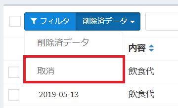

# Deleted data
This page explains the screen for seeing deleted data as a list, and for putting it back (restoring) or deleting it permanently.

- Deleted data can be shown only by users who have permission to show deleted data.
- Users with edit permission can restore data and delete it permanently.  

Note: for details on permissions, see [Role group](/role_group).

## List display
  

1. On the data list screen, choose "Deleted Data" from the ▼ mark to the right of [Filter] at the top left.
2. The display changes and the deleted data of that table is listed.

  

## Detail View

- The details of data in the deleted data list can be shown.  
- Click the row of the data you want to show, or the show icon in the action column.

  

- On the data details screen, you can check the user who deleted it and the date and time of deletion.

  

## Restore

- Deleted data can be put back on the data list screen (restored).
- There are three ways to restore.
    - Use the [Restore] button on the data details screen.
      
    - On the deleted data list screen, use the [Restore] icon in the action column.
      
    - On the deleted data list screen, check the data you want to restore, and choose "Restore" from the ▼ mark at the top left of the deleted data screen.
      

Note: only users who have edit permission for the data can restore it.

## Completely deleted

- Deleted data can be deleted permanently. Permanently deleted data also disappears from the deleted data list.
- There are three ways to delete permanently.
    - Use the [Permanently Delete] button on the data details screen.
      
    - On the deleted data list screen, use the [Permanently Delete] icon in the action column.
      
    - On the deleted data list screen, check the data you want to delete permanently, and choose "Permanently Delete" from the ▼ mark at the top left of the deleted data screen.
      

Note: only users who have edit permission for the data can delete it permanently.

## Move to the data list screen

- On the deleted data list screen, click [Deleted Data ▼] and choose "Cancel" to move to the data list screen of that table.

  

#### Authority settings
- To show deleted data, the user needs permission to show that data.
- To restore deleted data or delete it permanently, the user needs edit permission for that data.

Note: for the permission settings, see [Role group](/role_group).
