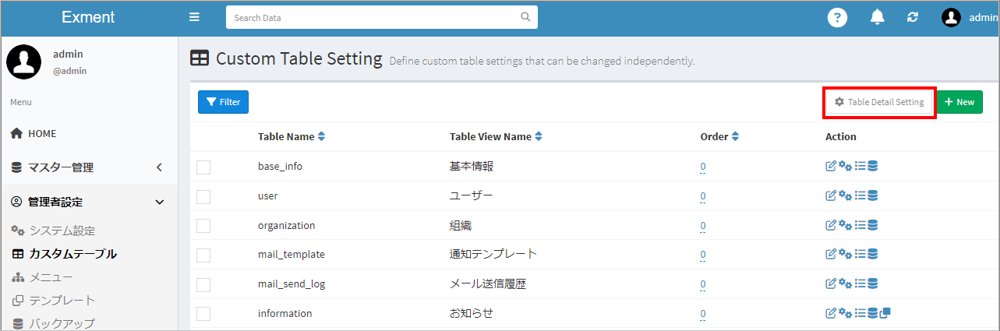

# Configuración de código de barras 2D
Esta página explica la pantalla en la que se decide, para cada tabla, el aspecto de la etiqueta del código de barras 2D y lo que ocurre al leerlo.

El flujo hasta poder usarlo es el siguiente.

1. Abrir la pantalla de configuración de código de barras 2D
2. Configurar y guardar
3. Pulsar el botón "Habilitar"
4. Crear el PDF de los códigos de barras 2D desde la lista de datos

## Resumen de la función de código de barras 2D
Para ver un resumen de la función de código de barras 2D, consulte la [publicación del sitio oficial](https://exment.net/release_v6-1-0/).

### Extensión de PHP necesaria (PDF de etiquetas)
Para crear el PDF de las etiquetas de códigos de barras 2D, la extensión gd de PHP debe estar instalada con FreeType (se puede usar `imagettftext`). Si no lo está, se produce un error al crear el PDF de las etiquetas.

- Si usa docker-exment: actualice docker-exment (PR #23 del 2026-11-23 o posterior) y vuelva a crear la imagen de php (`docker compose build php` y después `docker compose up -d`).
- En otros servidores: instale gd con FreeType (normalmente está incluido en el paquete php-gd de la distribución). Se puede comprobar si se puede usar con el siguiente comando. Si aparece `bool(true)`, se puede usar.

```
php -r 'var_dump(function_exists("imagettftext"));'
```

## Abrir la página
- En la lista de tablas personalizadas, marque la tabla que va a configurar y haga clic en "Configuración detallada de la tabla", arriba a la derecha.  


> Nota: también se puede pasar directamente desde la pantalla de lista de datos o la pantalla de registro de datos de esa tabla personalizada. En ese caso, haga clic también en "Configuración detallada de la tabla", arriba a la derecha.  


- En la pantalla de configuración detallada de la tabla, al hacer clic en el icono de configuración de código de barras 2D aparece la pantalla de configuración de código de barras 2D.  


## Opciones de configuración del código de barras 2D


### Información complementaria del código de barras 2D
Configure la información que se muestra a la derecha del código de barras 2D.

- #### Título
Introduzca el texto fijo que se muestra a la derecha del código de barras 2D.

- #### Columna mostrada
Elija la columna de los datos personalizados que se muestra a la derecha del código de barras 2D.   
Se puede elegir la columna ID o una columna de numeración automática (debe ser única y obligatoria).

### Tamaño de diseño del código de barras 2D
Configure el tamaño de diseño del código de barras 2D. 
Consulte la tabla siguiente.

| Caso | Ancho de celda | Alto de celda | Margen derecho | Margen superior | Columnas por página | Filas por página | Espaciado entre columnas | Espaciado entre filas |
| ---- | ---- | ---- | ---- | ---- | ---- | ---- | ---- | ---- |
| 2x5 | 84 | 52 | 17 | 10.5 | 2 | 5 | 8 | 4 |
| 2x6 | 83.8 | 42.3 | 19.3 | 21.5 | 2 | 6 | 3.8 | 0 |
| 2x7 | 83 | 32 | 20 | 24 | 2 | 7 | 4 | 4 |
| 3x6 | 63.5 | 46.5 | 7.2 | 9 | 3 | 6 | 2.55 | 0 |
| 3x7 | 63.5 | 38 | 7.2 | 15.5 | 3 | 7 | 2.55 | 0 |
| 3x8 | 56 | 30 | 17 | 14.5 | 3 | 8 | 4 | 4 |
| 3x9 | 62 | 31 | 9 | 9 | 3 | 9 | 3 | 0 |
| 3x10 | 53.3 | 25.4 | 19 | 21.5 | 3 | 10 | 3.8 | 0 |
| 3x12 | 60 | 20 | 12 | 12 | 3 | 12 | 3 | 3 |
| 4x11 | 48.3 | 25.4 | 8.4 | 8.8 | 4 | 11 | 0 | 0 |


### Lectura de código de barras 2D
Configure lo que ocurre al leer el código de barras 2D. 

- #### Formulario tras escanear el código de barras 2D
Elija el formulario de registro que se abre después de leer el código de barras 2D.  
Se puede elegir entre los formularios personalizados registrados en esa tabla. 

- #### Acción tras registrar los datos  
Elija la pantalla que se muestra después de registrar el dato.  
Se puede elegir entre la pantalla de inicio, la pantalla de lista, la pantalla de detalles, la pantalla de edición y la pantalla de la cámara.

Cuando termine de configurar, haga clic en el botón "Guardar".  

### Habilitar la configuración de código de barras 2D  
- Para poder usar la función de código de barras 2D en esa tabla, hay que "habilitarla". Guarde una vez y después haga clic en el botón "Habilitar", arriba a la derecha de la página.


## Crear nuevo código de barras 2D
- Al habilitar la función de código de barras 2D, en la lista de datos de esa tabla aparece el botón "Crear nuevo código de barras 2D".  
La parte "código de barras 2D" del nombre del botón se puede cambiar con "EXMENT_TEXT_QR_BUTTON_JA/EN" del archivo .env.  


- Al hacer clic en "Crear nuevo código de barras 2D", aparece la pantalla de creación de códigos de barras 2D.

- Al introducir el número de códigos de barras 2D y guardar, se crea esa cantidad de datos y también se genera el PDF de los códigos de barras 2D.


## Descargar código de barras 2D
- Al habilitar la función de código de barras 2D, en la lista de datos de esa tabla aparece el botón "Descargar código de barras 2D".  
La parte "código de barras 2D" del nombre del botón se puede cambiar con "EXMENT_TEXT_QR_BUTTON_JA/EN" del archivo .env.


- Al elegir datos y hacer clic en "Descargar código de barras 2D", los códigos de barras 2D de los datos elegidos se generan en PDF.


## Abrir la pantalla de la cámara desde Exment
- Desde el panel de Exment se puede abrir la pantalla de la cámara para leer códigos de barras 2D.

- Para ver cómo añadir al panel el elemento "Código de barras 2D/JAN", consulte [Panel](/es/dashboard).
