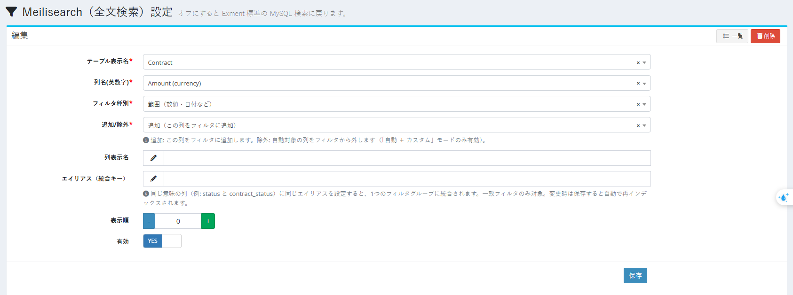

# (Para usuarios avanzados) Uso del motor de búsqueda de texto completo (Meilisearch)
Este ajuste hace más rápida la búsqueda de Exment con el motor de búsqueda de texto completo «[Meilisearch](https://www.meilisearch.com/)».  
Normalmente Exment busca en la base de datos. Con Meilisearch se puede buscar rápido también en entornos con muchísimos datos.  
※Esta función se puede usar con Exment v7.0.0 o posterior.

Hay 2 formas de instalarlo.

| Forma | Cuándo conviene |
|---|---|
| [La forma fácil](/es/additional_meilisearch?id=La-forma-fácil) | Exment v7.2.2 o posterior. Quiere instalarlo ejecutando un script una sola vez |
| [Instalación a mano](/es/additional_meilisearch?id=Instalación-a-mano) | Quiere configurarlo sin usar los scripts. Quiere comprobar el contenido de la configuración |

Se pueden usar las funciones siguientes.

- Búsqueda de texto libre más rápida
- Filtrado de los resultados de búsqueda (filtros y facetas)
- Resaltado de las palabras buscadas
- Ordenación de los resultados de búsqueda (por relevancia, más recientes primero, más antiguos primero)
- Guardar y compartir las condiciones de búsqueda
- Exportación de los resultados de búsqueda (CSV, XLSX)
- Configuración de sinónimos y palabras vacías (stop words)

  

> Para saber cómo funciona la búsqueda normal de Exment, vea [Búsqueda](/es/search).


## Requisitos
Para usar Meilisearch hay que cumplir las condiciones siguientes.

|Elemento|Contenido|
|---|---|
|Servidor Meilisearch|v1.10 o posterior|
|Biblioteca de PHP|Hay que instalar «meilisearch/meilisearch-php» (v1.10 o posterior). El zip de la instalación fácil ya la incluye. **Esta biblioteca no es una biblioteca obligatoria de Exment.** Si no está instalada, los comandos relacionados con Meilisearch dan error y la sincronización en tiempo real también queda desactivada.<br />Además, esta biblioteca necesita un cliente HTTP compatible con «guzzlehttp/guzzle».|
|Cola|«QUEUE_CONNECTION» tiene que ser database (o redis) y las migraciones tienen que estar ejecutadas.<br />La sincronización en tiempo real se ejecuta en la cola; por eso, si se deja el valor inicial sync, los procesos de la pantalla se bloquean. Para más detalles, vea [Ejecución diferida de las notificaciones](/es/additional_queue).|
|Tabla personalizada|Solo se crean índices de las tablas que tienen «Permitir búsqueda» en YES en la configuración de la tabla personalizada y que, además, tienen alguna columna personalizada con «Incluir en la búsqueda de texto libre» en YES.|


## Puntos de atención
- <span class="red">※No exponga Meilisearch a Internet.</span> Configúrelo para que solo se pueda conectar desde el mismo servidor que Exment o desde la red interna. Guarde la clave maestra con mucho cuidado, para que no la conozcan otras personas.
- **Meilisearch y el worker de la cola tienen que estar siempre en marcha**. En el paso 1 y en el paso 3, los dos se registran como servicios que se reinician solos. Si se detienen, pasa lo siguiente.

|Lo que se detiene|Qué pasa|
|---|---|
|Meilisearch|La pantalla de búsqueda pasa a la búsqueda normal, con la base de datos (si hay condiciones de filtrado aplicadas, no se muestran resultados, y el orden no se aplica).|
|Worker de la cola|Lo que se actualiza no llega al índice.|

- El índice de Meilisearch (los datos para la búsqueda) se guarda aparte de la base de datos de Exment. Por eso puede haber diferencias entre los dos. En el paso 4 se configura la reparación automática una vez al día.
- <span class="red">※Si «EXMENT_SEARCH_DOCUMENT» es true, la pantalla de búsqueda no usa Meilisearch.</span> Los nombres de los archivos adjuntos no entran en el índice; por eso, aunque «MEILISEARCH_GLOBAL_SEARCH» sea true, la pantalla de búsqueda busca con la base de datos. El autocompletado de la columna personalizada «Selección (desde tabla)» no se ve afectado.
- Para una explicación detallada del propio Meilisearch, vea la [documentación oficial de Meilisearch](https://www.meilisearch.com/docs).


## La forma fácil
Con Exment v7.2.2 o posterior, ejecutando un script una sola vez se hacen de una vez los pasos 1 a 4 de [Instalación a mano](/es/additional_meilisearch?id=Instalación-a-mano), más abajo. El script se puede ejecutar las veces que quiera sin problema (la clave maestra y la configuración que ya existen se usan tal cual).

Vea la parte que corresponde a su entorno.

|Entorno|Dónde mirar|
|---|---|
|Servidor Linux (incluye EC2 de AWS y similares)|«En Linux», más abajo|
|Servidor Windows|«En Windows», más abajo|
|docker-exment|«En Docker», más abajo|
|Meilisearch ya está en marcha (por ejemplo, preparado en otro servidor)|[Configurar solo Exment](/es/additional_meilisearch?id=Configurar-solo-Exment)|
|AWS, Azure, servidor de alquiler|«En AWS y servidores de alquiler», más abajo|

### En Linux
En un servidor que usa systemd (Ubuntu, Debian, RHEL, Amazon Linux, etc.; incluye EC2 de AWS), vaya a la carpeta de Exment y ejecute los comandos siguientes.

```
cd /var/www/exment
sudo sh vendor/exceedone/exment/resources/meilisearch/install-meilisearch.sh
```

El script hace lo siguiente.

1. Instala Meilisearch («/usr/local/bin/meilisearch»), crea el usuario de ejecución, crea «/etc/meilisearch.conf» con una clave maestra nueva (solo root puede leerlo) y registra el servicio «meilisearch» (solo escucha en 127.0.0.1:7700)
1. Configura Exment («php artisan exment:meili-setup»; vea el contenido en [Configurar solo Exment](/es/additional_meilisearch?id=Configurar-solo-Exment))
1. Registra el servicio del worker de la cola «exment-meili-worker»
1. Añade el programador (php artisan schedule:run) al crontab del usuario del servidor web

Si hace falta, indique las opciones siguientes.

|Opción|Contenido|
|---|---|
|--exment-dir=carpeta|La carpeta de Exment. El valor por defecto es la carpeta actual.|
|--user=usuario|El usuario con el que el servidor web ejecuta PHP (www-data, apache, nginx, etc.). El valor por defecto es el propietario de la carpeta «storage».|
|--php=ruta|La ruta del comando php. Indique el php de la misma versión que el servidor web (ejemplo: --php=/usr/bin/php8.3). El valor por defecto es el php que está en el PATH.|
|--version=versión|La versión de Meilisearch. El valor por defecto es «v1.10.3».|
|--index=nombre|El nombre del índice. El valor por defecto es «exment_global».|
|--no-cron|No añade el programador al crontab. Se indica cuando el programador ya se ejecuta de otra forma.|

### En Windows
Abra PowerShell con «Ejecutar como administrador» y ejecute los comandos siguientes en la carpeta de Exment.
※Cambie «C:\php\php.exe» por la ruta del php que usa IIS.

```
cd C:\inetpub\exment
powershell -ExecutionPolicy Bypass -File vendor\exceedone\exment\resources\meilisearch\install-meilisearch.ps1 -Php C:\php\php.exe
```

El script hace lo siguiente.

1. Instala Meilisearch («C:\meilisearch»), crea una clave maestra nueva («C:\meilisearch\master-key.txt»; solo Administrators y SYSTEM pueden leerla), registra el servicio «Meilisearch» con NSSM y excluye del análisis de Windows Defender el lugar donde se guarda el índice
1. Configura Exment («php artisan exment:meili-setup»)
1. Registra el servicio del worker de la cola «ExmentMeiliWorker»
1. Registra en el Programador de tareas la tarea «ExmentScheduler» (php artisan schedule:run cada minuto)

> Para NSSM, indique la ruta con «-Nssm» o colóquelo en el PATH o en «C:\nssm\nssm.exe». Si no está en ninguno de esos lugares y existe winget, se instala automáticamente.
> Otras opciones: «-ExmentDir» (carpeta de Exment), «-Version» (versión de Meilisearch), «-InstallDir» (carpeta de Meilisearch), «-Index» (nombre del índice), «-NoScheduler» (no registra la tarea), «-NoDefenderExclusion» (no cambia la configuración de Windows Defender)

### En Docker
Si usa [docker-exment](https://github.com/exceedone/docker-exment), basta con añadir «docker-compose.meilisearch.yml» para que se inicien los contenedores de Meilisearch, del worker de la cola y del programador.

- En el «.env» de la carpeta de docker-exment, escriba una clave maestra de 16 caracteres o más (ejemplo: un valor generado con «openssl rand -hex 16»).

```
EXMENT_DOCKER_MEILISEARCH_MASTER_KEY=(clave maestra)
```

- Ejecute los comandos siguientes para iniciar los contenedores y, después, configurar Exment.

```
docker compose -f docker-compose.yml -f docker-compose.mysql.yml -f docker-compose.meilisearch.yml up -d
docker compose -f docker-compose.yml -f docker-compose.mysql.yml -f docker-compose.meilisearch.yml exec -u www-data php php artisan exment:meili-setup
```

### Configurar solo Exment
Si Meilisearch ya está en marcha (por ejemplo, preparado en otro servidor), ejecute el comando siguiente en la carpeta de Exment. Hace de una vez «[2. Configuración de Exment](/es/additional_meilisearch?id=2.-Configuración-de-Exment)» de la instalación a mano.

```
php artisan exment:meili-setup --host=http://127.0.0.1:7700 --key-file=/etc/meilisearch.conf
```

Este comando ejecuta lo siguiente en este orden. Si hay un error a medias, muestra el contenido del error y se detiene. Después de corregirlo, ejecútelo otra vez.

1. Comprueba que se puede conectar a Meilisearch, que la clave maestra es correcta y que la versión es v1.10 o posterior
1. Configura «.env»: si «QUEUE_CONNECTION» es sync, lo cambia a database, y añade «MEILISEARCH_REINDEX_QUEUE=meili-reindex»
1. Crea las tablas de la cola (jobs y failed_jobs) si no existen y ejecuta «php artisan migrate»
1. Guarda la configuración del sistema: host, clave maestra, nombre del índice, sincronización en tiempo real (YES), reparación programada del índice (YES) y hora de reparación
1. Crea el índice. Cuando termina, pone la búsqueda global en YES
1. Comprueba el estado de la conexión («php artisan exment:meili-health --failed») e indica que se reinicien los workers de la cola que están en marcha («php artisan queue:restart»)

|Opción|Contenido|
|---|---|
|--host=URL|El destino de conexión de Meilisearch. El valor por defecto es el valor configurado ahora («http://127.0.0.1:7700»).|
|--key-file=archivo|El archivo donde está escrita la clave maestra. Indique un archivo que tenga la línea «MEILI_MASTER_KEY=» (como «/etc/meilisearch.conf») o un archivo donde solo esté escrita la clave.|
|--key=clave|La clave maestra. Una clave escrita en la línea de comandos puede ser visible para otros usuarios; por eso se recomienda usar «--key-file» o la variable de entorno «MEILI_MASTER_KEY».|
|--index=nombre|El nombre del índice. El valor por defecto es el valor configurado ahora («exment_global»).|
|--repair-at=HH:MM|La hora de la reparación programada del índice. El valor por defecto es el valor configurado ahora («03:00»).|
|--skip-env|No cambia «.env». Escriba usted mismo el contenido que se muestra.|
|--skip-index|Solo guarda la configuración y no crea el índice. La búsqueda global se queda en NO.|

> La clave maestra se busca en este orden: «--key-file», la variable de entorno «MEILI_MASTER_KEY», «--key» y el valor ya guardado en la configuración del sistema. Si no está en ninguno, se pide escribirla.
> Este comando no registra el worker de la cola ni el programador. Haga «[3. Registro del worker de la cola](/es/additional_meilisearch?id=3.-Registro-del-worker-de-la-cola)» y «[4. Configuración del programador](/es/additional_meilisearch?id=4.-Configuración-del-programador)» de la instalación a mano.

### En AWS y servidores de alquiler
- **AWS (EC2), máquinas virtuales de Azure, etc.**: igual que en los servidores Linux y Windows, se pueden usar los scripts de arriba. No exponga el puerto 7700 al exterior en los grupos de seguridad o similares.
- **Servidores de alquiler (Xserver, etc.)**: como no se pueden ejecutar programas que funcionan siempre, Meilisearch no puede funcionar dentro del servidor de alquiler. Coloque Meilisearch en otro servidor que pueda funcionar siempre (como EC2 de AWS) y configúrelo para que solo se pueda conectar desde el servidor de Exment. Después, ejecute «php artisan exment:meili-setup --host=(destino de conexión de Meilisearch)» en la carpeta de Exment. Como el worker de la cola no puede funcionar siempre, se ejecuta con cron cada minuto. Para más detalles, vea [Ejecución diferida de las notificaciones](/es/additional_queue).


## Instalación a mano
Estos son los pasos para configurarlo sin usar los scripts o para comprobar el contenido de la configuración. Se configura en este orden.

1. Instalación del servidor Meilisearch
1. Configuración de Exment
1. Registro del worker de la cola
1. Configuración del programador


## 1. Instalación del servidor Meilisearch

### En Linux
Son los pasos para Ubuntu y para los entornos que usan systemd.  
※Cambie las rutas y los nombres de usuario según su entorno.

- Ejecute los comandos siguientes para colocar el archivo binario de Meilisearch.  
Meilisearch funciona con 1 solo archivo, así que no hace falta instalar otras bibliotecas.

```
curl -L -o /tmp/meilisearch \
  https://github.com/meilisearch/meilisearch/releases/download/v1.10.3/meilisearch-linux-amd64

chmod +x /tmp/meilisearch && sudo mv /tmp/meilisearch /usr/local/bin/meilisearch
```

- Ejecute el comando siguiente y compruebe que se muestra la versión.

```
meilisearch --version
```

- Ejecute los comandos siguientes para crear el usuario de ejecución de Meilisearch y la carpeta donde se guardan los datos.

```
sudo useradd -r -s /usr/sbin/nologin meilisearch
sudo mkdir -p /var/lib/meilisearch
sudo chown meilisearch:meilisearch /var/lib/meilisearch
```

- Ejecute los comandos siguientes para crear el archivo de configuración de Meilisearch.  
La clave maestra se genera automáticamente con una cadena aleatoria.

```
sudo tee /etc/meilisearch.conf > /dev/null << EOF
MEILI_DB_PATH=/var/lib/meilisearch/data.ms
MEILI_HTTP_ADDR=127.0.0.1:7700
MEILI_ENV=production
MEILI_MASTER_KEY=$(openssl rand -hex 16)
MEILI_NO_ANALYTICS=true
EOF

sudo chmod 600 /etc/meilisearch.conf
```

> Con «MEILI_ENV=production», la clave maestra tiene que tener 16 bytes o más.  
«openssl rand -hex 16» genera una cadena de 32 caracteres, así que cumple esta condición.

- Ejecute el comando siguiente y compruebe la clave maestra generada.  
**Anote siempre esta clave, porque después se escribe en «Configuración del sistema» de Exment.**

```
sudo grep MASTER_KEY /etc/meilisearch.conf
```

- Ejecute el comando siguiente para registrar Meilisearch como servicio.

```
sudo tee /etc/systemd/system/meilisearch.service > /dev/null << 'EOF'
[Unit]
Description=Meilisearch search engine
After=network.target

[Service]
Type=simple
User=meilisearch
Group=meilisearch
EnvironmentFile=/etc/meilisearch.conf
WorkingDirectory=/var/lib/meilisearch
ExecStart=/usr/local/bin/meilisearch
Restart=always
RestartSec=3
NoNewPrivileges=true
ProtectSystem=full
ProtectHome=true
ReadWritePaths=/var/lib/meilisearch

[Install]
WantedBy=multi-user.target
EOF
```

> La línea «WorkingDirectory=/var/lib/meilisearch» es obligatoria.  
Meilisearch crea una carpeta temporal en el directorio actual; por eso, si falta esta línea, aparece «Permission denied» y el servicio se inicia y se detiene una y otra vez.

- Ejecute los comandos siguientes para activar el inicio automático del servicio e iniciar Meilisearch.

```
sudo systemctl daemon-reload
sudo systemctl enable --now meilisearch
```

- Ejecute el comando siguiente y compruebe que se muestra «{"status":"available"}».

```
curl -s http://127.0.0.1:7700/health
```

### En Windows
Son los pasos para un entorno que usa NSSM (Non-Sucking Service Manager) y el Programador de tareas.  
Abra PowerShell con «Ejecutar como administrador» y ejecute los comandos siguientes.  
※Cambie las rutas según su entorno.

- Ejecute los comandos siguientes para crear la carpeta y descargar el archivo binario de Meilisearch.

```
New-Item -ItemType Directory -Force C:\meilisearch
Invoke-WebRequest -Uri "https://github.com/meilisearch/meilisearch/releases/download/v1.10.3/meilisearch-windows-amd64.exe" `
  -OutFile C:\meilisearch\meilisearch.exe
```

- Ejecute el comando siguiente y compruebe que se muestra la versión.

```
C:\meilisearch\meilisearch.exe --version
```

- Ejecute los comandos siguientes para generar una clave maestra de 32 caracteres.  
**Anote siempre esta clave, porque después se escribe en «Configuración del sistema» de Exment.**

```
$key = -join (1..32 | ForEach-Object { '0123456789abcdef'[(Get-Random -Maximum 16)] })
$key
```

> «Get-Random -Count 32» no toma dos veces el mismo valor; por eso, con los caracteres hexadecimales, que solo son 16, solo puede generar una clave de 16 caracteres. No lo use.

- Descargue NSSM desde el [sitio oficial de NSSM](https://nssm.cc/download) y coloque «nssm.exe» en la carpeta «C:\nssm\».  
※También se puede instalar con el comando «winget install nssm».

- Ejecute los comandos siguientes para registrar Meilisearch como servicio de Windows.

```
C:\nssm\nssm.exe install Meilisearch C:\meilisearch\meilisearch.exe
C:\nssm\nssm.exe set Meilisearch AppParameters "--db-path C:\meilisearch\data.ms --http-addr 127.0.0.1:7700 --env production --master-key $key --no-analytics"
C:\nssm\nssm.exe set Meilisearch AppDirectory C:\meilisearch
C:\nssm\nssm.exe set Meilisearch AppExit Default Restart
C:\nssm\nssm.exe set Meilisearch Start SERVICE_AUTO_START
C:\nssm\nssm.exe start Meilisearch
```

> «$key» es la clave maestra generada en el paso anterior.  
Si ha vuelto a abrir PowerShell, el contenido de la variable se ha perdido; en ese caso, escriba directamente la cadena de la clave generada.

- Ejecute el comando siguiente y compruebe que se muestra «status : available».

```
Invoke-RestMethod http://127.0.0.1:7700/health
```

- Ejecute el comando siguiente para excluir del análisis de Windows Defender la carpeta donde se guarda el índice.  
※Si está incluida en el análisis, la creación y la actualización del índice pueden ser más lentas.

```
Add-MpPreference -ExclusionPath "C:\meilisearch\data.ms"
```


## 2. Configuración de Exment
Cuando el servidor Meilisearch esté preparado, haga la configuración del lado de Exment.  
※Este paso también se puede hacer de una vez con «php artisan exment:meili-setup». Para más detalles, vea [Configurar solo Exment](/es/additional_meilisearch?id=Configurar-solo-Exment).  
Los pasos siguientes son comunes para Linux y Windows.

### Instalación de la biblioteca
- En la carpeta de Exment, ejecute el comando siguiente.

```
composer require meilisearch/meilisearch-php
```

### Configuración de .env
- En la carpeta de Exment, abra el archivo «.env» y escriba los ajustes siguientes.  
Los datos de conexión al servidor Meilisearch y los ajustes principales no se ponen en «.env»: se configuran en la pantalla Configuración del sistema, en un paso posterior.

```
#Driver de la cola. Si se deja el valor inicial sync (proceso síncrono), los procesos de la pantalla se bloquean
QUEUE_CONNECTION=database

#Ejecuta el proceso que vuelve a crear el índice de una tabla entera (un proceso pesado) en una cola distinta de la sincronización de cada dato personalizado
MEILISEARCH_REINDEX_QUEUE=meili-reindex
```

- Para los demás valores de configuración, vea «Búsqueda» en la [Lista de valores de configuración](/es/config). Escríbalos solo si los cambia respecto al valor por defecto.

> El archivo de configuración de Meilisearch se carga desde dentro del paquete de Exment. Por eso no hace falta ejecutar «php artisan vendor:publish».

### Creación de las tablas
- Ejecute los comandos siguientes para crear las tablas donde se guarda la información de la cola y las tablas que usa Meilisearch.

```
php artisan queue:table
php artisan queue:failed-table
php artisan migrate
```

> Las tablas «jobs» y «failed_jobs» a veces se crean con las migraciones incluidas al crear el proyecto de Laravel. Mire la carpeta «database/migrations» y ejecute lo siguiente.
> - Si hay un archivo que contiene «create_jobs_table» (proyecto creado con Laravel 11 o posterior): las dos tablas se crean con las migraciones estándar, así que no se ejecutan «queue:table» ni «queue:failed-table»; ejecute solo «php artisan migrate».
> - Si solo hay un archivo que contiene «create_failed_jobs_table»: ejecute «queue:table» y «php artisan migrate».
> - Si no hay ninguno de los dos: ejecute los 3 comandos de arriba.
>
> Si aparece «Migration already exists.», esa migración ya existe; no haga caso del error y pase al comando siguiente.

- Ejecute el comando siguiente para borrar la caché de la configuración.  
※Si usa la caché de configuración, ejecute otra vez «php artisan config:cache».

```
php artisan config:clear
```

### Configuración del sistema
- Inicie sesión en Exment como administrador del sistema, abra el menú «Configuración de administración > Configuración del sistema» y cambie a «Configuración detallada».
- En «Configuración de Meilisearch (búsqueda de texto completo)», configure los campos siguientes y guarde.  
  

|Campo|Valor que se pone|
|---|---|
|Host de Meilisearch|El destino de conexión del servidor Meilisearch. Si Exment y Meilisearch están en el mismo servidor, deje «http://127.0.0.1:7700».|
|Clave de API maestra|La clave maestra generada al instalar el servidor Meilisearch.|
|Nombre del índice|Deje «exment_global». Si varios Exment usan el mismo servidor Meilisearch, ponga un nombre distinto para cada Exment.|
|Habilitar la búsqueda global con Meilisearch|Póngalo en YES. Es un ajuste del lado de la búsqueda, así que también se puede cambiar a YES después de que termine la creación del índice.|
|Sincronización del índice en tiempo real|Póngalo en YES. Es un ajuste del lado de la actualización, así que hace falta el worker de la cola que se registra en el paso 3.|
|Tamaño del lote (indexación)|Deje «1000».|
|Reparación programada del índice|Póngalo en YES. Hace falta el programador que se configura en el paso 4.|
|Hora de reparación (HH:MM)|Ponga una hora de poca carga, como «03:00».|
|Columnas de filtro de búsqueda|Deje «Automático + personalizado».|

> Los valores guardados en esta pantalla se conservan en la base de datos y tienen prioridad sobre los valores de «.env». La clave de API maestra se guarda cifrada.  
> Estos campos también se pueden configurar en «.env» en lugar de en la pantalla. Para más detalles, vea [Configurar en .env los campos de la pantalla](/es/additional_meilisearch?id=Configurar-en-.env-los-campos-de-la-pantalla).

> Un índice solo puede usarlo un Exment. El Exment que usa primero el índice queda registrado como propietario en un índice llamado «(nombre del índice)__owner». (El valor que se registra es un identificador creado a partir de «APP_KEY» de «.env»)  
> Si varios Exment usan el mismo servidor Meilisearch, ponga un «Nombre del índice» distinto para cada Exment. Un índice que tiene registrado como propietario a otro Exment no se puede usar. Para más detalles, vea [Si no funciona bien](/es/additional_meilisearch?id=Si-no-funciona-bien).

### Creación del índice
- Ejecute el comando siguiente para crear el índice a partir del contenido de la base de datos.  
※Según el número de datos, el proceso puede tardar.

```
php artisan exment:meili-index
```

- Ejecute el comando siguiente para comprobar el estado de la conexión con Meilisearch y el número de documentos registrados.

```
php artisan exment:meili-health
```


## 3. Registro del worker de la cola
Para que los cambios de los datos personalizados lleguen al índice, se registra el worker de la cola como servicio.  

El worker de la cola tiene que atender estas 2 colas.

- default : es la cola de procesos ligeros; hace la sincronización de cada dato personalizado, la aplicación de la configuración, etc. (valor por defecto de «MEILISEARCH_SYNC_QUEUE»)
- meili-reindex : es la cola de procesos pesados; vuelve a crear el índice de una tabla entera. (el valor puesto en «MEILISEARCH_REINDEX_QUEUE» en «Configuración de .env»)

※Si no se configura «MEILISEARCH_REINDEX_QUEUE», los procesos de tabla entera también se ejecutan en la misma cola que «MEILISEARCH_SYNC_QUEUE» (valor por defecto: default). En ese caso, la sincronización de cada dato personalizado tiene que esperar hasta que termine el proceso pesado.  
※Si cambia «MEILISEARCH_SYNC_QUEUE» o «MEILISEARCH_REINDEX_QUEUE», cambie también el contenido de «--queue=».

### En Linux
- Ejecute el comando siguiente.  
※«/var/www/exment» es la carpeta donde está instalado Exment y «/usr/bin/php» es la ruta del comando php. Cámbielas según su entorno.

```
sudo tee /etc/systemd/system/exment-meili-worker.service > /dev/null << 'EOF'
[Unit]
Description=Exment queue worker (Meilisearch sync)
After=network.target mysql.service

[Service]
User=www-data
Group=www-data
WorkingDirectory=/var/www/exment
ExecStart=/usr/bin/php artisan queue:work --queue=default,meili-reindex --max-time=3600 --tries=3
Restart=always
RestartSec=3

[Install]
WantedBy=multi-user.target
EOF
```

- Ejecute los comandos siguientes para activar el inicio automático del servicio e iniciar el worker de la cola.

```
sudo systemctl daemon-reload
sudo systemctl enable --now exment-meili-worker
```

- Ejecute el comando siguiente y compruebe que el servicio está en marcha.

```
systemctl status exment-meili-worker --no-pager
```

### En Windows
- Ejecute los comandos siguientes.  
※«C:\inetpub\exment» es la carpeta donde está instalado Exment y «C:\php\php.exe» es la ruta del comando php. Cámbielas según su entorno.

```
C:\nssm\nssm.exe install ExmentMeiliWorker C:\php\php.exe
C:\nssm\nssm.exe set ExmentMeiliWorker AppParameters "artisan queue:work --queue=default,meili-reindex --max-time=3600 --tries=3"
C:\nssm\nssm.exe set ExmentMeiliWorker AppDirectory C:\inetpub\exment
C:\nssm\nssm.exe set ExmentMeiliWorker AppExit Default Restart
C:\nssm\nssm.exe set ExmentMeiliWorker Start SERVICE_AUTO_START
C:\nssm\nssm.exe start ExmentMeiliWorker
```


## 4. Configuración del programador
Si «MEILISEARCH_REPAIR_ENABLED» es true, la reparación automática del índice se ejecuta a la hora configurada en «MEILISEARCH_REPAIR_AT».  
Para ejecutar este proceso hace falta configurar el programador. **Si no se configura, la reparación automática no se ejecuta.**  
※Si ya ha hecho la configuración de [Programación de tareas](/es/additional_task_schedule), este paso no hace falta.

### En Linux
- Ejecute el comando siguiente.

```
sudo crontab -u www-data -l 2>/dev/null | { cat; echo "* * * * * cd /var/www/exment && php artisan schedule:run >> /dev/null 2>&1"; } | sudo crontab -u www-data -
```

### En Windows
- Ejecute el comando siguiente.

```
schtasks /create /tn "ExmentScheduler" /sc minute /mo 1 /ru SYSTEM /f /tr "C:\php\php.exe C:\inetpub\exment\artisan schedule:run"
```

> «/f» es la opción que sobrescribe sin mostrar el mensaje de confirmación cuando ya hay registrada una tarea con el mismo nombre.


## Configurar en .env los campos de la pantalla
Los campos de «Configuración de Meilisearch (búsqueda de texto completo)» también se pueden configurar en «.env» en lugar de en la pantalla Configuración del sistema; por ejemplo, cuando la configuración se distribuye automáticamente. Las claves de configuración son las siguientes.

|Campo|Clave de configuración de «.env»|
|---|---|
|Host de Meilisearch|MEILISEARCH_HOST|
|Clave de API maestra|MEILISEARCH_KEY|
|Nombre del índice|MEILISEARCH_INDEX|
|Habilitar la búsqueda global con Meilisearch|MEILISEARCH_GLOBAL_SEARCH|
|Sincronización del índice en tiempo real|MEILISEARCH_REALTIME_SYNC|
|Tamaño del lote (indexación)|MEILISEARCH_BATCH_SIZE|
|Reparación programada del índice|MEILISEARCH_REPAIR_ENABLED|
|Hora de reparación (HH:MM)|MEILISEARCH_REPAIR_AT|
|Columnas de filtro de búsqueda|MEILISEARCH_FILTER_MODE («Automático + personalizado» es override; «Solo personalizado» es manual)|

<span class="red">※Cada vez que se guarda, la pantalla «Configuración detallada» de la configuración del sistema escribe en la base de datos todos los campos de arriba, también los que no se han cambiado. A partir de entonces, en estos campos tiene prioridad el valor guardado en la pantalla y el valor de «.env» se ignora.</span>  
Si gestiona estos campos en «.env», tenga en cuenta los puntos siguientes.

- «Habilitar la búsqueda global con Meilisearch», «Sincronización del índice en tiempo real», «Reparación programada del índice» y «Columnas de filtro de búsqueda» no se pueden guardar vacíos. Si se guarda la pantalla aunque sea una vez, en estos 4 campos se usa siempre el valor de la pantalla; por eso, haga los cambios en la pantalla.
- «Host de Meilisearch», «Clave de API maestra», «Nombre del índice», «Tamaño del lote (indexación)» y «Hora de reparación (HH:MM)»: si se dejan vacíos en la pantalla y se guarda, se vuelve a usar el valor de «.env».
- Si ha cambiado «.env» y el cambio no se aplica, compruebe si hay un valor guardado en la pantalla.
- Los demás valores de configuración solo se pueden configurar en «.env».


## Sobre la precisión de la búsqueda en japonés
Antes de buscar, Meilisearch divide el texto en palabras (segmentación).  
Cuando se trabaja con datos en japonés, se usa el ajuste «MEILISEARCH_LOCALES» para hacer bien este proceso.

- El valor por defecto es «jpn». Si solo se trabaja con japonés, no hace falta escribirlo.
- Como valor se escriben los códigos de idioma de ISO-639-3, separados por comas. (ejemplo: «jpn», «jpn,eng»)
- Si se deja vacío, como «MEILISEARCH_LOCALES=», este ajuste se borra del índice y Meilisearch detecta el idioma automáticamente.
- Para usar este ajuste hace falta Meilisearch v1.10 o posterior.
- Si cambia el ajuste, ejecute «php artisan exment:meili-settings». Meilisearch vuelve a dividir el texto automáticamente, así que no hace falta volver a crear el índice.

«MEILISEARCH_LOCALES» y la configuración del diccionario (sinónimos y palabras vacías) actúan en fases distintas del proceso. Úselos combinados.

|Ajuste|Fase|Proceso|
|---|---|---|
|MEILISEARCH_LOCALES|Antes|Divide el texto en palabras.|
|Sinónimos y palabras vacías|Después|Sobre las palabras ya divididas, expande los sinónimos y hace las exclusiones.|


## Pantallas de administración
Las pantallas relacionadas con Meilisearch son las siguientes.  
※El valor que se pone al principio de las URL (como «admin») depende del ajuste «ADMIN_ROUTE_PREFIX». Para más detalles, vea [Cambiar o quitar el «admin» de la URL](/es/additional_prefix).

|Pantalla|URL|Contenido|
|---|---|---|
|Configuración del sistema|/system|En «Configuración de Meilisearch (búsqueda de texto completo)» de «Configuración detallada» se configuran el destino de conexión, la clave maestra y los distintos indicadores.|
|Configuración de filtros de búsqueda|/meili-filter|Se configuran las condiciones de filtrado que se muestran en la barra lateral de la pantalla de resultados de búsqueda.|
|Configuración del diccionario de búsqueda|/meili-dictionary|Se configuran los sinónimos y las palabras vacías.|

※«Configuración de filtros de búsqueda» y «Configuración del diccionario de búsqueda» no aparecen en el menú en el estado inicial. Acceda directamente con las URL de arriba o añádalas como menú del sistema en la [configuración del menú](/es/menu). Estas dos solo aparecen entre las opciones de la configuración del menú cuando «MEILISEARCH_GLOBAL_SEARCH» es true.

- En «Configuración de filtros de búsqueda» se eligen la tabla y la columna y se configuran el tipo de filtro (igualdad o rango), incluir/excluir, el alias, etc.  
  

- En «Configuración del diccionario de búsqueda» se registran el tipo (sinónimo o palabra vacía) y la palabra.  
  


## Comprobación del funcionamiento
- Inicie sesión en Exment, escriba una palabra en la barra de búsqueda de la parte superior de la página y busque.
- Compruebe que se muestran los resultados de búsqueda.
- Después de crear o actualizar un dato personalizado, busque otra vez y compruebe que lo actualizado aparece en los resultados de búsqueda.  
※Si no aparece, compruebe si el worker de la cola se está ejecutando.

- También se puede buscar desde la línea de comandos. No aplica el filtrado por permisos de usuario como la pantalla: consulta directamente a Meilisearch y muestra el tiempo de respuesta. Así se puede distinguir si el problema está en el propio Meilisearch o en el lado de la pantalla.

```
php artisan exment:meili-search "palabra clave" --limit=5 --highlight --facets
```

※Para buscar solo en una tabla concreta, indique «--table=(nombre de la tabla)».


## Funciones de la pantalla de búsqueda
Cuando «MEILISEARCH_GLOBAL_SEARCH» es true, en la pantalla de resultados de búsqueda se pueden usar las funciones siguientes.

- Filtrado : en la barra lateral se filtran los resultados de búsqueda por tabla, por valor de columna, por rango de fechas o de números, etc. Las columnas que se usan se pueden cambiar en la pantalla «Configuración de filtros de búsqueda».
- Ordenación : se ordena por «Relevancia», «Más recientes primero» o «Más antiguos primero».
- Guardar las condiciones de búsqueda : con «Guardar las condiciones actuales» se guardan las condiciones de filtrado (y, si quiere, también la palabra buscada). A partir de la vez siguiente se pueden recuperar desde «Búsquedas guardadas».  
    - El alcance del uso compartido se elige entre «Solo yo», «Grupo de roles», «Organización» y «Todos los usuarios». Solo el administrador del sistema puede compartir con «Todos los usuarios».
    - Un usuario puede guardar hasta «MEILISEARCH_SAVED_SEARCH_LIMIT» (valor por defecto: 50).

      

- Exportación : los resultados de búsqueda se exportan, tabla por tabla, en CSV o en XLSX. Si el número de datos que se exportan es igual o mayor que el límite (el menor de estos dos valores: «MEILISEARCH_PERMISSION_SCAN_CAP» (valor por defecto: 1000) y el ajuste «maxTotalHits» del índice), se produce un error; reduzca las condiciones de búsqueda.  
※El número se calcula con todos los resultados de búsqueda (hits), antes de filtrar por los permisos de consulta. Por eso puede dar error aunque los datos que usted puede ver sean menos que el límite.


## Volver a crear y reparar el índice
Estos son los pasos para reparar el índice, por ejemplo cuando hay diferencias entre la base de datos y el índice o cuando se ha importado o eliminado una gran cantidad de datos.

### Reparación de las diferencias
El comando «exment:meili-reconcile» hace estos 2 procesos.

1. En las tablas que entran en el índice, añade los documentos que faltan y elimina los documentos que sobran (datos ya eliminados de la base de datos).
1. Elimina del índice todos los documentos de las tablas que ya no entran en el índice (se cambió «Permitir búsqueda» a NO, ya no hay columnas incluidas en la búsqueda de texto libre, se eliminó la propia tabla, etc.).  
※Si se ejecuta con «--table», este proceso no se hace.

<span class="red">※Este comando elimina documentos del índice.</span>  
Para comprobar antes lo que se va a eliminar, ejecútelo con «--dry-run».

- Ejecute el comando siguiente para comprobar las diferencias entre la base de datos y el índice. Con «--dry-run» solo se comprueba y no se repara.

```
php artisan exment:meili-reconcile --dry-run
```

- Ejecute el comando siguiente para reparar las diferencias.

```
php artisan exment:meili-reconcile
```

- Para reparar solo una tabla concreta, indique «--table».

```
php artisan exment:meili-reconcile --table=(nombre de la tabla)
```

### Volver a crear el índice
- Para volver a crear todo el índice, ejecute el comando siguiente.  
Con «--fresh» se vuelven a crear todos los documentos, y por eso aparece un mensaje de confirmación al ejecutarlo.  
※Mientras se vuelve a crear, se puede seguir buscando con el índice existente. Cuando termina la creación, se cambia al índice nuevo.

```
php artisan exment:meili-index --fresh
```

> Para ejecutarlo sin mostrar el mensaje de confirmación, por ejemplo en un proceso por lotes, indique también «--force».  
> En un entorno donde no se puede mostrar el mensaje de confirmación (cron, etc.), si no se indica «--force», el comando da error.
>
> ```
> php artisan exment:meili-index --fresh --force
> ```

- Los datos personalizados actualizados mientras se volvía a crear el índice no están en el índice nuevo. Cuando termine, ejecute el comando siguiente para reparar las diferencias.

```
php artisan exment:meili-reconcile
```

### Aplicar solo la configuración
- Cuando se guardan sinónimos o palabras vacías en la pantalla «Configuración del diccionario de búsqueda», la configuración llega automáticamente al índice a través de la cola. No hace falta ejecutar ningún comando.  
※Si el worker de la cola está detenido, no se aplica. En ese caso, ejecute el comando siguiente.
- Si ha cambiado «MEILISEARCH_LOCALES», «MEILISEARCH_PERMISSION_SCAN_CAP» o «MEILISEARCH_MAX_FACET_VALUES» en «.env», ejecute el comando siguiente. La configuración se aplica sin volver a crear el índice.  
※Con «--show» se muestra la configuración actual.

```
php artisan exment:meili-settings
php artisan exment:meili-settings --show
```


## Al actualizar el sistema o cambiar la configuración
El worker de la cola es un proceso que funciona durante mucho tiempo; mientras no se reinicie, no aplica los cambios del código ni de la configuración.  
Cuando actualice Exment y cuando cambie la configuración de Meilisearch (los valores de «.env» que empiezan por «MEILISEARCH_» o «Configuración de Meilisearch (búsqueda de texto completo)» de «Configuración del sistema (Configuración detallada)»), ejecute el comando siguiente para reiniciar el worker de la cola.

- En Linux

```
sudo systemctl restart exment-meili-worker
```

- En Windows

```
C:\nssm\nssm.exe restart ExmentMeiliWorker
```


## Si no funciona bien
|Síntoma|Causa posible|
|---|---|
|Se corrige «.env» pero el cambio no se aplica|Tiene prioridad el valor guardado en «Configuración de administración > Configuración del sistema (Configuración detallada)». Compruebe la configuración de la pantalla.|
|El worker de la cola no se inicia|No se han creado las tablas de la cola (jobs y failed_jobs). Cree las tablas siguiendo «Creación de las tablas» de «2. Configuración de Exment».|
|Se actualizan los datos pero los resultados de búsqueda no cambian|«MEILISEARCH_REALTIME_SYNC» es false o el worker de la cola está detenido. Compruebe el estado del servicio y, con «php artisan exment:meili-health --failed», los trabajos fallidos.|
|Se cambia la configuración de una columna pero los resultados de búsqueda no cambian|El proceso que vuelve a crear el índice no ha terminado. Compruebe si en el registro aparece «gave up after 3 attempts» y ejecute «php artisan exment:meili-index».|
|En el registro aparece «reindex ... skipped: the queue connection is 'sync'»|El proceso se ha cancelado porque «QUEUE_CONNECTION» es sync. Ejecute «php artisan exment:meili-index», o cambie la cola a database o redis y ejecute el worker de la cola.|
|Al exportar aparece «Hay demasiados resultados para exportar (límite N)»|El número de resultados de búsqueda es igual o mayor que el límite (el menor de estos dos valores: «MEILISEARCH_PERMISSION_SCAN_CAP» (valor por defecto: 1000) y el ajuste «maxTotalHits» del índice). El número se calcula con los hits antes de filtrar por los permisos de consulta. No se reduce el número, sino que se da error; por eso, reduzca las condiciones de búsqueda o aumente el valor de configuración y ejecute «php artisan exment:meili-settings».|
|En la búsqueda en japonés, a veces no se muestran resultados (por ejemplo, cuando hay kanji y katakana seguidos)|No se ha aplicado el ajuste de segmentación. Compruebe la configuración con «php artisan exment:meili-settings --show» y compruebe que «MEILISEARCH_LOCALES» no está vacío y que Meilisearch es v1.10 o posterior.|
|Hay diferencias en los datos después de una importación o de una eliminación en bloque, o aparece en los resultados de búsqueda una tabla en la que se cambió «Permitir búsqueda» a NO|Faltan documentos en el índice o quedan documentos de más. Ejecute «php artisan exment:meili-reconcile» sin indicar «--table».|
|La reparación automática no se ejecuta|No se ha configurado el programador o «MEILISEARCH_REPAIR_ENABLED» es false.|
|El servicio de Meilisearch se inicia y se detiene una y otra vez (Linux)|Falta la línea «WorkingDirectory=/var/lib/meilisearch» en el archivo de configuración del servicio.|
|En el resultado de un comando o en el registro aparece «Meilisearch index '(nombre del índice)' belongs to another Exment installation»|Otro Exment usa como propietario el índice configurado. Pasa cuando otro Exment usa el mismo nombre de índice en el mismo servidor Meilisearch o cuando se ha cambiado «APP_KEY» de «.env». En este estado, los comandos «exment:meili-index» y «exment:meili-reconcile» dan error y los cambios de los datos tampoco llegan al índice. Además, la búsqueda se hace con la base de datos.<br />Cambie «Nombre del índice» de «Configuración del sistema (Configuración detallada)» a un nombre que no se repita en otro Exment, guarde, ejecute «php artisan exment:meili-index» y reinicie el worker de la cola. Si la causa es que se cambió «APP_KEY», también se resuelve devolviendo «APP_KEY» a su valor original.|

- En Linux, se puede comprobar el contenido de los errores de Meilisearch con el comando siguiente.

```
sudo journalctl -u meilisearch -n 50 --no-pager
```

- Con el comando siguiente se puede comprobar el número de trabajos cuya sincronización ha fallado.

```
php artisan exment:meili-health --failed
```


[← Volver a la lista de ajustes adicionales](/es/quickstart_more)
