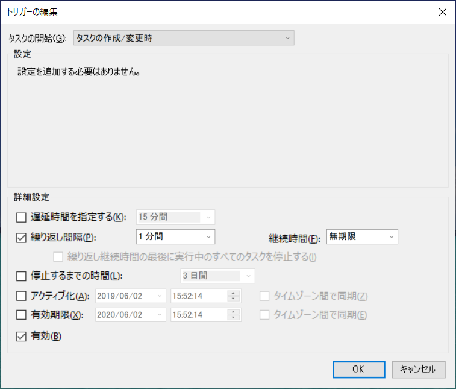

# Programación de tareas
Este ajuste sirve para que los procesos de Exment se ejecuten solos a una hora fija (programación de tareas).  
Hace falta una configuración adicional en el servidor. Los pasos son distintos en Linux y en Windows.

La programación de tareas se usa para lo siguiente.

- Hacer cada día, a una hora fija, la copia de seguridad de la base de datos y de los archivos.  
- Enviar un correo a una hora fija, según la configuración de las notificaciones, a las personas relacionadas con los datos que cumplen las condiciones.
- Comprobar cada minuto la información de terremotos y, si hay un terremoto que cumple las condiciones, enviar automáticamente la [comprobación de seguridad](/es/safety_check) (comando «exment:safetywatch»).
- Cuando se usa el motor de búsqueda de texto completo (Meilisearch), reparar automáticamente, una vez al día, las diferencias entre la base de datos y el índice (comando «exment:meili-reconcile»).  
※Solo se ejecuta cuando «MEILISEARCH_REPAIR_ENABLED» es true, a la hora de «MEILISEARCH_REPAIR_AT». Para más detalles, vea la [página del motor de búsqueda de texto completo (Meilisearch)](/es/additional_meilisearch).

### Pasos de configuración (Linux)
**(1) Ejecute el comando siguiente.**

~~~
crontab -e
~~~

**(2) Aparece la pantalla de configuración de Cron. Escriba lo siguiente.**

Con esto, el comando artisan schedule se ejecuta cada minuto. Después, Exment ejecuta las tareas a la hora fijada.  
※Lo de abajo es un ejemplo. Según el sistema operativo o el servicio, la forma de escribirlo o la configuración pueden ser distintas.

~~~
# Linux normal
* * * * * cd /(directorio raíz de Exment) && php artisan schedule:run >> /dev/null 2>&1

# Xserver (la misma versión de PHP elegida en el panel de administración, con la ruta completa. Abajo, el caso de PHP 8.3)
* * * * * cd /(directorio raíz de Exment) && nice -n 15 /usr/bin/php8.3 artisan schedule:run >> /dev/null 2>&1

# Sakura Internet
* * * * * cd /(directorio raíz de Exment); php artisan schedule:run >> /dev/null 2>&1
~~~

> **En los servidores de alquiler (Xserver, etc.)**: el `php` de cron puede ser el PHP estándar del servidor, distinto del PHP elegido en el panel de administración. Escriba con la ruta completa el PHP de la misma versión que en el panel de administración ([Servidor de alquiler](/es/install_rental)).

### Pasos de configuración (Windows)
- Ejecute el comando siguiente y copie el lugar (la ruta) donde está el archivo php.exe.  

~~~
where php
// C:\xampp\php\php.exe
~~~

- En el menú de Windows, escriba «task» e inicie el Programador de tareas.  


- En el Programador de tareas, haga clic en «Crear tarea».


- En la pestaña «General», configure como sigue. (El «Nombre» puede ser el que quiera)


- Haga clic en la pestaña «Desencadenadores». Se crean 2 desencadenadores.  
    (1) Haga clic en el botón «Nuevo».  
    Después, escriba lo siguiente.  
    - Iniciar la tarea: Al iniciar el sistema
    - Repetir cada: 1 minuto
    - Durante: Indefinidamente
    - Marque «Habilitado»  
    Al terminar, haga clic en «Aceptar».  


    (2) Haga clic otra vez en el botón «Nuevo».  
    Después, escriba lo siguiente.  
    - Iniciar la tarea: Al crear o modificar la tarea
    - Repetir cada: 1 minuto
    - Durante: Indefinidamente
    - Marque «Habilitado»  
    Al terminar, haga clic en «Aceptar».  


- En la pestaña «Acciones», haga clic en el botón «Nuevo».  
Después, escriba lo siguiente.
    - Acción: Iniciar un programa
    - Programa o script: la ruta hasta php que copió antes
    - Agregar argumentos: (directorio raíz de Exment)/artisan schedule:run


- En la pestaña «Configuración», marque «Ejecutar la tarea lo antes posible si no hubo un inicio programado».


- En un portátil, en la pestaña «Condiciones», desmarque «Iniciar la tarea solo si el equipo está conectado a la corriente alterna». 


- Cuando termine la configuración hasta aquí, haga clic en Aceptar.  
Aparece una pantalla para escribir las credenciales del usuario. Escriba la contraseña.  


- Por último, en la «Biblioteca del Programador de tareas», seleccione la tarea creada y haga clic en «Ejecutar». 


Con esto termina la configuración.


## Comprobación cuando no funciona bien (v4.0.6 o posterior)
Si no funciona bien, compruebe dónde está la causa con estos 2 métodos.

| Método | Lo que se sabe |
| ---- | ---- |
| Salida de registros | Si cron o el Programador de tareas llaman a la programación |
| Ejecutar el comando directamente | Si la propia configuración de las notificaciones o de la copia de seguridad es correcta |

### Salida de registros
Se recomienda comprobar mientras se escriben registros (logs).  
En la v4.0.6 se añadió un registro de depuración para la ejecución programada. Compruebe con los pasos siguientes.

#### Pasos de configuración 
- Añada lo siguiente al archivo .env y guárdelo.

~~~
EXMENT_DEBUG_MODE_SCHEDULE=true
~~~

- Con esto, al definir y al ejecutar la programación se escriben registros en /storage/logs/laravel.log.  
Si la programación de tareas está bien configurada, aparece un registro cada minuto.


#### Contenido de los registros

- Exment schedule debug defined.  
→Es el registro que aparece cuando terminan la salida de los registros de abajo y la configuración de la programación.  
→Si no aparece este registro, puede que la definición o la llamada de la programación no hayan terminado bien. Revise la configuración de cron o del Programador de tareas.

- Exment schedule debug everyMinute called.  
→Es el registro que aparece cada minuto. Si la definición de la programación ha terminado bien, aparece cada minuto.  
→Si no aparece este registro, puede que la definición o la llamada de la programación no hayan terminado bien. Revise la configuración de cron o del Programador de tareas.

- Exment schedule debug hourly called.  
→Es el registro que aparece en el minuto 0 de cada hora. Si la definición de la programación ha terminado bien, aparece cada hora.  
Tiene la misma definición que el comando de programación real de Exment. Primero compruebe si aparece este registro.

- Exment schedule command called.  
→Es el registro que aparece cuando el comando de programación de Exment empieza a ejecutarse. Si aparece este registro, al menos el comando de programación se ejecuta bien.  
Si aparece este registro pero las notificaciones o la copia de seguridad no se ejecutan como esperaba, revise los valores de configuración.


#### Puntos de atención
Este registro no distingue «si la ejecución viene de la programación o de un comando normal». También aparece al ejecutar un comando normal.  
Salvo cuando esté comprobando la programación, borre el valor EXMENT_DEBUG_MODE_SCHEDULE.


### Ejecutar el comando directamente
Si las notificaciones o la copia de seguridad no funcionan bien, también puede comprobarlo ejecutando usted mismo el comando de programación de Exment.  
Ejecute el comando siguiente.

```
php artisan exment:schedule
```

Este comando hace lo siguiente. En los dos casos, normalmente solo funciona en el minuto 00, pero si ejecuta el comando directamente se ejecuta enseguida.

- Ejecuta las notificaciones (Paso del tiempo) cuya «Hora de notificación» coincide.
- Ejecuta la copia de seguridad automática cuya «Hora de inicio de la copia de seguridad automática (hora)» coincide.

Si con este comando funciona como esperaba, es posible que, por algún motivo, sea la programación (cron o el Programador de tareas) la que no funciona bien.  
Úselo como referencia para buscar la causa.


[← Volver a la lista de ajustes adicionales](/es/quickstart_more)
