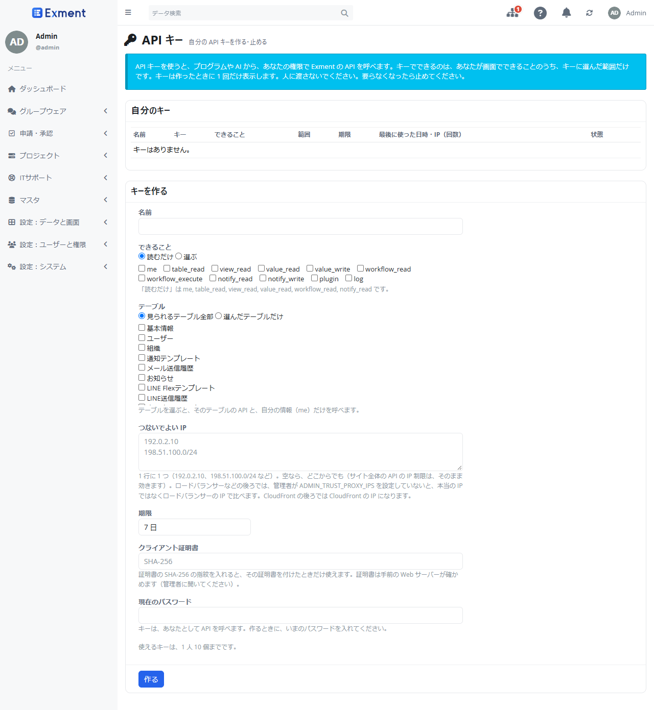
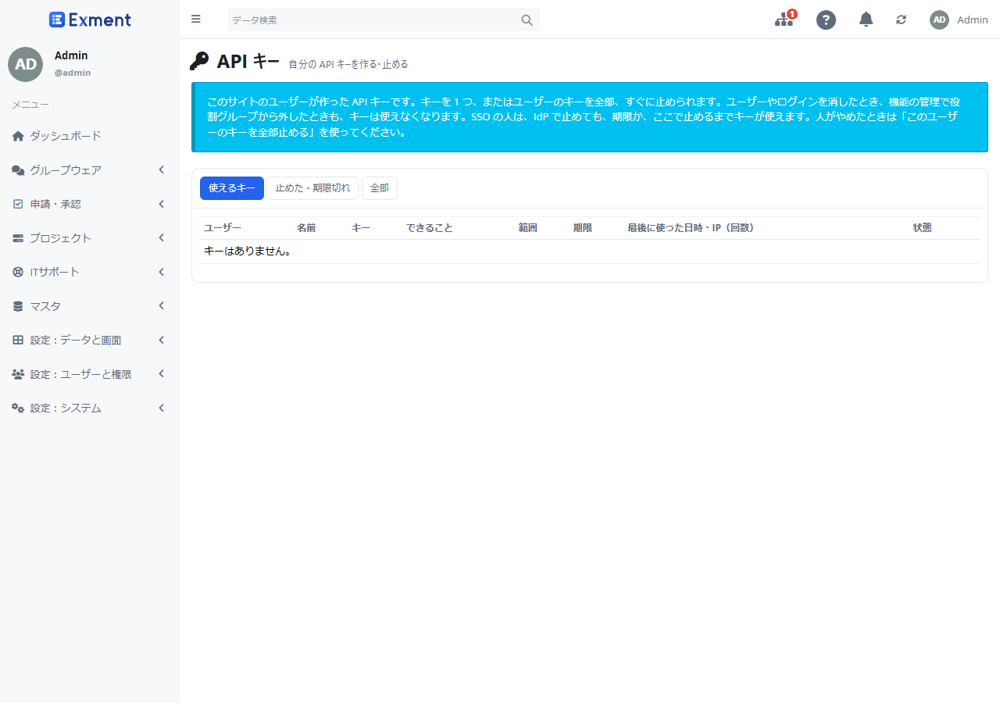

# Claves de API
Cada usuario crea sus propias claves de API y, desde un programa o una IA, puede llamar a la API de Exment con sus propios permisos. La clave se envía como `Authorization: Bearer exk_...`, en lugar de un token de acceso de OAuth.

Nota: esta función se puede usar desde Exment v7.2.1.  
Nota: al principio no se usa. El administrador del sistema debe activar "Claves de API de los usuarios" en "Configuración: sistema" → "[Gestión de funciones](/es/feature)" y elegir los grupos de roles que pueden usarla.  
Nota: los tokens de acceso de OAuth ([Configuración de la API](/es/api)) se pueden usar como hasta ahora.

## Crear una clave propia
Se abre desde "Claves de API", en la pantalla "Configuración" del menú de usuario, arriba a la derecha (la URL es `/auth/api_keys`). Los administradores del sistema también pueden abrirla desde la lista de "Configuración de la API".

| Campo | Contenido |
|---|---|
| Nombre | Un nombre que indique para qué sirve la clave |
| Qué puede hacer | "Solo lectura" (me, table_read, view_read, value_read, workflow_read, notify_read), o elegir los ámbitos |
| Tablas | Todas las tablas que usted puede ver, o solo las tablas elegidas. Si elige tablas, solo se puede llamar a la API de esas tablas y a su propia información (me) |
| Direcciones IP permitidas | Una por línea (se admiten rangos). IPv4 e IPv6 (7.3.0: `2001:db8::/32`, `2001:db8:1:2::/64`). Si está vacío, desde cualquier lugar (la restricción de IP de la API de todo el sitio se sigue aplicando) |
| Fecha de caducidad | 7, 30, 90 (al principio), 180 o 365 días |
| Certificado de cliente | Si escribe la huella SHA-256 de un certificado, la clave solo funciona cuando se presenta ese certificado (el certificado lo comprueba el servidor web que está delante) |
| Contraseña actual | Al crear la clave, escriba su contraseña actual |

- **La clave se muestra una sola vez, al crearla**. Anótela y no se la dé a nadie. Después no se puede volver a ver.
- Con una clave **solo se puede hacer lo que ese usuario puede hacer en las pantallas y, de eso, solo los ámbitos elegidos para la clave**.
- Cada persona puede tener hasta 10 claves en uso.
- En la lista aparecen la fecha y hora, la IP y el número de veces del último uso. Detenga desde la lista las claves que ya no necesite.

## Usar una clave
~~~
curl -H "Authorization: Bearer exk_xxxxxxxx" https://(URL de Exment)/api/data/(nombre de la tabla)
~~~

Nota: en un sitio que lleva "/admin", es `https://(URL de Exment)/admin/api/...` ([el "admin" incluido en la URL](/es/additional_prefix)).

Una clave deja de funcionar cuando caduca, cuando se detiene, cuando se elimina el usuario o su inicio de sesión, cuando el usuario sale de los grupos de roles que pueden usarla, cuando no coincide con las direcciones IP permitidas o con el certificado, o cuando llama fuera de las tablas elegidas (no se devuelve el motivo).

## Administradores del sistema: todas las claves
En la pantalla de administración de "Claves de API" (la URL es `/api_keys`), puede ver las claves de API creadas por los usuarios de este sitio y detener una clave, o todas las claves de un usuario, al instante.

- En el caso de los usuarios de SSO, aunque se les detenga en el IdP, la clave sigue funcionando hasta que caduca o se detiene aquí. Cuando una persona deje la organización, use "Detener todas las claves de este usuario".
- Con `ADMIN_API_KEY_REQUIRE_CLIENT_CERT=true` en `.env`, se puede exigir un certificado de cliente a todas las claves. Detrás de un balanceador de carga o similar, configure `ADMIN_TRUST_PROXY_IPS` para que se compare la IP real.

## Temas relacionados
- [Servidor MCP (uso desde una IA)](/es/mcp)
- [Configuración de la API](/es/api)
- [Gestión de funciones](/es/feature)
