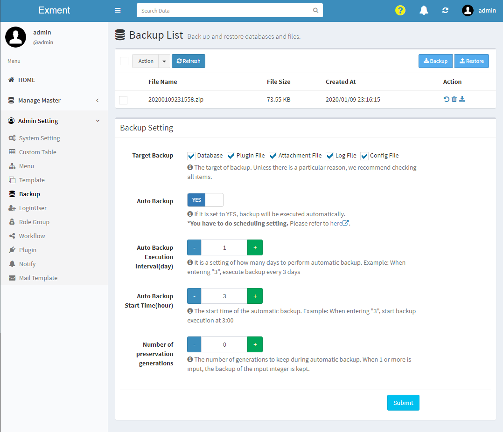

# Copia de seguridad y restauración
Aquí se explica cómo hacer la "copia de seguridad", que guarda los datos de Exment, y la "restauración", que vuelve al estado anterior con los datos guardados.

| Lo que quiere hacer | Dónde mirar |
|---|---|
| Hacer una copia de seguridad ahora mismo | Hacer una copia de seguridad manual |
| Hacer copias de seguridad automáticas a una hora fija, por ejemplo cada día | Hacer copias de seguridad automáticas |
| Volver al estado de una copia de seguridad | Restaurar |
| Hacerlo con comandos | (Para usuarios avanzados) Copia de seguridad con comandos y (Para usuarios avanzados) Restauración con comandos |

## Resumen
La copia de seguridad y la restauración se usan, por ejemplo, en estos casos.

- Hacer una copia de seguridad antes de una actualización grande de datos y volver atrás si algo sale mal.
- Hacer una copia de seguridad cada día para estar preparado ante fallos inesperados.
- Migrar todos los datos del entorno actual a otro entorno. (Antes de hacerlo, compruebe siempre que funciona.)

Lo que se guarda en la copia de seguridad es lo siguiente.
- Base de datos
- Archivos de plugins
- Archivos adjuntos
- Archivos de registro
- Archivos de configuración

## Atención
- Al migrar a otro entorno, según el entorno, puede que no termine bien.  
En especial, al migrar a otro sistema operativo (Windows o Linux), a otro tipo de base de datos (MySQL o MariaDB) o a otra versión de la base de datos, puede que no termine bien por distintos motivos.  
Haga siempre una comprobación previa.

- Como comprobación previa, recomendamos sobre todo lo siguiente.
    - Hacer la migración primero en un entorno de desarrollo o similar.
    - Probar la migración cuando solo se han creado las definiciones de las tablas.
    - Usar el mismo tipo y la misma versión de base de datos.

- Ahora, en SQLServer no se admiten la copia de seguridad ni la restauración automáticas.  
Haga la copia de seguridad y la restauración a mano con los pasos de [Copia de seguridad y restauración (SQL Server)](/es/backup_sqlserver).

## Pantalla
- En el menú de la izquierda, elija "Configuración de administración > Copia de seguridad".  
O bien abra la siguiente URL.  
http(s)://(URL de Exment)/backup  
Así se muestra la pantalla de copias de seguridad.

> ※La URL corresponde a la configuración estándar, sin "/admin" (sitios instalados de nuevo con la v7.2.1 o posterior). Si `ADMIN_ROUTE_PREFIX` del archivo `.env` tiene un valor (en los sitios instalados con una versión anterior es "admin"), añada ese valor después de la URL del sitio (ejemplo: `http(s)://(URL de Exment)/admin/backup`). Para más detalles, vea [Cambiar o quitar el "admin" de la URL](/es/additional_prefix).

## Copia de seguridad
Hay 2 formas de hacer la copia de seguridad: "manual" y "automática".

### Hacer una copia de seguridad manual
Estos son los pasos para hacer una copia de seguridad a mano cuando quiera.

- Haga clic en el botón [Copia de seguridad], arriba a la derecha de la página.  
  

- Se muestra un cuadro de diálogo de confirmación. Haga clic en [Confirmar] y espere.  
**※La copia de seguridad tarda mucho. Espere sin hacer nada.**
  

- Al terminar, se muestra un mensaje.  
En la lista de copias de seguridad aparece un archivo cuya fecha de creación es la del momento en que se ejecutó.
  
  

- El archivo de copia de seguridad creado se puede descargar.  
Haga clic en el enlace [Descargar] de la fila de la copia de seguridad.  
  

- El nombre del archivo de la copia de seguridad creada se puede cambiar.  
Haga clic en el enlace [Editar nombre de archivo] de la fila de la copia de seguridad.  
※No se pueden poner nombres con katakana de ancho medio ni con símbolos.
  
- Después de escribir el nombre del archivo, haga clic en el botón [Enviar].
  

- Al terminar, se muestra un mensaje y cambia el nombre del archivo en la lista de copias de seguridad.
  

  

### Hacer copias de seguridad automáticas
Se pueden hacer copias de seguridad automáticas a una hora fija.  
Si hace copias de seguridad de forma periódica, puede recuperar los datos también cuando, por ejemplo, se actualizan con un error grande.  
**※Antes hay que hacer la configuración de la [programación de tareas](/es/additional_task_schedule).**

Como ejemplo, se explica cómo configurar una copia de seguridad "a las 3 de la noche", "cada día", guardando "7 generaciones de copias de seguridad".  

- En "Configuración de copias de seguridad", ponga "Copia de seguridad automática" en "YES".
  

- Cambie los ajustes de las opciones.
  

- Después, haga clic en el botón [Guardar], en la parte de abajo de la página.  

<h3 id="backup_command"><a href="#/es/backup?id=backup_command" data-id="backup_command" class="anchor">(Para usuarios avanzados) Copia de seguridad con comandos</a></h3>

La copia de seguridad también se puede hacer con un comando. Ejecute el siguiente comando en el directorio raíz del proyecto.

~~~
php artisan exment:backup
~~~

- Si no indica "--target=", se hace la copia de seguridad de todo (base de datos, archivos de plugins, archivos adjuntos, archivos de registro y archivos de configuración).
- Para limitar lo que se guarda, indique en "--target=" las siguientes claves separadas por comas.
    - database : Base de datos
    - plugin : Archivos de plugins
    - attachment : Archivos adjuntos
    - log : Archivos de registro
    - config : Archivos de configuración

~~~
# Ejemplo: hacer la copia de seguridad solo de la base de datos y de los archivos adjuntos
php artisan exment:backup --target=database,attachment
~~~

## Restaurar
Hay 2 formas de restaurar (recuperar) los datos: "Elegir en la lista de copias de seguridad" y "Subir".  

### Atención al restaurar
- Si la versión de Exment con la que se hizo la copia de seguridad es distinta de la versión de Exment instalada ahora, después de restaurar hay que actualizar la base de datos.  
Ejemplo: 
    - Versión en el momento de la copia de seguridad: v1.1.6 
    - Versión actual: v1.2.0  
    →Hay que actualizar la base de datos  
    
En ese caso, después de restaurar, ejecute el siguiente comando.  

~~~
php artisan exment:update
~~~

- Después de restaurar, la sesión se cierra automáticamente. Inicie sesión con el ID y la contraseña de un usuario que estaba en la copia de seguridad.  

- Desde la v4.1.0, mientras se hace la restauración, el sistema está en modo de mantenimiento.  
Al terminar la restauración, el modo de mantenimiento se quita automáticamente. Si por algún motivo el modo de mantenimiento no se quita, quítelo con los pasos de [Quitar el modo de mantenimiento](/es/troubleshooting).

### Elegir en la lista de copias de seguridad
Es la forma de recuperar los datos eligiendo el archivo que se restaura en la lista de las copias de seguridad hechas antes.  

- En la lista de copias de seguridad, haga clic en el enlace [Restaurar].  
  

- Se muestra un cuadro de diálogo de confirmación. Haga clic en [Confirmar] y espere.  
**※La restauración tarda mucho. Espere sin hacer nada.**
  

- Si se muestra el mensaje de finalización, el entorno ha vuelto al momento de la copia de seguridad.  
Se pasa automáticamente a la página de inicio de sesión.  
  

### Subir
Es la forma de recuperar los datos subiendo a Exment una copia de seguridad guardada en su equipo (local).  
**※Si el archivo que se sube es demasiado grande, puede que no termine bien.** En ese caso, vea [Si el archivo es demasiado grande para cargarlo](/es/backup?id=Si-el-archivo-es-demasiado-grande-para-cargarlo), más abajo.  

- Haga clic en el botón [Restaurar], arriba a la derecha de la página.  
  

- Se muestra el cuadro de diálogo de subida de archivos. Elija el archivo de copia de seguridad descargado en su equipo y haga clic en "Enviar".  
  

- Después de hacer clic en el botón "Enviar", espere.  
**※La restauración tarda mucho. Espere sin hacer nada.**

- Si se muestra el mensaje de finalización, el entorno ha vuelto al momento de la copia de seguridad.
  

### Si el archivo es demasiado grande para cargarlo
Al restaurar con "Subir", si el archivo de copia de seguridad es demasiado grande, la restauración puede fallar.  
En ese caso, haga la restauración con uno de los dos procedimientos siguientes.  

#### (1) Cambiar el límite de subida

- Cambie el tamaño máximo de subida con los pasos de [Cambio de los valores de configuración de PHP](/es/additional_php_ini).

#### (2) Colocar el archivo de copia de seguridad directamente en el servidor

- Coloque el archivo de copia de seguridad descargado en la siguiente ruta del servidor.  

~~~
(directorio raíz del proyecto)/storage/app/backup/list
~~~

- Vuelva a cargar la pantalla de copias de seguridad.  

- En la lista de copias de seguridad aparece el archivo de copia de seguridad que ha colocado. Haga la restauración con los pasos de "Elegir en la lista de copias de seguridad", explicados arriba.

### Si aparece un error en la pantalla de copias de seguridad o en los comandos
En la pantalla de copias de seguridad o en los comandos puede aparecer un mensaje como el siguiente.

  

Cuando sale este error, puede que el servidor no tenga la configuración necesaria para la copia de seguridad y la restauración.  
Consulte [Solución de problemas](/es/troubleshooting) y cambie la configuración del servidor.

### Si quiere inicializar los datos personalizados, etc. después de restaurar
Después de restaurar, puede limpiar los datos personalizados, etc. de Exment que estaban guardados y crear los datos desde cero.  
Para más detalles, vea [Limpieza de los datos personalizados](/es/refresh_data).

### Si usa SQL Server
Si usa SQLServer, ahora Exment no admite la copia de seguridad ni la restauración desde la pantalla. Hay que hacer el trabajo a mano.  
Para más detalles, vea [Copia de seguridad y restauración (SQL Server)](/es/backup_sqlserver).

<h3 id="restore_command"><a href="#/es/backup?id=restore_command" data-id="restore_command" class="anchor">(Para usuarios avanzados) Restauración con comandos</a></h3>

La restauración también se puede hacer con un comando.

- Coloque el archivo de copia de seguridad descargado en la siguiente ruta del servidor.  

~~~
(directorio raíz del proyecto)/storage/app/backup/list
~~~

- Ejecute el siguiente comando en el directorio raíz del proyecto.

~~~
php artisan exment:restore (nombre del archivo zip)
~~~

- Si omite el nombre del archivo zip, se muestra la lista de copias de seguridad. Elija el archivo que quiere restaurar.
- Antes de ejecutar se muestra un mensaje de confirmación. Para ejecutar sin mostrar el mensaje de confirmación, indique "--yes".

~~~
# Ejemplo: restaurar sin mostrar el mensaje de confirmación
php artisan exment:restore (nombre del archivo zip) --yes
~~~

<h3 id="change_backup_target"><a href="#/es/backup?id=change_backup_target" data-id="change_backup_target" class="anchor">(Para usuarios avanzados) Cambiar el destino de las copias de seguridad</a></h3>

Normalmente, los archivos de copia de seguridad se guardan dentro del servidor web.  
También se pueden guardar en otro lugar. Si están en otro lugar, aunque el servidor web se averíe y no arranque, puede descargar de allí el archivo de copia de seguridad y recuperar Exment.

※Los pasos de configuración se han movido a [Cambiar el lugar de almacenamiento de archivos](/es/additional_file_saveplace).

### Puntos a tener en cuenta
- En algunos servidores no se puede cambiar el destino de las copias de seguridad.  
En especial, en los servidores de alquiler, **el proveedor puede limitar FTP y otros servicios con su configuración**. Téngalo en cuenta.