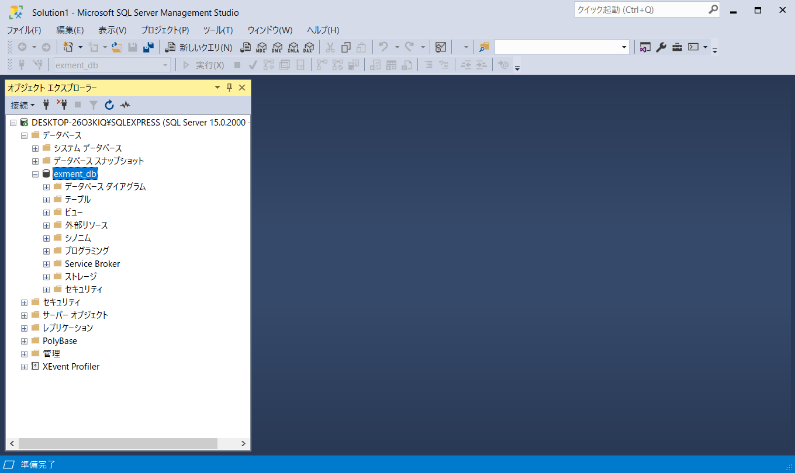
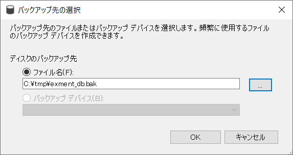

# Copia de seguridad y restauración (SQL Server)
Estos son los pasos para hacer a mano la copia de seguridad y la restauración (volver al estado anterior) de los datos de Exment cuando la base de datos es SQL Server.  

## Resumen
Con SQL Server no se puede hacer la copia de seguridad ni la restauración desde la pantalla de Exment. Haga a mano estas 2 cosas.

| Objeto | Método |
| ---- | ---- |
| Base de datos | Se hace la copia de seguridad y la restauración con Microsoft SQL Server Management Studio (SSMS) |
| Archivos (los 4 de abajo) | Se guardan en otro lugar, carpeta por carpeta, con el Explorador o una herramienta parecida. Se devuelven a su sitio cuando hace falta |

- Archivos de plugins
- Archivos adjuntos
- Archivos de registro (log)
- Archivos de configuración

## Copia de seguridad de la base de datos
Estos son los pasos para hacer la copia de seguridad de SQL Server.  
Ejecútelos cuando quiera.  

- Inicie Microsoft SQL Server Management Studio (SSMS).  
**※Inicie sesión siempre con un miembro que tenga el rol de servidor sysadmin, el rol de base de datos db_owner o el rol de base de datos db_backupoperator.**
  

- Haga clic con el botón derecho en la base de datos de la que quiere hacer la copia y elija Tareas → Copia de seguridad.  
  

- En la pantalla de copia de seguridad de la base de datos, elija «Tipo de copia de seguridad: Completa» y haga clic en Agregar, en el destino de la copia.  
  

- Aparece el cuadro de diálogo para elegir el destino de la copia. Decida la carpeta y el nombre de archivo que quiera y haga clic en el botón Aceptar.  
  

- Vuelva a la pantalla de copia de seguridad de la base de datos y haga clic en el botón Aceptar. Empieza la copia de seguridad. Al terminar, aparece un mensaje.   
  

- Compruebe que en el destino elegido se ha creado el archivo de copia de seguridad (.bak).

## Copia de seguridad de los archivos
Los archivos siguientes están en carpetas fijas del servidor. Guárdelos, carpeta por carpeta, en otra carpeta o en un medio externo con el Explorador o una herramienta parecida.
  
~~~
Archivos de plugins        : (directorio raíz del proyecto)/storage/app/plugins
Archivos adjuntos          : (directorio raíz del proyecto)/storage/app/admin
Archivos de registro (log) : (directorio raíz del proyecto)/storage/logs
Archivos de configuración  : (directorio raíz del proyecto)/config
Archivo .env               : (directorio raíz del proyecto)/.env
~~~
    
**※El archivo .env contiene ajustes importantes de Laravel. Se recomienda hacer copia de seguridad de él. Pero al restaurar, no lo sustituya tal cual**.

## Restauración de la base de datos
Estos son los pasos para restaurar una copia de seguridad de SQL Server.  
Hágalo siempre después de comprobar que no hay usuarios usando Exment.  

- Inicie Microsoft SQL Server Management Studio (SSMS).  
**※Inicie sesión siempre con un miembro que tenga el rol de servidor sysadmin o dbcreator, o con el propietario de la base de datos (dbo).**
  

- Haga clic con el botón derecho en la base de datos que quiere restaurar y elija Tareas → Restaurar → Base de datos.  
  

- En la pantalla de restauración de la base de datos, elija «Origen: Dispositivo» y haga clic en «...» para abrir el cuadro de diálogo de selección de dispositivos de copia de seguridad.  
  

- Al hacer clic en el botón Agregar, aparece el cuadro de diálogo para buscar el archivo de copia de seguridad. Elija el archivo de copia de seguridad que quiere restaurar y haga clic en Aceptar.  
  

- Compruebe que el archivo elegido se ha añadido al cuadro de diálogo de selección de dispositivos de copia de seguridad y haga clic otra vez en Aceptar.  
  

- Vuelve a la pantalla de restauración de la base de datos. Elija «Seleccionar una página: Opciones» para abrir la pestaña de opciones. Marque «Opciones de restauración: Sobrescribir la base de datos existente» y «Conexiones del servidor: Cerrar las conexiones existentes con la base de datos de destino», y haga clic en Aceptar.  
  

- Cuando termina la restauración, aparece un mensaje.  
  

### Atención al restaurar
- Si la versión de Exment del momento de la copia de seguridad y la versión de Exment instalada ahora son distintas, después de restaurar hay que actualizar la base de datos.  
Ejemplo: versión en el momento de la copia: v1.1.6; versión actual: v1.2.0 → hay que actualizar la base de datos  
En ese caso, después de restaurar, ejecute el comando siguiente.  

~~~
php artisan exment:update
~~~
    
**※Una base de datos copiada con una versión nueva de Exment no se puede restaurar en una versión antigua de Exment**.

## Restauración de los archivos
Devuelva a su sitio los archivos guardados, carpeta por carpeta, con el Explorador o una herramienta parecida.  

- Los archivos de plugins y los archivos adjuntos están unidos a los datos de la base de datos. Restaure, junto con la base de datos, los que se copiaron en el mismo momento.
- Se recomienda no sobrescribir tal cual los archivos de registro, sino guardarlos con otro nombre en la misma carpeta.
  
~~~
Archivos de plugins        : (directorio raíz del proyecto)/storage/app/plugins
Archivos adjuntos          : (directorio raíz del proyecto)/storage/app/admin
Archivos de registro (log) : (directorio raíz del proyecto)/storage/logs
Archivos de configuración  : (directorio raíz del proyecto)/config
~~~
