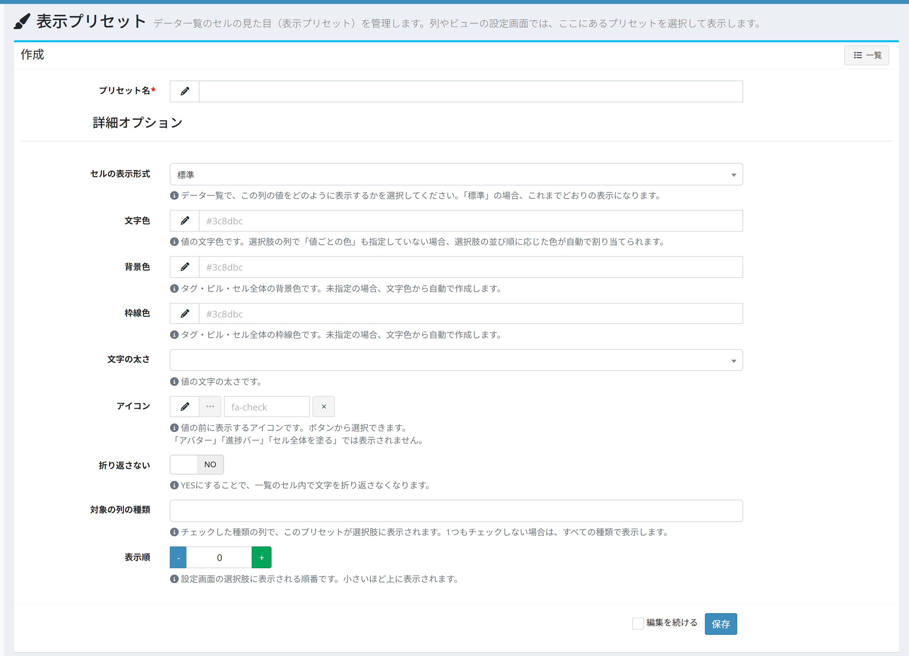
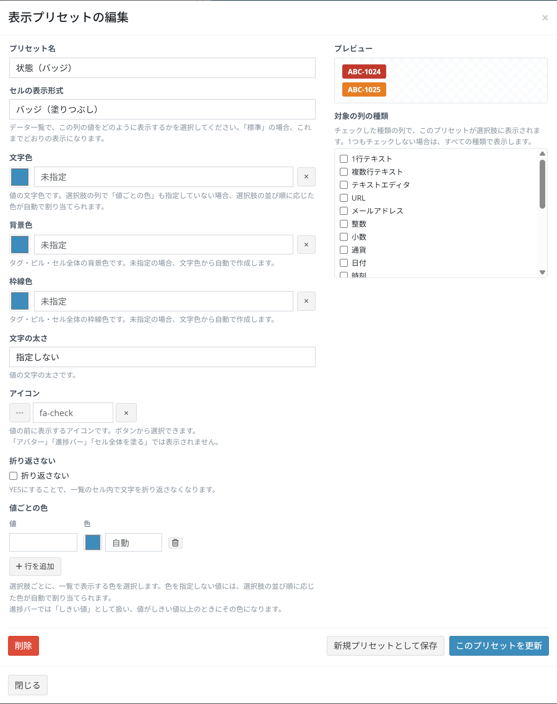

# Ajustes predefinidos de estilo de celda

Esta función guarda con un nombre el aspecto de una celda (color, forma, icono, etc.) para reutilizarlo en varias columnas y vistas. El mismo aspecto se aplica no solo a la lista de datos, sino también a las tarjetas de la vista Kanban.

## Qué son los ajustes predefinidos de estilo de celda

Hasta ahora, el aspecto de la celda se configuraba **columna por columna**.  
Por eso, una misma configuración, como "mostrar el estado como píldora (esquinas redondeadas)", había que volver a hacerla cada vez que cambiaba la tabla o la columna.

Un ajuste predefinido es un mecanismo para guardar esa configuración una sola vez y con un nombre.  
En la columna o en la vista solo se registra "qué ajuste predefinido se usa", así que ocurre lo siguiente.

- El mismo aspecto se puede usar en otras columnas y en otras tablas con solo elegirlo en una lista
- Al corregir un ajuste predefinido, cambia de una vez la visualización de todas las columnas que lo tienen elegido

## Dónde se usan los ajustes predefinidos

Los ajustes predefinidos se usan en las 4 pantallas siguientes.

| Pantalla | Función | Permiso necesario |
| --- | --- | --- |
| Ajustes predefinidos de estilo de celda (pantalla de biblioteca) | Lista, creación, edición y eliminación de ajustes predefinidos | Administrador del sistema |
| Configuración de columnas personalizadas > Apariencia de la celda | Elegir un ajuste predefinido como aspecto predeterminado de esa columna | Permiso de configuración de tabla de la tabla en cuestión |
| Configuración de vista personalizada > Seleccionar columnas de la vista | Elegir un ajuste predefinido como aspecto solo para esa vista | Permiso de configuración de tabla de la tabla en cuestión |
| Configuración de la vista Kanban > Columnas mostradas en la tarjeta > Estilo | Elegir un ajuste predefinido como aspecto en la tarjeta | Permiso de configuración de tabla de la tabla en cuestión |

Nota: los ajustes predefinidos no pertenecen a una tabla. Con crear uno, se puede elegir desde las columnas de cualquier tabla.  
Nota: el ajuste predefinido indicado en la vista tiene prioridad sobre la configuración de la columna.

## Pantalla de biblioteca (lista de ajustes predefinidos)

### Abrir la página

Abra `(dirección de Exment)/cell_style_preset` en el navegador.

> Nota: la URL corresponde a la configuración estándar sin "/admin" (sitios instalados de nuevo con v7.2.1 o posterior). Si `ADMIN_ROUTE_PREFIX` tiene un valor en `.env` (en los sitios instalados con una versión anterior es "admin"), añada ese valor después de la URL del sitio (ejemplo: `http(s)://(URL de Exment)/admin/cell_style_preset`). Para más detalles, consulte [Cambiar o quitar "admin" de la URL](/es/additional_prefix).

Para poder abrirla en cualquier momento, añádala al menú en la configuración de [Menú](/es/menu).

1. Abra "Configuración de administración" > "Menú".
2. Haga clic en [Nuevo], arriba a la derecha.
3. Elija "Menú del sistema" en "Tipo de menú" y "Estilos de celda predefinidos" en "Nombre del menú".
4. Elija el menú principal donde se mostrará ("Configuración de administración", etc.) y guarde.

En la lista aparecen los siguientes elementos.

| Elemento | Contenido |
| --- | --- |
| Nombre del ajuste predefinido | El nombre que aparece en las opciones de las pantallas de configuración |
| Vista previa | Cómo se ve realmente en la lista de datos |
| Tipos de columna | Los tipos de columna en los que este ajuste aparece como opción |
| Orden de visualización | El orden en las opciones (cuanto menor, más arriba) |
| Fecha de actualización | Fecha y hora de la última actualización |

Al instalar Exment ya están registrados desde el principio 15 ajustes predefinidos de uso frecuente.

| Nombre del ajuste predefinido | Principales tipos de columna |
| --- | --- |
| Estado (píldora) | Selección (valores fijos) |
| Estado (insignia) | Selección (valores fijos) |
| Etiqueta (tag) | Selección (valores fijos) |
| Opciones (punto) | Selección (valores fijos) |
| Prioridad (punto cuadrado) | Selección (valores fijos), Selección (guardar valor y etiqueta) |
| Nivel (punto redondo) | Selección (valores fijos), Selección (guardar valor y etiqueta) |
| SÍ/NO (insignia) | SÍ/NO, Selección de 2 valores |
| Responsable (avatar) | Usuario, Organización |
| Progreso (barra) | Entero, Decimal |
| Número (negrita) | Entero, Decimal, Moneda |
| Fecha (sin ajuste de línea) | Fecha, Fecha y hora, Hora |
| Código (monoespaciado) | Texto de una línea, Numeración automática, URL, Correo electrónico |
| Solo texto (sin nombre) | Todos los tipos de columna |
| Alerta (rojo, negrita) | Todos los tipos de columna |
| Rellenar toda la celda | Todos los tipos de columna |

Quién puede editar y eliminar los ajustes predefinidos:

- Solo los administradores del sistema pueden abrir la pantalla de biblioteca (no pueden abrirla los usuarios a los que se dio el permiso de sistema con un grupo de roles). En la pantalla de biblioteca se pueden editar y eliminar todos los ajustes predefinidos, sea quien sea su creador, incluidos los registrados desde el principio.
- En la pantalla de "Crear o editar un ajuste predefinido en el momento (botón del lápiz)", los administradores del sistema pueden editar y eliminar todos los ajustes predefinidos. Los demás usuarios solo pueden editar y eliminar los que crearon ellos mismos. Los demás ajustes son de solo lectura: no aparece [Eliminar] y no se puede pulsar [Actualizar este ajuste predefinido]. En la pantalla de edición aparece "Este ajuste predefinido no se puede editar. Para usarlo con cambios, guárdelo como un nuevo ajuste predefinido.". Para usarlo con cambios, use [Guardar como nuevo ajuste predefinido].

Nota: si "Usar la gestión de permisos" de la configuración del sistema está en NO, todos los usuarios pueden usar la pantalla de biblioteca.

### Crear o editar un ajuste predefinido

Haga clic en el botón [Nuevo], arriba a la derecha de la lista, o en el icono de edición de cada fila.

#### Nombre del ajuste predefinido
Es el nombre que aparece en las opciones de las pantallas de configuración. Es obligatorio.

#### Estilo de visualización de la celda
Elija con qué forma se muestra el valor.

| Opción | Qué se muestra |
| --- | --- |
| Estándar | La visualización de siempre (sin decoración) |
| Solo color del texto | Solo se da color al texto |
| Etiqueta (esquinas poco redondeadas) | Etiqueta con marco y esquinas un poco redondeadas |
| Píldora (esquinas muy redondeadas) | Etiqueta con esquinas muy redondeadas |
| Insignia (relleno sólido) | Insignia de color intenso con el fondo relleno |
| Marca cuadrada + texto | Pone una marca cuadrada de color delante del valor |
| Marca redonda + texto | Pone una marca redonda de color delante del valor |
| Monoespaciada | Muestra los caracteres con el mismo ancho (códigos, ID, etc.) |
| Avatar (inicial en un círculo) | Muestra la inicial como un icono redondo (responsable, etc.) |
| Barra de progreso (0-100) | Muestra el valor como un gráfico de barra horizontal |
| Rellenar toda la celda | Da color a todo el fondo de la celda |

#### Color del texto
Es el color del texto del valor.  
Nota: en una columna de opciones, si tampoco se indica "Color por valor", se asigna automáticamente un color según el orden de las opciones.

#### Color de fondo
Es el color de fondo de la etiqueta, la píldora o toda la celda. Si no se indica, se crea automáticamente a partir del color del texto.

#### Color del borde
Es el color del borde de la etiqueta, la píldora o toda la celda. Si no se indica, se crea automáticamente a partir del color del texto.

#### Grosor de la fuente
Se elige entre "Normal", "Seminegrita" y "Negrita".

#### Icono
Es el icono que se muestra delante del valor. Se puede elegir con el botón.  
Nota: no se muestra con "Avatar", "Barra de progreso" ni "Rellenar toda la celda".

#### No ajustar líneas
Con YES, el texto ya no se parte en varias líneas dentro de la celda de la lista. Se usa en columnas difíciles de leer si se cortan a mitad, como fechas o números.

#### Tipos de columna
Este ajuste predefinido aparece como opción en las columnas de los tipos marcados.  
Nota: si no se marca ninguno, aparece en todos los tipos.

#### Orden de visualización
Es el orden en que aparece en las opciones de las pantallas de configuración. Cuanto menor es el número, más arriba aparece.

## Asignar un ajuste predefinido a una columna personalizada

1. Elija la tabla en el menú y abra [Configuración detallada de la tabla] > [Configuración de columnas personalizadas].
2. Abra la pantalla de edición de la columna que quiere configurar y desplácese hasta el apartado "Apariencia de la celda".

3. En las opciones de "Apariencia predefinida", elija el ajuste predefinido que quiere usar.  
Las opciones se muestran con su aspecto real.

4. Al elegir, la "Vista previa" de abajo cambia al momento. Se puede comprobar sin guardar.

5. Guarde con el botón [Enviar], en la parte inferior de la pantalla.

### Color por valor

En una columna de opciones, con "Color por valor" se puede indicar un color para cada opción.  
A los valores sin color indicado se les asigna automáticamente un color según el orden de las opciones.

Nota: en la barra de progreso se trata como "umbral": el valor toma ese color cuando es igual o mayor que el umbral.

## Crear o editar un ajuste predefinido en el momento (botón del lápiz)

Al hacer clic en el botón del lápiz, a la derecha de "Apariencia predefinida", se puede editar el ajuste predefinido sin salir de la pantalla de configuración.

Al cambiar la configuración en la parte izquierda, la "Vista previa" de la derecha se actualiza al momento.

En la parte inferior del cuadro de diálogo están los siguientes botones.

| Botón | Comportamiento |
| --- | --- |
| Guardar como nuevo ajuste predefinido | Añade el contenido actual como **otro ajuste predefinido**. El ajuste original no cambia. |
| Actualizar este ajuste predefinido | Sobrescribe el ajuste predefinido que está abierto. **También cambia la visualización de las demás columnas que tienen elegido este ajuste.** |
| Eliminar | Elimina el ajuste predefinido. Para evitar errores, se elimina al pulsarlo otra vez. |
| Cerrar | Cierra sin guardar. |

> Si quiere usar un ajuste predefinido existente con un pequeño cambio, no use "Actualizar este ajuste predefinido": use **"Guardar como nuevo ajuste predefinido"**.  
> Al actualizar, también cambia el aspecto de las demás columnas que usan el mismo ajuste predefinido.

## Asignar un ajuste predefinido a una columna de la vista

A veces se quiere cambiar la forma de mostrar según la vista, aunque la tabla sea la misma.  
En ese caso, indique el ajuste predefinido en "Seleccionar columnas de la vista" de la configuración de vista personalizada.

En la columna "Ajuste predefinido de aspecto de celda", elija un ajuste predefinido para cada columna.  
Con el botón del lápiz de la derecha se abre el mismo cuadro de diálogo que en la configuración de la columna.

Nota: el ajuste predefinido indicado aquí **tiene prioridad sobre la configuración de la columna personalizada.**  
Nota: si no se elige nada, se usa la configuración de la columna personalizada.

## Preguntas frecuentes y puntos de atención

#### Si elimino un ajuste predefinido, ¿qué pasa con las columnas que lo usan?
Las columnas que tenían elegido ese ajuste vuelven a la visualización "Estándar", sin decoración. Los datos no cambian.

#### El ajuste predefinido no aparece en las opciones
Puede que "Tipos de columna" del ajuste predefinido no incluya el tipo de esa columna.  
Abra el ajuste predefinido en la pantalla de biblioteca y compruebe "Tipos de columna". Si quiere que aparezca en todos los tipos, no marque ninguna casilla.

#### Cambié el aspecto y también cambió la visualización de otras tablas
Los ajustes predefinidos no pertenecen a una tabla: se comparten en todo Exment.  
Si quiere cambiar el aspecto solo en una tabla, cree otro ajuste predefinido con "Guardar como nuevo ajuste predefinido".

## Temas relacionados

- [Columna personalizada](/es/column)
- [Vista personalizada](/es/view)
- [Lista de datos](/es/data_grid)
- [Vista Kanban](/es/view_kanban)
