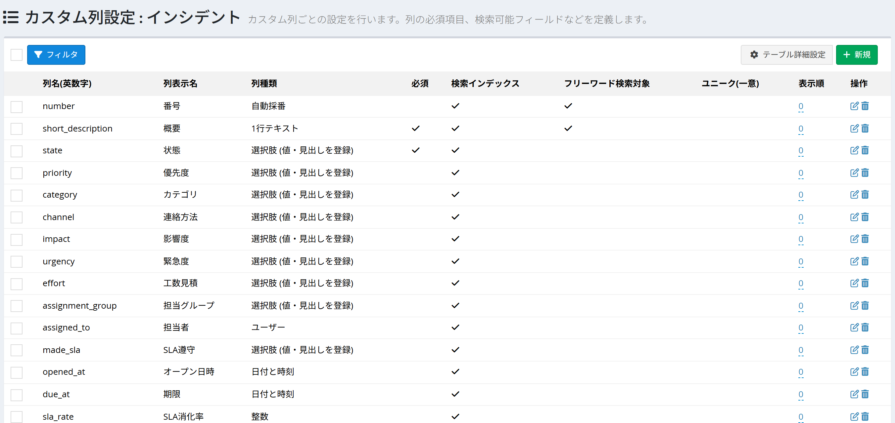
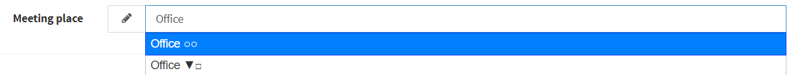
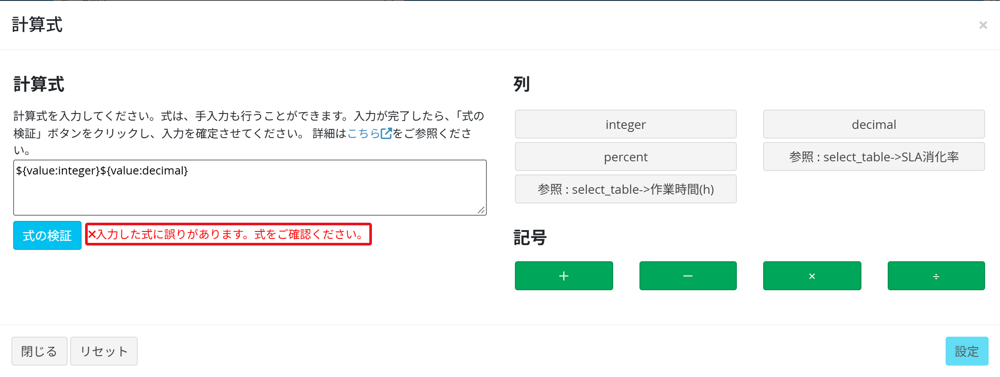
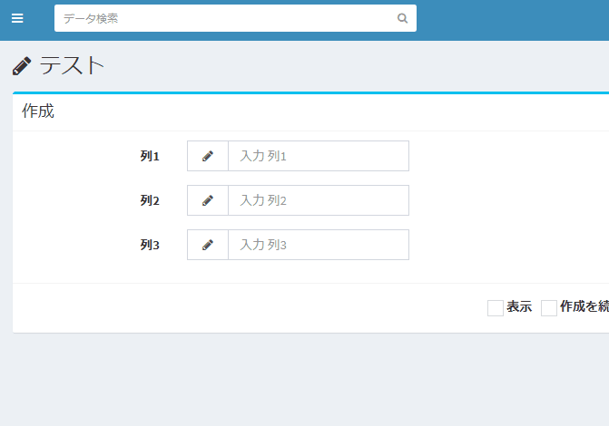

# Gestión de columnas personalizadas
En esta página se crean, modifican y eliminan las columnas de las tablas personalizadas («columnas personalizadas»). Las columnas son cada uno de los campos de los datos, como «Nombre del cliente», «Código postal» o «Dirección».  

- Cómo crear una columna: vea, en este orden, «Pantalla de configuración», «Añadir una columna» y «Guardar», más abajo.
- Qué tipos de columna hay: vea «Tipo de columna», más abajo.
- Explicación de cada campo: vea «Detalle de los campos (comunes)» y «Detalle de los campos (por tipo de columna)», más abajo.  

## Pantalla de configuración
- En la lista de tablas personalizadas, marque 1 tabla, la que quiere configurar, y pulse «Configuración detallada de la tabla», arriba a la derecha.  

- O elija en el menú la tabla que quiere configurar y, de la misma forma, pulse «Configuración detallada de la tabla», arriba a la derecha.  
※Antes hace falta el ajuste para mostrar esa tabla en el menú.  

- En la pantalla de configuración detallada de la tabla que aparece, pulse el icono de las columnas personalizadas.

- Con esto aparece la lista de columnas de esa tabla personalizada.  

## Añadir una columna
- En la pantalla «Configuración de columnas personalizadas», pulse el botón [Nuevo], arriba a la derecha de la página.

- Aparece la pantalla para añadir una columna personalizada; introduzca los campos necesarios.

## Guardar
Cuando haya introducido la configuración, pulse [Enviar].

## Editar
Si quiere modificar una columna, pulse el enlace [Editar] de su fila.  

## Eliminar
Si quiere eliminar una columna, pulse el enlace [Eliminar] de su fila.  

**※Sin embargo, las columnas instaladas por el sistema no se pueden eliminar.**

## Detalle de los campos (comunes)
- Nombre de la columna (alfanumérico): es el nombre de la columna que usa el sistema. Se escribe con letras y números, o con «-» y «\_». Solo se puede poner una vez y no se puede cambiar.  
**※No se pueden usar los siguientes nombres.**  
id,suuid,parent_id,parent_type,created_at,updated_at,deleted_at,created_user,updated_user,deleted_user

### Nombre visible de la columna
Es el nombre de la columna que se muestra en la pantalla.

## Tipo de columna
Es el tipo de la columna. Según el tipo elegido aquí, se decide la forma del campo de entrada al registrar datos.

> Para ver el detalle de las especificaciones del sistema de cada columna personalizada, consulte la [Referencia de columnas personalizadas](/es/column_reference).

#### Texto de una línea
Es un texto de una línea (cuadro de texto).  

#### Texto de varias líneas
Es un texto de varias líneas (área de texto).  

#### Editor de texto
Permite introducir datos con un editor de texto.

#### URL
Es un campo donde se puede introducir una URL.  

#### Correo electrónico
Es un campo donde se puede introducir una dirección de correo electrónico.  

#### Entero
Es un campo donde solo se pueden introducir números enteros. Además, al registrar datos se pueden mostrar los botones [＋] y [－] a los lados del campo, para subir y bajar el valor con un clic.  

#### Decimal
Es un campo donde solo se pueden introducir números decimales. Si pone «Mostrar como porcentaje» en YES, los datos se muestran con %.  

#### Moneda
Es un campo donde se puede introducir un importe. El formato de visualización se puede elegir entre 4 tipos (￥, 円 (yen), ＄, €).

#### Fecha
Es un campo de fecha. Al registrar datos, se puede cambiar la fecha desde un calendario.  

#### Hora
Es un campo de hora. Al registrar datos, se puede cambiar la hora desde un reloj.  

#### Fecha y hora
Es un campo de fecha y hora. Al registrar datos, se pueden cambiar la fecha y la hora desde un calendario y un reloj.  

#### Selección (valores fijos)
Es un campo de selección. Es una lista de opciones en la que el valor y la etiqueta son iguales.  

#### Selección (guardar valor y etiqueta)
Es un campo de selección. Es una lista de opciones en la que el valor y la etiqueta son distintos.  

#### Selección (desde tabla)
Es un campo de selección. Crea una selección cuyas opciones son los elementos de otra tabla.  

#### SÍ/NO
Crea un interruptor que cambia entre «YES» y «NO». Al registrar datos, con YES se registra 1 y con NO se registra 0.  

#### Selección de 2 valores
Crea un interruptor que cambia entre 2 valores. También se pueden cambiar los valores que se registran.  

#### Numeración automática
Crea valores como un UUID o un texto aleatorio al crear el dato.  

#### Imagen
Es un campo para subir imágenes.  
※En la pantalla de lista de datos y en la pantalla de detalle de datos, las imágenes se muestran con un enlace. El enlace (etiqueta a) lleva la class «image-link», así que con un [plugin (script)](/es/plugin_quickstart_script) o un [plugin (estilo)](/es/plugin_quickstart_style) puede cambiar el comportamiento o el aspecto solo de los enlaces de imágenes.

#### Archivo
Es un campo para subir archivos.  

#### Usuario
Es una selección para elegir usuarios del sistema.  

#### Organización
Es una selección para elegir organizaciones del sistema.  

## Detalle de los campos (comunes)
- ##### Nombre de la columna (alfanumérico)
Es el nombre de la columna que usa el sistema. Se escribe con letras y números, o con «-» y «_». Solo se puede poner una vez y no se puede cambiar.  
**※No se pueden usar los siguientes nombres.**  
id,suuid,parent_id,parent_type,created_at,updated_at,deleted_at,created_user,updated_user,deleted_user

- ##### Nombre visible de la columna
Es el nombre de la columna que se muestra en la pantalla.

- ##### Tipo de columna
Elija en la [lista de tipos de columna](/es/column?id=Tipo-de-columna) la columna que se usa para registrar los datos.

- ##### Obligatorio
Elija si esta columna es obligatoria. Si lo pone en YES, es un campo obligatorio en la pantalla de entrada de datos y aparece un error si no se introduce.  

- ##### Índice de búsqueda
Vea «[Índice de búsqueda](/es/column?id=Índice-de-búsqueda-1)», más abajo.  

- ##### Incluir en la búsqueda de texto libre
Aparece cuando el índice de búsqueda está en YES.  
Vea «[Incluir en la búsqueda de texto libre](/es/column?id=フリーワード検索対象詳細)», más abajo.  

- ##### Único
Si lo pone en YES, al registrar un dato no se puede registrar el mismo valor que tiene otro dato. Si quiere evitar los duplicados con la combinación de varias columnas, vea la configuración de clave única compuesta en [Configuración de tablas personalizadas](/es/table).  

- ##### Introducir solo una vez
Si lo pone en YES, la columna solo se puede introducir al registrar un dato nuevo. Al editar el dato, solo se muestra.

- ##### Valor inicial
Es el valor que el campo de entrada tiene desde el principio.  

- ##### Texto de marcador
Es el texto que aparece en gris claro cuando el campo de entrada está vacío (placeholder).  

- ##### Ayuda
Es el contenido que aparece debajo del campo de entrada, como explicación.

- ##### Orden de visualización
Indica el orden en la pantalla de lista de columnas personalizadas.

- ##### Agregar al formulario predeterminado y a la vista predeterminada
Si lo pone en YES, al crear la columna también se añade al formulario y a la vista predeterminados. Solo se puede configurar al crear la columna. Para cambiarlo después, hágalo en la [pantalla de formularios](/es/form) y en la [pantalla de vistas](/es/view), respectivamente.

- ##### Agregar a las columnas de encabezado
Permite añadir a las columnas de encabezado la columna personalizada que se crea.  
※Es un ajuste que solo aparece al crear la columna personalizada. Para cambiarlo después, hágalo en la configuración de columnas de encabezado ([Configuración de tablas personalizadas](/es/table)).

- ##### Apariencia de la celda
Configura con qué aspecto (color, etiqueta, insignia, etc.) se muestra el valor de esta columna en la lista de datos.  
Se elige en «Apariencia predefinida». Para más detalles, vea [Estilos de celda predefinidos](/es/cell_style_preset).

## Detalle de los campos (por tipo de columna)
- ##### Longitud máxima (Texto de una línea, Texto de varias líneas)
Es el número máximo de caracteres que se pueden introducir. Si se supera, hay un error.  

- ##### Caracteres permitidos (Texto de una línea)
Solo se pueden introducir los tipos de caracteres marcados.
Si no se marca ninguno, se pueden introducir todos los tipos de caracteres.

- ##### Sugerencias de entrada (Texto de una línea)
Entre los valores ya registrados en la misma columna personalizada, los que coinciden con lo introducido aparecen como sugerencias de entrada.

- ##### Expresión regular (Texto de una línea)
Puede comprobar lo introducido con una expresión regular (una forma de escribir reglas sobre el orden de los caracteres). Para más detalles, vea [Expresión regular](/es/column?id=Expresión-regular).

- ##### Valor mínimo (Entero, Decimal)
Es el valor mínimo que se puede introducir. Si se envía un valor menor, hay un error. Si está vacío, no se comprueba el valor mínimo.  

- ##### Valor máximo (Entero, Decimal)
Es el valor máximo que se puede introducir. Si se envía un valor mayor, hay un error. Si está vacío, no se comprueba el valor máximo.  

- ##### Fórmula de cálculo (Entero, Decimal, Moneda)
Para más detalles, vea [Fórmula de cálculo](/es/column?id=Fórmula-de-cálculo), más abajo.

- ##### Opciones (Selección (valores fijos), Selección (guardar valor y etiqueta))
Registre las opciones que aparecen como candidatas en el campo de entrada. Regístrelas una por línea, separadas por saltos de línea.  
Cuando el tipo de columna es «Selección (guardar valor y etiqueta)», escriba el valor en la primera columna y la etiqueta en la segunda, separados por una coma.  

↓  
  
Al guardar los datos en el formulario, en la base de datos se guarda el valor de la primera columna.  

- #####  Mostrar como botones de opción / casillas de verificación (SÍ/NO, Selección (valores fijos), Selección (guardar valor y etiqueta))
En las columnas Selección (valores fijos) y Selección (guardar valor y etiqueta) con la selección múltiple en NO, se puede mostrar en el formulario como botones de opción.
 

En las columnas SÍ/NO, o en las columnas Selección (valores fijos) y Selección (guardar valor y etiqueta) con la selección múltiple en YES, se puede mostrar en el formulario como casillas de verificación.

- ##### Permitir entrada libre (Selección (valores fijos))
Si lo pone en YES, también se pueden introducir y registrar libremente opciones que no están registradas en la configuración de la columna.  

>Si [Mostrar como botones de opción / casillas de verificación](/es/column?id=radio_buttom) está en YES, este ajuste no se puede usar.

- ##### Tipo de valor inicial (Fecha, Hora, Fecha y hora, Usuario)
Puede decidir el tipo del valor inicial al registrar un dato nuevo.  
• En las columnas Fecha, Hora y Fecha y hora, se puede poner como valor inicial [la fecha y hora especificadas] o [la fecha y hora de introducción de los datos].  
• En las columnas Usuario, se puede poner como valor inicial [el usuario especificado] o [el usuario con sesión iniciada].

- ##### Tabla de destino (Selección (desde tabla))
Decide la tabla que se muestra como candidata de las opciones.  

>El texto que aparece en la lista como opción se puede cambiar en la configuración de columnas de encabezado ([Configuración de tablas personalizadas](/es/table)).

- ##### Buscar las opciones cada vez (Selección (desde tabla), Usuario, Organización)
Normalmente, las opciones de la pantalla de edición de datos muestran en una lista todos los candidatos al cargar la pantalla.  

Si pone este ajuste en YES, al principio no se cargan las opciones: se buscan los datos con lo que introduce el usuario y se reducen los candidatos.  

Al introducir texto en el campo de entrada, se buscan los datos en el servidor y el resultado se muestra como candidatos.

> Con independencia de este ajuste, cuando el número total de datos es 100 o más, se aplica el ajuste de reducir los candidatos, para mejorar el rendimiento.  
Este límite se puede cambiar con los [valores de configuración](/es/config).  

- ##### Tipo de numeración (Numeración automática)
Elija el tipo de numeración que se hace al registrar los datos.
- Formato  
Registra la numeración con el formato indicado por el usuario.
- Aleatorio (código de licencia de 25 caracteres)    
Registra un texto aleatorio de 25 caracteres (5 caracteres × 5).
- Aleatorio (UUID)  
Registra un texto aleatorio de 32 dígitos en total.

- ##### Número de dígitos (Numeración automática)
Es el número de dígitos que se registra como dato en la numeración automática. Lo que falta se rellena con ceros.  

- ##### Mostrar también usuarios y organizaciones sin permiso (Usuario, Organización)
Decide si se muestran solo los usuarios y organizaciones con permiso de acceso a la tabla o todos los usuarios y organizaciones.

- ##### Mostrar el botón "Asignarme" (Usuario)
Si lo pone en YES, en la pantalla de registro y edición de datos aparece el botón [Asignarme] al lado de esta columna. Al hacer clic en el botón, se selecciona el usuario que ha iniciado sesión.  
※Si «Permitir selección múltiple» está en YES, el usuario que ha iniciado sesión se añade a los usuarios ya seleccionados.

- ##### Aceptar imágenes pegadas desde el portapapeles (Imagen, Archivo)
Si lo pone en YES, en la pantalla de registro y edición de datos las imágenes pegadas con Ctrl+V (capturas de pantalla, etc.) se añaden como archivos de esta columna. El nombre del archivo es «paste-(año mes día)-(hora minuto segundo)-(número de orden)».  
※Si «Permitir selección múltiple» está en YES, se añade a los archivos ya seleccionados. Si está en NO, se sustituye por la imagen pegada.  
※Si se pega dentro del editor de texto, entra en el texto, como hasta ahora. Y si se pega texto en un cuadro de texto, no se añade como archivo.  
※Si en la pantalla hay varias columnas con este ajuste en YES, se añade a la primera.

- ##### Permitir selección múltiple
Póngalo en YES para que se puedan elegir varios en los campos de imagen y archivo y en los de tipo selección.  

## Reglas del formato de numeración automática
Si pone el tipo de columna «Numeración automática» y el tipo de numeración (Numeración automática) «Formato», puede poner números automáticamente con las reglas que usted decida.  

Para ver las variables de parámetros que se pueden usar, consulte la siguiente página.  
[Variables de parámetros](/es/params)

## Índice de búsqueda
El «Índice de búsqueda» es algo que se configura de antemano en la base de datos para que la búsqueda de datos sea más rápida.  
En Exment, algunas funciones solo se pueden usar en las columnas con el índice de búsqueda en YES.
    

Si lo pone en YES, se activan las siguientes funciones.  
- Aparece en la «Columna de destino» del ajuste de condiciones de visualización de las [vistas personalizadas](/es/view)  
    

- Aparece en la «Columna de destino» del ajuste «Ordenar» de las [vistas personalizadas](/es/view)  
    

- Aparece en los elementos del ajuste «Filtro» de la [lista de datos](/es/data_grid)  
    

- Aparece el icono para ordenar en la [lista de datos](/es/data_grid)
    

- Cuando el usuario escribe una palabra en la barra de búsqueda de la parte superior de la página, la columna se incluye en la búsqueda de datos. Póngalo en YES en las columnas que quiere que se busquen en la pantalla de búsqueda, como los códigos y los nombres.  

- Se puede configurar **Incluir en la búsqueda de texto libre**.  
Si lo pone en YES, la columna se incluye en la búsqueda cuando se busca escribiendo texto en la barra de búsqueda.

※Si pone muchísimos «Índice de búsqueda» en una tabla, la creación y la actualización de datos pueden ir más lentas.  
En una tabla se recomiendan hasta 10 «Índice de búsqueda», y el máximo es 20.  
※El límite de índices de búsqueda se puede cambiar con los [valores de configuración](/es/config).

## Usar en la etiqueta
> En v1.3.0, este método de configuración cambió a la [configuración ampliada de las tablas personalizadas](/es/table).

## Expresión regular
> Este ajuste solo aparece cuando está activado el [modo experto](/es/additional_expert).

Cuando el tipo de columna personalizada es «Texto de una línea», puede comprobar lo introducido con una expresión regular.  

  

#### Ejemplos de expresiones regulares
~~~
# Número de teléfono  
^0\d{2,3}-\d{1,4}-\d{4}$

# Código postal  
^\d{3}-\d{4}$

# Solo hiragana
^[ぁ-ん]+$

# Solo katakana
^[ァ-ヴ]+$
~~~

#### Otros
- Si hay una expresión regular configurada, «Caracteres permitidos» no tiene efecto.  
- Para evaluar la expresión regular se usan funciones de PHP. Cuando busque ejemplos de expresiones regulares, busque expresiones regulares de PHP.  
- No hacen falta la «/» del principio y del final ni la «u» del final.  
- El contenido de las expresiones regulares queda fuera de las consultas que atendemos. Le pedimos su comprensión.

## Fórmula de cálculo
Cuando el tipo de columna personalizada es «Entero», «Decimal» o «Moneda», puede configurar una fórmula de cálculo.  
Al introducir los campos en la pantalla de entrada de datos, se calcula automáticamente con la fórmula configurada.  

### Cómo configurarla
- Cuando el tipo de columna personalizada es «Entero», «Decimal» o «Moneda», aparece el campo «Fórmula de cálculo»; haga clic en él.  
    

- Aparece el diálogo de la fórmula de cálculo.  
  

- Introduzca la fórmula. Puede introducirla pulsando los botones de la columna de la derecha o escribiéndola a mano.
※Las variables que se pueden introducir se explican más adelante.
  

- Cuando termine de introducirla, pulse el botón «Validar fórmula» para confirmarla.
  

- ※Si la fórmula introducida tiene un error, aparece un error y no se puede configurar.
  

- Después de introducir una fórmula correcta, al pulsar el botón «Configurar» se cierra el diálogo y la fórmula queda configurada.
  

- Después de configurarla, la fórmula se ejecuta en la pantalla de entrada de datos. (En el ejemplo de abajo, en la columna 3 se ha configurado columna 1 × columna 2)
  

### Fórmulas y variables que se pueden usar

#### Operadores normales
- +, -, *, /  
※Introdúzcalos con caracteres de ancho medio. Tenga en cuenta que la multiplicación no es "×" y la división no es "÷".

- Paréntesis ()

#### Variables
※Le recomendamos insertar las variables con los botones de la columna de la derecha del diálogo «Fórmula de cálculo».

- El valor de otra columna
- El valor de una columna de la tabla referenciada
- El valor de una columna de la tabla padre
- La suma de una columna de la tabla hija
- El número de datos de la tabla hija

| Elemento | Ejemplo | Explicación |
| ---- | ---- | ---- |
| ${value:(nombre de la columna)} | ${value:mitsumori_zeigaku} | Se pone otro valor de la misma tabla. (Ejemplo: si en la tabla de detalle del presupuesto escribe el importe del presupuesto ${value:mitsumori_zeigaku}, se pone el valor introducido en el campo «Importe del presupuesto»)  |
| ${select_table:(nombre de la columna).(nombre de la columna de la tabla referenciada)} | ${select_table:client.client_shikiri} | En las columnas de la misma tabla de tipo «Selección (desde tabla)», «Usuario» u «Organización», se pone el valor de la columna referenciada. (Ejemplo: si la tabla «Contratos (contract)» tiene una columna «Cliente (client)» que referencia la tabla «Datos de clientes (client)», al poner ${select_table:client.client_shikiri} se pone el valor introducido en el precio de venta al cliente (client_shikiri) de la tabla «Datos de clientes (client)»)  |
| ${parent:(nombre de la columna)} | ${parent:mitsumori_value} | Se pone otro valor de la tabla padre. (Ejemplo: si la tabla de presupuestos y la tabla de detalle del presupuesto tienen una relación 1:n y en una columna de la tabla de detalle escribe el importe del presupuesto de la tabla padre ${parent:mitsumori_value}, se pone el valor de la columna «Importe del presupuesto» introducido en el dato padre)  |
| ${sum:(nombre de la tabla hija).(nombre de la columna de la tabla hija)} | ${sum:mitsumori_detail.mitsumori_zeigaku} | Cuando hay una relación 1:n y el formulario permite introducir a la vez los datos padre e hijo, se pone la suma de los valores de la columna indicada de la tabla hija. (Ejemplo: si la tabla de presupuestos y la tabla de detalle del presupuesto tienen una relación 1:n y en una columna de la tabla de presupuestos escribe el importe del detalle de la tabla hija ${sum:mitsumori_detail:mitsumori_zeigaku}, se pone la suma de los valores introducidos en «Importe del presupuesto» de todos los datos hijo)  |
| ${count:(nombre de la tabla hija)} | ${count:mitsumori_detail} | Cuando hay una relación 1:n y el formulario permite introducir a la vez los datos padre e hijo, se pone el número de datos de la tabla hija. (Ejemplo: si la tabla de presupuestos y la tabla de detalle del presupuesto tienen una relación 1:n, se pone el número de datos de la tabla hija)  |

### Si la fórmula es circular
Con una configuración como la siguiente, el cálculo no termina nunca.    

- Columna calc1: fórmula «${value:calc2} + 2»
- Columna calc2: fórmula «${value:calc1} + 2»

Pasa esto: «se pone el valor de la columna calc1» → «en la columna calc2 se pone el valor de calc1 + 2» → «en la columna calc1 se pone el valor de calc2 + 2» → «en la columna calc2 se pone el valor de calc1 + 2»..., y el cálculo no termina.  

Si hay una fórmula así configurada, al introducir un valor en la pantalla de entrada de datos aparece una alerta como la siguiente.  
En ese caso, revise la configuración de las fórmulas.
  

### Si hay una división por 0
Según la fórmula, puede producirse una división por 0.  
En ese caso, el campo del resultado queda vacío.

### Otros
La lógica de las fórmulas de cálculo funciona al introducir datos en la pantalla.  
Por ahora no funciona al registrar datos con funciones como la API o los plugins. Le pedimos su comprensión.
