# Panel
El panel es la pantalla que se muestra al iniciar sesión en Exment y al hacer clic en "INICIO" o en el "nombre del sitio de arriba a la izquierda".  
En él puede colocar con libertad listas de datos, gráficos, calendarios, etc., para ver de un vistazo la información que gestiona en Exment.

El contenido de esta página es el siguiente.

| Lo que quiere hacer | Dónde mirar |
|---|---|
| Crear un panel | Crear un panel nuevo y Elementos de configuración del panel |
| Poner listas, gráficos, etc. en el panel | Elegir los elementos que se muestran |
| Decidir qué sale en el eje horizontal y en el eje vertical del gráfico | Contenido de la configuración del gráfico |
| Mostrarlo a otros usuarios u organizaciones | Compartir el panel |
| Filtrar, cambiar de gráfico y ordenar desde la pantalla | Operaciones en el panel |
  
### Ejemplo de panel
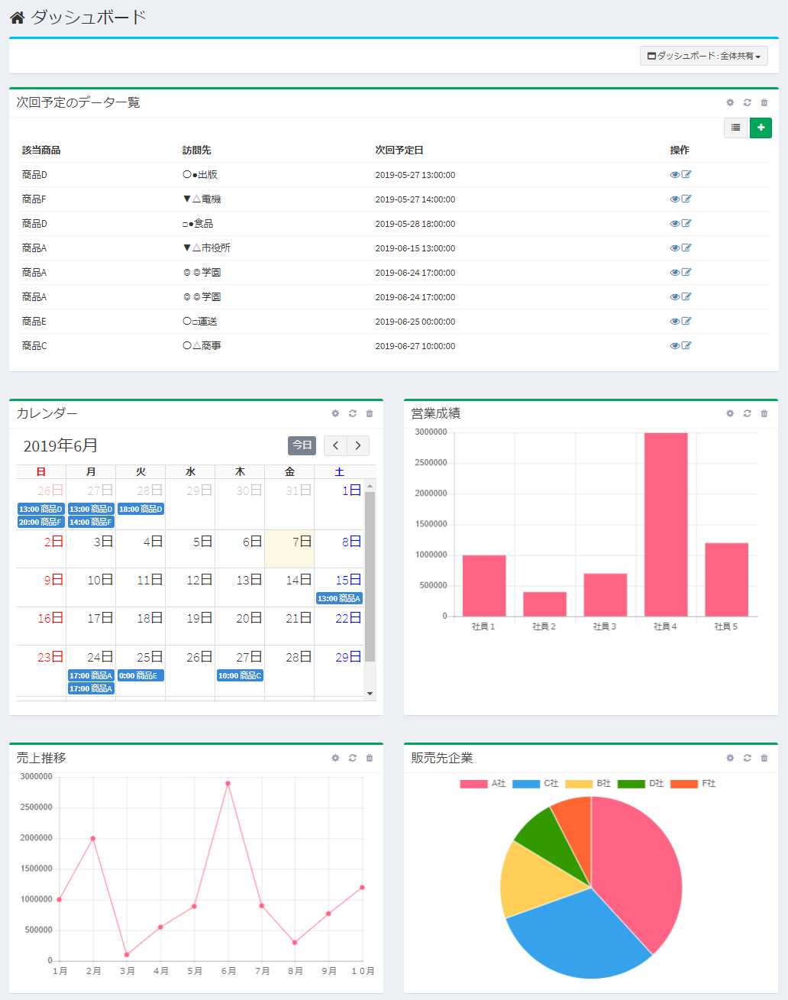

## Crear un panel nuevo
1. Haga clic en "Crear panel", arriba a la derecha de la pantalla del panel.
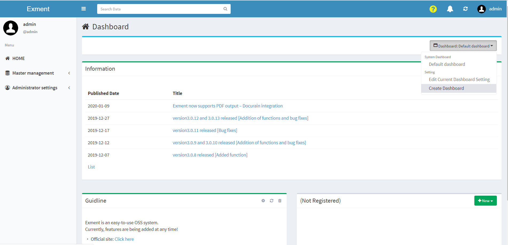

2. Configure los datos necesarios. Para el significado de los elementos, vea "Elementos de configuración del panel", más abajo.  
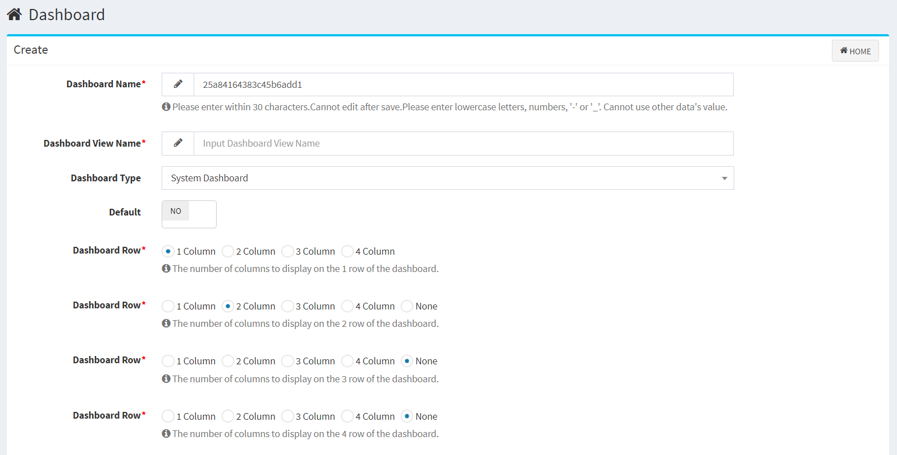

## Elementos de configuración del panel
#### Nombre del panel
Es el nombre del panel.  
No se puede cambiar después de guardar.

#### Nombre visible del panel
Es el nombre que se muestra en la pantalla al elegir un panel.  
También se puede escribir en japonés. Se puede cambiar después de guardar.

#### Tipo de panel
Elija "Panel del sistema" o "Panel de usuario".  

- "Panel del sistema"  
Solo lo puede configurar el administrador del sistema. Es un panel que pueden usar todos los usuarios.  

- "Panel de usuario"  
Lo puede configurar también quien no es administrador del sistema. Es un panel que solo puede usar el usuario que lo creó.    

※Un "Panel del sistema" no se puede cambiar después a "Panel de usuario".  
**Un "Panel de usuario" creado por el administrador del sistema** se puede cambiar después a "Panel del sistema".  
※Si configura [Desactivar el panel de usuario](/es/config), los usuarios generales ya no pueden crear paneles.

#### Predeterminado
Elija "YES" o "NO".  
Cuando hay varios paneles, el que se muestra primero al abrir el panel es el que tiene "YES".  
※Los paneles con "NO" también se pueden mostrar eligiéndolos en la lista.  
※Solo １ panel puede tener "Predeterminado" en "YES".  
Si pone "YES" en 2 paneles o más, todos menos el último que puso en "YES" pasan a "NO".

#### Elegir el número de columnas
Elija el número de columnas que se muestran en cada fila del panel.  
En 1 fila se pueden mostrar hasta 4 columnas.  
※Si aumenta el número de columnas, el espacio de cada una es menor.  

#### Altura máxima de la fila (n) del panel (px)
Indique en píxeles la altura máxima de los elementos que se muestran en esa fila. Se puede configurar fila por fila.  
Si el contenido de un elemento supera esta altura, se desplaza dentro del elemento.  
Introduzca un número entero de 150 a 3000. Si no introduce nada, son 400px.

### Ejemplo con ４ columnas en １ fila
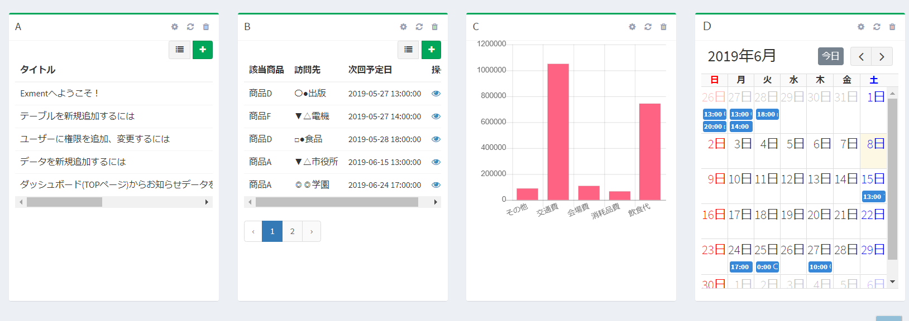  

## Configuración de la barra de filtros del panel
En la parte de arriba del panel se puede mostrar una "barra de filtros", que filtra todos los gráficos a la vez.  
Sin crear una vista para cada condición (región, producto, responsable, etc.), puede cambiar las condiciones en 1 solo panel y ver los resultados del resumen.  
※Para saber cómo usar la barra de filtros, consulte [Filtrar con la barra de filtros](/es/dashboard?id=Filtrar-con-la-barra-de-filtros).

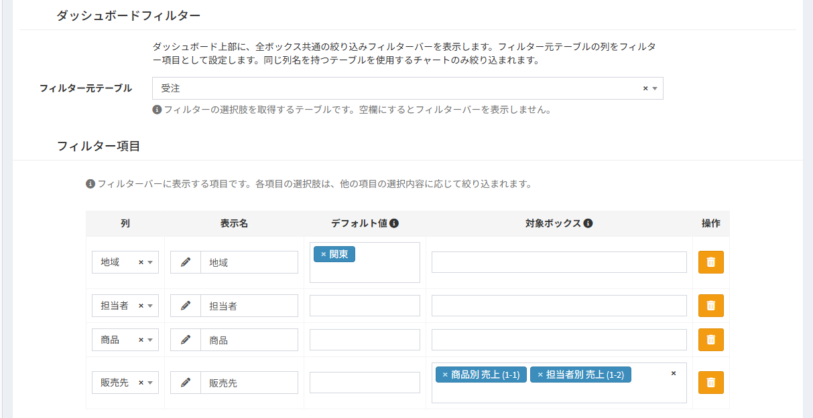

#### Tabla de origen del filtro
Elija la tabla de la que se obtienen las opciones de los filtros.  
Si lo deja vacío, la barra de filtros no se muestra.

#### Elementos de filtro
Configure los elementos que se muestran en la barra de filtros, 1 por fila. Con "Nuevo" se añaden filas.

| Ajuste | Descripción |
|---|---|
| Columna | Elija, entre las columnas de la tabla de origen del filtro, la columna que se usa para filtrar. |
| Nombre visible | Es el nombre que se muestra en la barra de filtros. Si está vacío, se muestra el nombre de la columna. |
| Valor predeterminado | Es el valor que está elegido desde el principio al abrir el panel. En los elementos que se eligen de una lista, se indican los valores guardados separados por comas; en los elementos que se indican con un rango "desde" / "hasta", se indica con la forma "mínimo~máximo" (también se puede indicar un solo lado). Si está vacío, se muestra sin nada elegido. |
| Elementos de destino | Elija los gráficos que filtra este filtro. Si está vacío, se filtran todos los gráficos que tienen el mismo nombre de columna. Como opciones solo se muestran los gráficos ya guardados, así que elíjalos en la pantalla de configuración después de añadir los gráficos. |

> Con los filtros solo se filtran los gráficos que usan **una tabla que tiene una columna con el mismo nombre de columna que el elemento de filtro**.  
> En los gráficos que no cumplen esto se muestra "No afectado por los filtros".

> Para trabajar con comodidad también con tablas de muchos registros, le recomendamos activar "Índice de búsqueda" en la [configuración de columnas personalizadas](/es/column) para las columnas que se usan como elementos de filtro.

> Si exporta e importa el panel con una [plantilla](/es/template), la configuración de la barra de filtros (incluidos los elementos de destino) se conserva tal cual.

# Elegir los elementos que se muestran
En [Nuevo], arriba a la derecha de cada columna del panel creado, elija el elemento que quiere mostrar. Hay 4 tipos de elementos: "Lista de datos", "Sistema", "Gráfico" y "Calendario".  
※Si tiene instalado un [plugin (panel)](/es/plugin_quickstart_dashboard), también se puede elegir "Plugin".

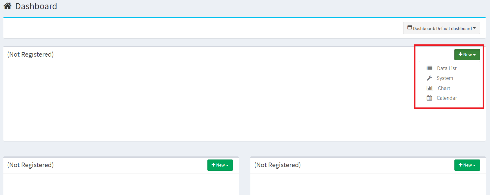  

Después, en cada elemento se configura lo que se muestra.

## Lista de datos
Se eligen una tabla y una vista, y la lista de esos datos se muestra en el panel.

### Ejemplo de lista de datos
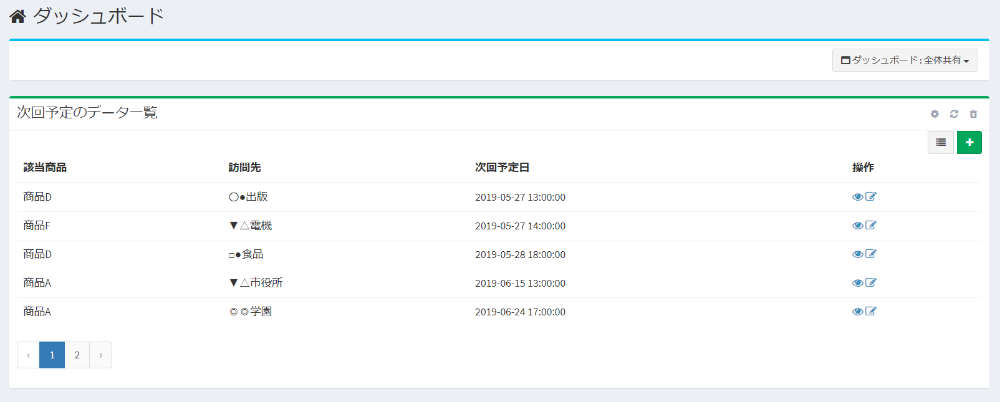

### Elementos de configuración de la lista de datos
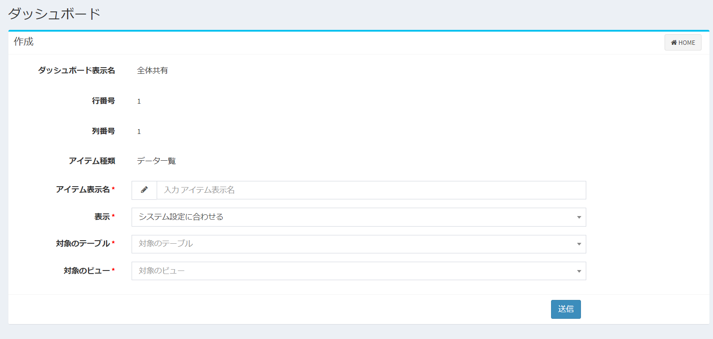
#### Nombre visible del elemento
Introduzca el nombre del elemento que se muestra en la pantalla.

#### Mostrar
Elija cuántos datos se muestran de una vez.

#### Tabla de destino
Elija lo que se muestra entre las tablas ya creadas en la [configuración de tablas personalizadas](/es/table).

#### Vista de destino
Elija lo que se muestra entre las [vistas](/es/view) de la tabla de destino elegida.  
※No se pueden elegir la Vista de calendario, la Vista Kanban, la Vista de diagrama de Gantt ni la Vista de condiciones. En un Panel del sistema solo se pueden elegir las vistas del sistema.  

## Sistema
Muestra en el panel información relacionada con el sistema.  
※Ahora se pueden mostrar "Guía", "Lista de novedades de Exment", "Editor", "HTML", "Lista de notificaciones" y "Código de barras 2D/JAN".

### Elementos de configuración de Sistema
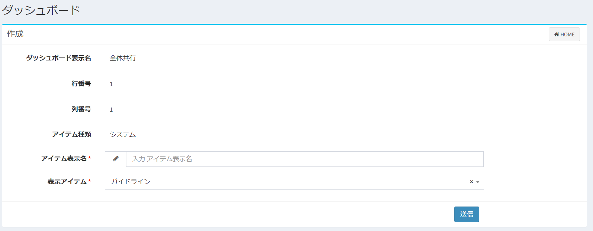

#### Nombre visible del elemento
Introduzca el nombre del elemento que se muestra en la pantalla.

#### Elemento mostrado
Elija el elemento que se muestra.

- ##### Guía
Muestra indicaciones sobre el sistema.  
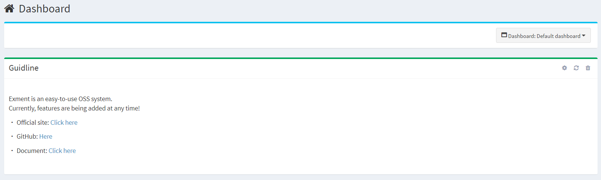

- ##### Lista de novedades de Exment
Obtiene las novedades del sitio oficial de Exment y las muestra.
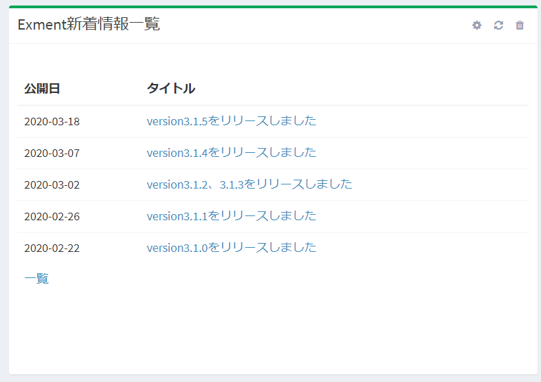

- ##### Editor
Se escribe un texto libre y se muestra en la pantalla.
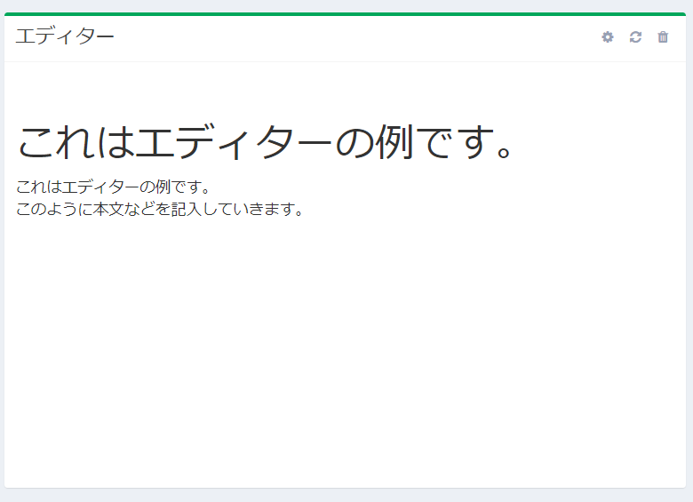

- ##### HTML
Se escribe el contenido en formato HTML y se muestra en la pantalla. ※Los scripts también se ejecutan.
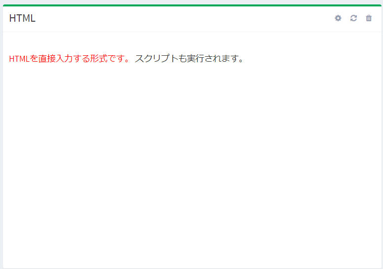

- ##### Código de barras 2D/JAN
Muestra el botón de lectura de códigos de barras 2D/JAN.  
El nombre visible "Código de barras 2D/JAN" del botón "Leer Código de barras 2D/JAN" se puede cambiar con "EXMENT_TEXT_SCAN_BUTTON_JA/EN" del archivo .env.  

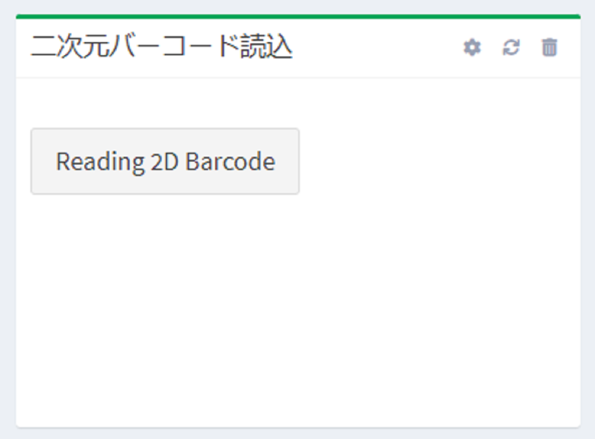

## Gráfico
Muestra en el panel, en forma de gráfico, los datos de las vistas de Exment (vista, Vista de todos los datos, Vista de resumen, etc.). Hay 18 tipos de gráfico, empezando por el gráfico de barras, el gráfico de líneas y el gráfico circular.  
En el gráfico que se muestra se puede cambiar el tipo, filtrar, ordenar, etc. desde la pantalla ([Operaciones en el panel](/es/dashboard?id=Operaciones-en-el-panel)).  
※Para más detalles, consulte [Contenido de la configuración del gráfico](/es/dashboard?id=Contenido-de-la-configuración-del-gráfico).

### Ejemplo de gráfico de barras

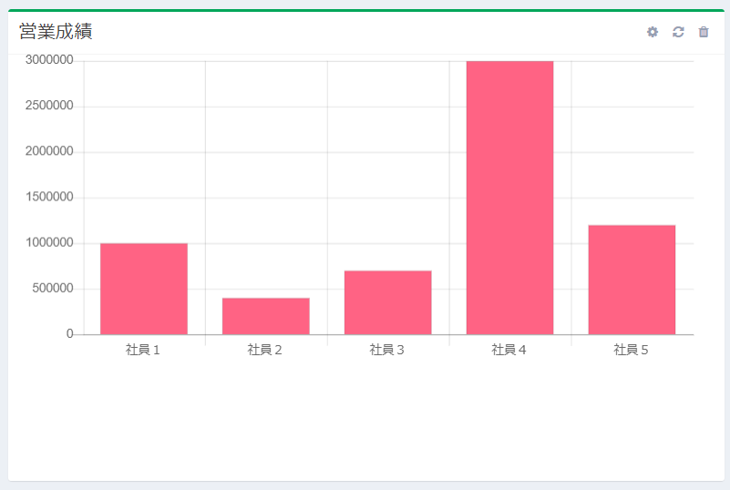

### Ejemplo de gráfico de líneas  
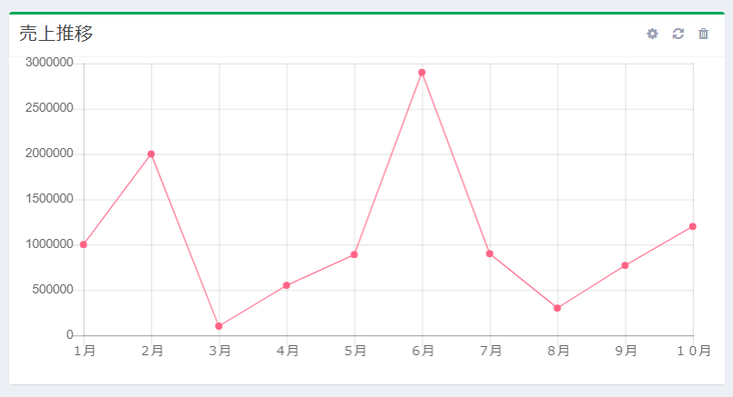

### Ejemplo de gráfico circular
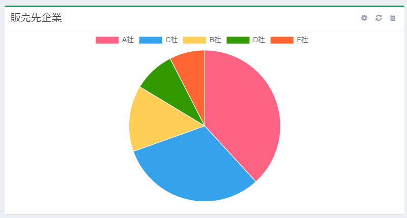

### Elementos de configuración del gráfico
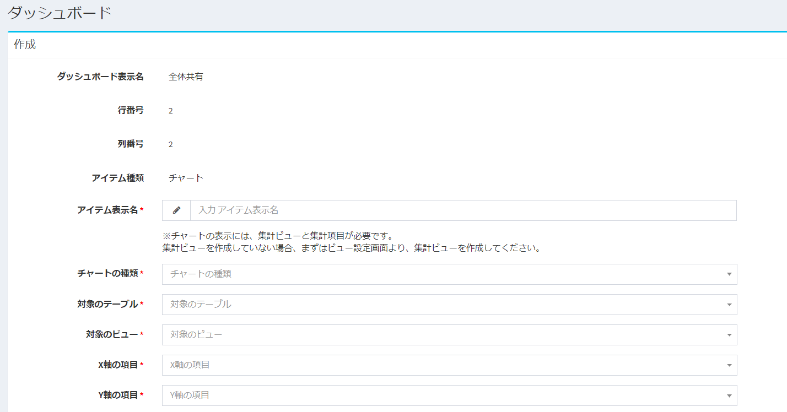

#### Nombre visible del elemento
Introduzca el nombre del elemento que se muestra en la pantalla.

#### Tipo de gráfico
Elija 1 tipo de gráfico entre los 18 siguientes.

| Grupo | Tipos de gráfico |
|---|---|
| Básicos | Gráfico de barras, Gráfico de líneas, Gráfico circular |
| Una serie | Barras horizontales, Gráfico de áreas, Gráfico de anillo, Gráfico radial, Gráfico de embudo, Indicador, Dispersión |
| Varias series | Barras agrupadas, Barras apiladas, Varias líneas, Mapa de calor, Áreas apiladas, Mapa de árbol, Gráfico de proyección solar, Diagrama de caja |

Los gráficos de "varias series" muestran varias series por cada elemento del eje horizontal (ejemplo: las ventas de cada mes, por producto).

Para usar un gráfico de varias series, la vista de resumen tiene que estar agrupada por 2 columnas o más. De las columnas de agrupación, la columna elegida en [Columna de serie (varias series)](/es/dashboard?id=Columna-de-serie-(varias-series)) (de forma predeterminada, la segunda) es la serie, y la primera de las demás es el eje horizontal.

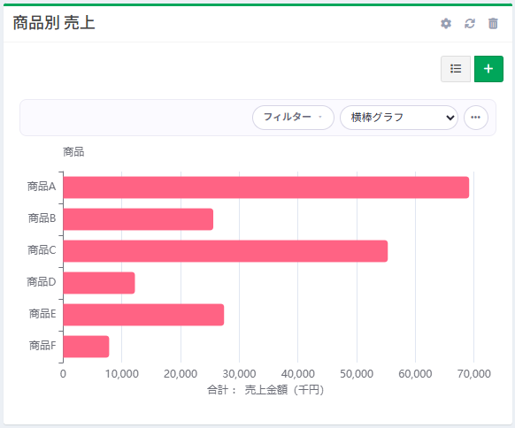

Barras horizontales

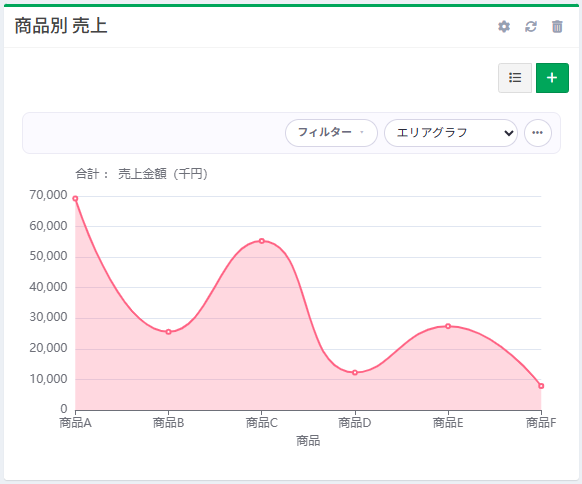

Gráfico de áreas

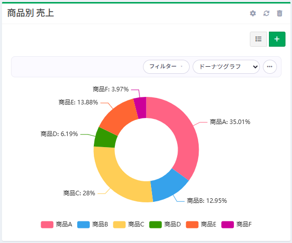

Gráfico de anillo

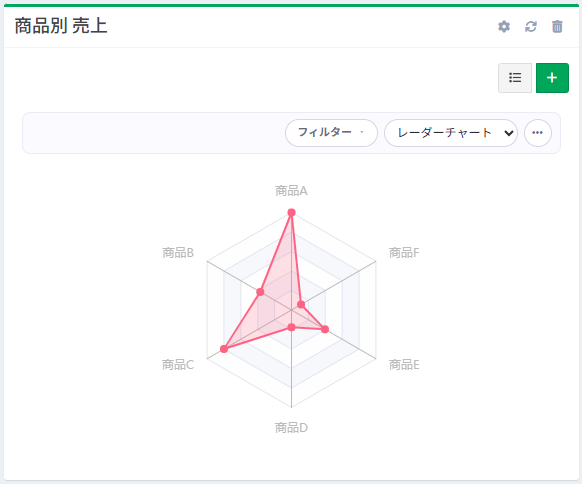

Gráfico radial

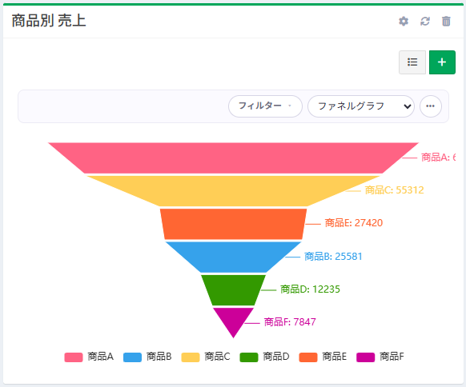

Gráfico de embudo

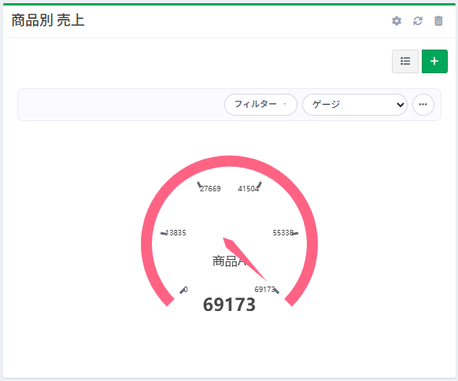

Indicador

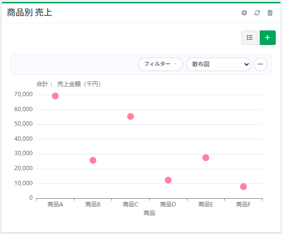

Dispersión

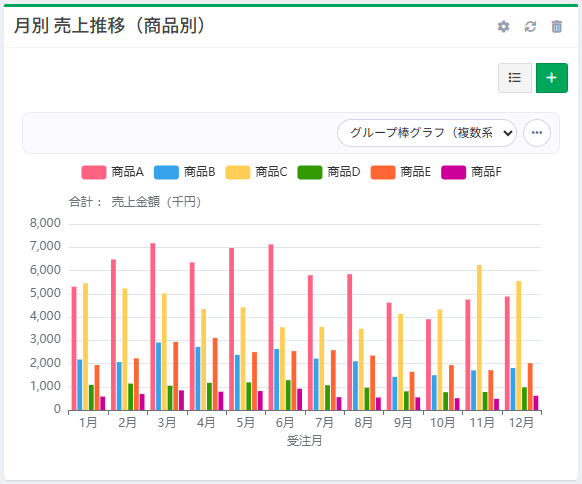

Barras agrupadas

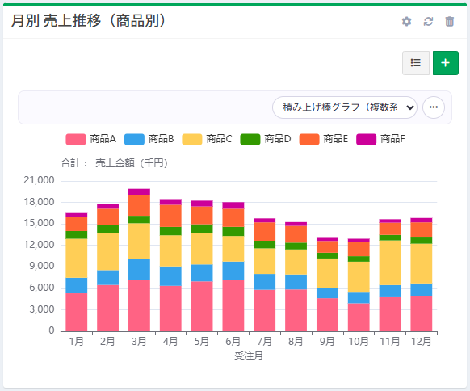

Barras apiladas

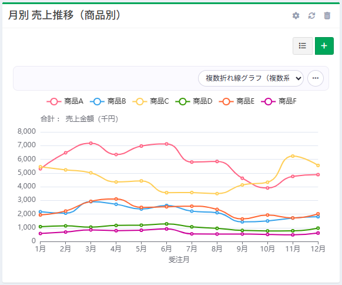

Varias líneas

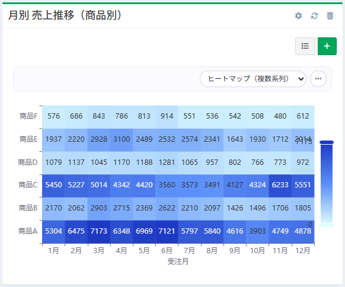

Mapa de calor

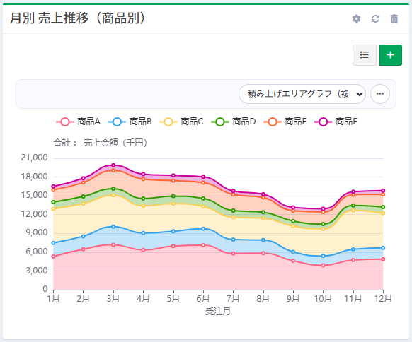

Áreas apiladas

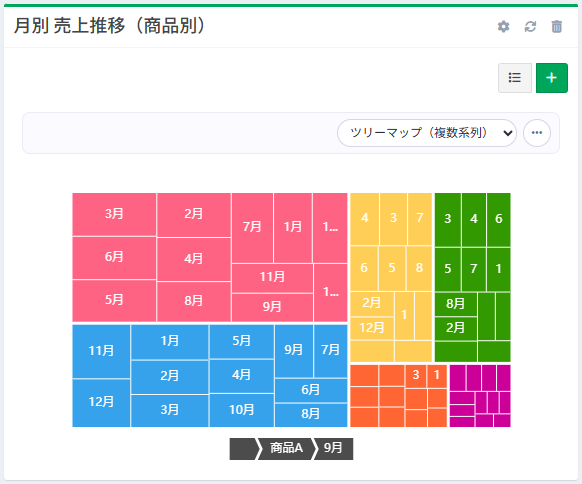

Mapa de árbol

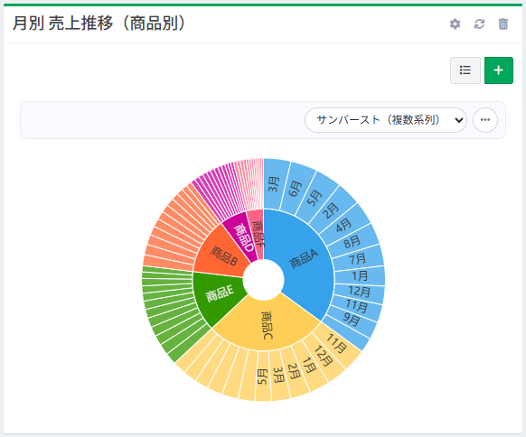

Gráfico de proyección solar

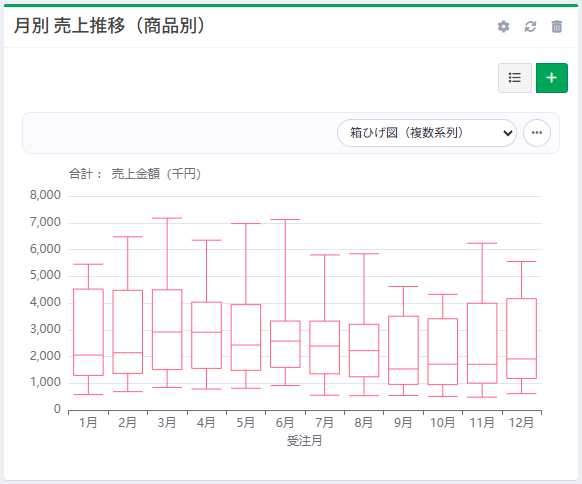

Diagrama de caja

#### Tabla de destino
Elija lo que se muestra entre las tablas ya creadas en la [configuración de tablas personalizadas](/es/table).  
※Como opciones se muestran las tablas sobre las que tiene permiso de ver.

#### Vista de destino
Elija lo que se muestra entre las vistas (vista, Vista de todos los datos, Vista de resumen, etc.) de la tabla de destino elegida.  
※No se pueden elegir la Vista de calendario, la Vista Kanban, la Vista de diagrama de Gantt ni la Vista de condiciones. En un Panel del sistema solo se pueden elegir las vistas del sistema.  
※Para usar un gráfico de varias series, elija una Vista de resumen.  

#### Eje X
Elija el eje X (eje horizontal) que se muestra en el gráfico.  
※Para más detalles, consulte [Contenido de la configuración del gráfico](/es/dashboard?id=Contenido-de-la-configuración-del-gráfico).  

#### Eje Y
Elija el eje Y (eje vertical) que se muestra en el gráfico.  
※Para más detalles, consulte [Contenido de la configuración del gráfico](/es/dashboard?id=Contenido-de-la-configuración-del-gráfico).  

#### Columna de serie (varias series)

Es un ajuste que solo se muestra cuando se elige un gráfico de varias series.

Elija, entre las columnas de agrupación de la vista de resumen, la columna que se usa como serie. Si no elige ninguna, la serie es la segunda columna de agrupación.

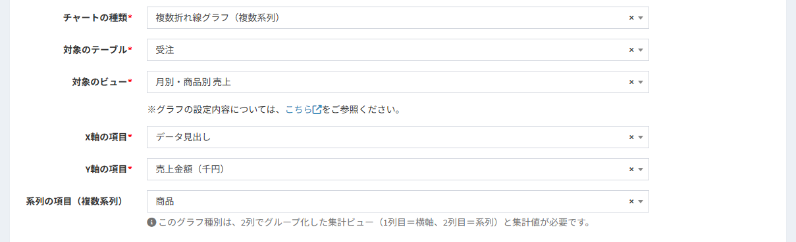

#### Campos de filtro del gráfico

Elija las columnas para filtrar solo este gráfico. Se pueden elegir varias.

Las columnas elegidas se pueden usar para filtrar con el botón **Filtro** del gráfico ([Filtrar con el filtro del gráfico](/es/dashboard?id=Filtrar-con-el-filtro-del-gráfico)).

Si no elige ninguna columna, el botón **Filtro** no se muestra.

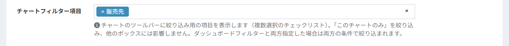

#### Otras opciones según el tipo de gráfico

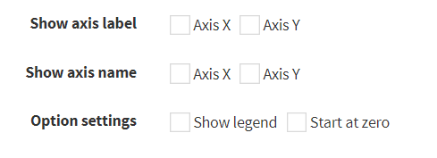

Las opciones elegidas se aplican al gráfico.

※**Mostrar etiquetas del eje**, **Mostrar nombre del eje** y **Empezar en cero** solo se pueden usar en el gráfico de barras y en el gráfico de líneas.

## Calendario
Muestra en el panel los datos de una Vista de calendario de Exment. La forma de mostrarlo se elige entre 2 tipos: "Mensual" y "Lista".
>El texto que se muestra se puede cambiar en la [Configuración de columnas de encabezado](/es/table).

### Ejemplo de Mensual
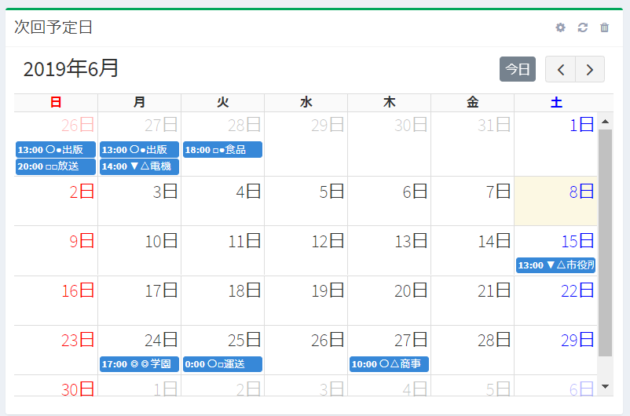  

### Ejemplo de Lista
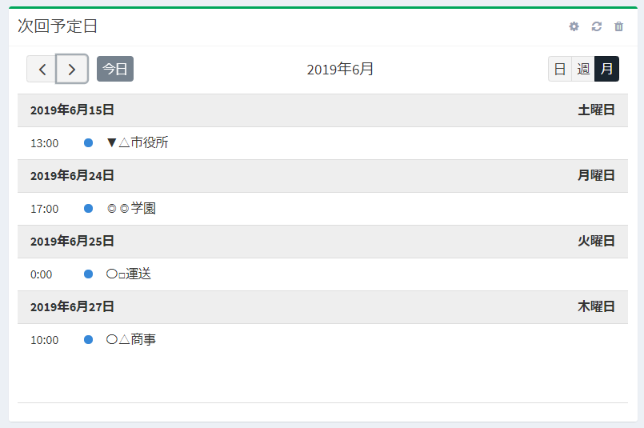  

### Elementos de configuración del calendario

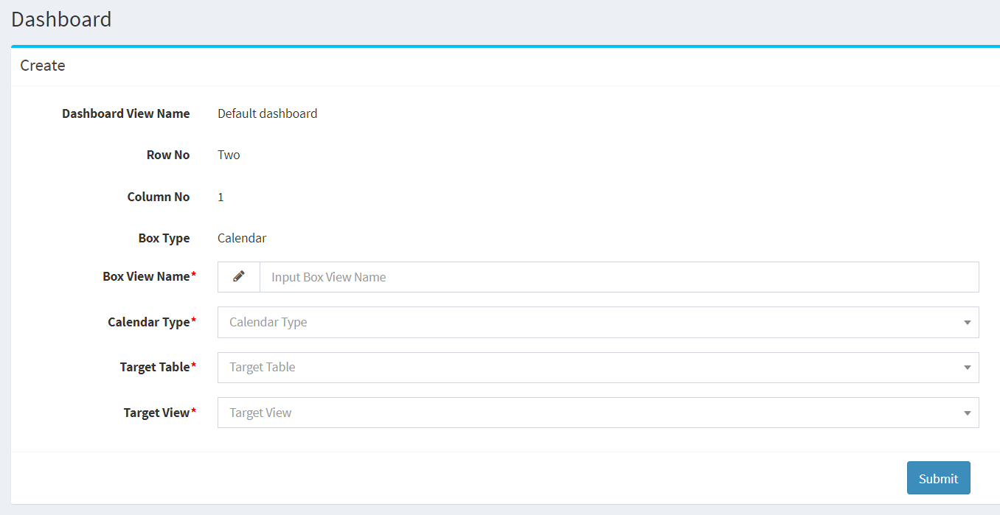  

#### Nombre visible del elemento
Introduzca el nombre del elemento que se muestra en la pantalla.

#### Tipo de calendario
Elija el calendario que quiere mostrar entre los 2 tipos: "Mensual" y "Lista".

#### Tabla de destino
Elija lo que se muestra entre las tablas ya creadas en la [configuración de tablas personalizadas](/es/table).  
※Como opciones solo se muestran las tablas que tienen configurada una Vista de calendario.

#### Vista de destino
Elija lo que se muestra entre las Vistas de calendario de la tabla de destino elegida.  

## Contenido de la configuración del gráfico
Los elementos que se pueden elegir en el eje X y en el eje Y del gráfico cambian según el tipo de la vista de destino.  

### Cuando la vista de destino es la Vista de todos los datos o una vista estándar

#### Eje X
Como opciones del eje X se muestran los 2 tipos siguientes. Elija uno.

- El elemento "Etiqueta de datos".  
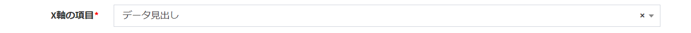  

Al elegirlo, en el eje X se muestra lo puesto en la [Configuración de columnas de encabezado de la configuración de tablas personalizadas](/es/table).  

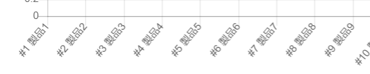  

- Los elementos que aparecen en ["Seleccionar columnas de la vista" de la configuración de vistas personalizadas](/es/view). Al elegir uno, en el eje X se muestra el valor de la columna elegida.  
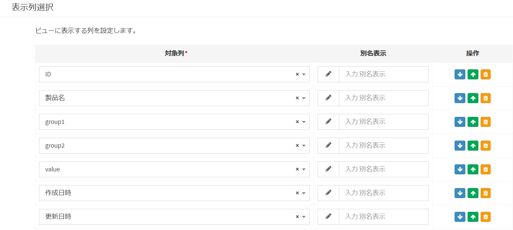  

#### Eje Y
Como opciones del eje Y se muestra 1 tipo, el siguiente. Elija uno.

- De los elementos que aparecen en ["Seleccionar columnas de la vista" de la configuración de vistas personalizadas](/es/view), los de los siguientes tipos de columna. Al elegir uno, en el eje Y se muestra el valor de la columna elegida.
    - Entero
    - Decimal
    - Moneda

### Cuando la vista de destino es una Vista de resumen

#### Eje X
Como opciones del eje X se muestra 1 tipo, el siguiente.

- El elemento "Etiqueta de datos".  
  

Al elegirlo, en el eje X se muestran los valores configurados en ["Seleccionar columnas de agrupación" de la configuración de vistas personalizadas](/es/view).  
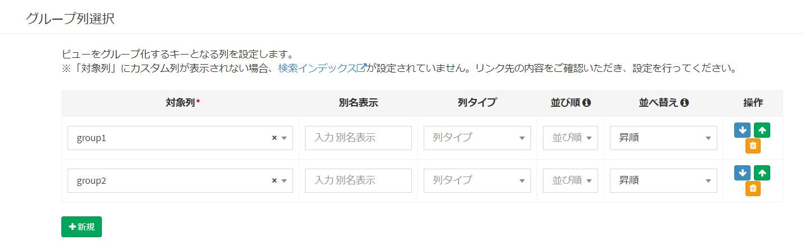  
  

#### Eje Y
Como opciones del eje Y se muestran los 2 tipos siguientes. Elija uno.

- De los elementos que aparecen en ["Seleccionar columnas de agrupación" de la configuración de vistas personalizadas](/es/view), los de los siguientes tipos de columna. Al elegir uno, en el eje Y se muestra el valor de la columna elegida.
    - Entero
    - Decimal
    - Moneda

  

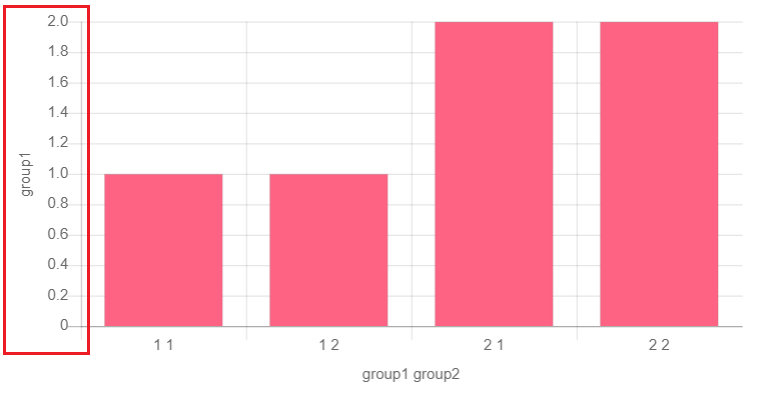  

- Los elementos que aparecen en ["Seleccionar columnas de resumen" de la configuración de vistas personalizadas](/es/view). Al elegir uno, en el eje Y se muestra el valor de la columna elegida.

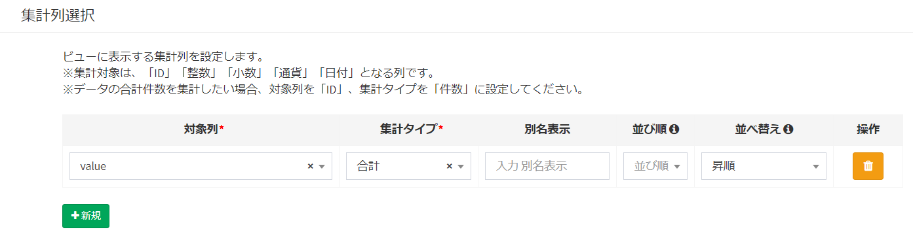  

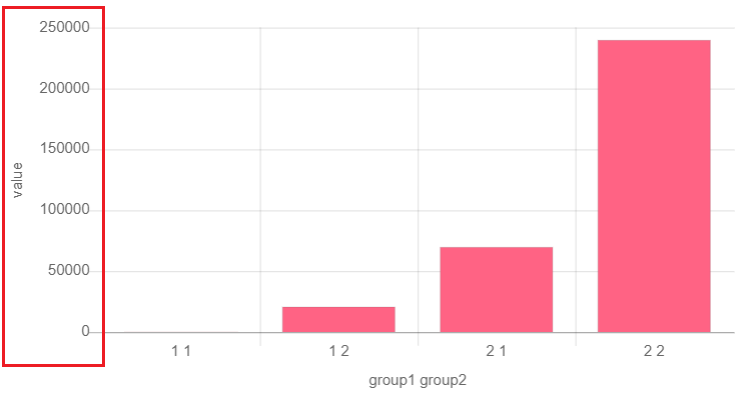  

## Compartir el panel
El panel creado se comparte con otros usuarios u organizaciones.  
※Solo se puede compartir un "Panel de usuario". (Un "Panel del sistema" está publicado para todos los usuarios desde el principio.)  

#### Cómo compartir
1. Haga clic en el botón "Compartir" de la pantalla de cambio de configuración del panel.  
※Este botón no se muestra al crear un panel nuevo.
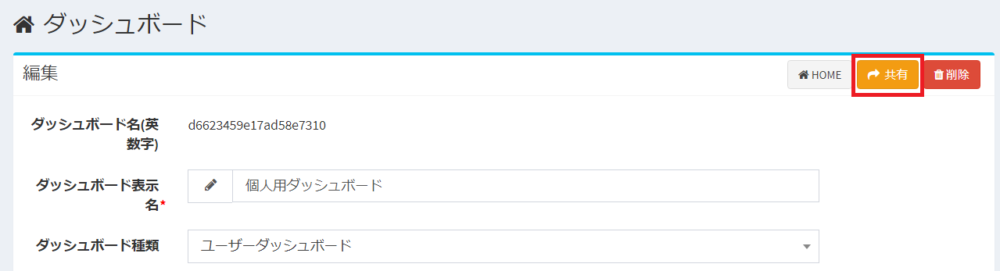

2. Se muestra el cuadro de diálogo para compartir el panel.
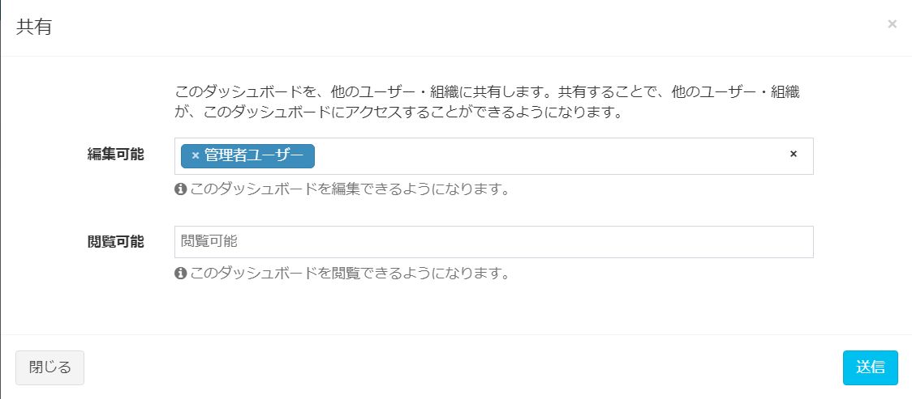

3. Añada los usuarios o las organizaciones con los que quiere compartir y haga clic en "Enviar". Con esto queda compartido.  
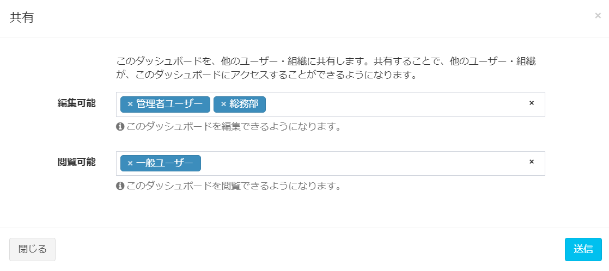  

# Operaciones en el panel

En el panel se pueden filtrar los gráficos, cambiar el tipo de gráfico y ordenar los datos. Salvo el cambio de colores, estas operaciones no cambian la configuración del panel, la configuración de los gráficos ni los datos.

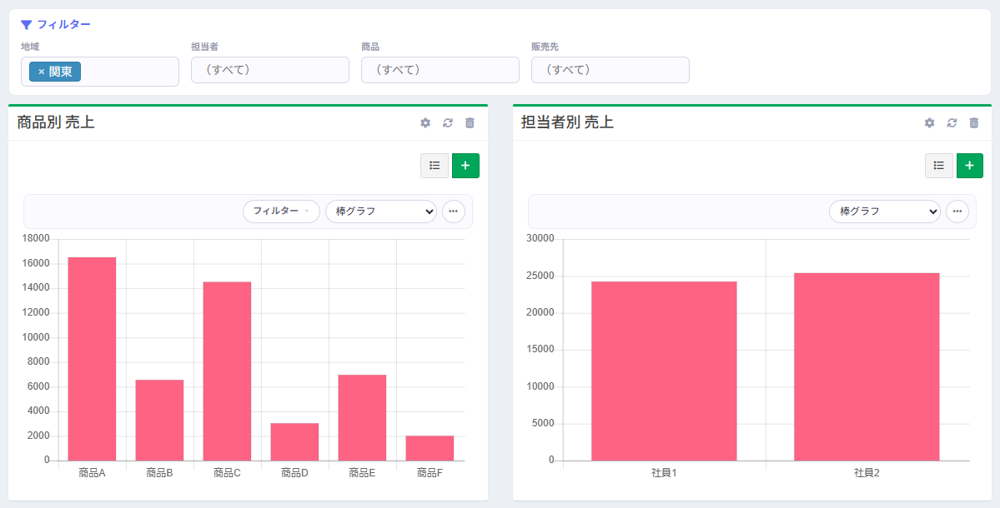

| Operación | Lo que se puede hacer | Alcance |
|---|---|---|
| [Barra de filtros](/es/dashboard?id=Filtrar-con-la-barra-de-filtros) | Filtra a la vez los gráficos del panel | Todo el panel |
| [Clic en el gráfico](/es/dashboard?id=Filtrar-haciendo-clic-en-el-gráfico) | Elige en la barra de filtros el valor en el que se hizo clic | Todo el panel |
| [Filtro del gráfico](/es/dashboard?id=Filtrar-con-el-filtro-del-gráfico) | Filtra solo 1 gráfico | Por gráfico |
| [Cambio del tipo de gráfico](/es/dashboard?id=Cambiar-el-tipo-de-gráfico) | Muestra los mismos datos con otro tipo de gráfico | Por gráfico |
| [Menú ⋯](/es/dashboard?id=Menú-⋯) | Ordena, muestra las etiquetas de datos y exporta los datos | Por gráfico |
| [Cambio de colores](/es/dashboard?id=Cambiar-los-colores-del-gráfico) | Cambia el color de las barras, los sectores, etc. | Por gráfico |

## Filtrar con la barra de filtros

Si hace la [Configuración de la barra de filtros del panel](/es/dashboard?id=Configuración-de-la-barra-de-filtros-del-panel), en la parte de arriba del panel se muestra la barra de filtros.

Al elegir un valor en la barra de filtros, la misma condición se aplica a todos los gráficos a los que alcanza ese filtro.

※A los usuarios que no tienen permiso de ver la tabla de origen del filtro no se les muestra la barra de filtros.

#### Elegir valores

Haga clic en un elemento de filtro y elija los valores en la lista. Se pueden elegir varios valores.

Si elige un valor en otro filtro, en la lista solo se muestran los valores que tienen datos con esa condición. Por ejemplo, si elige "Kanto" en "Región", en "Responsable" solo se muestran los responsables de Kanto.

Las columnas de fecha y de fecha y hora no se indican con una lista, sino con un rango "desde" / "hasta". Las columnas numéricas también se indican con un rango cuando hay demasiadas opciones.

> Si hay demasiadas opciones y no se pueden mostrar, elija antes un valor en otro filtro para reducirlas.

#### Quitar el filtro

Al hacer clic en "Restablecer", se vuelve al estado del [Valor predeterminado](/es/dashboard?id=Elementos-de-filtro).

Si no hay valor predeterminado configurado, se quitan todos los filtros.

#### Gráficos no afectados por los filtros

En los gráficos a los que no afecta la barra de filtros se muestra "No afectado por los filtros", y en los gráficos a los que no se aplica alguno de los elementos de filtro se muestra "Filtros no aplicados aquí".

Así puede ver cómo se reflejan los filtros elegidos en los datos que se muestran.

> Las condiciones del filtro se guardan en la URL. Con "Atrás" y "Adelante" del navegador se vuelve a las condiciones anteriores. Además, si comparte la URL, otros usuarios pueden ver el panel con las mismas condiciones.

> Las últimas condiciones elegidas se recuerdan por usuario, y la próxima vez que abre el panel se muestra con las mismas condiciones.

## Filtrar haciendo clic en el gráfico

Al hacer clic en una barra, un sector, etc. del gráfico, ese valor se elige en la barra de filtros y los demás gráficos se filtran.

El gráfico en el que se hizo clic sigue mostrando todos los valores: el valor elegido se muestra más intenso y los demás, más tenues.

| Operación | Resultado |
|---|---|
| Clic en un valor | Elige solo ese valor. |
| Otro clic en el valor elegido (cuando solo está elegido ese valor) | Quita la selección. |
| Clic con Ctrl pulsado (⌘ en Mac) | Añade el valor a la selección. Si hace clic en un valor ya elegido, quita de la selección solo ese valor. |

※Se puede usar cuando la columna del eje horizontal del gráfico está entre los elementos de la barra de filtros.  
※Se puede usar en los gráficos de vistas de resumen. No se puede usar cuando la columna del eje horizontal es un elemento que se indica con un rango "desde" / "hasta" (una columna de fecha, etc.) o una columna de selección múltiple.  
※No se puede usar en Gráfico radial, Indicador, Mapa de árbol, Gráfico de proyección solar ni Diagrama de caja.  
※Si elige un valor en la barra de filtros, los gráficos cuyo eje horizontal corresponde a ese elemento de filtro no se filtran, y el valor elegido se muestra resaltado.

## Filtrar con el filtro del gráfico

El filtro del gráfico se aplica solo a ese gráfico. No afecta a los demás gráficos.

Si configura los [Campos de filtro del gráfico](/es/dashboard?id=Campos-de-filtro-del-gráfico) en un gráfico, arriba a la derecha del gráfico se muestra el botón "Filtro".

Haga clic en "Filtro" y elija los valores que quiere mostrar.

En el botón se muestra el número de elementos con filtro. Al hacer clic en "Restablecer", se quitan las condiciones del filtro del gráfico.

Si hay más de 8 opciones, encima de la lista se muestra un campo de búsqueda para encontrar el valor que busca.

Las columnas de fecha y de fecha y hora no se indican con una lista, sino con un rango "desde" / "hasta". Las columnas numéricas también se indican con un rango cuando hay demasiadas opciones.

※El filtro del gráfico se puede usar junto con la barra de filtros. En ese caso se filtra con las dos condiciones.  
※La selección del filtro del gráfico se quita al volver a cargar la página (F5).

## Cambiar el tipo de gráfico

Con el campo de selección del tipo de gráfico, arriba a la derecha del gráfico, puede mostrar los mismos datos con otro tipo de gráfico.

El tipo de gráfico elegido se recuerda por usuario, y la próxima vez que abre el panel se muestra con el mismo tipo.

Si vuelve a elegir el tipo de gráfico original, el cambio se quita y vuelve al tipo original.

※Los gráficos de una serie solo se pueden cambiar por gráficos de una serie, y los de varias series, por gráficos de varias series. Por ejemplo, un gráfico de barras se puede cambiar por un gráfico de anillo o por uno de dispersión, pero no por uno de barras apiladas (varias series).

## Menú ⋯

Al hacer clic en "⋯", arriba a la derecha del gráfico, se muestra el menú.

| Menú | Descripción |
|---|---|
| Ordenar por | Ordena de forma ascendente o descendente por el elemento del eje horizontal o por el valor. |
| Etiquetas de datos | Muestra los valores encima de las barras, los puntos, etc. Solo se muestra en Gráfico de barras, Gráfico de líneas, Gráfico circular, Barras horizontales, Gráfico de áreas, Dispersión, Barras agrupadas, Barras apiladas, Varias líneas y Áreas apiladas. |
| Exportar datos | Descarga en un archivo CSV los datos que se muestran. |
| Restablecer colores | Devuelve los colores cambiados a como estaban. Solo se muestra a los usuarios que pueden cambiar los colores, y cuando se han cambiado colores. |
| Restablecer | Devuelve el orden y las etiquetas de datos a la configuración original. |

※La configuración del orden y de las etiquetas de datos se recuerda por usuario.  
※En los gráficos que no tienen ningún elemento de menú que mostrar, no se muestra "⋯".

## Cambiar los colores del gráfico

Los usuarios que tienen permiso de edición del panel pueden cambiar el color haciendo clic derecho en una barra, un sector, etc. del gráfico.

Elija entre "Colores del tema" y "Colores estándar", o indique el color que quiera con "Más colores...". Si elige "Automático", vuelve al color original.

En el gráfico de barras, el gráfico circular, etc., el color se cambia barra por barra o sector por sector. En los gráficos que se dibujan con 1 color, como el gráfico de líneas o el gráfico de áreas, y en los gráficos de varias series, el color se cambia serie por serie.

Al elegir "Más colores...", se abre una paleta en la que se puede indicar cualquier color.

Haga clic en la paleta o introduzca los valores RGB. Con ↕ se cambia a la entrada en HSL o HEX. Al hacer clic en "Aceptar", el color se aplica.

※El color cambiado se guarda en la configuración del gráfico y se muestra igual a todos los usuarios.  
※Los usuarios que solo pueden ver no pueden cambiar los colores.  
※El Mapa de calor y el Diagrama de caja no admiten el cambio de colores.
