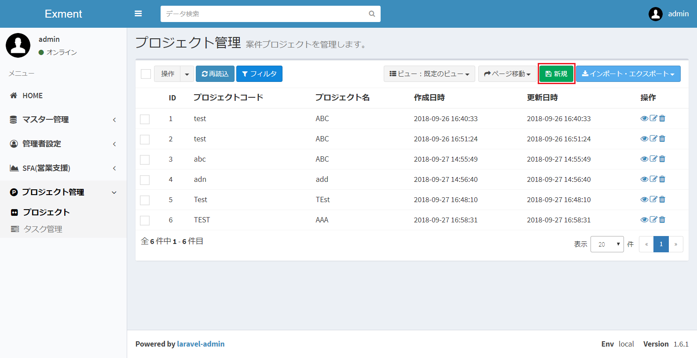

# Datos
Esta página explica las pantallas para ver en una lista, añadir, editar, mostrar y eliminar los datos de una tabla.  
Las tablas las crea el administrador del sistema. Los usuarios introducen valores en esas tablas y los guardan.

| Qué quiere hacer | Dónde mirar |
|---|---|
| Ver los datos en una lista | [Lista de datos](/es/data?id=Lista-de-datos) |
| Añadir un dato | [Añadir un dato nuevo](/es/data?id=Añadir-un-dato-nuevo) |
| Corregir un dato | [Editar un dato](/es/data?id=Editar-un-dato) |
| Ver el contenido de un dato | [Mostrar un dato](/es/data?id=Mostrar-un-dato) |
| Borrar un dato | [Eliminar un dato](/es/data?id=Eliminar-un-dato) |
| Crear un dato copiando otro | [Copiar un dato](/es/data?id=Copiar-un-dato) |

## Lista de datos
Es la lista de los datos guardados en esa tabla.  
En la lista aparecen los datos que uno mismo ha creado y los datos sobre los que tiene permisos asignados.

Nota: si se registra para un usuario o una organización el permiso para editar o ver todos los datos, aparecen todos los datos, sin importar la condición anterior.  
  
  
Para una explicación detallada de la pantalla de lista, consulte [Lista de datos](/es/data_grid).  

## Añadir un dato nuevo
1. Haga clic en el enlace [Nuevo], arriba a la derecha de la página.  

Nota: si el usuario con sesión iniciada no tiene el permiso de "edición" de esa tabla, este botón no aparece.  
Para saber cómo asignar permisos, consulte [Grupos de roles y configuración de permisos](/es/role_group), en el menú de la izquierda.  

2. Aparece la pantalla de creación de un dato.  

  
Para una explicación detallada de la pantalla para añadir, consulte [Formulario de datos](/es/data_form).  

### Comprobar el contenido antes de guardar (vista previa)
Al hacer clic en el botón [Vista previa], arriba a la derecha de la pantalla de creación, se puede comprobar en otra ventana lo que se está introduciendo, sin guardarlo.  
Aparece una lista de nombres de campo y valores, por cada bloque del formulario.

- El botón [Vista previa] solo aparece en la pantalla de creación de un dato. No aparece en la pantalla de edición.  
- La vista previa no guarda el dato. Para actualizar lo que se muestra después de cambiar lo introducido, vuelva a hacer clic en el botón [Vista previa] en la pantalla original.  
- Los bloques de tablas secundarias no aparecen en la vista previa.

## Editar un dato
1. Haga clic en el enlace [Editar] de la fila que quiere editar.  

Nota: si el usuario con sesión iniciada no tiene el permiso de "edición" de esa tabla, este enlace no aparece.  
Para saber cómo asignar permisos, consulte [Grupos de roles y configuración de permisos](/es/role_group), en el menú de la izquierda.  

2. Aparece la pantalla de edición del dato.  

  
Para una explicación detallada de la pantalla de edición, consulte [Formulario de datos](/es/data_form).  

> Al actualizar un dato, si otro usuario ya había actualizado el mismo dato, aparece el siguiente mensaje de error.

## Mostrar un dato
1. Haga clic en el enlace [Ver] de la fila que quiere mostrar.  

2. Aparece la pantalla de visualización del dato.  

  
Para una explicación detallada de la pantalla de visualización, consulte [Detalle de datos](/es/data_details).  

## Eliminar un dato
- Haga clic en el enlace [Eliminar] de la fila que quiere eliminar.  

## Copiar un dato
Nota: para que aparezca el enlace [Copiar] hay que cambiar un valor de configuración. Consulte la opción para mostrar el enlace de copia de los datos personalizados en [Valores de configuración](/es/config).  

1. Haga clic en el enlace [Copiar] de la fila que quiere copiar.  

2. Aparece la pantalla de edición con el contenido del dato elegido ya introducido.  

3. Corrija lo necesario y guarde.  

Qué se copia y qué no:

- Solo se copian los campos que están en el formulario.  
- La numeración automática, los archivos, las imágenes, etc. no se copian.  
