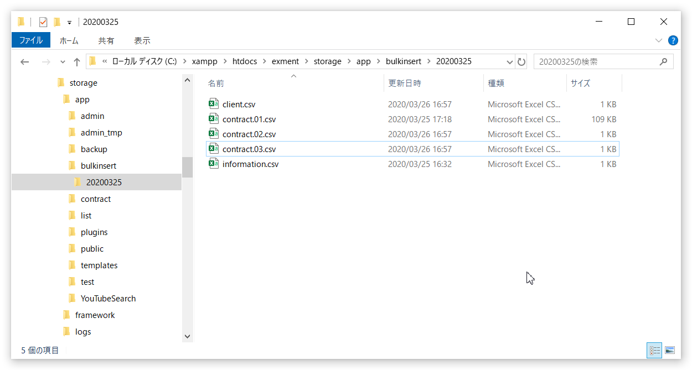

# Inserción masiva de datos
Es la función para meter de una vez en una tabla personalizada, con un comando del servidor, una gran cantidad de datos preparados en archivos csv (bulk insert; también con 1000 datos o más).  
Como da prioridad a la velocidad, no hace comprobaciones de errores detalladas.

El flujo es el siguiente.

1. Crear los archivos csv ("Preparación de los datos")
2. Colocarlos en una carpeta del servidor y ejecutar el comando ("Cómo se hace")

## Puntos de atención
La inserción masiva da prioridad a la velocidad. Por eso, tenga en cuenta lo siguiente.

- **Aunque el csv creado o el contenido de los datos tengan errores, no se hacen comprobaciones de errores detalladas.** Compruebe bien el archivo al crearlo. Si hay algún problema, compruébelo, por ejemplo, metiendo una parte de los datos con la importación desde la pantalla.

- "[Cambiar la forma de indicar los datos de otra tabla](/es/data_import_export)", que se puede hacer con la [importación normal](/es/data_import_export), no se puede hacer con esta función. Escriba el id en la columna e importe.

## Preparación de los datos
Primero se crean los archivos csv para importar.

| Regla | Contenido |
| ---- | ---- |
| Fila 1 | Nombres de columna de la tabla personalizada |
| Fila 2 en adelante | Datos que se insertan |
| Nombre del archivo | **"(nombre de la tabla personalizada).csv"** (ejemplo: client.csv). Si los datos de una tabla se reparten en varios archivos, se pone un número correlativo, como **"(nombre de la tabla personalizada).número.csv"** (ejemplo: client.01.csv) |
| Codificación | <strong>UTF-8</strong> (sin BOM) |

**Si el archivo se crea con EXCEL, la codificación es al principio Shift JIS. Convierta siempre antes la codificación con un editor de texto u otra herramienta.**  

### Valores que se pueden usar como nombres de columna de la tabla personalizada
| Elemento | Explicación |
| ---- | ---- |
| id | Clave principal (número). Se rellena solo si se quiere indicar |
| parent_type | Nombre de la tabla principal. Se rellena solo en los datos de una tabla secundaria |
| parent_id | ID del dato principal vinculado. Se rellena solo en los datos de una tabla secundaria |
| deleted_at | Fecha y hora de eliminación del dato. Se rellena solo si se quiere indicar |
| deleted_user_id | ID del usuario que eliminó el dato. Se rellena solo si se quiere indicar |
| value.(nombre de columna de la columna personalizada) | Nombre de columna registrado en la configuración de columnas personalizadas. Ponga siempre value. delante |

- Si no hay un motivo especial, escriba en el archivo csv solo las columnas personalizadas (los demás campos se rellenan automáticamente).  
- **A diferencia de la importación normal, aunque se indique el mismo id que un dato existente, no se hace ninguna actualización.**  

#### Archivo de ejemplo (client.csv)
- Es un ejemplo que mete datos en la tabla de clientes (client). Se meten el código de cliente (client_code) y el nombre del cliente (client_name), y solo en el tercer dato se meten la fecha de eliminación (deleted_at) y el ID del usuario que eliminó (deleted_user_id).  

~~~
value.client_code,value.client_name,deleted_at,deleted_user_id
CUST001,Cliente de prueba 001,,
CUST002,Cliente de prueba 002,,
CUST003,Cliente de prueba 003,2019/3/20,2
CUST004,Cliente de prueba 004,,
CUST005,Cliente de prueba 005,,
CUST006,Cliente de prueba 006,,
CUST007,Cliente de prueba 007,,
CUST008,Cliente de prueba 008,,
CUST009,Cliente de prueba 009,,
~~~

## Cómo se hace

1. Cree una carpeta de trabajo en la siguiente ubicación del servidor. Se recomienda un nombre de carpeta que indique el contenido del trabajo, la fecha, etc.  

~~~
(directorio raíz del proyecto)/storage/app/bulkinsert/(nombre de la carpeta)
~~~

2. Coloque en esa carpeta los archivos csv creados (pueden ser varios).

#### Ejemplo de colocación de la carpeta
  

3. Ejecute el siguiente comando en la línea de comandos.
~~~
php artisan exment:bulkinsert {nombre de la carpeta}
~~~

#### Ejemplo de ejecución del comando
  
