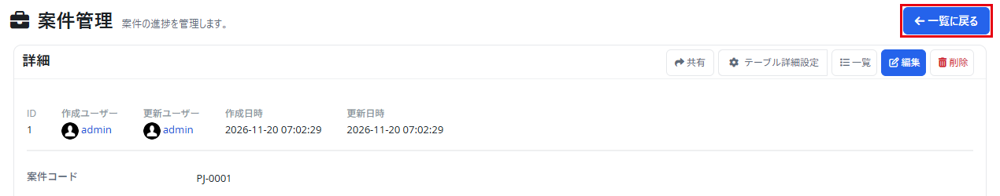
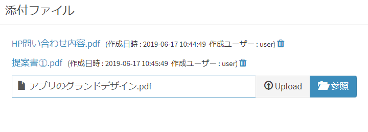

# Detalle de datos
Esta página explica la pantalla para ver el contenido de un dato. Se abre al hacer clic en el dato que se quiere ver en la [Lista de datos](/es/data_grid).  

- En la lista de datos aparece lo indicado en "Seleccionar columnas de la vista" de la [configuración de la vista](/es/view).  
- En el detalle de datos aparecen los campos del formulario que corresponde según el orden de prioridad de la [Configuración de condiciones de visualización del formulario](/es/form).  

En la pantalla de detalle de datos aparecen los 4 tipos de información siguientes.  

- Detalle del contenido  
- Archivos adjuntos  
- Comentarios  
- Historial de actualizaciones  

## Detalle del contenido

- Muestra con detalle el contenido registrado como dato.

## Volver a la lista
En las pantallas de detalle y de edición de un dato, a la derecha de la fila del encabezado (nombre de la tabla) aparece el botón [← Volver a la lista]. Al hacer clic, se vuelve a la lista de datos de esa tabla (el mismo destino que el botón [Lista], arriba a la derecha).

Nota: se puede usar desde v7.1.0. El color del botón es azul en el diseño "Clásico" y, en el diseño "Moderno", el color de acento de la [Apariencia del sitio](/es/system_setting).

## Archivo adjunto
  

En la pantalla de detalle de datos se pueden adjuntar archivos.  

1. Haga clic en el botón [Examinar] y elija el archivo que quiere adjuntar.  
2. Haga clic en el botón [Upload].  

Los archivos adjuntos se pueden eliminar con el botón [Eliminar].

#### Reemplazo y versiones anteriores (v7.2.0 o posterior)
Al pulsar [Reemplazar], junto al archivo adjunto, y elegir un archivo, se reemplaza por el archivo nuevo.  
El archivo anterior queda como "versión anterior". Al pulsar la indicación "Versión 2" (o similar) que aparece junto al archivo reemplazado, aparece la lista de versiones anteriores, y desde ahí se pueden abrir.  

- Se conservan hasta 10 versiones anteriores por cada archivo adjunto. Las que sobran se borran empezando por las más antiguas. El número se puede cambiar con `EXMENT_DOCUMENT_VERSION_LIMIT` en `.env`.  
- Al eliminar un archivo adjunto, también se borran sus versiones anteriores.  

## Comentario
  

- Al escribir un comentario y hacer clic en el botón [Enviar], se añade el comentario al dato.
- La fecha y hora del comentario y el nombre del usuario se ponen automáticamente.
- Los comentarios se pueden eliminar con el botón [Eliminar].  

Nota: solo se pueden eliminar los comentarios del propio usuario con sesión iniciada.  
En el ejemplo de la imagen se ha iniciado sesión como user, así que el comentario de admin no tiene el botón [Eliminar].

#### Markdown e imágenes (v7.1.0 o posterior)
Los comentarios se pueden escribir en Markdown. Se pueden usar encabezados, listas, negrita, código, enlaces y tablas (GitHub Flavored Markdown). Los saltos de línea se muestran tal cual, como saltos de línea.

- Con [Escribir] y [Vista previa] del campo de comentario se puede comprobar cómo queda antes de enviar.
- Las imágenes (PNG, JPEG, GIF, WebP) se suben como archivos adjuntos del dato al pegarlas en el campo de entrada o al arrastrarlas y soltarlas, y entran en el comentario con la forma ``. El tamaño máximo es de 10MB como valor inicial (se puede cambiar en los [valores de configuración](/es/config)).
- Una imagen escrita en el texto (columna personalizada "Editor de texto") como `)` también se muestra como imagen en la pantalla de detalle del dato (en la lista sigue apareciendo como texto, igual que antes). También se muestra si se escribe tal cual la url que devuelve "Crear un documento (archivo adjunto)" de la API.

Nota: **los comentarios escritos antes de actualizar a v7.1.0 se muestran como texto, igual que antes** (no se leen como Markdown). Los comentarios escritos después de la actualización se muestran como Markdown.  
Nota: el HTML escrito en un comentario no se muestra como HTML, sino como texto. Los enlaces a sitios externos se abren en una pestaña nueva.  
Nota: las imágenes solo se muestran a los usuarios con sesión iniciada que pueden ver el dato al que está adjunto ese archivo. Las imágenes SVG y las imágenes de otros sitios no se muestran como imagen en los comentarios, sino como enlace.  
Nota: los comentarios también se pueden listar, añadir y eliminar con la API. Para más detalles, consulte la [referencia de la API](https://exment.net/reference/en/webapi.html) (inglés).

#### Menciones (notificar a un miembro con @)
Dentro de un comentario se puede indicar un usuario para enviarle una notificación.

- Al escribir "@" en el campo de comentario (también vale "＠" de ancho completo), aparecen usuarios candidatos.  
Si se siguen escribiendo caracteres, los candidatos se reducen. Al hacer clic en un candidato (o elegirlo con las teclas ↑↓ y pulsar Enter), se introduce "@código de usuario".  
- Al enviar el comentario, el usuario indicado recibe una alerta dentro del sistema (el icono de notificaciones de arriba a la derecha de la página) con el texto "Le han mencionado en un comentario: (encabezado del dato)". En el cuerpo de la notificación aparece el contenido del comentario.

Nota: los candidatos aparecen cuando "@" se escribe al principio de una línea o justo después de un espacio.  
Nota: aparecen como candidatos los usuarios que tienen un código de usuario registrado. Se muestran como máximo 20 candidatos a la vez (según el valor de configuración `EXMENT_API_DEFAULT_DATA_COUNT`).  
Nota: la notificación solo se envía a los usuarios con permiso para ver ese dato. Además, si uno se indica a sí mismo, no se envía ninguna notificación.

## Historial de actualizaciones

  

- El historial de actualizaciones aparece cuando [Usar historial de cambios de datos](/es/table) está en YES en la configuración de la tabla.
- Al editar un dato, la fecha y hora de la edición y el nombre del usuario se ponen automáticamente.
- Al hacer clic en la fecha y hora del historial de actualizaciones, se pasa a la pantalla de revisiones.

#### Revisión
  
- En "Seleccionar revisión", elija en el historial el dato que quiere comparar.
- A la izquierda aparece "el dato del historial elegido" y a la derecha, "el dato más reciente". Los campos con contenido distinto tienen color de fondo.
- Al hacer clic en el botón [Restaurar esta revisión], en la parte inferior de la página, el dato vuelve al contenido del historial elegido.

  

## Compartir datos

> Sobre la configuración para compartir datos, consulte primero la página [Resumen de roles y permisos en Exment](/es/permission).

Comparte con otros usuarios u organizaciones los datos guardados.  
Nota: solo se puede usar cuando se tiene el permiso "Compartir datos" en la [Configuración de roles](/es/role_group).

#### Cómo compartir
1. Haga clic en el botón [Compartir] de la pantalla de detalle de datos.
  

2. Aparece el cuadro de diálogo para compartir datos.
  

3. Añada los usuarios con los que quiere compartir y haga clic en [Enviar]. Con esto queda compartido.  
  

Nota: si el administrador del sistema configura en la [Configuración de notificaciones](/es/notify) la notificación "Creación/actualización de datos", se puede notificar a los usuarios con los que se comparte.
