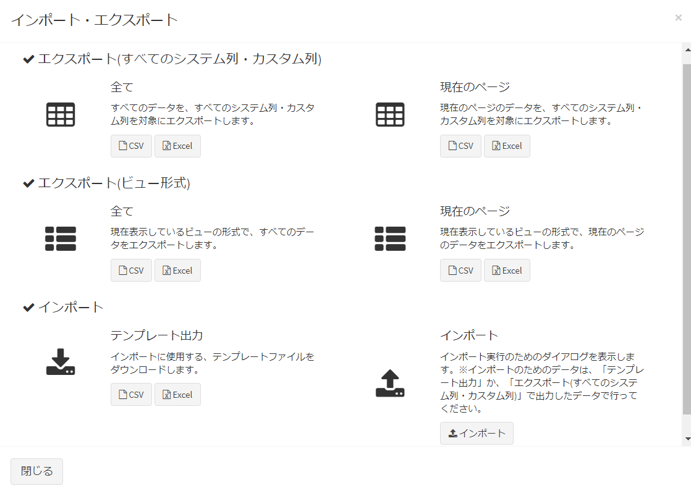
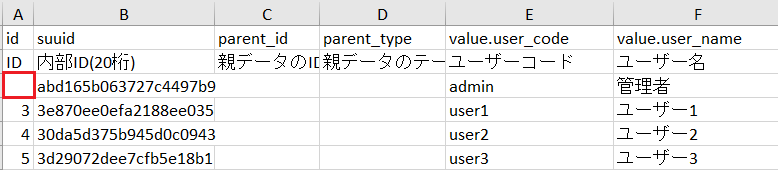
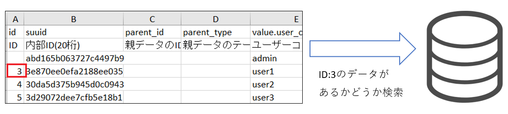

# Importación y exportación de datos
Esta página explica las pantallas para sacar los datos de una tabla a un archivo (csv, xlsx) (exportar) y para meterlos desde un archivo (importar).

| Qué quiere hacer | Dónde mirar |
|---|---|
| Sacar los datos a un archivo (todas las columnas) | [Exportación de datos](/es/data_import_export?id=Exportación-de-datos) |
| Sacar los datos a un archivo con la forma de la vista que se está viendo | "Exportación de datos (vista)" |
| Meter datos desde un archivo | "Importación de datos" |
| Importar y exportar con comandos | [Importación y exportación de datos con comandos](/es/data_cmd_import_export) |
| Meter de una vez una gran cantidad de datos con un comando | [Inserción masiva de datos](/es/data_bulk_insert) |

## Tipos de funciones de exportación e importación de datos
- Las funciones de exportación e importación tienen ahora los siguientes tipos.
    - Exportar  
    Exporta (saca) los datos de la tabla guardados, con todas las columnas.  

    - Exportar (según la vista)  
    Exporta (saca) los datos de la tabla con la forma de la vista que se está mostrando.  

    - Importar  
    Importa (mete) los datos de la tabla desde un archivo csv o xlsx.  

- Al hacer clic en el botón [Importar/Exportar] de la pantalla de lista de datos de la tabla, aparece el siguiente menú.
  

>Los elementos que no se usan se pueden ocultar con los [valores de configuración](/es/config).

## Exportación de datos
Exporta (saca) los datos de la tabla a un archivo.  
El formato del archivo es csv o xlsx (recomendado).  

### Cómo se hace
- Abra la pantalla de lista de datos.
  

- Arriba a la derecha de la página aparece el botón [Importar/Exportar]. Haga clic en él.  
  

- Aparece un menú. Elija lo que quiere exportar.  
  
    - Todo  
    Exporta todos los datos de esa tabla.  
    Nota: **los datos sobre los que el usuario con sesión iniciada no tiene permiso no se exportan.**  
    
    - Página actual  
    Exporta la lista de datos de la página abierta ahora.

    - Todo (con comentarios)  
    Exporta todos los datos de esa tabla y los comentarios de cada dato.  
    Los comentarios se exportan en la hoja "comment" en formato Excel y en el archivo "comment" en formato CSV.  
    Nota: solo aparece en las tablas que tienen "Usar comentarios" en YES en la configuración de la tabla personalizada.  
    Nota: la exportación de comentarios es para consulta. Al importar, la hoja (archivo) "comment" no se importa.

- Al hacer clic en el botón [CSV] o [Excel], los datos se descargan en un archivo.  

### Lista de campos exportados
##### ID  
Es un entero positivo que se asigna automáticamente, en orden correlativo, al registrar el dato.

##### ID del sistema (20 caracteres)
Es un código alfanumérico de 20 caracteres que se asigna automáticamente al registrar el dato. Casi no aparece en las pantallas. Se usa, por ejemplo, en la migración de datos.  

##### ID de los datos principales  
Es el id de la tabla principal cuando esa tabla está registrada como la n de una configuración de relaciones "1:n". Si no hay configuración de relaciones, está vacío.  

##### Nombre de la tabla de los datos principales  
Es el nombre (alfanumérico) de la tabla principal cuando esa tabla está registrada como la n de una configuración de relaciones "1:n". Si no hay configuración de relaciones, está vacío.  

##### Lista de columnas personalizadas  
Los valores registrados como columnas personalizadas se exportan columna por columna.  

##### Fecha de creación, Fecha de actualización, Fecha de eliminación  
Se exportan la fecha y hora en que se creó, se actualizó y se eliminó el dato.  

### Exportación de una relación 1:n
- Al exportar datos en una tabla registrada como el "1" de una configuración de relaciones "1:n", **también se exporta a la vez la lista de datos de la "n" relacionada.**  

Ejemplo: se ha guardado una configuración de relaciones con "Información de contratos" como 1 e "Información de detalles de contrato" como n  
  
- Si se ejecuta la exportación de datos en la pantalla "Información de contratos" (el "cliente" de la imagen es un dato de prueba)  
  
- Se exportan los datos de "Información de contratos" y también los de "Información de detalles de contrato".
  
  
- En "ID de los datos principales" y "Nombre de la tabla de los datos principales" de la lista de datos de la "n" se exportan el ID y el nombre de la tabla principal relacionada.

### Exportación de una relación n:n
- Al exportar datos en una tabla registrada como la n de origen de una configuración de relaciones "n:n", **también se exporta a la vez la información de relación con la "n" relacionada.**  

Ejemplo: se ha guardado una configuración de relaciones n:n entre "Información de organizaciones" e "Información de usuarios"  
  
- Si se ejecuta la exportación de datos en la pantalla "Información de organizaciones",  
  
- Se exportan los datos de "Información de organizaciones". Además, se exportan los datos que relacionan "Información de usuarios" con "Información de organizaciones".
  
  
- En "parent_id" aparece el ID de la información de organización principal, y en "child_id", el ID de la información de usuario secundaria.  

### Otras observaciones
- Tanto en formato CSV como en formato Excel, la fila 1 es el nombre de la columna (alfanumérico) y la fila 2 es el nombre visible de la columna (en japonés). En formato CSV el encabezado también tiene 2 filas. Téngalo en cuenta.  
- El archivo exportado en formato CSV tiene codificación UTF-8, salto de línea LF y no lleva BOM.  
- Cuando la configuración de relaciones hace que se exporten varios conjuntos de datos, en formato Excel se crean varias hojas y en formato CSV se reúnen varios archivos csv en un zip.  

### Cambiar el valor exportado
Al exportar, en las columnas "ID de los datos principales", "Selección (desde tabla)", "Usuario" y "Organización" normalmente se exporta el ID del dato de la tabla de referencia. **Se puede hacer que sea el valor de una columna personalizada de la tabla de referencia.**  
El procedimiento se explica a continuación.  

#### En el caso de parent_id (ID de los datos principales)
1. Abra la pantalla de configuración de relaciones.

2. En "Columna clave al exportar", configure la columna personalizada que quiere sacar al exportar, y guarde.  

3. Después, al exportar los datos, el valor exportado es el de la columna personalizada elegida, en lugar del id. 

Nota: caso normal
  
  
Nota: con "Columna clave al exportar" indicada
  

#### En el caso de "Selección (desde tabla)", "Usuario" y "Organización"
1. Abra la pantalla de configuración de columnas personalizadas de esa columna.

2. En "Columna clave al exportar", configure la columna personalizada que quiere sacar al exportar, y guarde.  

3. Después, al exportar los datos en la tabla de origen de la referencia, el valor exportado es el de la columna personalizada elegida, en lugar del id. 

Nota: caso normal
  
  
Nota: con "Columna clave al exportar" indicada
  

## Exportación de datos (vista)
Exporta (saca) los datos de la tabla a un archivo, con la forma de la vista que se está mostrando.  
El formato del archivo es csv o xlsx (recomendado).  

### Cómo se hace
- Abra la pantalla de lista de datos.
  

- Arriba a la derecha de la página aparece el botón [Importar/Exportar]. Haga clic en él.  
  

- Aparece un menú. Elija lo que quiere exportar.
  
    - Todo  
    Exporta todos los datos de esa tabla.  
    Nota: **los datos sobre los que el usuario con sesión iniciada no tiene permiso no se exportan.**  

    - Página actual  
    Exporta la lista de datos de la página abierta ahora.

- Al hacer clic en el botón [CSV] o [Excel], los datos se descargan en un archivo. Los campos de la vista que se está mostrando se exportan tal cual.  

## Importación de datos
Importa (mete) los datos de la tabla desde un archivo.  
El formato del archivo es csv o xlsx (recomendado). Los datos hay que prepararlos antes con el formato que decide Exment.

El flujo es el siguiente.

1. Exportar la plantilla ("Exportar plantilla")  
2. Escribir en la plantilla los datos que se quieren importar ("Lista de campos importados")  
3. Ejecutar la importación ("Ejecutar la importación de datos")

> Ahora, por motivos de rendimiento, se pueden importar hasta 5000 datos de una vez.  
Para registrar más de 5000 datos de una vez, considere la [inserción masiva de datos](/es/data_bulk_insert).

### Cómo se hace

#### Exportar plantilla
Exporta el archivo de plantilla para importar datos.

- Abra la pantalla de lista de datos.
  

- Arriba a la derecha de la página aparece el botón [Importar/Exportar]. Haga clic en él.  
  

- Dentro de la exportación de plantilla de la importación, haga clic en [CSV] o [Excel].
  

- Se descarga el archivo CSV o Excel para importar datos.  
  
Nota: el formato del archivo es el mismo que al exportar con "Exportar".  
La plantilla se exporta con 0 datos.

- Escriba en la plantilla exportada los datos que quiere importar.

### Lista de campos importados
##### ID  
Es un entero positivo que se asigna automáticamente, en orden correlativo, al registrar el dato.  
Escríbalo solo si quiere decidir usted este ID al importar.  
Si no hace falta decidirlo, déjelo vacío. Al importar, el sistema pone el valor automáticamente.  

##### ID del sistema (20 caracteres)  
Es un código alfanumérico de 20 caracteres que se asigna automáticamente al registrar el dato. Casi no aparece en las pantallas.  
Escríbalo solo si quiere decidir usted este ID del sistema al importar.  
Si no hace falta decidirlo, déjelo vacío. El sistema pone el valor automáticamente.  

##### ID de los datos principales  
Normalmente se deja vacío.  
Si la tabla que se importa está registrada como la n de una configuración de relaciones "1:n", introduzca el id de la tabla principal.  
  
Nota: con la configuración inicial se indica el ID del dato de la tabla principal, pero **también se puede importar indicando una columna personalizada**. Para más detalles, consulte "[Cambiar la forma de indicar los datos de otra tabla](/es/data_import_export?id=Cambiar-la-forma-de-indicar-los-datos-de-otra-tabla)".  

##### Nombre de la tabla de los datos principales  
Normalmente se deja vacío.  
Si esa tabla está registrada como la n de una configuración de relaciones "1:n", introduzca el nombre (alfanumérico) de la tabla principal.  
  

##### Lista de columnas personalizadas  
Escriba los valores que se registran como columnas personalizadas.  
Nota: la forma de escribir el valor cambia según el tipo de columna. Consulte "[Cómo introducir las columnas personalizadas al importar](/es/data_import_export?id=Cómo-introducir-las-columnas-personalizadas-al-importar)", más abajo.

##### Fecha de creación, Fecha de actualización, Fecha de eliminación  
Normalmente se dejan vacías.  
Escríbalas solo si quiere decidir usted la fecha y hora de creación, de actualización o de eliminación del dato.  
Si están vacías, el sistema pone el valor automáticamente al importar.

### Ejecutar la importación de datos
La importación se ejecuta desde la pantalla.

- Abra la pantalla de lista de datos.
  

- Arriba a la derecha de la página aparece el botón [Importar/Exportar]. Haga clic en él.  
  

- Dentro de "Importar (CSV)" o "Importar (Excel)", haga clic en "Importar".
  

- Aparece el cuadro de diálogo de importación.  
  

- En "Archivo de importación", elija el archivo de plantilla de importación con los datos escritos.  

- En "Clave principal", elija la clave principal que sirve para distinguir, al importar, si el dato es nuevo o es una actualización.  
Para más detalles, consulte "Tipos de clave principal", más abajo.

- Cuando esté configurado, haga clic en [Enviar] en el cuadro de diálogo.

- Si hay algún problema en los datos importados, en "Mensaje de error" aparecen el número de fila (contado después del encabezado) y el contenido del error.

Nota: si un campo configurado como "[Obligatorio](/es/column)" en la configuración de la columna personalizada no tiene valor, la importación no se completa. Compruebe que no falta ningún dato en el archivo de plantilla de importación.
- Cuando la importación termina correctamente, el cuadro de diálogo se cierra y los datos se vuelven a cargar.

### Cómo se decide si un dato es nuevo o es una actualización
Al importar, se distingue fila por fila si es un dato que se añade o un dato que actualiza uno existente.  
Aquí se explica cómo se distingue.

- En la pantalla de importación se indica la columna de "Clave principal" que se usa para distinguir. (Aquí se supone "ID")  
Nota: la clave principal se elige al importar. Consulte "Tipos de clave principal", más abajo

- Al importar, el sistema mira el valor de la columna ID de los datos importados.
  

    - Si el ID del dato importado está vacío, se trata como un dato que se añade.
  

    - Si el ID del dato importado tiene valor, se busca entre los datos ya registrados si hay uno con el mismo ID.  
  
    Si hay un dato con el mismo ID, ese dato se actualiza con el contenido del dato importado.  
    Si no lo hay, el dato importado se añade como nuevo. En ese caso, el ID es el del dato importado.  

### Tipos de clave principal

- ##### ID (recomendado)  
Es un entero que el sistema asigna automáticamente. También se usa en las relaciones con otras tablas, etc.  
Es un campo cómodo y fácil de rellenar de antemano. Pero, como es un campo que se numera automáticamente en orden correlativo, al migrar de un entorno a otro pueden aparecer desajustes inesperados.

- ##### ID del sistema (20 caracteres)  
Es un código alfanumérico de 20 caracteres que el sistema asigna automáticamente al guardar el dato.  
Al migrar de un entorno a otro se recomienda usar este ID del sistema, para dejar claro qué dato se actualiza.  

- ##### Columna única  
Las columnas configuradas como "Único" en la configuración de columnas personalizadas se pueden elegir como clave principal. (Ejemplo: dirección de correo electrónico, código de usuario)    

### Cómo introducir las columnas personalizadas al importar
La forma de escribir el valor al importar cambia según el tipo de la columna personalizada.  
Consulte lo siguiente.

##### Selección (guardar valor y etiqueta)  
Introduzca el "valor" que se registra en la base de datos o la "etiqueta" que aparece en la pantalla.  

##### Selección (desde tabla), Usuario, Organización  
Introduzca **el ID de la tabla de referencia**.  
  
Nota: con la configuración inicial se indica el ID del dato de la tabla de referencia, pero **también se puede importar indicando una columna personalizada**. Para más detalles, consulte "[Cambiar la forma de indicar los datos de otra tabla](/es/data_import_export?id=Cambiar-la-forma-de-indicar-los-datos-de-otra-tabla)".  

##### SÍ/NO  
Introduzca "YES" o "NO", o bien "1" o "0".  

##### Selección de 2 valores  
Introduzca el texto visible o el valor de la "Selección de 2 valores" introducido en la pantalla de la columna personalizada.  
  

##### Los demás  
Introduzca tal cual el valor que se registra.  

### Cambiar la forma de indicar los datos de otra tabla
Al importar, en las columnas "ID de los datos principales", "Selección (desde tabla)", "Usuario" y "Organización" normalmente se escribe el ID del dato de la tabla de referencia. **Se puede importar indicándolo con el valor de una columna personalizada.**  
El procedimiento se explica a continuación.  

#### En el caso de parent_id (ID de los datos principales)
1. Abra la pantalla de configuración de relaciones.

2. En "Columna clave al importar", configure la columna personalizada que se usa para buscar el valor al importar, y guarde.  
Nota: solo se pueden indicar las columnas marcadas como "Índice de búsqueda" en la configuración de columnas personalizadas.  

3. Después, descargue el archivo Excel de importación en la tabla secundaria. En la hoja "##setting##" aparecen el nombre de la tabla secundaria, "parent_id" y el nombre de la columna personalizada indicada de la tabla principal.  
  

4. Sin cambiar el contenido de esta hoja, escriba los datos que se importan en la hoja de la tabla secundaria.  
En la columna "parent_id" escriba el valor de la columna personalizada registrada en **Columna clave al importar**.  
En el ejemplo de abajo se introduce el valor de "Código de contrato" de la tabla principal "Información de contratos".
  
  

5. Después, ejecute la importación.

#### En el caso de "Selección (desde tabla)", "Usuario" y "Organización"
1. Abra la pantalla de configuración de columnas personalizadas de esa columna.

2. En "Columna clave al importar", configure la columna personalizada que se usa para buscar el valor al importar, y guarde.  
Nota: solo se pueden indicar las columnas marcadas como "Índice de búsqueda" en la configuración de columnas personalizadas.  

3. Después, descargue el archivo Excel de importación en la tabla de origen de la referencia. En la hoja "##setting##" aparecen el nombre de la tabla de origen de la referencia, "value." + el nombre de la columna personalizada de origen y el nombre de la columna personalizada de referencia.  
  

4. Sin cambiar el contenido de esta hoja, escriba los datos que se importan en la hoja de la tabla de origen de la referencia.  
En la columna personalizada de origen escriba el valor de la columna personalizada de referencia registrada en **Columna clave al importar**.  
En el ejemplo de abajo se introduce el valor de "Código de cliente" de la tabla de referencia "Maestro de clientes".
  
  

5. Después, ejecute la importación.

#### Puntos de atención
- Solo se admite la importación en formato Excel. El formato CSV no se admite por ahora.
