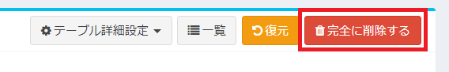

# Datos eliminados
Esta página explica la pantalla para ver en una lista los datos eliminados y para recuperarlos (restaurar) o eliminarlos permanentemente.

- Solo pueden mostrar los datos eliminados los usuarios con el permiso para mostrar datos eliminados.
- Los usuarios con permiso de edición pueden restaurar los datos y eliminarlos permanentemente.  

Nota: para más detalles sobre los permisos, consulte [Grupo de roles](/es/role_group).

## Mostrar la lista
  

1. En la marca ▼ que está justo a la derecha de [Filtro], arriba a la izquierda de la pantalla de lista de datos, elija "Datos eliminados".
2. La visualización cambia y aparecen en una lista los datos eliminados de esa tabla.

  

## Mostrar el detalle

- Se puede mostrar el detalle de los datos que están en la lista de datos eliminados.  
- Haga clic en la fila del dato que quiere mostrar o en el icono de ver de la columna de acciones.

  

- En la pantalla de detalle de datos se pueden comprobar el usuario que eliminó y la fecha de eliminación.

  

## Restaurar

- Los datos eliminados se pueden devolver a la pantalla de lista de datos (restaurar).
- Hay 3 formas de restaurar.
    - Usar el botón [Restaurar] de la pantalla de detalle de datos.
      
    - En la pantalla de lista de datos eliminados, usar el icono [Restaurar] de la columna de acciones.
      
    - En la pantalla de lista de datos eliminados, marcar los datos que se quieren restaurar y elegir "Restaurar" en la marca ▼ de arriba a la izquierda de la pantalla de datos eliminados.
      

Nota: solo pueden restaurar un dato los usuarios con permiso de edición de ese dato.

## Eliminar permanentemente

- Los datos eliminados se pueden eliminar permanentemente. Los datos eliminados permanentemente desaparecen también de la lista de datos eliminados.
- Hay 3 formas de eliminar permanentemente.
    - Usar el botón [Eliminar permanentemente] de la pantalla de detalle de datos.
      
    - En la pantalla de lista de datos eliminados, usar el icono [Eliminar permanentemente] de la columna de acciones.
      
    - En la pantalla de lista de datos eliminados, marcar los datos que se quieren eliminar permanentemente y elegir "Eliminar permanentemente" en la marca ▼ de arriba a la izquierda de la pantalla de datos eliminados.
      

Nota: solo pueden eliminar permanentemente un dato los usuarios con permiso de edición de ese dato.

## Ir a la pantalla de lista de datos

- En la pantalla de lista de datos eliminados, al hacer clic en [Datos eliminados▼] y elegir "Cancelar", se pasa a la pantalla de lista de datos de esa tabla.

  

#### Configuración de permisos
- Para mostrar los datos eliminados, el usuario necesita el permiso de visualización de esos datos.
- Para restaurar o eliminar permanentemente los datos eliminados, el usuario necesita el permiso de edición de esos datos.

Nota: sobre la configuración de permisos, consulte [Grupo de roles](/es/role_group).
