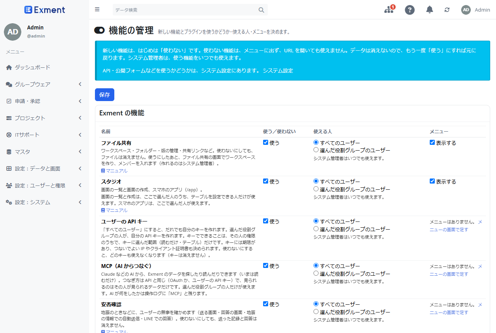

# Gestión de funciones
Decida qué funciones nuevas y qué plugins se usan, quién puede usarlos y si se muestran sus menús.  
Exment se usa en muchos sitios, así que las funciones nuevas están al principio en «no usar». Hasta que el administrador del sistema las pone en «usar», no aparecen en el menú y no se pueden usar aunque se abra la URL. Solo por actualizar Exment no cambian las pantallas ni los menús.

※Esta pantalla se puede usar en Exment v7.2.1 o posterior.

## Pantalla de configuración
Inicie sesión como administrador del sistema y abra «Configuración de administración» → «Gestión de funciones» (la URL es `/feature`).  
Solo el administrador del sistema puede abrir esta pantalla.

La pantalla se divide en «Funciones de Exment», arriba, y «Plugins», abajo.

## Funciones de Exment
Son las funciones nuevas del propio Exment. Ahora hay las siguientes.

| Nombre | Contenido |
| --- | --- |
| Archivos compartidos | Espacios de trabajo, carpetas, control de versiones, enlaces para compartir, etc. Aunque la ponga en «no usar», los archivos no se borran. (Solo aparece en las versiones que incluyen los archivos compartidos) |
| Studio | La lista de pantallas, la creación de pantallas y la aplicación para teléfono (/app). Pueden usarlo las personas que pueden configurar tablas. |
| Mantenimiento de datos | Ordena de una vez los datos de las tablas (por ahora, la eliminación de archivos adjuntos en bloque). Pueden usarlo las personas que pueden configurar tablas. (v7.3.0 o posterior) [Mantenimiento de datos](/es/data_maintenance) |

Para cada función se deciden estas 3 cosas.

| Campo | Contenido |
| --- | --- |
| Usar | Si esa función se usa en este sitio. Al principio está en «no usar». |
| Quién puede usarlo | «Todos los usuarios» o «Usuarios de los grupos de roles elegidos». Si no elige ningún grupo de roles, solo pueden usarla los administradores del sistema. Los administradores del sistema siempre pueden usarla. |
| Menú | Si se «muestra» en el menú. Solo se muestra a quienes pueden usarla. Si no hay fila de menú, aparece «No hay fila de menú. Al guardar, se crea.». |

En la columna «Estado» aparece lo siguiente.

| Estado | Significado |
| --- | --- |
| Nuevo | Es una función sobre la que nadie ha decidido todavía (se trata como «no usar»). |
| En uso | Está en «usar» y se puede usar. |
| No disponible en este entorno | Está detenida por la configuración del servidor ([Fijar con la configuración del servidor](/es/feature?id=Fijar-con-la-configuración-del-servidor)). No se puede poner en «usar» desde esta pantalla. |
| No se puede usar porque una función que necesita está desactivada. | Es una función que solo funciona si existe otra función (aparece «Solo mientras se usa «○○».»), y esa otra función está en «no usar». |

※Studio solo lo pueden usar, de las personas elegidas aquí, las que pueden configurar tablas.  
※El uso de la API, los formularios públicos, etc. sigue estando, como hasta ahora, en la [Configuración del sistema](/es/system_setting).

<!-- Captura de pantalla: 1 fila de las funciones de Exment (usar, quién puede usarlo, menú) (img/feature/feature_core.png). Se toma después de fusionar #1861 -->

## Plugins
Los plugins instalados también aparecen en la misma pantalla.  
No se guarda un ajuste nuevo por duplicado: se muestran tal cual los ajustes que ya existen.

| Campo | Contenido |
| --- | --- |
| Usar | Es lo mismo que activar o desactivar el plugin. Cuando está desactivado, aparece «El plugin está desactivado». Para cambiarlo, vaya desde «Cambiarlo en la configuración del plugin» a la pantalla de [Plugin](/es/plugin). |
| Quién puede usarlo | Es lo mismo que el permiso de «uso» del plugin en los grupos de roles. Para cambiarlo, hágalo en la pantalla de [Grupo de roles](/es/role_group). |
| Menú | Si se muestra en el menú. Solo esto se decide en esta pantalla. |

※En los plugins de un tipo que «puede usar cualquiera» y en los plugins configurados como «todos los usuarios pueden usarlo», se indica ese hecho.  
※Si dentro de un plugin hay funciones registradas por el plugin (por ejemplo, el correo web), aparecen debajo del plugin, una fila por función. Las funciones de dentro de un plugin también están al principio en «no usar». Pueden usarlas, de las personas que pueden usar el plugin, las elegidas aquí.

<!-- Captura de pantalla: la fila de un plugin y la fila de una función de dentro del plugin (img/feature/feature_plugin.png). Se toma después de fusionar #1861 -->

## Plugins oficiales gratuitos (incluidos con Exment)
Exment incluye plugins oficiales gratuitos (gestión de proyectos, soporte de TI, Groupware). Se instalan desde la sección «Plugins oficiales gratuitos (incluidos con Exment)» de «Gestión de funciones». Para más detalles, consulte [Plugins oficiales](/es/plugin_official).

- Hasta que pulse «Usar (instalar)», no se instalan ni se cargan (tampoco se crean tablas).
- Al pulsarlo, se comprueba, se instala y se activa. La función principal de ese plugin también pasa a «usar». Después aparece también en la sección «Plugins» de arriba, y puede decidir quién puede usarlo y el menú.
- Cuando hay una versión nueva, aparece «Está disponible la versión ○○.». No se instala automáticamente. Se actualiza con «Actualizar a esta versión» (los ajustes, los menús y los permisos se conservan).
- La versión anterior a la actualización se conserva, y puede volver a ella con «Volver a la versión anterior (○○)».
- Actualizar Exment no cambia solo los plugins en uso. Vea [Las actualizaciones y los plugins oficiales incluidos](/es/update?id=las-actualizaciones-y-los-plugins-oficiales-incluidos).
- Los plugins que ya había instalado a mano se siguen usando tal cual (no se reinstalan). Solo se le avisa cuando la versión incluida es más reciente. Si lo sustituye por la versión incluida, no puede volver a la versión instalada a mano.
- Los plugins incluidos se instalan después de comprobar la firma de Exceed One. Los que no tienen una firma correcta no aparecen.
- En los sitios donde el proveedor cambia las versiones (SaaS, etc.), aparece «Las versiones las cambia el proveedor de este sitio.» y no aparecen los botones (`EXMENT_BUNDLED_PLUGINS_UPDATES=false` en `.env`).

#### Aviso de correcciones de seguridad
Cuando la versión nueva de un plugin oficial instalado incluye una corrección de seguridad, se avisa al administrador del sistema.

- En la parte superior del inicio del administrador del sistema aparece «Actualización disponible para un plugin oficial (○○)». En la fila de la gestión de funciones también aparecen la marca «Corrección de seguridad» y «Esta versión incluye una corrección de seguridad. Pulse «Actualizar a esta versión».».
- Se envía una sola vez el mismo asunto y el mismo texto por la notificación de la campana y, en los sitios que pueden enviar correo, por correo.
- A los demás usuarios no les aparece nada. Solo se actualiza cuando el administrador del sistema pulsa «Actualizar a esta versión».
- Al volver a una versión que no incluye la corrección de seguridad, se pide confirmación otra vez.

#### Aviso de funciones nuevas
Cuando, al actualizar Exment, aumentan las funciones nuevas sobre las que todavía no se ha decidido, se avisa una sola vez con el aviso del inicio del administrador del sistema y con la campana («Hay nuevas funciones (○○). Al principio están desactivadas. …»). No se envía correo. En los sitios recién instalados no aparece.

<!-- Captura de pantalla: la sección de los plugins oficiales gratuitos (img/feature/feature_bundled.png). Se toma después de fusionar #1867 -->

## Cuando se pone en «no usar»
- Deja de aparecer en el menú (la fila del menú no se borra, solo se oculta).
- Las páginas y la API de esa función no se pueden usar aunque se abra la URL directamente.
- Los datos (espacios de trabajo, archivos, pantallas, etc.) no se borran. Si la vuelve a poner en «usar», todo vuelve a estar como antes.
- Al guardar después de poner en «no usar» una función que alguien está usando, o de reducir quién puede usarla, se pregunta «Algunos usuarios ya no podrán usar lo siguiente. ¿Guardar?».

## Avisos que aparecen cuando no se puede usar
Al abrir la URL de una función que no se puede usar, aparecen estos avisos.

| Aviso | Cuándo aparece |
| --- | --- |
| Esta función no se usa en este sitio. | Cuando la función está en «no usar» (o cuando está detenida por la configuración del servidor). Al administrador del sistema también le aparece un enlace a «Gestión de funciones». |
| No tiene permiso para usar esta función. Póngase en contacto con su administrador. | Cuando la función está en «usar», pero la persona que ha iniciado sesión no está en «Quién puede usarlo». |

En los dos casos puede volver al inicio con el enlace «Volver al inicio». Cuando se llama desde la API, el mismo aviso se devuelve en JSON (404 cuando no se usa, 403 cuando no hay permiso).

<!-- Captura de pantalla: la pantalla de «Esta función no se usa en este sitio.» (img/feature/feature_not_used.png). Se toma después de fusionar #1861 -->

## En los sitios actualizados
Aunque actualice Exment, lo que usaba hasta ahora se sigue usando igual.

- Las funciones que se usaban antes de actualizar pasan a «usar». Se ven como hasta ahora.
  - Archivos compartidos: los sitios que tienen al menos 1 espacio de trabajo
  - Studio: los sitios donde alguien ha abierto alguna vez la pantalla de Studio o la aplicación para teléfono (se comprueba con el registro de operaciones)
- Las funciones que solo tenían menú y no se usaban pasan a «no usar».
- La activación o desactivación de los plugins y los permisos de los grupos de roles no cambian.
- De las funciones de dentro de un plugin, las que ese plugin ya tenía antes siguen en «usar» en los sitios que ya tenían instalado el plugin.
- En los sitios recién instalados, todo empieza en «no usar».
- Debajo de «Configuración de administración» se añade el menú «Gestión de funciones».

## Fijar con la configuración del servidor
Si escribe `EXMENT_FEATURES_LOCKED` en el `.env` del servidor, puede fijar esa función en «no usar», elija lo que elija el administrador del sistema del sitio.  
Se usa en los servicios que no ofrecen una función (SaaS, etc.). Escriba las claves separadas por comas.

~~~
EXMENT_FEATURES_LOCKED=file_server,studio
~~~

| Clave | Función |
| --- | --- |
| `file_server` | Archivos compartidos |
| `studio` | Studio (incluida la aplicación para teléfono) |

Las funciones fijadas aparecen en esta pantalla como «No disponible en este entorno».

※Después de cambiar `.env`, en los servidores que usan la caché de la configuración ejecute `php artisan config:clear` (o `php artisan config:cache`).

## Orden en que se decide
Si algo se puede usar o no se decide en orden, de arriba abajo. Un ajuste de abajo no puede ampliar lo que permite un ajuste de arriba.

1. **Configuración del servidor**: las funciones escritas en `EXMENT_FEATURES_LOCKED` no se pueden usar.
2. **«Usar» o «no usar» del sitio**: las funciones en «no usar» no las puede usar nadie.
3. **Quién puede usarlo**: todos los usuarios o los usuarios de los grupos de roles elegidos (los administradores del sistema siempre pueden usarlo).
4. **Ajustes de dentro de la función**: en Studio, los permisos de las tablas; en los archivos compartidos, los permisos de los espacios de trabajo; etc.

## Para quienes crean plugins
Un plugin puede registrar sus funciones internas y mostrar 1 fila en esta pantalla. Las funciones registradas están al principio en «no usar».

~~~php
use Exceedone\Exment\Services\Features;

// Se registra en el constructor de la clase del plugin, por ejemplo. La clave empieza por la uri del plugin
Features::register('exment_groupware.mail', [
    'label' => 'Correo web',
    'endpoints' => ['plugins/exment_groupware/mail'],
]);

// Se comprueba dentro de la página del plugin
if (!Features::allowed('exment_groupware.mail')) {
    return Features::deny('exment_groupware.mail');
}
~~~

- En las páginas escritas en `endpoints` aparece el aviso de arriba cuando no se pueden usar.
- Con `existing => true`, en los sitios que ya tenían instalado ese plugin la función sigue en «usar» (para registrar más tarde una función que ya existía).
- Si escribe en `requires` la clave de otra función, no se puede usar cuando esa función está en «no usar».

## Temas relacionados
- [Configuración del sistema](/es/system_setting)
- [Plugin](/es/plugin)
- [Grupos de roles y configuración de permisos](/es/role_group)
- [Menú](/es/menu)
