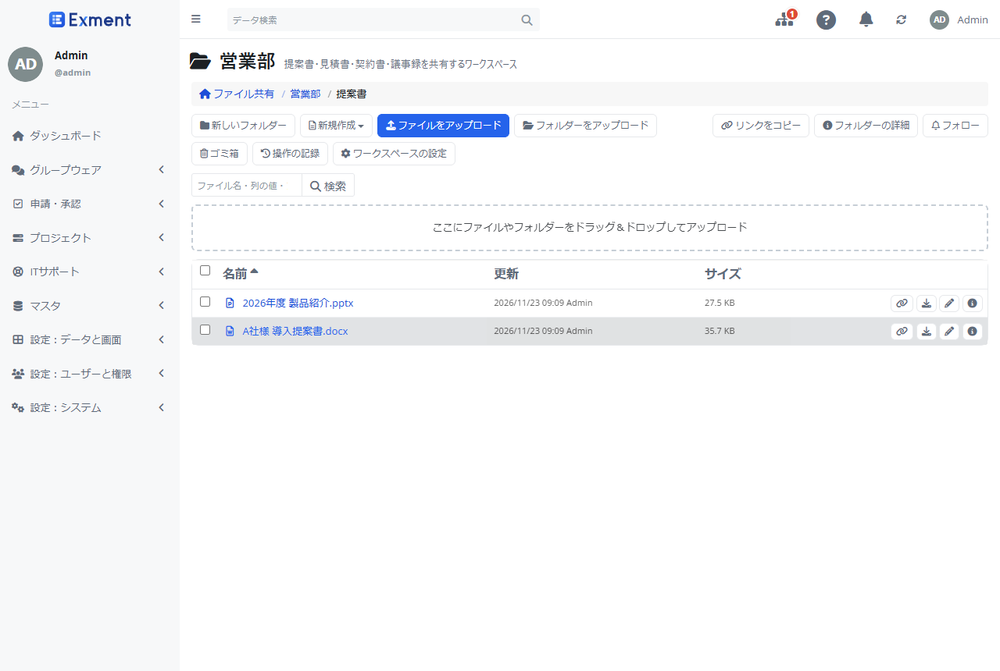
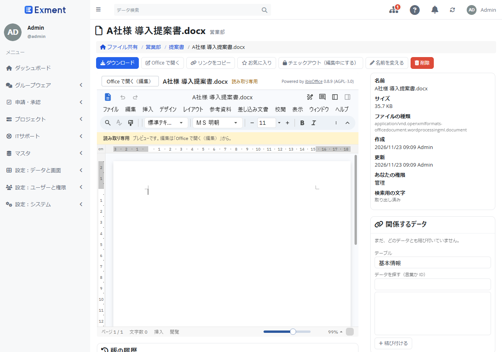

# Archivos compartidos
Las carpetas y los archivos se colocan en el espacio de trabajo de cada equipo y se comparten. Hay permisos por carpeta, gestión de versiones, vista previa y papelera. Se usa como Box o como una biblioteca de documentos de SharePoint.  
El contenido de los archivos se guarda en el lugar de almacenamiento de archivos de Exment (local, S3, Azure, FTP, etc., con la configuración que ya tiene).

※Esta función se puede usar desde Exment v7.2.1. <!-- TODO: corregir según la versión en la que Archivos compartidos entre en master -->

## Empezar a usarlo
Al principio, Archivos compartidos está en "no usar". Cuando el administrador del sistema pone "Archivos compartidos" en "Usar" en "Configuración de administración" → "[Gestión de funciones](/es/feature)", aparece "Archivos compartidos" en el menú de la izquierda. Quién puede usarlo (grupos de roles) también se elige en Gestión de funciones.

## Espacio de trabajo
El espacio de trabajo es el lugar donde un equipo guarda sus archivos (equivale a un sitio de SharePoint).

- Se crea con "Nuevo espacio de trabajo". Quien lo crea pasa a ser el administrador de ese espacio de trabajo. Quién puede crearlos se decide con `EXMENT_FILE_SERVER_WORKSPACE_CREATE` del archivo `.env` (`admin`: solo el administrador del sistema; `all`: cualquiera).
- En "Configuración del espacio de trabajo" se decide lo siguiente.

| Elemento | Descripción |
| --- | --- |
| Nombre y Descripción | El nombre y la descripción del espacio de trabajo. |
| Miembros | Los usuarios y las organizaciones, con su permiso (Ver, Subir, Editar, Administrar). Hace falta 1 administrador o más. |
| Límite de espacio (GB) | Vacío: sin límite. También cuentan las versiones antiguas y los archivos de la papelera. |
| Días en la papelera | Pasados estos días, se eliminan definitivamente. Con 0, se conservan hasta que se eliminan a mano. |
| Versiones conservadas | El número de versiones antiguas que se conservan de 1 archivo. |
| Columnas (metadatos) | Las columnas que se añaden a los archivos de este espacio de trabajo. Vea "Columnas (metadatos)", más abajo. |

En la página principal aparecen la lista de los espacios de trabajo que puede abrir y "Favoritos", "Archivos modificados recientemente" y "Compartido conmigo".

## Carpetas y archivos
- Se sube con "Nueva carpeta", "Subir archivos" o "Subir una carpeta", o arrastrando y soltando. Los archivos grandes se envían por partes, así que, si se corta a medias, se puede seguir desde donde se quedó.
- En cada archivo o carpeta se puede cambiar el nombre, mover, copiar, descargar (varios, en ZIP), eliminar y marcar como favorito.
- Lo eliminado va a la papelera. Desde la papelera se puede "Restaurar" o "Eliminar definitivamente".

## Permisos
Hay 4 permisos. Un permiso superior puede hacer también todo lo que pueden los inferiores.

| Permiso | Lo que se puede hacer |
| --- | --- |
| Ver | Ver y descargar |
| Subir | Añadir archivos |
| Editar | Cambiar el nombre, mover, eliminar, subir una nueva versión y crear enlaces para compartir |
| Administrar | Cambiar los permisos, descartar una desprotección y aprobar |

- Las carpetas y los archivos heredan los permisos de la carpeta superior (o del espacio de trabajo).
- Con "Dejar de heredar permisos", esa carpeta o ese archivo pasa a tener permisos propios. Con "Heredar permisos" se vuelve a como estaba.
- El administrador del sistema puede administrar todos los espacios de trabajo.

## Gestión de versiones y desprotección
- Si sobrescribe un archivo con el mismo nombre o usa "Subir una nueva versión", se crea una versión nueva. Desde "Historial de versiones" puede descargar una versión anterior, o guardar el contenido de una versión anterior como versión nueva con "Restaurar esta versión".
- Con "Desproteger (editar)", las demás personas no pueden cambiar ni eliminar ese archivo. Al terminar, use "Proteger (terminar edición)". Quien tiene el permiso Administrar puede usar "Descartar desprotección".

## Vista previa
Las imágenes, los vídeos, el audio, los PDF y los textos se ven en pantalla. En los archivos de Office (docx, xlsx, pptx), cómo se ven depende de lo que esté preparado en el servidor.

| Preparación del servidor | Cómo se ven los archivos de Office |
| --- | --- |
| Hay LibreOffice (`EXMENT_FILE_SERVER_SOFFICE_PATH`) | Se convierten a PDF y se muestran. |
| Está el plugin oficial "Groupware" | Con "Abrir en Office" se abren en modo de solo lectura en el Office del navegador (ibisOffice). Si además hay LibreOffice, se cambia con pestañas. |
| No hay ninguno de los dos | Solo se muestra el texto del archivo. Para verlo con su aspecto real, descárguelo. |

Con el ibisOffice de Groupware no hacen falta ni LibreOffice ni Docker, y se puede usar también en un servidor de alquiler. Para la preparación y la configuración del servidor web, vea [Groupware](/es/plugin_groupware).

※Los archivos html, svg, etc. no se muestran en pantalla por seguridad; solo se pueden descargar.

※De los archivos que llegan de fuera de la empresa por un enlace de recepción no se genera la vista previa ni se extrae el texto al abrirlos. Solo se generan cuando alguien con el permiso Administrar pulsa "Generar vista previa".

## Enlaces para compartir con personas externas
Puede entregar archivos y carpetas a personas de fuera de la empresa que no inician sesión, y recibir archivos de personas de fuera. El enlace se crea en el apartado "Enlaces para compartir con personas externas" de la pantalla del archivo.

| Tipo de enlace | Descripción | Quién puede crearlo |
| --- | --- | --- |
| Enlace para compartir (las personas externas ven y descargan) | Si es una carpeta, también se muestra lo que hay dentro. Si desmarca "Permitir descargas", solo hay vista previa. | Quien tiene el permiso Editar |
| Enlace de recepción (las personas externas suben archivos) | Las personas de fuera ponen archivos en la carpeta. No ven los archivos de otras personas. Un archivo con el mismo nombre no se sobrescribe: pasa a llamarse "nombre (2)". | Quien tiene el permiso Editar (desde la 7.2.1. Los enlaces creados antes por alguien que solo tenía el permiso Subir dejan de abrirse) |

- Se pueden poner caducidad, contraseña y número de accesos permitidos. La contraseña tiene 8 caracteres o más (`EXMENT_FILE_SERVER_SHARE_PASSWORD_MIN`). Con "Revocar" se puede anular en cualquier momento.
- Todos los enlaces no válidos (caducados, revocados, con los accesos agotados, etc.) muestran "No se puede abrir el enlace".
- La caducidad de un enlace para compartir nuevo es de 30 días de forma predeterminada y de 90 días como máximo (`EXMENT_FILE_SERVER_SHARE_DEFAULT_DAYS` y `EXMENT_FILE_SERVER_SHARE_MAX_DAYS`. Con 0, sin valor predeterminado y sin máximo). Los enlaces sin caducidad creados antes aparecen como "Sin fin" en la lista de enlaces.
- La dirección de un enlace para compartir solo la pueden ver quien creó ese enlace y quien tiene el permiso Administrar sobre ese archivo o carpeta.
- Para entregarlo a alguien de la empresa, use "Copiar enlace interno". Solo lo pueden abrir las personas que tienen permiso para ver ese archivo.
- Para que no se usen los enlaces para compartir con personas externas, escriba `EXMENT_FILE_SERVER_EXTERNAL_SHARE=false` en `.env`. El máximo de la caducidad se cambia con `EXMENT_FILE_SERVER_SHARE_MAX_DAYS`.
- Los enlaces para compartir (`/share/...`) son para entregarlos a personas de fuera, así que normalmente no se les aplica el filtro de IP web de la Configuración del sistema. Si quiere que solo se abran desde dentro de la empresa, escriba `EXMENT_FILE_SERVER_SHARE_WEB_IP_FILTER=true` en `.env`. Es un ajuste que se lee al crear las rutas, así que en los sitios que usan `php artisan route:cache` hay que ejecutarlo otra vez después de cambiarlo.

## Columnas (metadatos)
En la configuración del espacio de trabajo puede crear columnas para los archivos ("Cliente", "Tipo", etc.).

- Los tipos son texto, varias líneas, número, fecha, selección, selección múltiple y sí/no. Se puede decidir si es obligatoria, el valor predeterminado y si se muestra en la lista.
- En la lista se puede filtrar por columna (también se puede elegir "(vacío)"), ordenar y agrupar.

## Vincular con los datos
Con "Datos relacionados" de la pantalla del archivo, se puede vincular con datos de las tablas de Exment (un cliente, etc.). En la pantalla de detalle del dato aparece el apartado "Archivos en archivos compartidos". En los dos lados solo aparece lo que se tiene permiso para ver.

## Búsqueda
Con "Buscar" se busca por el nombre del archivo, por los valores de las columnas y por el texto del archivo. Solo aparecen los archivos que se tiene permiso para ver.

- El texto del archivo se extrae de texto, HTML, Office (docx, xlsx, pptx) y OpenDocument. De los PDF se extrae cuando hay pdftotext (`EXMENT_FILE_SERVER_PDFTOTEXT_PATH`), y de las imágenes y los PDF escaneados, cuando hay tesseract (`EXMENT_FILE_SERVER_OCR_PATH`).
- Normalmente se busca en la base de datos. Con `EXMENT_FILE_SERVER_MEILI=true` se busca con [Meilisearch](/es/additional_meilisearch) (usa el índice `exment_files`, distinto del de la búsqueda de texto completo de los datos).

## Aprobación, retención legal y período de conservación
<!-- TODO: comprobar cuando entre P5 (exment PR #1859) -->
| Función | Descripción |
| --- | --- |
| Aprobación | Si en las "Reglas" de la carpeta se pone que requieren aprobación, los archivos que se colocan quedan "Pendiente de aprobación". Hasta que se aprueban, solo los ven quien los subió y los administradores. Quien tiene el permiso Administrar hace "Aprobar" o "Devolver". |
| Retención legal | Si se aplica a un espacio de trabajo, una carpeta o un archivo, ya no se puede eliminar. Las versiones antiguas tampoco se borran. Solo el administrador del sistema puede aplicarla y quitarla (quien tiene el permiso Administrar solo la ve). |
| Período de conservación | Si en la configuración del espacio de trabajo se fija un número de días, los archivos no se pueden eliminar durante esos días. Solo el administrador del sistema puede fijarlo y quitarlo (quien tiene el permiso Administrar solo lo ve). |
| Quién puede descargar | Las personas con un permiso inferior al fijado solo pueden ver (vea "Cuando solo se puede ver", más abajo). |
| Marca de agua | Sobre la vista previa se superponen el nombre de quien la ve y la fecha y hora. |
| Registro de auditoría | Registra las visualizaciones, las descargas, las subidas, las eliminaciones, los cambios de permisos, los enlaces para compartir, etc. Se puede exportar en CSV. |
| Seguir y comentarios | Cuando cambia un espacio de trabajo, una carpeta o un archivo que usted sigue, se le avisa con la campana y por correo. Con `@código de usuario` en un comentario se avisa a esa persona. |

### Cuando solo se puede ver
A las personas con un permiso inferior a "Quién puede descargar" del espacio de trabajo, y en los enlaces para compartir con "Permitir descargas" desmarcado, los archivos se muestran así.

| Archivo | Cómo se ve |
| --- | --- |
| Imagen | Se muestra una imagen reducida. |
| Office y PDF | Si existe la versión convertida a PDF, se muestra esa. |
| Texto, vídeo y audio | No se muestran. |

Cada vez que se ve, queda en el registro de auditoría.

## Preparación del servidor
- **Proceso diario**: la eliminación automática de la papelera funciona con `php artisan exment:file-server-purge` (todos los días a las 3:30). Configure la [programación de tareas](/es/additional_task_schedule).
- **Cola**: las miniaturas, las vistas previas y la extracción de texto funcionan con la cola.
- **Rehacer la extracción de texto**: con `php artisan exment:file-server-index` se extrae el texto de los archivos pendientes y se vuelve a crear el índice de Meilisearch.
- **Otros programas** (funciona también sin ninguno de ellos): LibreOffice (vista previa de Office), pdftotext (texto de los PDF), tesseract (OCR) y Meilisearch (búsqueda rápida).
- **Ejecutar LibreOffice sin red**: los archivos de Office a veces intentan leer URL externas. Si escribe en `EXMENT_FILE_SERVER_SOFFICE_PREFIX` el comando que se pone delante de LibreOffice, la conversión se hace sin red (ejemplos: `unshare -rn`, `firejail --net=none --quiet`). Compruebe antes que ese comando se puede usar en el servidor.
- **Límites de subida**: los archivos grandes se envían por partes. 1 archivo puede tener hasta 2 GB (`EXMENT_FILE_SERVER_MAX_FILE_SIZE`), 1 persona puede tener hasta 20 subidas a medias (`EXMENT_FILE_SERVER_MAX_UPLOADS`) y su total puede ser de hasta 10 GB (`EXMENT_FILE_SERVER_MAX_UPLOAD_BYTES`). Las subidas a medias también cuentan para el espacio del espacio de trabajo. Las que no reciben nada durante 60 minutos no cuentan y se borran la próxima vez que esa persona empieza una subida.

## Ajustes principales (.env)
| Ajuste | Valor predeterminado | Descripción |
| --- | --- | --- |
| `EXMENT_FILE_SERVER_WORKSPACE_CREATE` | `admin` | Quién puede crear espacios de trabajo (`admin` o `all`) |
| `EXMENT_FILE_SERVER_MAX_FILE_SIZE` | `2147483648` (2 GB) | Tamaño máximo de 1 archivo (en bytes. 0: sin límite. Desde la 7.2.1, 2 GB) |
| `EXMENT_FILE_SERVER_MAX_UPLOADS` | `20` | Número de subidas a medias que puede tener 1 persona |
| `EXMENT_FILE_SERVER_MAX_UPLOAD_BYTES` | `10737418240` (10 GB) | Total de las subidas a medias de 1 persona (en bytes. 0: sin límite) |
| `EXMENT_FILE_SERVER_EXTERNAL_SHARE` | `true` | Si se usan los enlaces para compartir con personas externas |
| `EXMENT_FILE_SERVER_SHARE_DEFAULT_DAYS` | `30` | Caducidad predeterminada de un enlace para compartir nuevo (en días. 0: sin valor predeterminado) |
| `EXMENT_FILE_SERVER_SHARE_MAX_DAYS` | `90` | Máximo de la caducidad de los enlaces para compartir (en días. 0: sin máximo, y también se permite sin caducidad) |
| `EXMENT_FILE_SERVER_SHARE_PATH` | `share` | Primera parte de la URL de los enlaces para compartir |
| `EXMENT_FILE_SERVER_SHARE_PASSWORD_MIN` | `8` | Número mínimo de caracteres de la contraseña de los enlaces para compartir |
| `EXMENT_FILE_SERVER_SHARE_WEB_IP_FILTER` | `false` | Si el filtro de IP web se aplica también a los enlaces para compartir |
| `EXMENT_FILE_SERVER_SOFFICE_PATH` | ninguno | Ubicación de LibreOffice (soffice) |
| `EXMENT_FILE_SERVER_SOFFICE_PREFIX` | ninguno | Comando que se pone delante de LibreOffice (para ejecutarlo sin red) |
| `EXMENT_FILE_SERVER_PDFTOTEXT_PATH` | ninguno | Ubicación de pdftotext |
| `EXMENT_FILE_SERVER_OCR_PATH` | ninguno | Ubicación de tesseract |
| `EXMENT_FILE_SERVER_MEILI` | `false` | Si se busca con Meilisearch |
| `EXMENT_FILE_SERVER_AUDIT` | `true` | Si se guarda el registro de auditoría |
| `EXMENT_FILE_SERVER_NOTIFY` | `true` | Si se envían los avisos de lo que se sigue |

## Temas relacionados
- [Gestión de funciones](/es/feature)
- [Configuración del lugar de almacenamiento de archivos](/es/additional_file_saveplace)
- [Programación de tareas](/es/additional_task_schedule)
- [Uso del motor de búsqueda de texto completo (Meilisearch)](/es/additional_meilisearch)
- [Grupos de roles y configuración de permisos](/es/role_group)
