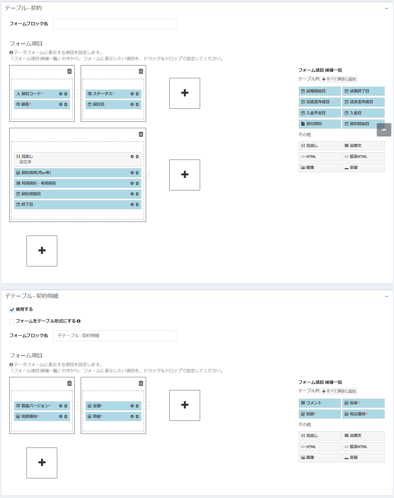
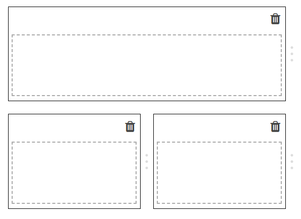
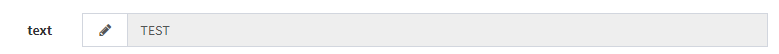
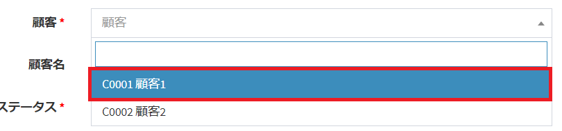
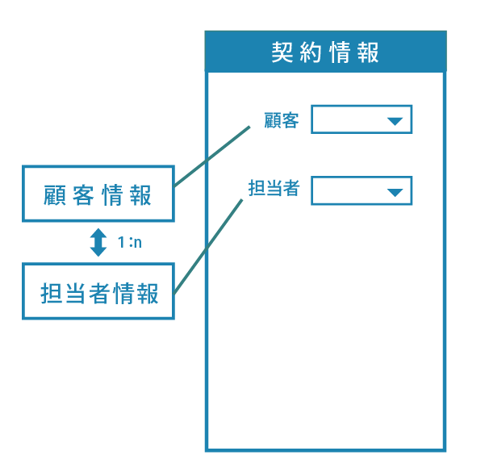

# Formulario personalizado
En esta página se deciden los campos que aparecen en la [pantalla del formulario de datos](/es/data_form) de Exment (la pantalla donde se introducen los datos) y cómo se colocan. Puede cambiar la disposición de los campos (el diseño de los cuadros), los campos ocultos, la configuración de vinculación de datos, etc.  
Lo que se configura aquí se refleja en la [pantalla del formulario de datos](/es/data_form) de cada tabla.

- Cómo abrir la pantalla: «Mostrar la página» y «Editar un formulario», más abajo
- Cómo colocar los campos: «Ajustes del formulario personalizado», más abajo
- Copiar los valores de un dato elegido en otra tabla: «Configuración de vinculación de datos», más abajo
- Reducir las opciones de otra selección según el valor elegido: «Configuración del filtro por relación», más abajo
- Cambiar el formulario que se usa según una condición: «Configuración de condiciones de visualización del formulario», más abajo

## Mostrar la página
- En la lista de tablas personalizadas, marque la tabla que va a configurar y pulse «Configuración detallada de la tabla», arriba a la derecha.  

> ※ También se puede abrir directamente desde la pantalla de lista de datos o la pantalla de registro de datos de esa tabla personalizada. En ese caso, pulse también «Configuración detallada de la tabla», arriba a la derecha.  

- En la pantalla de configuración detallada de la tabla que aparece, pulse el icono de la configuración de formularios y aparece la lista de formularios.  
※Cada tabla tiene 1 formulario predeterminado creado desde el principio.


## Editar un formulario
Para modificar un formulario, pulse el enlace [Editar] de ese formulario.  


## Ajustes del formulario personalizado


### Configuración básica del formulario
Introduzca la información básica del formulario.

- ##### Nombre visible del formulario
Introduzca el nombre del formulario.  

- ##### Formulario predeterminado
Póngalo en YES para que este formulario sea el formulario predeterminado.  
Si está configurada la [Configuración de condiciones de visualización del formulario](/es/form?id=Configuración-de-condiciones-de-visualización-del-formulario), tiene prioridad esa configuración.

- ##### Visualización en la pantalla de detalle
Elija cómo se muestran los campos en la [pantalla de detalle de datos](/es/data_details): siguiendo el diseño de filas y columnas decidido en esta pantalla o en una sola columna vertical sencilla.  


- ##### Visualización de etiquetas
Decide cómo se muestran las etiquetas de los campos.  
※Es un ajuste de todo el formulario. Para cambiarlo campo por campo, cambie el ajuste de cada campo.

### Configuración de los bloques del formulario
Configure los bloques del formulario.  
Un bloque es un conjunto de datos, y normalmente hay 1 por tabla.  
Sin embargo, si hay una configuración de relación 1:n, los datos de la tabla hija también se pueden introducir en la misma pantalla. Marque «Usar» en el bloque de la tabla hija y configúrelo.



#### Campos del bloque del formulario
※Todos los siguientes son ajustes de las tablas hijas.

- ##### Mostrar el formulario en formato de tabla  
Muestra los campos de entrada de la tabla hija en forma de tabla.

- ##### Optimizar la carga de los datos de la tabla hija  
Si lo pone en YES, las filas de esta tabla hija se cargan automáticamente después de mostrar la pantalla de edición. En los datos con muchas filas en la tabla hija, acorta el tiempo hasta que aparece la pantalla de edición. El valor por defecto es NO.  
Se puede usar al editar datos existentes, en los bloques uno a varios con «Mostrar el formulario en formato de tabla» en YES. No se puede guardar hasta que termina la carga.  
Si guarda el formulario con «Mostrar el formulario en formato de tabla» en NO, este ajuste también pasa a NO.  
※Se puede usar desde v7.1.0.


- ##### Nombre del bloque del formulario  
Es el nombre que se muestra en cada bloque del formulario.  

- ##### Orden de visualización  
Cuando hay varias tablas hijas, puede decidir el orden en que aparecen.  


#### Campos del formulario
Elija los campos que aparecen en el formulario de entrada y colóquelos.  
Los campos se eligen en «Campos del formulario: campos candidatos», más abajo.


En el formulario se pueden colocar cuadros de 1 a 4 columnas.  
Dentro de esos cuadros se van colocando los campos del formulario.


Con los cuadros se pueden hacer las siguientes operaciones.  

- Al pulsar el botón «+» que está al lado de un cuadro, se añade una columna nueva a la fila actual.  


- Al pulsar el botón «+» que está debajo de un cuadro, se añade una fila nueva. (Si ya existe la fila siguiente, se añade una columna nueva a esa fila)  


- Al arrastrar y soltar el margen derecho de un cuadro, se cambia el tamaño del cuadro.  


- Al pulsar el icono de la papelera, arriba a la derecha de un cuadro, se elimina el cuadro.  


Añadiendo y quitando filas y columnas de cuadros y cambiando su ancho, puede crear, por ejemplo, diseños como estos.  

- 1 columna - 2 columnas


- 3 columnas - 1 columna


- 1 columna - 2 columnas - 1 columna


### Campos del formulario: campos candidatos  
Son los candidatos de campos que se pueden añadir al formulario.  
Hay 2 tipos: «Columna de tabla» y «Otros».  


#### Columna de tabla  
Son los campos de las columnas personalizadas configuradas en la tabla personalizada.  
Al arrastrarlos y soltarlos en un cuadro de «Campos del formulario», se colocan en el formulario de datos. El comportamiento cambia según el tipo de columna personalizada y los ajustes de [Detalles del campo del formulario](/es/form?id=Detalles-del-campo-del-formulario), pero normalmente se puede editar o mostrar el valor del campo.

#### Otros  
Son elementos que solo se muestran en el formulario y no están conectados a los datos, como encabezados, textos explicativos y HTML.  
Al arrastrarlos y soltarlos en un cuadro de «Campos del formulario», se colocan en el formulario de datos.

- ##### Encabezado:
Se muestra en el formulario con formato de encabezado.

- ##### Texto explicativo:
Muestra un texto explicativo en el formulario. No se puede usar HTML.

- ##### HTML:
Muestra HTML en el formulario.  
※Por seguridad, las etiquetas `<script>` e `<iframe>` y el atributo `id` no se emiten (v6.2.15 o posterior). Para ejecutar scripts en la pantalla, use un [plugin de script](/es/plugin_quickstart_script).  

- ##### HTML ampliado:
Además de HTML, se puede usar texto con el formato indicado en los [parámetros](/es/params). Al dibujar la pantalla, se sustituye por los valores de los datos guardados para crear el HTML.  
※Igual que en «HTML», las etiquetas `<script>` e `<iframe>` y el atributo `id` no se emiten (v6.2.15 o posterior).  
Ejemplo:
```
<h4>ID: ${id}, Código de empresa: ${value:company_code}</h4>
```
※Los valores de las columnas solo se sustituyen al dibujar la pantalla. Tenga en cuenta que, aunque edite el valor de la columna en la pantalla de edición de datos, el valor no cambia a la vez.  

- ##### Imagen:
Muestra una imagen en el formulario.

- ##### Línea divisoria:
Muestra una línea divisoria en el formulario.


#### Detalles del campo del formulario
Los campos añadidos a un cuadro aparecen con una etiqueta como la siguiente.  
- Los campos que son obligatorios en la configuración de la columna personalizada llevan una marca roja al lado del nombre.  
- Al pulsar el icono de la papelera, a la derecha de la etiqueta, ese campo se elimina del cuadro.  
- Al pulsar el icono del engranaje, a la derecha de la etiqueta, aparece el diálogo de configuración detallada.  


##### Formato de visualización de la etiqueta
Puede decidir cómo se muestra la etiqueta de cada campo.
(Tiene prioridad sobre el ajuste de todo el formulario)

##### Tipo de campo
Decide cómo se muestra en la pantalla del formulario de datos. Hay estos 4.

| Tipo | Cómo se ve en la pantalla | El usuario cambia el valor | Se usa desde los campos de cálculo y la configuración de vinculación de datos |
|---|---|---|---|
| Solo lectura | Aparece en gris | No puede | Se puede |
| Solo visualización | Aparece como texto | No puede | No se puede |
| Campo oculto | No aparece (se añade como campo oculto (hidden)) | - | Se puede |
| No mostrar | No aparece (se añade dentro del sistema justo antes de guardar) | - | - |

- Solo lectura:  
Si lo marca, el usuario no puede cambiar el valor. El valor solo se puede cambiar y obtener desde el sistema, los campos de cálculo y la [Configuración de vinculación de datos](/es/form?id=Configuración-de-vinculación-de-datos).  
Al configurarlo, en el formulario aparece en gris, como se ve abajo.  
  
- Solo visualización:  
Si lo marca, el usuario no puede cambiar el valor. El valor tampoco se puede cambiar ni obtener desde el sistema, los campos de cálculo ni la [Configuración de vinculación de datos](/es/form?id=Configuración-de-vinculación-de-datos).  
Al configurarlo, en el formulario aparece como texto, como se ve abajo.  
  
- Campo oculto:  
Si lo marca, el campo no se muestra en la pantalla y se añade como campo oculto (hidden).  
Use este ajuste cuando quiere usar el campo en los campos de cálculo o en la [Configuración de vinculación de datos](/es/form?id=Configuración-de-vinculación-de-datos), pero no quiere mostrarlo en la pantalla.  

- No mostrar:  
Si lo marca, el campo no se añade a la pantalla. Se añade dentro del sistema justo antes de guardar los datos.  
Como no existe en la pantalla, no se puede usar en los campos de cálculo ni en la configuración de vinculación de datos.  
Use este ajuste en los campos que no quiere que se manipulen ni se modifiquen, como los valores de parámetros internos.


##### Configuración de vinculación de datos (campo)  
Vea [Configuración de vinculación de datos](/es/form?id=Configuración-de-vinculación-de-datos).  

##### Configuración del filtro por relación (campo)  
Vea [Configuración del filtro por relación](/es/form?id=Configuración-del-filtro-por-relación).  


## Configuración de vinculación de datos
Cuando en el formulario hay un campo que elige datos de otra tabla, puede copiar el contenido del dato elegido a otro campo del formulario.  
Ejemplo: al seleccionar el «Cliente» en el formulario «Contrato», copiar el valor de «Nombre del cliente» del dato de «Cliente» al «Nombre del cliente» del formulario «Contrato».


El formulario «Contrato» tiene la selección «Cliente» y el texto de una línea «Nombre del cliente»,  
  
 
al seleccionar el «Cliente», 


el valor se pone automáticamente en el texto «Nombre del cliente»  


<br />  

#### Pasos
- Abra la pantalla de formularios personalizados.  
En los campos del formulario, pulse el icono de configuración de «Nombre del cliente».  


- En el diálogo que se abre está el campo «Configuración de vinculación de datos».  


- En «Seleccionar columna», elija la columna personalizada que desencadena la copia (el disparador).  
**※ Se pueden elegir las columnas del mismo formulario cuyo tipo de columna es «Selección (desde tabla)», «Usuario» u «Organización».**
En este ejemplo se elige «Cliente».  


- Al elegir en «Seleccionar columna», aparecen las opciones del segundo campo, «Seleccionar columna de enlace».  
Aparece la lista de las columnas personalizadas de la tabla elegida en «Seleccionar columna».  
En este ejemplo se elige «Nombre del cliente».  


- Por último, pulse el botón [Configurar].  
El diálogo se cierra y al lado del botón [Configuración de vinculación de datos] aparece «Configurado».  


- Pulse el botón [Enviar], en la parte de abajo de la página, para guardar la configuración.


## Configuración del filtro por relación
Cuando el tipo de columna es «Selección (desde tabla)», «Usuario» u «Organización», reduce las opciones según lo seleccionado en otro campo del mismo formulario. Solo se puede configurar cuando en el mismo formulario existe una columna de la tabla padre o de la tabla referenciada de la tabla de destino.  

#### Ejemplo
Las tablas «Datos de clientes» y «Datos de personas de contacto» tienen configurada una relación 1:n, y la tabla «Contratos» tiene las columnas «Cliente» y «Persona de contacto».  
Al seleccionar la columna «Cliente», se quieren reducir las opciones candidatas de la columna «Persona de contacto» solo a las personas de contacto cuyo padre es el «Cliente» seleccionado.

  

Hay datos como los siguientes,
  

y en la pantalla de contratos,
 

si en «Cliente» se selecciona «Empresa A», las opciones candidatas son las personas de contacto que pertenecen a la Empresa A,
  

y si en «Cliente» se selecciona «Empresa B», las opciones candidatas son las personas de contacto que pertenecen a la Empresa B.
  

#### Pasos
- Abra la pantalla de formularios personalizados.  
En los campos del formulario, pulse el icono de configuración de la columna «Persona de contacto».  


- En el diálogo que se abre está el campo «Configuración del filtro por relación».  
En las opciones aparece la lista de las columnas del mismo formulario que son padre de la columna elegida.  
En este ejemplo, en las opciones aparece la columna de la tabla «Cliente», que es la tabla padre de la tabla «Persona de contacto».  
※El botón «Configuración del filtro por relación» aparece cuando la columna personalizada es «Selección (desde tabla)», «Usuario» u «Organización».


- Cuando lo haya configurado, pulse el botón «Configurar».  


#### Sobre el comportamiento en versiones anteriores a v3.3.1
<span class="small">En las versiones anteriores a v3.3.1, esta pantalla de configuración no aparecía, y las opciones se reducían en todos los campos con una relación padre-hijo 1:n o una relación de referencia.  
Como resultado, a veces se producían reducciones innecesarias o errores inesperados, así que en v3.3.1 se añadió un ajuste para poder elegir si se hace o no la reducción.  
Al actualizar de una versión anterior a v3.3.1 a v3.3.1 o superior, para mantener la compatibilidad se conserva el ajuste «reducir las opciones en todos los campos con una relación padre-hijo 1:n o una relación de referencia».  
Para ver el detalle del comportamiento al actualizar, consulte [esta página](/patch/relation_filter) (inglés).</span>


## Configuración de condiciones de visualización del formulario
Si decide condiciones y prioridades, puede cambiar según la condición el formulario que se usa al crear datos y en la pantalla de detalle de datos.  

### Crear
Se crea con el botón [Nuevo], a la derecha de la configuración de condiciones de visualización del formulario.


### Pantalla de configuración


##### Formulario de destino  
Elija el formulario que quiere usar cuando se cumple la condición.

##### Prioridad  
Decide la prioridad con la que se usa el formulario.
En los datos que cumplen varias condiciones de visualización de formularios, la pantalla se muestra con el formulario de mayor prioridad.

##### Elemento de condición  
Es la columna que se usa como condición de visualización.

##### Condición de filtro  
Elija el contenido de la condición.
Lo que se puede elegir cambia según el tipo de la columna elegida en «Elemento de condición» («Fecha», «Usuario», etc.).

##### Valor de la condición  
Introduzca el valor que se compara con la condición de filtro.

##### Botón [Eliminar]  
Elimina una condición de visualización del formulario.

##### Botón [Nuevo]  
Añade una condición de visualización del formulario.
