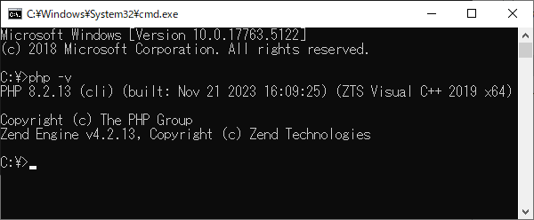
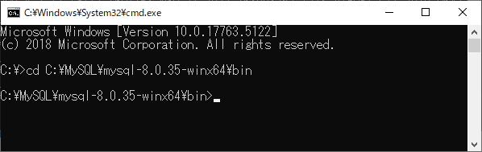
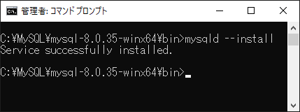
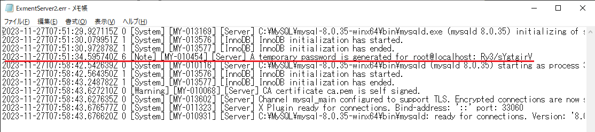
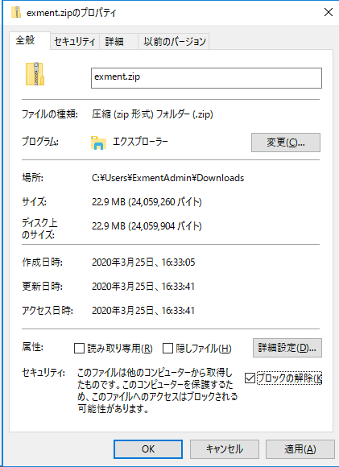
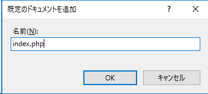
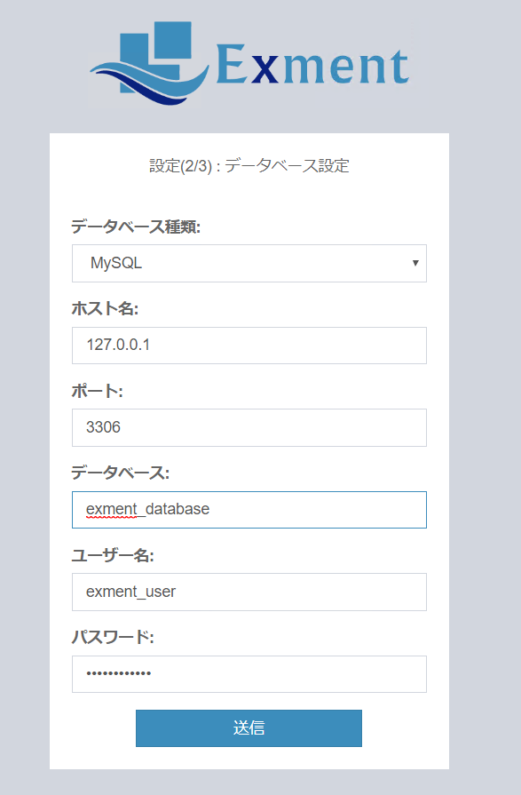

# Creación del entorno en Windows Server
Estos son los pasos para instalar Exment en IIS (el servidor web que viene con Windows) de Windows Server.  
Se empieza por la instalación del servidor web y se crea todo desde cero.

El flujo general es el siguiente.

1. Instalar el servidor web (IIS)
2. Preparar PHP
3. Instalar MySQL
4. Preparar IIS
5. Instalar Composer
6. Descargar Exment y prepararlo para su ejecución

## Entorno
Los pasos de esta página se han preparado con el entorno siguiente.
- Windows Server 2019 Standard, versión japonesa
- IIS 10
- PHP 8.2.X
- MySQL 8.4.X

Las diferencias cuando se usa Windows 10 para pruebas se escriben en cada lugar.

## Puntos de atención

- Según su entorno y sus versiones, puede que no se pueda configurar tal como dice este procedimiento. Le pedimos su comprensión.

- En esta página solo se escriben los pasos para que Exment funcione en Windows Server.  
No se escriben conocimientos generales de informática, como la administración de Windows Server, la creación de la base de datos o los comandos. Le pedimos su comprensión.

- **Este procedimiento necesita permisos de administrador. Según haga falta, use «Ejecutar como administrador» (o eleve los permisos con el Control de cuentas de usuario) para el símbolo del sistema, PowerShell y los archivos ejecutables**.

## Pasos de instalación en Windows Server

> Antes de empezar, se recomienda configurar el Explorador de Windows Server para que muestre las «Extensiones de nombre de archivo»

### Instalación del servidor web (IIS)
Si la característica IIS no está habilitada en el servidor, instale primero la característica IIS.
1. Abra el asistente \[Agregar roles y características\] desde \[Administrar\] del Administrador del servidor  
   
2. En \[Tipo de instalación\] seleccione «Instalación basada en características o en roles», en \[Selección de servidor\] seleccione el servidor donde se instala IIS (normalmente, el servidor en el que trabaja) y continúe.
3. En \[Roles de servidor\] seleccione «Servidor web (IIS)» y agregue también las características que se muestran  
   
4. En las pantallas \[Características\] y \[Rol de servidor web (IIS)\], continúe sin cambiar nada
5. En \[Servicios de rol\], despliegue \[Desarrollo de aplicaciones\], marque «CGI» y continúe  
     
   Agregue los demás roles (autenticación, compresión, etc.) según lo necesite (no hace falta agregar nada más para que funcione Exment)
6. En \[Confirmación\], haga clic en «Instalar» y espere a que termine la instalación
7. Cuando termine la instalación, inicie un navegador (Internet Explorer, etc.), acceda a http://localhost y compruebe que se muestra la página predeterminada de IIS

> Si instala en Windows 10, habilite «Internet Information Services» en \[Panel de control\] - \[Programas\] -\[Programas y características\] - \[Activar o desactivar las características de Windows] y habilite «CGI» en \[Características de desarrollo de aplicaciones\].

### Preparación de PHP
Descargue PHP e instálelo
1. Acceda a https://windows.php.net/download/
2. Descargue el archivo ZIP de \[VC15 x64 Non Thread Safe\] de \[PHP 8.2\]  
   > Si usa Windows de 32 bits en un entorno Windows 10, descargue el archivo ZIP de \[VC15 x86 Non Thread Safe \]
3. Haga clic con el botón derecho en el archivo ZIP descargado para ver las propiedades, marque «Desbloquear» en \[Seguridad\] de la pestaña \[General\] y haga clic en \[Aceptar\]  
   
4. Descomprima el contenido del archivo ZIP en una carpeta adecuada (ejemplo: C:\PHP)
5. Configure la variable de entorno para ejecutar PHP  
   Ejecute sysdm.cpl en \[Ejecutar\] para mostrar \[Propiedades del sistema\]
6. En la pestaña \[Opciones avanzadas\], abra \[Variables de entorno\]  
   
7. En la lista \[Variables del sistema\], busque y seleccione el elemento con el nombre de variable "Path"  
   
8. Haga clic en \[Editar\] y haga clic en \[Nuevo\]  
   
9.  Escriba la ruta de la carpeta donde descomprimió PHP (ejemplo: C:\PHP) y haga clic 3 veces en \[Aceptar\]  
    
10. En el símbolo del sistema, ejecute  
    ```
    set path
    ```
    y compruebe que la carpeta de PHP está en la ruta
11. Cree el archivo de configuración de PHP  
    Copie el archivo «php.ini-development» de la carpeta donde descomprimió PHP para crear el archivo php.ini
12. Edite el archivo php.ini y guárdelo
    1.  En la sección "Paths and Directories", cambie  
        ```
        ;extension_dir = "ext"
        ```
        por
        ```
        extension_dir = "ruta de la carpeta donde descomprimió PHP\ext" (ejemplo: extension_dir = "C:\PHP\ext")
        ```
        (quite el ; del principio de la línea para quitar el comentario)
    2. En la sección "Dynamic Extension", cambie
        ```
        ;extension=gd
        ;extension=openssl
        ;extension=pdo_mysql
        ```
        por
        ```
        extension=gd
        extension=openssl
        extension=pdo_mysql
        ```
        (quite el ; del principio de la línea para quitar el comentario)
    3.  En la sección "File Uploads", cambie  
        ```
        ;upload_tmp_dir=
        ```
        por
        ```
        upload_tmp_dir = "ruta de una carpeta de trabajo cualquiera" (ejemplo: upload_tmp_dir = "C:\Temp")
        ```
        (quite el ; del principio de la línea para quitar el comentario)  
        ※La carpeta indicada es el lugar donde se guardan temporalmente los archivos al subirlos.
    4. Añada lo siguiente al final del archivo.
        ```
        extension=php_fileinfo.dll
        ```

13. Ejecute el comando siguiente en el símbolo del sistema y compruebe que PHP funciona  
    ```
    php -v
    ```
    

    Si aparece un error que dice que no se encuentra el runtime de Visual C++ 14.0, descargue e instale el paquete redistribuible de Visual C++ para Visual Studio 2015, 2017 y 2019 (vc_redist.x64.exe) desde [Descargas más recientes compatibles de Visual C++](https://support.microsoft.com/help/2977003/the-latest-supported-visual-c-downloads)  
    

### Instalación de MySQL
Instale el MySQL que usa Exment y haga su configuración inicial  
Aquí se instala MySQL 8.4.X

1. Acceda a la página [MySQL Community Downloads](https://dev.mysql.com/downloads/mysql/)
2. Haga clic en \[General Availability (GA) Releases\]  
   
3. En \[Select Version\] seleccione "8.4.X", en \[Select Operating System\] seleccione "Microsoft Windows" y en \[Select OS Version\] seleccione "Windows (x86, 64bit)"
     
   > Si usa Windows de 32 bits en un entorno Windows 10, seleccione "Windows (x86, 32bit)" en \[Select OS Version\]
4. Haga clic en el botón \[Download\] de la fila "ZIP Archive" de \[Other Downloads\] y descargue el archivo mysql-8.4.xx-winx64.zip
   
5. Cuando aparezca \[Login Now or Sign Up for a free account.\], haga clic en \[No thanks, just start my download.\], abajo del todo. Empieza la descarga
6. Haga clic con el botón derecho en el archivo ZIP descargado para ver las propiedades, marque «Desbloquear» en \[Seguridad\] de la pestaña \[General\] y haga clic en \[Aceptar\]  
   
7. Descomprima el contenido del archivo ZIP en una carpeta adecuada (ejemplo: C:\MySQL)
8. Inicie el símbolo del sistema como administrador y vaya a la carpeta mysql-8.4.xx-winx64\bin de la carpeta donde descomprimió el archivo ZIP
   
9.  Ejecute el comando siguiente para inicializar MySQL
    ```
    mysqld --initialize
    ```
    

    Si aparece un error que dice que no se encuentra el runtime de Visual C++ 12.0, consulte [Descargas más recientes compatibles de Visual C++](https://support.microsoft.com/help/2977003/the-latest-supported-visual-c-downloads) y descargue e instale, desde \[Update for Visual C++ 2013 Redistributable Package\](https://support.microsoft.com/help/4032938/update-for-visual-c-2013-redistributable-package), el paquete redistribuible de Microsoft Visual C++ para Visual Studio 2013 (vc_redist.x64.exe) en su idioma  
    
10. Ejecute el comando siguiente para comprobar que MySQL se inicia. Si aparece "mysqld: ready for connections.", se ha iniciado bien
    ```
    mysqld --console
    ```
    
11. Pulse Ctrl + C para detener MySQL por ahora
12. Instale MySQL como servicio de Windows. Al instalarlo como servicio, MySQL se ejecuta automáticamente al iniciar Windows
    ```
    mysqld --install
    ```
    
13. Para iniciar MySQL enseguida, ejecute el comando siguiente
    ```
    net start mysql
    ```
    
14. Compruebe el valor inicial de la contraseña del administrador (root) para usar MySQL  
    Si la carpeta donde descomprimió MySQL es C:\MySQL, en C:\MySQL\mysql-8.4.xx-winx64\data hay un archivo con la extensión .err. Ábralo con un editor de texto, como el Bloc de notas  
    > En la figura de abajo, el archivo se llama ExmentServer2.err  
    
15. Cerca del principio del archivo hay una línea que dice "\[Note\] A temporary password is generated for root@localhost:" (subrayado rojo de la figura de abajo). El texto que viene después (en la figura, 1fyr*IXeC2%w) es la contraseña inicial. Anote esta contraseña
    
16. Vuelva al símbolo del sistema de administrador y ejecute el comando siguiente para hacer la configuración inicial de MySQL
    ```
    mysql_secure_installation
    ```
    1. Se pregunta "Enter password for user root:". Escriba la contraseña inicial anotada y pulse Enter
    2. Aparece "The existing password for the user account root has expired. Please set a new password."  
       Se pregunta la contraseña nueva con "New password:". Escriba la contraseña nueva y pulse Enter. Se pide confirmarla con "Re-enter new password:". Escriba otra vez la contraseña nueva y pulse Enter
       > Use una contraseña fuerte y difícil de adivinar. Se recomienda cumplir estos requisitos: 8 caracteres o más, usar 3 o más tipos entre mayúsculas, minúsculas, números y símbolos, y no usar tal cual palabras que están en el diccionario
    3. Se pregunta si quiere usar VALIDATE PASSWORD PLUGIN  
       Si ha puesto una contraseña fuerte y difícil de adivinar, escriba una tecla distinta de "y" y pulse Enter
    4. Se pregunta "Change the password for root ?". Escriba una tecla distinta de "y" y pulse Enter
    5. En todas las demás preguntas, escriba "y" y pulse Enter
    6. Cuando aparece "All done!", la configuración inicial ha terminado
17. Ejecute el comando siguiente para iniciar sesión en MySQL
    ```
    mysql -u root -p
    ```
18. Se pregunta la contraseña con "Enter password:". Escriba la contraseña que puso antes y pulse Enter
    
19. Cuando aparezca el indicador "MySQL>", ejecute en orden los comandos siguientes
    > Aquí, el usuario de MySQL que usa Exment es "exment_user" y su contraseña es "M!p3~S$W7fLm"  
      Decida usted el nombre de usuario y la contraseña reales (use una contraseña fuerte y difícil de adivinar)  
      Este nombre de usuario y esta contraseña se usan en la configuración inicial de Exment
    ```
    CREATE DATABASE exment_database;
    CREATE USER 'exment_user' IDENTIFIED BY 'M!p3~S$W7fLm';
    GRANT ALL ON exment_database.* TO 'exment_user';
    FLUSH PRIVILEGES;
    ```
20. Escriba lo siguiente y pulse Enter para cerrar la sesión de MySQL
    ```
    \q
    ```

### Preparación de IIS
Prepare IIS para ejecutar Exment
1. Instale el módulo URL Rewrite.  
   Acceda a https://www.iis.net/downloads/microsoft/url-rewrite y haga clic en \[Install this extention\]
2. Se descarga urlrewrite2.exe. Ejecútelo e instale siguiendo las indicaciones de la pantalla
   1. Haga clic en \[Instalar\]  
      
   2.  Haga clic en \[Acepto\]  
      
   3.  Empieza la instalación  
      
   4.  Haga clic en \[Finalizar\]  
      
   5.  Haga clic en \[Salir\]  
      
3. Abra \[Administrador de Internet Information Services (IIS)\] desde \[Herramientas\] del Administrador del servidor  
   
4. En el panel Conexiones, despliegue \[(nombre del servidor)\] - \[Sitios\] y seleccione \[Default Web Site\]
5. En la Vista Características, haga doble clic en \[Asignaciones de controlador\]
6. En el panel Acciones, haga clic en \[Agregar asignación de módulo\]
7. En \[Agregar asignación de módulo\], escriba lo siguiente y haga clic en \[Aceptar\]  
   - Ruta de acceso de solicitudes: *.php  
   - Módulo: FastCgiModule  
   - Ejecutable: (ruta de la carpeta donde descomprimió PHP)\php-cgi.exe (ejemplo: C:\PHP\php-cgi.exe)  
   - Nombre: libre (ejemplo: PHP)  
   
8. Cuando aparezca el mensaje de confirmación, haga clic en \[Sí\]

### Instalación de Composer
Instale la herramienta de gestión de bibliotecas de PHP (Composer) que necesita Exment
1. Acceda a la [página de descarga de Composer (https://getcomposer.org/download/)](https://getcomposer.org/download/) y descargue Composer-Setup.exe desde la parte que dice "Download and run Composer-Setup.exe - it will install the latest composer version whenever it is executed"  
   
2.  Ejecute el Composer-Setup.exe descargado
3.  Seleccione "Install for all users"  
   
4.  No marque "Developer Mode" y continúe  
   
5. Compruebe que la ruta de PHP que se muestra en "Setting Check" es correcta y continúe  
   
6. Si aparece "PHP Configration Error", marque \[Create a php,ini file\] o \[Update this php.ini\] y continúe  
   
7. En "Proxy Settings" se indica el proxy que se usa para la conexión a Internet. Si no usa proxy, continúe sin cambiar nada  
   
8. Aparece la pantalla de confirmación. Haga clic en \[Install\]  
   
9. Si aparece "Information", continúe sin cambiar nada  
    
10. Haga clic en \[Finish\] para terminar  
    

### Descarga de Exment y preparación para su ejecución

1. Descargue el archivo zip de Exment (exment.zip) desde la página de los pasos de instalación de Exment ([Pasos de la instalación](/es/quickstart))
2. Haga clic con el botón derecho en el archivo ZIP descargado para ver las propiedades, marque «Desbloquear» en \[Seguridad\] de la pestaña \[General\] y haga clic en \[Aceptar\]  
   
3. Descomprima el contenido de la carpeta exment del archivo ZIP en una carpeta adecuada (ejemplo: C:\exment)  
     
   **No lo descomprima nunca justo debajo de la carpeta «inetpub\wwwroot». Los archivos de configuración donde están escritos los valores de la base de datos, la contraseña del correo, etc. quedarían visibles desde fuera, y eso lleva a una fuga grave de información**
4. Cree el directorio virtual  
   Abra el Administrador de Internet Information Services (IIS), en el panel \[Conexiones\] despliegue \[(nombre del servidor)\] - \[Sitios\], haga clic con el botón derecho en \[Default Web Site\] y seleccione \[Agregar directorio virtual\]  
   
5. Configure el directorio virtual como sigue  
   En el ejemplo, el alias (la ruta de la URL para acceder a Exment) es "exment"  
   En la ruta de acceso física se pone la ruta de la carpeta donde descomprimió el archivo ZIP de Exment (ejemplo: C:\exment)
   - Alias: exment  
   - Ruta de acceso física: C:\Exment\public  
   
6. Añada "index.php" a los documentos predeterminados  
   Seleccione \[Default Web Site\] y abra \[Documento predeterminado\] con doble clic  
   
7. En el panel \[Acciones\], haga clic en \[Agregar\]
8. Añada index.php  
   
9.  Añada a Web.config la regla de reescritura de URL (Rewrite)  
   En el panel \[Conexiones\], seleccione el directorio virtual añadido en «4.» (en el ejemplo, exment) y abra \[Reescritura de direcciones URL\] con doble clic  
   
10. En el panel \[Acciones\], haga clic en \[Agregar reglas\]  
   
11. En \[Agregar reglas\], seleccione \[Regla en blanco\] de \[Reglas de entrada\] y haga clic en \[Aceptar\]  
   
12. En \[Editar regla de entrada\], cree la regla como sigue  
    
    - Nombre: el nombre que quiera
    - \[Coincidencia de dirección URL\]
      - Dirección URL solicitada: Coincide con el patrón
      - Usando: Expresiones regulares
      - Patrón: (.*)$
    - Condiciones
      - Agrupación lógica: Coincidir con todas
      - Haga clic en \[Agregar\] y añada estas 2 condiciones
        - Entrada: {REQUEST_FILENAME}  
        Tipo: No es un archivo
        - Entrada: {REQUEST_FILENAME}  
        Tipo: No es un directorio
    - Acción
      - Tipo de acción: Reescribir
      - Propiedades de acción
      - Dirección URL de reescritura: index.php/{R:1}
      - Anexar cadena de consulta: ON
      - Registrar dirección URL reescrita: OFF
    - Detener el procesamiento de las reglas siguientes: ON
13. En el panel \[Acciones\], haga clic en \[Aplicar\]
14. Cuando aparezca «Los cambios se guardaron correctamente», haga clic en \[Volver a las reglas\]

<!-- Hay que comprobar los pasos que siguen -->

15. Configure los permisos de acceso de la carpeta para que Laravel pueda escribir
    Dé permiso de escritura al usuario de ejecución de IIS (IIS_IUSRS) en la carpeta donde descomprimió el ZIP de Exment y configuró el directorio virtual  
    > En el ejemplo, C:\exment
    
    

16. Añada al usuario de ejecución de IIS (IIS_IUSRS) el permiso de escritura sobre la carpeta exment
    1. Haga clic con el botón derecho en la carpeta exment y seleccione \[Propiedades\]
    2. Abra la pestaña \[Seguridad\] y haga clic en \[Editar\]
    3. En \[Permisos de exment\], haga clic en el botón \[Agregar\] para mostrar \[Seleccionar Usuarios o Grupos\]
    4. En el campo \[Escriba los nombres de objeto que desea seleccionar\], escriba IIS_IUSRS y haga clic en \[Comprobar nombres\]
    5. Cuando el texto cambie a (nombre del equipo)\IIS_IUSRS, haga clic en \[Aceptar\]  
       
    6. Vuelve a \[Permisos de exment\]. En el campo \[Nombres de grupos o usuarios\], haga clic en IIS_IUSRS y, en el campo \[Permisos\], marque \[Permitir\] de \[Escritura\]  
    
    1. Haga clic 2 veces en \[Aceptar\] para cerrar las propiedades

<!--
En realidad, parece que IIS_IUSRS necesita permiso de escritura no solo en la carpeta storage, sino también en otros archivos y carpetas de la carpeta exment.
Como no sabemos qué permisos mínimos hacen falta de verdad y en qué recursos, en el entorno de prueba hemos dado permiso de escritura a IIS_IUSRS en toda la carpeta C:\exment y hemos comprobado que la aplicación web de Exment funciona.
Cuando se conozcan los permisos mínimos, esta parte se revisará de acuerdo con ellos.

14. Configure los permisos de acceso de la carpeta para que Laravel pueda escribir
    > Dé permiso de escritura al usuario de ejecución de IIS (IIS_IUSRS) en la carpeta donde descomprimió el ZIP de Exment y configuró el directorio virtual (ejemplo: C:\exment)
15. Configure los permisos de acceso
    1. Haga clic con el botón derecho en la carpeta exment y seleccione \[Propiedades\]
    2. Abra la pestaña \[Seguridad\] y haga clic en \[Editar\]
    3. En \[Permisos de exment\], haga clic en el botón \[Agregar\] para mostrar \[Seleccionar Usuarios o Grupos\]
    4. En el campo \[Escriba los nombres de objeto que desea seleccionar\], escriba IIS_IUSRS y haga clic en \[Comprobar nombres\]
    5. Cuando el texto cambie a (nombre del equipo)\IIS_IUSRS, haga clic en \[Aceptar\]  
    6. Vuelve a \[Permisos de exment\]. En el campo \[Nombres de grupos o usuarios\], haga clic en IIS_IUSRS y, en el campo \[Permisos\], marque \[Permitir\] de \[Escritura\]  
    7. Haga clic 2 veces en \[Aceptar\] para cerrar las propiedades
-->

17.  Inicie un navegador (Chrome o Microsoft Edge) y acceda a http://localhost/(alias del directorio virtual) (ejemplo: http://localhost/exment. Un sitio con «admin» en `ADMIN_ROUTE_PREFIX` está en http://localhost/exment/admin)  
    Se muestra la página de instalación de Exment.
> Exment no es compatible con Internet Explorer. Use Chrome o Microsoft Edge para acceder a Exment

   1. Compruebe Language y Timezone (en el ejemplo, Language es \[japonés\] y Timezone es \[(GMT+09:00) Japón\]) y haga clic en \[subumit\]
   

   2. Escriba los datos de la base de datos ya creada y haga clic en \[Enviar\]
   > En el ejemplo, <br />Base de datos \[exment_database\] <br />Nombre de usuario \[exment_user\] <br />Contraseña \[M!p3~S$W7fLm\] 

   

   3. Haga clic en \[Ejecutar la instalación\]  
   
   Si la instalación ha terminado bien, se muestra la pantalla de configuración inicial de Exment.  
   Para la configuración inicial, vea [esta página](/es/first_setting).

18.  Cuando termine la instalación, quite el permiso de acceso que había puesto en la carpeta exment

   1. Haga clic con el botón derecho en la carpeta exment y seleccione \[Propiedades\]
   > En el ejemplo, C:\exment  
   2. Abra la pestaña \[Seguridad\] y haga clic en \[Editar\]
   3. En el campo \[Nombres de grupos o usuarios\], seleccione \[IIS_IUSRS\]
   4. En \[Permisos\], haga clic en \[Comprobar nombres\] y, en el campo \[Permisos\], desmarque \[Permitir\] de \[Escritura\]
   
   5. Haga clic 2 veces en \[Aceptar\] para cerrar las propiedades   

19.  Añada el permiso de escritura en algunas carpetas. Las carpetas y los archivos donde se añade son los siguientes.

| Tipo | Nombre del archivo o de la carpeta | Función que lo necesita |
| ---- | ---- | ---- |
| Carpeta | storage | Todas las funciones |
| Carpeta | bootstrap/cache | Todas las funciones |
| Archivo | .env | Instalación fácil, restauración |
| Carpeta | config | Instalación fácil, restauración |
| Carpeta | app | Instalación fácil |
| Carpeta | public | Instalación fácil |
| Carpeta | resources | Instalación fácil |

El ejemplo siguiente son los pasos para añadir el permiso en la carpeta storage.

   1. Haga clic con el botón derecho en la carpeta storage y seleccione \[Propiedades\]
   > En el ejemplo, C:\exment\storage
   2. Abra la pestaña \[Seguridad\] y haga clic en \[Editar\]
   3. En \[Permisos de storage\], haga clic en el botón \[Agregar\] para mostrar \[Seleccionar Usuarios o Grupos\]
   4. En el campo \[Escriba los nombres de objeto que desea seleccionar\], escriba IIS_IUSRS y haga clic en \[Comprobar nombres\]
   5. Cuando el texto cambie a (nombre del equipo)\IIS_IUSRS, haga clic en \[Aceptar\]  
       
   6. Vuelve a \[Permisos de storage\]. En el campo \[Nombres de grupos o usuarios\], haga clic en IIS_IUSRS y, en el campo \[Permisos\], marque \[Permitir\] de \[Escritura\]  
    
   7. Haga clic 2 veces en \[Aceptar\] para cerrar las propiedades

20.  Para poder guardar temporalmente los archivos subidos, añada el permiso de escritura sobre la carpeta indicada en upload_tmp_dir de php.ini
   1. Haga clic con el botón derecho en esa carpeta y seleccione \[Propiedades\]
   > En el ejemplo, C:\Temp
   2. Abra la pestaña \[Seguridad\] y haga clic en \[Editar\]
   3. En \[Permisos de Temp\], haga clic en el botón \[Agregar\] para mostrar \[Seleccionar Usuarios o Grupos\]
   4. En el campo \[Escriba los nombres de objeto que desea seleccionar\], escriba IIS_IUSRS y haga clic en \[Comprobar nombres\]
   5. Cuando el texto cambie a (nombre del equipo)\IIS_IUSRS, haga clic en \[Aceptar\]  
       
   6. Vuelve a \[Permisos de Temp\]. En el campo \[Nombres de grupos o usuarios\], haga clic en IIS_IUSRS y, en el campo \[Permisos\], marque \[Permitir\] de \[Escritura\]  
    
   7. Haga clic 2 veces en \[Aceptar\] para cerrar las propiedades

   > Para la configuración inicial después de la instalación, vea [esta página](/es/first_setting)

   
## Qué hacer al actualizar la versión de PHP
Para cambiar la versión de PHP, actualícela con los pasos siguientes.  
※Durante la actualización no se puede acceder a Exment.  
※El ejemplo de abajo son los pasos para actualizar de PHP7.4 a PHP8.2.  
※La forma de actualizar puede ser distinta según el entorno, el momento de la instalación, la versión y el método de instalación.  

- Primero, detenga IIS.

- Haga una copia de seguridad de la carpeta de ejecución del PHP que usa ahora. Puede hacerlo como quiera: cambiar el nombre de la carpeta, copiarla en otro lugar, etc.

- Descargue el PHP nuevo.  

   1. Acceda a https://windows.php.net/download/
   2. Descargue el archivo ZIP de \[VC15 x64 Non Thread Safe\] de \[PHP 8.2\]  
      > Si usa Windows de 32 bits en un entorno Windows 10, descargue el archivo ZIP de \[VC15 x86 Non Thread Safe \]
   3. Descomprima el contenido del archivo ZIP en la misma ruta que el PHP anterior.  
   ※ Se supone que el PATH está puesto en las variables de entorno.  

- Copie el archivo php.ini de la carpeta del PHP de la versión anterior, de la que hizo copia de seguridad, a la carpeta del PHP de la versión nueva.

- Si hace falta, corrija el archivo php.ini.
   1. Si la biblioteca GD de la sección "Dynamic Extension" está comentada, actívela. Cambie
        ```
        ;extension=gd
        ```
        por
        ```
        extension=gd
        ```
        (quite el ; del principio de la línea para quitar el comentario)

   ※ Según la versión de PHP anterior, puede estar escrito extension=gd2. Cámbielo a extension=gd.  

- Inicie IIS.  

- Compruebe, en el símbolo del sistema u otra herramienta, que la versión de PHP es la 8.2.X.

~~~
php -v
~~~
