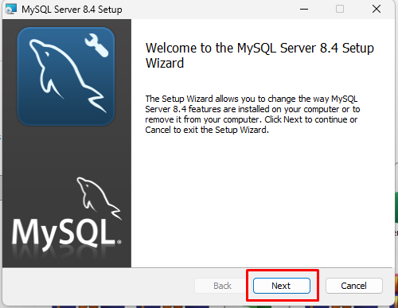
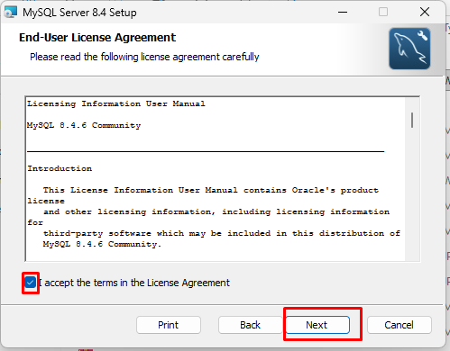

# Pasos de instalación de MySQL
Estos son los pasos para instalar y configurar MySQL para usarlo con Exment.  
※Los pasos pueden ser distintos según el sistema operativo, la versión, el momento de la instalación, etc.  

Según su servidor, vea una de estas dos partes.

| Servidor | Dónde mirar |
| ---- | ---- |
| Windows | «Configuración de MySQL (Windows)», más abajo |
| Linux | «Configuración de MySQL (Linux)», más abajo (los pasos se dividen según si ya existe MySQL5.7 o no) |

## Configuración de MySQL (Windows)

- Recomendado: antes de actualizar, haga una [copia de seguridad de la base de datos](https://dev.mysql.com/doc/refman/8.4/en/mysqldump-sql-format.html).

- (Si MySQL está en marcha) Abra el símbolo del sistema como administrador y detenga MySQL.  
En la «barra de búsqueda», a la derecha del botón Inicio, escriba «Símbolo del sistema».  
Haga clic con el botón derecho en «Símbolo del sistema», que aparece arriba, en «Mejor coincidencia».  
En el menú que aparece, elija «Ejecutar como administrador».
   

~~~
net stop mysql57
net stop mysql80
~~~

- Abra el sitio siguiente y descargue MySQL.  
※MySQL Installer solo existe para la serie MySQL 8.0. Para MySQL 8.1 o posterior (incluida la 8.4), descargue MySQL Server en MSI o en ZIP.  
[MySQL Community Server Downloads](https://downloads.mysql.com/archives/community/)  

- En Select Version elija «8.4.X» y, como sistema operativo, elija Windows (x86, 64-bit).  

- Descargue uno de los siguientes.
	- MSI Installer

- Ejecute el archivo MSI descargado e instale siguiendo las indicaciones de la pantalla (el asistente).
	- En la pantalla Welcome, haga clic en «Next».

		
	- Acepte el License Agreement y haga clic en «Next».

		
	- En Setup Type elija «Complete».

		
	- Haga clic en «Install».

		
	- Cuando termine la instalación, haga clic en «Finish».

		

- Cuando termina la instalación del MSI, se abre automáticamente MySQL Server Configurator.
	- En «Welcome to the MySQL Server Configurator», haga clic en «Next».

		

- En Data Directory, deje el valor inicial y haga clic en «Next».

	

- Type and Networking:
	- Config Type: Development Computer
	- Connectivity: TCP/IP (el puerto por defecto es 3306)
	- Haga clic en «Next».

		

- Accounts and Roles: decida la contraseña del usuario root y haga clic en «Next».

	

- Windows Service: decida el nombre del servicio (ejemplo: MySQL84) y haga clic en «Next».

	

- En Server File Permissions, deje el valor inicial y haga clic en «Next».

	

- Sáltese Sample Databases y haga clic en «Next».

	

- En Apply Configuration, haga clic en «Execute» y, cuando termine, haga clic en «Next» y «Finish».

	

- Corrija my.ini. (C:\ProgramData\MySQL\MySQL Server 8.4\my.ini)

~~~
# Añada lo siguiente al final

local-infile=1
~~~

- Reinicie MySQL. (El nombre del servicio depende del entorno)

~~~
net stop MySQL84
net start MySQL84
~~~

### Añadir la variable de entorno 

- En el Explorador, haga clic con el botón derecho en «Este equipo» y haga clic en «Propiedades».

- Haga clic en «Configuración avanzada del sistema».

- Haga clic en «Variables de entorno».  

- Haga clic en «Path», en «Variables de usuario», y haga clic en «Editar».  

- Si existe la línea «C:\Program Files\MySQL\MySQL Server 5.7\bin», bórrela.

- Haga clic en «Nuevo» y añada la línea siguiente.  
 «C:\Program Files\MySQL\MySQL Server 8.4\bin»   

- Cuando lo haya escrito, cierre con «Aceptar» todos los cuadros de diálogo abiertos.  

## Configuración de MySQL (Linux)
Estos son los pasos para instalar MySQL en Linux.  
※Si hace falta, ponga sudo al principio de los comandos.  
※Si instala en CentOS8, RHEL8 o similares, use el comando dnf en lugar de yum.

Los pasos son distintos según si MySQL5.7 ya está instalado o no.

| Estado actual | Dónde mirar |
| ---- | ---- |
| MySQL5.7 está instalado | «Si existe MySQL5.7 (actualizar de MySQL5.7 a MySQL8.4)» |
| MySQL5.7 no está instalado | «Si no existe MySQL5.7 (instalación nueva de MySQL8.4)» |

### Si existe MySQL5.7 (actualizar de MySQL5.7 a MySQL8.4)
- Elimine los paquetes de MySQL5.7.
~~~
sudo killall mysqld; sudo killall mysqld_safe;
sudo rpm -e --nodeps mysql57-community-release
sudo yum remove mysql mysql-server mysql-client mysql-common mysql-devel mysql-community-client-plugins -y
~~~

- Instale MySQL8.4 e inícielo.

※El rpm es distinto según la versión del sistema operativo.

Por ejemplo, en AlmaLinux9.5, si aparece
 

~~~
[root@localhost ~]# uname -a
Linux localhost.localdomain 5.14.0-503.11.1.el9_5.x86_64 #1 SMP PREEMPT_DYNAMIC Tue Nov 12 09:26:13 EST 2024 x86_64 x86_64 x86_64 GNU/Linux
~~~

entonces
 

~~~
sudo rpm -ivh https://dev.mysql.com/get/mysql84-community-release-el9-2.noarch.rpm
~~~

es el comando.
 

~~~
# Con CENTOS STREAM

rpm -ivh https://dev.mysql.com/get/mysql84-community-release-el9-2.noarch.rpm
rpm --import https://repo.mysql.com/RPM-GPG-KEY-mysql-2023
dnf clean packages
dnf update -y

# Instalar mysql-community-server e iniciarlo
dnf install mysql-community-server -y
systemctl start mysqld
systemctl enable mysqld
~~~

~~~
# Con CENTOS8
sudo rpm -ivh https://dev.mysql.com/get/mysql84-community-release-el8-2.noarch.rpm
sudo rpm --import https://repo.mysql.com/RPM-GPG-KEY-mysql-2023

# Ejecute esto para comprobar si existe mysql-community-server
sudo yum search mysql-community-server

# Si el comando de arriba muestra un mensaje de que no existe, como «Error: Unable to find a match: mysql-community-server», ejecute antes el comando siguiente
sudo yum -y module disable mysql

# Instalar mysql-community-server e iniciarlo
sudo yum -y install mysql-community-server
sudo systemctl enable mysqld.service
~~~

- Corrija my.cnf.

~~~
vi /etc/my.cnf

# Añada lo siguiente al final

local-infile=1
~~~

- Inicie MySQL.

~~~
sudo systemctl start mysqld
~~~

### Si no existe MySQL5.7 (instalación nueva de MySQL8.4)
- Instale MySQL8.4 e inícielo.

※El rpm es distinto según la versión del sistema operativo.

Por ejemplo, en AlmaLinux9.5, si aparece
 

~~~
[root@localhost ~]# uname -a
Linux localhost.localdomain 5.14.0-503.11.1.el9_5.x86_64 #1 SMP PREEMPT_DYNAMIC Tue Nov 12 09:26:13 EST 2024 x86_64 x86_64 x86_64 GNU/Linux
~~~

entonces
 

~~~
sudo rpm -ivh https://dev.mysql.com/get/mysql84-community-release-el9-2.noarch.rpm
~~~

es el comando.
 

~~~
# Con CENTOSSTREAM

rpm -ivh https://dev.mysql.com/get/mysql84-community-release-el9-2.noarch.rpm
rpm --import https://repo.mysql.com/RPM-GPG-KEY-mysql-2023
dnf clean packages
dnf update -y

# Instalar mysql-community-server e iniciarlo
dnf install mysql-community-server -y
systemctl start mysqld
systemctl enable mysqld
~~~

~~~
# Con CENTOS 8
sudo rpm -ivh https://dev.mysql.com/get/mysql84-community-release-el8-2.noarch.rpm
sudo rpm --import https://repo.mysql.com/RPM-GPG-KEY-mysql-2023

# Ejecute esto para comprobar si existe mysql-community-server
sudo yum search mysql-community-server

# Si el comando de arriba muestra un mensaje de que no existe, como «Error: Unable to find a match: mysql-community-server», ejecute antes el comando siguiente
sudo yum -y module disable mysql

# Instalar mysql-community-server e iniciarlo
sudo yum -y install mysql-community-server
sudo systemctl enable mysqld.service
sudo systemctl start mysqld
~~~

- Compruebe la contraseña inicial de MySQL.

~~~
cat /var/log/mysqld.log | grep -i 'temporary password'

#Se escribe un registro como el siguiente; compruebe la contraseña
2025-03-25T04:35:28.567119Z 6 [Note] [MY-010454] [Server] A temporary password is generated for root@localhost: et5k>Y.b0eJ.
~~~

- (Opcional) Desactive la política de contraseñas.

~~~
vi /etc/my.cnf

#Añada el validate_password siguiente
[mysqld]
validate_password=OFF
~~~

- Reinicie MySQL.

~~~
sudo systemctl restart mysqld
~~~

- Haga la configuración inicial de MySQL. Ejecute el comando siguiente.

~~~
mysql_secure_installation

Enter password for user root: (escriba la contraseña copiada antes)

New password: (escriba la contraseña nueva)
Re-enter new password: (escriba la contraseña nueva)

Change the password for root? : n

Remove anonymous users? : y #Eliminar las cuentas de usuario anónimo
Disallow root login remotely? : y # Eliminar las cuentas root accesibles desde fuera de localhost
Remove test database and access to it? : y # Eliminar la base de datos test
Reload privilege tables now? : y #Volver a cargar las tablas de privilegios
~~~

- Inicie sesión en MySQL.

~~~
mysql -u root -p(contraseña)
~~~
- Corrija my.cnf.

~~~
vi /etc/my.cnf

# Añada lo siguiente al final

local-infile=1
~~~

- Reinicie MySQL.

~~~
sudo systemctl restart mysqld
~~~

- Cree la base de datos y el usuario para Exment.  
※Aquí, la base de datos se llama «exment_database» y el usuario, «exment_user».  
Además, la dirección IP de origen es «192.168.137.%».

~~~
CREATE DATABASE exment_database;
CREATE USER 'exment_user'@'192.168.137.%' IDENTIFIED BY '(contraseña para exment_user)';
GRANT ALL ON exment_database.* TO 'exment_user'@'192.168.137.%';
FLUSH PRIVILEGES;
~~~

- En la configuración del cortafuegos, permita el acceso a MySQL solo desde la dirección IP de origen.  
※Aquí, la dirección IP de origen es «192.168.137.%».

~~~
firewall-cmd --permanent --new-zone=from_webserver
firewall-cmd --reload
firewall-cmd --permanent --zone=from_webserver --add-source="192.168.137.0/24"
firewall-cmd --permanent --zone=from_webserver --add-port=3306/tcp
firewall-cmd --zone=from_webserver --add-service=mysql
firewall-cmd --reload
~~~
