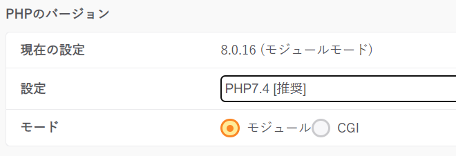

# Montaje del entorno en un servidor de alquiler
Estos son los pasos para instalar Exment en un servidor de alquiler. Es una opción para crear y usar un entorno de forma sencilla.  
Se explican los pasos para Xserver y para Sakura Internet.

| Su servidor | Dónde mirar |
|---|---|
| Xserver | [En Xserver](/es/install_rental?id=En-Xserver) |
| Sakura Internet | [En Sakura Internet](/es/install_rental?id=En-Sakura-Internet) |

En los dos casos, el proceso general es el mismo.

1. Crear el MySQL (la base de datos) para Exment
2. Conectarse al servidor por SSH e instalar composer
3. Instalar Exment en una carpeta que no se publica en la web
4. Publicar en la web solo la carpeta «public» de Exment
5. Terminar la configuración siguiendo los [Pasos de la instalación](/es/quickstart)

## Notas para el montaje en un servidor de alquiler
- Exment necesita el siguiente entorno.
    1. PHP 8.2 o superior
    1. MySQL 8.0 o superior (recomendado: 8.4)  
    o MariaDB 10.11 o superior  
  En especial, la versión de MySQL de algunos servidores de alquiler no cumple los requisitos.  
  Compruebe antes si su servidor de alquiler los cumple.

- En un servidor de alquiler, la carpeta que se publica en la web está fijada (/home/username/www, /public_html, etc.).  
No coloque directamente en esa carpeta la carpeta donde ha instalado Exment. Los archivos que contienen los valores de la base de datos, la contraseña del correo, etc. quedarían expuestos al público, y eso causaría una fuga de información muy grave.  
Los pasos de esta página publican en la web solo la carpeta que debe publicarse. Publique siguiendo estos pasos.

- En un servidor de alquiler, después de conectarse por SSH, primero se instala composer y luego se instala Exment.

- Según el entorno del servidor de alquiler o las versiones del servidor, puede que con los pasos de esta página no se pueda configurar bien.

- Esta página solo describe los pasos para hacer funcionar Exment en un servidor de alquiler.  
No explica conocimientos generales de informática, como SSH, la creación de bases de datos o los comandos de Linux. Téngalo en cuenta.

## Pasos de instalación en un servidor de alquiler

### En Xserver
※ El funcionamiento se ha comprobado con el plan X10.

<iframe width="560" height="420" src="https://www.youtube.com/embed/RB6i0F2fev0" frameborder="0" allow="accelerometer; autoplay; encrypted-media; gyroscope; picture-in-picture" allowfullscreen></iframe>

**(1) Crear el MySQL**

Cree antes el MySQL para Exment.

**(2) Poner en los comandos la misma versión de PHP que en el panel de administración**

En Xserver, la versión de PHP que se configura en el panel de administración y la versión de PHP que se usa al ejecutar comandos por SSH pueden ser distintas.  
Por eso se configura la versión de PHP que usan los comandos.

1. En el panel de administración de Xserver, haga clic en «PHP Ver.切替» (cambio de versión de PHP).  
Después, elija el dominio.  
  
  

2. En «PHPバージョン切替» (cambio de versión de PHP) está escrita la versión actual. Anótela.  
  

3. Conéctese a Xserver por SSH.

4. Busque con el siguiente comando los PHP instalados en Xserver.  
Copie del resultado la ruta del PHP de la versión que ha anotado.

~~~ bash
find /opt/php-*/bin -type f -name 'php'

## /opt/php-8.2.9/bin/php ←en este ejemplo, esta
~~~

5. Cree una carpeta y cree un enlace simbólico a PHP (algo parecido a un atajo que apunta a un archivo que está en otro lugar).

~~~
mkdir $HOME/bin
ln -s /opt/php-8.2.9/bin/php $HOME/bin/php
~~~

6. Modifique el archivo bashrc para añadir este PHP al PATH.

~~~ bash
vi ~/.bashrc

## Escriba lo siguiente en la última línea y guarde con «:wq!»
export PATH=$HOME/bin:$PATH

## Aplicar el cambio
source ~/.bashrc
~~~

7. Compruebe la versión de PHP. Si es la versión escrita en el panel de administración, está bien.

~~~ bash
php --version
~~~

**(3) Instalar composer**

~~~ bash
cd ~
curl -sS https://getcomposer.org/installer | php -- --install-dir=$HOME/bin/
## Cambiar el nombre
mv $HOME/bin/composer.phar $HOME/bin/composer
## Comprobar
composer --version
# Composer version 2.6.5 2023-10-06 10:11:52
~~~

**(4) Instalar Exment**

No instale nunca directamente en la carpeta «$HOME/(nombre del dominio)/public_html». Los archivos que contienen los valores de la base de datos, la contraseña del correo, etc. quedarían expuestos al público, y eso causaría una fuga de información muy grave.  
Aquí se crea la carpeta «$HOME/(nombre del dominio)/laravel» y se instala Exment dentro de ella.

~~~ bash
cd ~/(nombre del dominio)
mkdir laravel
cd laravel
wget https://exment.net/downloads/en/exment.zip
unzip exment.zip
rm exment.zip
~~~

**(5) Publicar solo la carpeta public**

Convierta «$HOME/(nombre del dominio)/public_html» en un enlace simbólico a la carpeta «$HOME/(nombre del dominio)/laravel/exment/public» que acaba de crear.  
Así, el núcleo de Laravel y los valores de configuración quedan fuera de la carpeta que se publica en la web, y solo la carpeta public de laravel está en public_html.

~~~ bash
## Eliminar el public_html predeterminado
rm -r $HOME/(nombre del dominio)/public_html
ln -s $HOME/(nombre del dominio)/laravel/exment/public $HOME/(nombre del dominio)/public_html
~~~

**(6) Continuar con la instalación**

Con esto ya está todo listo para abrir Exment.  
Termine la configuración siguiendo los [Pasos de la instalación](/es/quickstart).  
※ Desde la v7.2.1, Exment se abre en esta URL. En los sitios que tienen «admin» en `ADMIN_ROUTE_PREFIX` de `.env` (sitios instalados con una versión anterior), añada «/admin» al final de la URL.  

#### PHP que usan los comandos y cron
En Xserver, el PHP de la web (el elegido en «PHP Ver.切替» del panel de administración) y el PHP que se ejecuta al escribir `php` por SSH o en cron son distintos.

- Al escribir `php` por SSH, se ejecuta `~/bin/php` (el PHP enlazado arriba). Si no lo ha enlazado, se ejecuta el PHP estándar del servidor (puede ser una versión antigua).
- cron no lee `~/.bashrc`. Con solo `php` se ejecuta el PHP estándar del servidor (8.0, por ejemplo) y Exment no funciona.

Por eso, ejecute los comandos de artisan y cron con **el PHP de la misma versión que el panel de administración, con la ruta completa**.

- Ejemplo (con PHP 8.3): `/usr/bin/php8.3`, o el `/opt/php-8.3.x/bin/php` encontrado con el `find` de arriba
- Si cambia la versión de PHP en el panel de administración, cambie también a la misma versión el enlace `~/bin/php` y la ruta de cron.

La [Programación de tareas](/es/additional_task_schedule) se configura en «Cron設定» (configuración de Cron) del panel de administración de Xserver, como sigue (cambie `(ID del servidor)` y `(nombre del dominio)` por los suyos).

~~~
* * * * * cd /home/(ID del servidor)/(nombre del dominio)/laravel/exment && nice -n 15 /usr/bin/php8.3 artisan schedule:run >> /dev/null 2>&1
~~~

Para la cola ([Ejecución diferida de las notificaciones](/es/additional_queue)), en un servidor de alquiler no se puede tener un worker siempre en marcha. Deje `QUEUE_CONNECTION` de `.env` en `sync` (el valor de la instalación). Si lo cambia a `database`, haga que cron procese cada minuto los trabajos acumulados.

~~~
* * * * * cd /home/(ID del servidor)/(nombre del dominio)/laravel/exment && nice -n 15 /usr/bin/php8.3 artisan queue:work --stop-when-empty --max-time=50 >> /dev/null 2>&1
~~~

#### Qué hacer al subir la versión de PHP
Para cambiar la versión de PHP, siga estos pasos.

- Durante el cambio de versión no se puede acceder a Exment.
- El ejemplo de abajo son los pasos para actualizar de PHP7.4 a PHP8.2.
- Los pasos pueden ser distintos según el entorno, el momento en que se instaló, la versión y la forma de instalación.

1. En el panel de administración de Xserver, haga clic en «PHP Ver.切替» (cambio de versión de PHP).  
Después, elija el dominio.

2. En «PHPバージョン切替» (cambio de versión de PHP), cambie a la versión nueva y haga clic en «変更» (cambiar).  
  

3. Conéctese a Xserver por SSH.

4. Compruebe la versión actual de PHP con el siguiente comando.  
(En este momento se muestra la versión antigua.)

~~~ 
php --version
~~~

5. Quite el enlace simbólico a PHP.

~~~
unlink $HOME/bin/php
~~~

6. Busque la ruta de la versión elegida en «PHPバージョン切替» (cambio de versión de PHP).

~~~ bash
find /opt/php-*/bin -type f -name 'php'

## /opt/php-8.2.9/bin/php  ←en este ejemplo, esta
~~~

7. Cree el enlace simbólico a la ruta encontrada.

~~~
ln -s /opt/php-8.2.9/bin/php $HOME/bin/php
~~~

8. Compruebe la versión de PHP. Si es la versión nueva, ha salido bien.

~~~ 
php --version
~~~

### En Sakura Internet
※ El funcionamiento se ha comprobado con el plan estándar.  
※ En Sakura Internet, la ejecución de «composer» puede terminar a medias.  
Por eso se ejecuta con «nice -n 20» delante, como «nice -n 20 composer».

**(1) Crear el MySQL**

Cree antes el MySQL para Exment.

**(2) Cambiar la carpeta que se publica**

1. En «ドメイン/SSL設定» (configuración de dominio/SSL) del menú de administración de Sakura Internet, elija el dominio que quiere cambiar.  
  

2. En «マルチドメインの対象のフォルダ» (carpeta de destino del multidominio), cambie la carpeta indicada. Aquí se pone «/exment».  
  

**(3) Conectarse por SSH y configurar el shell y el PATH**

1. Conéctese por SSH con su ID y su contraseña.

2. Cambie el shell.

~~~
which bash
#  /usr/local/bin/bash

chsh -s /usr/local/bin/bash
# Password:  ## Escriba la contraseña
# chsh: user information updated
~~~

3. Modifique .bash_profile.

~~~ bash
vi .bash_profile

## Escriba lo siguiente y guarde con «:wq!»
PATH=$PATH:$HOME/bin:$HOME/usr/local/bin
export PATH
~~~

4. Cierre la conexión SSH una vez y vuelva a conectarse por SSH.

**(4) Instalar composer**

~~~ bash
cd ~
mkdir -p usr/local/bin/
curl -sS https://getcomposer.org/installer | php -- --install-dir=usr/local/bin/
## Cambiar el nombre
mv usr/local/bin/composer.phar usr/local/bin/composer
## Comprobar
nice -n 20 composer --version
# Composer version 2.6.5 2023-10-06 10:11:52
~~~

**(5) Instalar Exment**

No instale nunca directamente en la carpeta «$HOME/www/». Los archivos que contienen los valores de la base de datos, la contraseña del correo, etc. quedarían expuestos al público, y eso causaría una fuga de información muy grave.  
Aquí se crea la carpeta «$HOME/laravel» y se instala Exment dentro de ella.

~~~ bash
cd ~
mkdir laravel
cd laravel
wget https://exment.net/downloads/en/exment.zip
unzip exment.zip
rm exment.zip
~~~

**(6) Publicar solo la carpeta public**

Cree «$HOME/www/exment» como enlace simbólico a la carpeta «$HOME/laravel/exment/public» que acaba de crear.  
Así, el núcleo de Laravel y los valores de configuración quedan fuera de la carpeta que se publica en la web, y solo la carpeta public de laravel está dentro de la carpeta www.

~~~
ln -s $HOME/laravel/exment/public $HOME/www/exment
~~~

**(7) Continuar con la instalación**

Con esto ya está todo listo para abrir Exment.  
Termine la configuración siguiendo los [Pasos de la instalación](/es/quickstart).  
※ Desde la v7.2.1, Exment se abre en esta URL. En los sitios que tienen «admin» en `ADMIN_ROUTE_PREFIX` de `.env` (sitios instalados con una versión anterior), añada «/admin» al final de la URL.  

#### Qué hacer al subir la versión de PHP
Para cambiar la versión de PHP, siga estos pasos.

- Durante el cambio de versión no se puede acceder a Exment.
- Los pasos pueden ser distintos según el entorno, el momento en que se instaló, la versión y la forma de instalación.

1. En el panel de administración de Sakura Internet, haga clic en «スクリプト設定» (configuración de scripts) → «言語のバージョン設定» (configuración de la versión del lenguaje).  
  

2. En «PHPのバージョン» (versión de PHP), cambie a la versión nueva y haga clic en «保存» (guardar).  
  

3. Conéctese a Sakura Internet por SSH.

4. Compruebe la versión de PHP. Si es la versión nueva, ha salido bien.

~~~ bash
php --version
~~~
