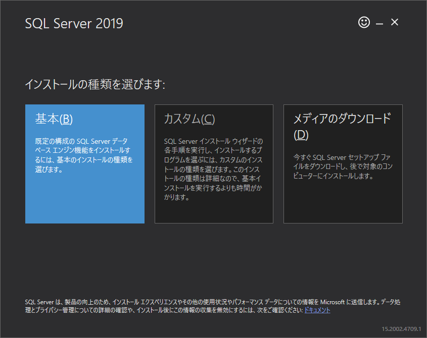
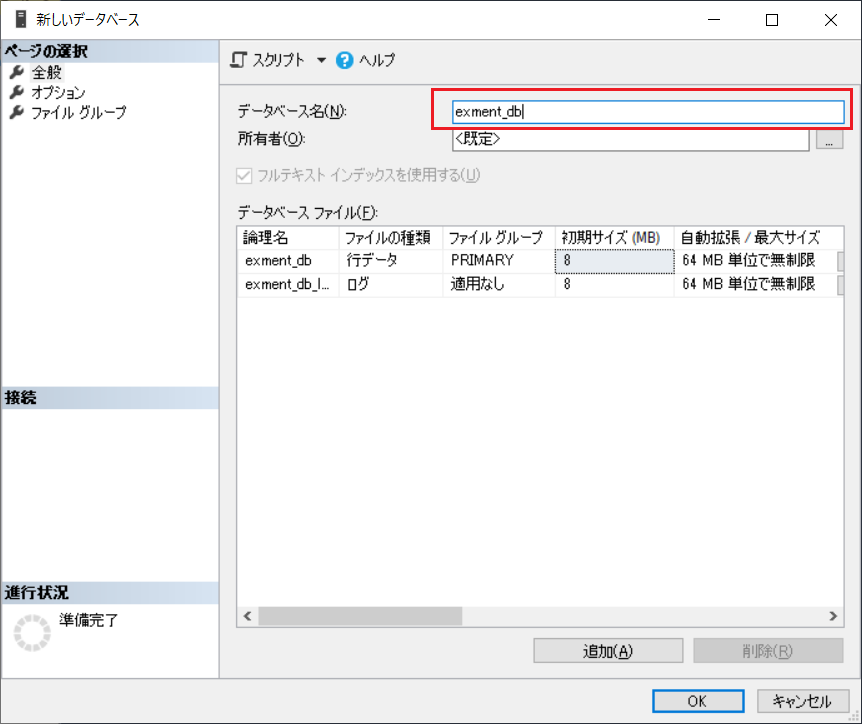
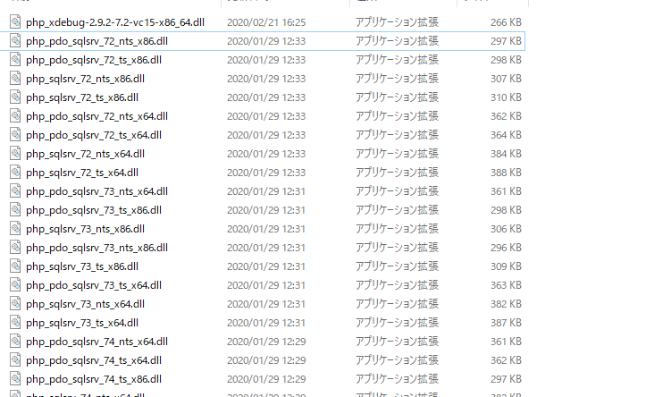

# Pasos de instalación de SQL Server
Estos son los pasos para usar SQL Server como base de datos de Exment.

- <span class="red bold">※ Por ahora no es compatible con la función de copia de seguridad y restauración.</span>
- Los pasos pueden ser distintos según el sistema operativo, la versión, el momento de la instalación, etc.

## Resumen de los pasos
1. **Preparar SQL Server** (instalación, creación de la base de datos y del usuario) … «Configuración de SQL Server»
2. **Comprobar que se puede conectar** … «Comprobación de la conexión»
3. **Conectar desde Exment** (instalar el controlador de PHP e instalar Exment) … «Configuración de Exment»

## Configuración de SQL Server

### Instalación de SQL Server
1. Descargue SQL Server desde el siguiente sitio.  
※ Elija la edición según el uso, el tamaño del negocio, etc.  
[Descarga de SQL Server](https://www.microsoft.com/en-us/sql-server/sql-server-downloads)  

2. Ejecute el archivo descargado y siga con la instalación.  
  

3. La instalación termina.

### Instalación de SQL Server Management Studio (herramienta GUI)
SQL Server Management Studio es una herramienta para manejar SQL Server desde pantallas.

- Abra el siguiente sitio.  
En «Idiomas disponibles», haga clic en el idioma que quiera usar. Después, descargue e instale la herramienta.  
https://docs.microsoft.com/en-us/sql/ssms/download-sql-server-management-studio-ssms?view=sql-server-ver15#available-languages


### Configuración adicional (Windows)
※ Por ahora hemos comprobado que la siguiente configuración hace falta cuando SQL Server se instala en Windows.

1. En el menú Inicio de Windows, abra «Administrador de configuración de SQL Server».  
  

2. En el menú de la izquierda, haga clic en «Configuración de red de SQL Server» → «Protocolos de (nombre de la edición)». Después, haga clic con el botón derecho en «TCP/IP» y haga clic en «Habilitar».  
  
  
  

3. Haga clic en el botón del menú Inicio, escriba «Servicios» y ejecute la aplicación «Servicios» que aparece.  
  

4. En la lista de servicios, elija «SQL Server (nombre de la edición)» y haga clic en «Reiniciar el servicio».  
  


### Creación de la base de datos y alta del usuario
1. Ejecute «SQL Server Management Studio».  
  

2. Inicie sesión.  
  

#### Creación de la base de datos
1. En el menú de la izquierda, haga clic con el botón derecho en la carpeta «Bases de datos» y haga clic en «Nueva base de datos».  
  

2. Escriba el nombre de base de datos que quiera y haga clic en Aceptar.  
  

#### Alta del usuario
1. En el menú de la izquierda, haga clic con el botón derecho en «Seguridad» → «Inicios de sesión» y elija «Nuevo inicio de sesión».  
  

2. Escriba el nombre de inicio de sesión y la contraseña, y elija «Autenticación de SQL Server». Le recomendamos quitar la marca de «Directiva de contraseñas». (Siga la política de su empresa u organización.)  
    

3. Elija «Asignación de usuarios», arriba a la izquierda.  
En la lista de bases de datos de «Usuarios asignados a este inicio de sesión», elija la base de datos que acaba de crear.  
En «Pertenencia al rol de la base de datos», elija los siguientes.
   - db_backupoperator
   - db_ddladmin
   - db_datawriter
   - db_datareader
   - public
   - dbcreator (※ Se usa para la copia de seguridad y la restauración manuales de los datos. Márquelo si va a hacer la copia de seguridad y la restauración manuales de los datos.)

       

4. Cuando termine todo, haga clic en Aceptar.

#### Configuración del inicio de sesión del servidor
1. En el menú de la izquierda, haga clic con el botón derecho en el servidor, arriba a la izquierda, y elija «Propiedades».  
 

2. En el menú «Seguridad», elija «Modo de autenticación de Windows y SQL Server» en «Autenticación de servidor» y haga clic en Aceptar.

3. Haga clic en el botón del menú Inicio, escriba «Servicios» y ejecute la aplicación «Servicios» que aparece.  
  

4. En la aplicación «Servicios», elija otra vez «SQL Server (nombre de la edición)» y haga clic en «Reiniciar el servicio».  
  

#### Comprobación del puerto
- En «Administrador de configuración de SQL Server», haga clic con el botón derecho en «TCP/IP» y haga clic en «Propiedades».  
Después, abra la pestaña «Direcciones IP» y compruebe el valor de «Puertos dinámicos TCP», al final del todo. (Se usará después en la configuración de la base de datos de Exment.)  
  
  


## Comprobación de la conexión
Compruebe que se puede conectar a SQL Server.

1. Ejecute «SQL Server Management Studio».  
  

2. Inicie sesión con los siguientes datos.
    - Nombre del servidor: el nombre de servidor predeterminado
    - Autenticación: Autenticación de SQL Server
    - Nombre de usuario: el nombre de usuario del usuario creado
    - Contraseña: la contraseña del usuario creado

      

3. Compruebe que puede iniciar sesión con normalidad.  
Si la configuración no ha terminado bien, aparece un error.


## Configuración de Exment
Aquí se prepara el entorno y se hace la configuración para conectar a SQL Server desde Exment.

### Instalación del controlador
Instale el controlador (la pieza que conecta PHP con SQL Server). Los pasos son distintos según el sistema operativo del servidor donde está Exment.

#### Windows
1. Ejecute el siguiente comando.  
En el resultado aparece una ruta de archivo. Anótela.

```
php -i | find "extension_dir"
# Ejemplo de resultado
extension_dir => C:\xampp\php\ext => C:\xampp\php\ext
```


2. Descargue desde el siguiente sitio el controlador para conectar PHP con Microsoft SQL Server.  
https://docs.microsoft.com/en-us/sql/connect/php/download-drivers-php-sql-server?view=sql-server-ver15

3. Ejecute el archivo EXE descargado. Aparece un cuadro de diálogo como el siguiente.  


4. Pegue la ruta de archivo anotada en el paso 1 y haga clic en «OK».  


5. Los archivos dll para conectar a SQL Server se colocan en la carpeta de bibliotecas de extensión de PHP.  


6. Abra el archivo php.ini y escriba el siguiente contenido al final del archivo.  
※ Cambie el nombre del archivo según lo que dicen los comentarios.

```
extension=php_pdo_sqlsrv_82_ts_x64.dll
# Parte "82": la versión de PHP que usa. Si usa PHP8.3, es 83
# Parte "ts": al ejecutar el comando «php -i | find "Thread Safety"», escriba «ts» si aparece «enabled» y «nts» si aparece «disabled»
# Parte "x64": al ejecutar el comando «php -v», escriba «x64» si la primera línea contiene «x64»; si no, escriba «x86»
```

7. Reinicie PHP. Con esto termina la configuración en Windows.


#### Linux

Siga los pasos de [esta página](https://docs.microsoft.com/en-us/sql/connect/php/installation-tutorial-linux-mac?view=sql-server-ver15) para instalar el controlador ODBC y el controlador de PHP en su sistema operativo.


### Configuración de Exment
- A partir de aquí, siga con la instalación según los [Pasos de la instalación](/es/quickstart).

- En la pantalla de configuración de la base de datos, escriba los siguientes valores.
    - Tipo de base de datos : SQL Server
    - Nombre de host : el nombre del servidor
    - Puerto : el número de puerto comprobado en la pantalla TCP/IP
    - Base de datos : el nombre de la base de datos creada
    - Nombre de usuario : el nombre de usuario creado
    - Contraseña : la contraseña del usuario creado
