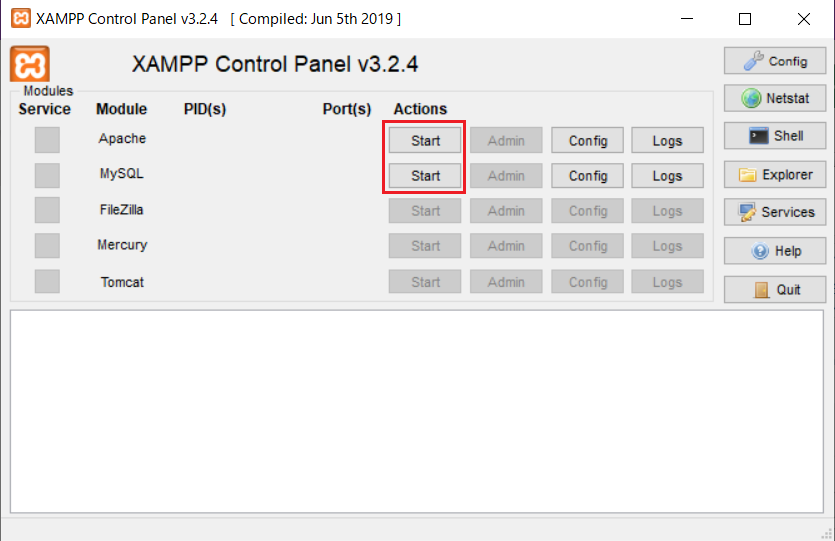

# Montaje del entorno con XAMPP
Estos son los pasos para crear, con XAMPP, un entorno donde funcione Exment en un ordenador con Windows.  
XAMPP es un programa que instala PHP, Apache y MySQL de una vez. Lo recomendamos para crear desde cero un entorno de desarrollo.

## Notas
- **Use la instalación con XAMPP solo para desarrollo y pruebas. Le recomendamos no usarla como entorno de producción.** 

## Pasos de la instalación
Siga este orden.

1. Instalar XAMPP y poner en marcha Apache y MySQL
2. Hacer que se pueda usar el comando mysql (variables de entorno)
3. Crear la base de datos
4. Crear la URL para Exment (configuración del subdominio)
5. Instalar Exment

### Pasos de instalación de XAMPP
1. Descargue XAMPP desde el siguiente sitio.  
[Descarga de XAMPP](https://www.apachefriends.org/jp/download.html)

2. Elija y descargue una versión con «PHP8.2» o superior.  

3. Siga con la instalación de XAMPP.  

4. Durante la instalación aparece una pantalla para elegir los componentes de XAMPP. Elija Apache y MySQL.  
Marque también «phpMyAdmin».  
※ Marque los demás como quiera  
Después, haga clic en «Next».  

5. Siga las pantallas hasta terminar la instalación.

6. Cuando termine la instalación, inicie el panel de control de XAMPP.  

7. Haga clic en «Start» en las filas «Apache» y «MySQL», arriba del todo.  

8. Si aparece la configuración del firewall, haga clic en «Permitir».  

9. Con esto, Apache está en marcha.  

#### 【Nota】
- Cuando reinicie el sistema operativo, tiene que iniciar otra vez el panel de control de XAMPP y volver a poner en marcha Apache.

### Añadir la variable de entorno
Para ejecutar mysql desde el símbolo del sistema, hay que añadir la ruta a las «variables de entorno».

1. En el Explorador, haga clic con el botón derecho en «Este equipo» y haga clic en «Propiedades».  

2. Haga clic en «Configuración avanzada del sistema».  

3. Haga clic en «Variables de entorno».  

4. Haga clic en «Path» en «Variables de usuario» y haga clic en «Editar».  

5. Haga clic en «Nuevo» y añada la siguiente línea.

~~~
C:\xampp\mysql\bin  
~~~

6. Cuando lo haya escrito, cierre todos los cuadros de diálogo abiertos con «Aceptar».

##### Si ejecuta el Mysql que está dentro de XAMPP
- Si ejecuta el Mysql que está dentro de XAMPP, en el paso de [Instalación de Exment](/es/install_xampp?id=Instalación-de-Exment) añada al .env del directorio raíz de Exment la ruta hasta la carpeta donde está el archivo ejecutable.

~~~
#Ejemplo  
EXMENT_MYSQL_BIN_DIR="C:/xampp/mysql/bin"
~~~

#### Crear la base de datos
1. Inicie el panel de control de XAMPP y haga clic en «Admin» en la fila «MySQL».  

2. Haga clic en «Nueva» en el menú de la izquierda.  

3. En la fila «Crear base de datos», escriba con caracteres alfanuméricos el nombre de base de datos que quiera y haga clic en «Crear».  

Con esto, la base de datos está creada.

### Configuración del subdominio
Con la configuración normal, si coloca los archivos del proyecto de Exment en la carpeta "C:\xampp\htdocs", puede usar Exment.  
Pero así hay problemas graves. Por ejemplo, al abrir la URL [http://localhost/exment/.env](http://localhost/exment/.env), se muestra en pantalla el archivo de configuración, que contiene la información de la base de datos.  
Por eso recomendamos encarecidamente una configuración que evita este problema. Configúrela con los siguientes pasos.

1. Cree la carpeta «local» en la carpeta «C:\xampp».  

2. Abra "C:\xampp\apache\conf\extra\httpd-vhosts.conf".

3. Añada lo siguiente al final del archivo. **※ Hace falta «/public» al final de DocumentRoot**  

~~~
<VirtualHost *:80>
    DocumentRoot "C:/xampp/htdocs"
    ServerName localhost
</VirtualHost>

<VirtualHost *:80>
  DocumentRoot "C:/xampp/local/exment/public"
  ServerName exment.localapp
</VirtualHost>

<Directory "C:\xampp\local\exment\public">
  Allow from all
  AllowOverride All
  Require all granted
</Directory>
~~~

4. Abra "C:\WINDOWS\system32\drivers\etc\hosts" y edítelo como sigue.  
※ Este archivo no se puede editar directamente. Cópielo, por ejemplo, al escritorio, edítelo y después sobrescriba el archivo original.  

~~~
127.0.0.1       localhost
127.0.0.1       exment.localapp
~~~

5. Reinicie Apache en el panel de control de XAMPP. Haga clic en el botón «Stop» de la fila «Apache» y después haga clic otra vez en «Start».  

6. Con esto, puede abrir Exment en la siguiente URL.  
http://exment.localapp

### Instalación de Exment
Instale Exment siguiendo los [Pasos de la instalación](/es/quickstart) de Exment.  
Normalmente, Exment se instala dentro de la carpeta "C:\xampp\local".  
Aquí se supone que se ha instalado dentro de la carpeta "C:\xampp\local\exment".  

- Durante la instalación hay una pantalla para escribir la configuración de la base de datos. Escriba lo siguiente.
    - Tipo de base de datos: MariaDB
    - Nombre de host: 127.0.0.1
    - Puerto: 3306
    - Base de datos: (el nombre de la base de datos creada arriba)
    - Nombre de usuario: root
    - Contraseña: (vacío)

## Qué hacer al subir la versión de PHP
Para cambiar la versión de PHP, siga estos pasos.

- Durante el cambio de versión no se puede acceder a Exment.
- El ejemplo de abajo son los pasos para actualizar de PHP7.4 a PHP8.2. Es un método que sustituye solo PHP, sin actualizar todo XAMPP.
- Los pasos pueden ser distintos según el entorno, el momento en que se instaló, la versión y la forma de instalación.

1. Como preparación, detenga Apache y MySQL y cierre el panel de control de XAMPP.

2. Haga una copia de seguridad de la carpeta PHP (por defecto, C:\xampp\php) y de la carpeta Apache (por defecto, C:\xampp\apache) del XAMPP que usa ahora. Puede hacerlo como prefiera: cambiar el nombre de las carpetas, copiarlas a otro lugar, etc.

3. Descargue el XAMPP nuevo en formato ZIP.  

   1. Abra [Descarga de XAMPP](https://www.apachefriends.org/jp/download.html)
   2. Descargue el archivo que corresponda a su sistema operativo y a la versión de PHP que quiere usar.  
      > Elija el archivo zip, no installer.exe. (Si puede descomprimirlo, también vale el archivo 7z.)
      

   3. Descomprima el archivo ZIP y copie dentro de XAMPP la carpeta PHP y la carpeta Apache que están justo dentro de la carpeta descomprimida.  

4. Si hace falta, modifique el archivo php.ini.  
※ Si había cambiado el archivo ini original, hay que hacer los mismos cambios en el archivo ini nuevo. Compare el php.ini de la copia de seguridad con el php.ini nuevo y añada los valores de configuración.  

5. Inicie el panel de control de XAMPP.

6. Pulse el botón config de Apache y elija «Apache(httpd-xampp.conf)» en el menú desplegable. 
   

7. Edite httpd-xampp.conf. 
   1. Primero, sustituya todos los "php7_module" por "php_module".
   2. Sustituya todos los "php7" restantes por "php8".
   

8. Pulse el botón Shell para abrir la pantalla de comandos y compruebe que la versión de PHP es la nueva.

~~~
php -v
~~~

9. Haga clic en «Start» en las filas «Apache» y «MySQL».  

   > Puede producirse un error al hacer «Start» en «Apache».  
   En ese caso, abra «Logs» → «Apache(error.log)», a la derecha de la misma fila.  
   Si en la última línea del registro aparece «PHP Warning: 'vcruntime140.dll'...», hay que instalar el «Paquete redistribuible de Visual C++».  
   Abra [el sitio de descargas de Microsoft](https://visualstudio.microsoft.com/downloads/), desplácese hasta el final y abra «Other Tools, Frameworks, and Redistributables».	  
   Haga clic en el botón de descarga de «Microsoft Visual C++ Redistributable for Visual Studio 2022» para obtener el instalador y ejecútelo.
