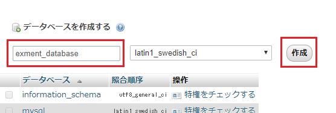

# Montaje del entorno con XAMPP
Estos son los pasos para crear, con XAMPP, un entorno donde funcione Exment en un Mac.  
XAMPP es un programa que instala PHP, Apache y MySQL de una vez. Lo recomendamos para crear desde cero un entorno de desarrollo.

## Notas
- **Use la instalación con XAMPP solo para desarrollo y pruebas. Le recomendamos no usarla como entorno de producción.** 

## Pasos de la instalación
Siga este orden.

1. Instalar XAMPP y poner en marcha Apache y MySQL
2. Hacer que se pueda usar el comando mysql (variables de entorno)
3. Crear la base de datos
4. Crear la URL para Exment (configuración del subdominio)
5. Instalar Exment

### Pasos de instalación de XAMPP
1. Descargue XAMPP desde el siguiente sitio.  
[Descarga de XAMPP](https://www.apachefriends.org/jp/download.html)  

2. Dentro de «XAMPP para OS X», elija y descargue la versión con «PHP8.2».  

3. Siga con la instalación de XAMPP.  

4. En la pantalla para elegir los componentes de XAMPP, marque los dos y pulse Next.  

5. Siga las pantallas pulsando Next hasta terminar la instalación.

6. Cuando termina la instalación, en XAMPP (Otros) de LaunchPad hay una aplicación llamada manager-osx. Desde ahí puede iniciar XAMPP.  

7. Cuando haya iniciado XAMPP, haga clic en Manage Servers.  

8. Haga clic en el botón Start de MySQL y de Apache para que Status pase a Running.  

#### 【Nota】
- Cuando reinicie el sistema operativo, tiene que iniciar otra vez el panel de control de XAMPP y volver a poner en marcha Apache.  

### Añadir la variable de entorno
Para ejecutar mysql desde el terminal, añada la ruta (Path) al archivo de configuración del terminal, .bash_profile.

1. Abra .bash_profile con el siguiente comando.

~~~
vi .bash_profile
~~~

2. En la pantalla que se abre, pulse la tecla i para pasar al modo de inserción (abajo a la izquierda aparece INSERT). Después, escriba el Path como sigue.

~~~
export PATH="/Applications/XAMPP/xamppfiles/bin:$PATH"
~~~

3. Para guardar y cerrar, pulse la tecla Esc y después escriba :wq.  

4. Por último, cargue .bash_profile con el siguiente comando para que el Path quede activo.

~~~
source ~/.bash_profile
~~~

#### Crear la base de datos
1. Después de iniciar el panel de control de XAMPP, abra la siguiente URL en el navegador web para entrar en phpMyadmin.

http://localhost/phpmyadmin/index.php  

2. Haga clic en «Nueva» en el menú de la izquierda.  

3. En la fila «Crear base de datos», escriba con caracteres alfanuméricos el nombre de base de datos que quiera y haga clic en «Crear».  

Con esto, la base de datos está creada.

### Configuración del subdominio
Con la configuración normal, si coloca los archivos del proyecto de Exment en la carpeta "/Applications/XAMPP/htdocs", puede usar Exment.  
Pero así hay problemas graves. Por ejemplo, al abrir la URL [http://localhost/exment/.env](http://localhost/exment/.env), se muestra en pantalla el archivo de configuración, que contiene la información de la base de datos.  
Por eso recomendamos encarecidamente una configuración que evita este problema. Configúrela con los siguientes pasos.

1. Cree la carpeta «local» en la carpeta «/Applications/XAMPP».  

2. Abra "/Applications/XAMPP/xamppfiles/etc/extra/httpd-xampp.conf".

3. Añada lo siguiente al final del archivo. **※ Hace falta «/public» al final de DocumentRoot**  

~~~
<VirtualHost *:80>
    DocumentRoot "/Applications/XAMPP/xamppfiles/htdocs"
    ServerName localhost
</VirtualHost>

<VirtualHost *:80>
  DocumentRoot "/Applications/XAMPP/local/exment/public"
  ServerName exment.localapp
</VirtualHost>

<Directory "/Applications/XAMPP/local/exment/public">
  Allow from all
  AllowOverride All
  Require all granted
</Directory>  
~~~

4. Abra "/Applications/XAMPP/xamppfiles/etc/httpd.conf" y busque en el texto las siguientes líneas.

~~~
User daemon
Group daemon
</IfModule>
~~~

Cambie esas líneas como sigue.

~~~
User (nombre del usuario con el que inicia sesión en el Mac)
Group daemon
</IfModule>
~~~

5. Edite "/etc/hosts".  
Escriba el siguiente comando en el terminal.  
※ Se le pedirá la contraseña. Escriba la contraseña del usuario con el que ha iniciado sesión

~~~
sudo vi /etc/hosts
~~~

Añada las siguientes líneas al archivo hosts.

~~~
127.0.0.1       localhost
127.0.0.1       exment.localapp
~~~

6. Reinicie Apache en el panel de control de XAMPP.  

### Instalación de Exment
Instale Exment siguiendo los [Pasos de la instalación](/es/quickstart) de Exment.  
Normalmente, Exment se instala dentro de la carpeta "/Applications/XAMPP/local".  
Aquí se supone que se ha instalado dentro de la carpeta "/Applications/XAMPP/local/exment".  

- Durante la instalación hay una pantalla para escribir la configuración de la base de datos. Escriba lo siguiente.
    - Tipo de base de datos: MariaDB
    - Nombre de host: 127.0.0.1
    - Puerto: 3306
    - Base de datos: (el nombre de la base de datos creada arriba)
    - Nombre de usuario: root
    - Contraseña: (vacío)

