# Integración con LINE
Es la función que conecta Exment con la cuenta oficial de LINE de la empresa.  
Las notificaciones de Exment se pueden recibir en LINE. Desde los botones de la tarjeta de notificación recibida en LINE también se pueden ejecutar acciones del flujo de trabajo (aprobar, etc.).  
En esta página se explican la configuración para conectarlos y la forma de crear las notificaciones.

- Para la función que comprueba por LINE y por correo si los empleados están a salvo, consulte [Comprobación de seguridad del personal](/es/safety_check).
- La integración con LINE se puede usar desde v7.0.0.

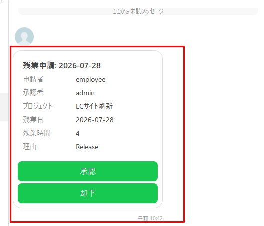

## Qué se puede hacer con la integración con LINE
- **Vinculación de la cuenta de LINE**: cada usuario vincula su cuenta de LINE con su usuario de Exment. Esta vinculación es necesaria para recibir notificaciones en LINE.
- **Notificación por LINE**: si se elige "LINE" como acción de notificación de una [notificación](/es/notify), se envía un mensaje a LINE. Además de texto, se puede enviar en forma de tarjeta (Flex Message).
- **Ejecución del flujo de trabajo desde LINE**: en la tarjeta de notificación se muestran botones de acciones como "Aprobar" o "Rechazar". Al pulsar un botón, la acción se ejecuta directamente desde LINE.
- **Historial de envíos de LINE**: se anotan los mensajes enviados por las notificaciones por LINE y por la comprobación de seguridad, tanto si se enviaron bien como si fallaron.

## Pasos de la configuración
Configure en este orden. Solo el paso 5 lo hace cada usuario que va a recibir notificaciones.

| Paso | Contenido | Quién lo hace |
| --- | --- | --- |
| 1 | [Preparar la cuenta oficial de LINE](/es/line?id=Preparación-de-la-cuenta-oficial-de-LINE) | Administrador |
| 2 | [Introducir los datos del canal en la configuración del sistema de Exment](/es/line?id=Configuración-del-sistema) | Administrador |
| 3 | [Registrar la URL del Webhook en LINE](/es/line?id=Configuración-del-Webhook) | Administrador |
| 4 | [Configurar la programación de tareas](/es/additional_task_schedule) (si se usan las notificaciones de "Paso del tiempo") | Administrador del servidor |
| 5 | [Vincular la cuenta de LINE](/es/line?id=Vinculación-de-la-cuenta-de-LINE) | Cada usuario |
| 6 | [Crear una plantilla LINE Flex](/es/line?id=Plantilla-LINE-Flex) (si se envía en forma de tarjeta) | Administrador |
| 7 | [Configurar la notificación](/es/line?id=Configuración-de-la-notificación-por-LINE) | Administrador |

## Requisitos
- Hace falta una cuenta oficial de LINE con Messaging API activado (el mecanismo para enviar y recibir mensajes de LINE desde un programa). Los mensajes de Exment se envían desde esta cuenta.
- Los servidores de LINE deben poder acceder a la URL del Webhook de Exment. Publique Exment en una URL "https://" accesible desde Internet y con un certificado SSL válido.
- Si se usan notificaciones con el disparador "Paso del tiempo", hace falta configurar la [programación de tareas](/es/additional_task_schedule).

> Las cuentas oficiales de LINE tienen, según el plan de precios, un límite de mensajes que se pueden enviar al mes.  
Las notificaciones enviadas desde Exment cuentan como 1 mensaje por cada destinatario. Las respuestas a operaciones del usuario ("¡La cuenta de LINE se ha vinculado correctamente!", etc.) no cuentan.  
Para más detalles, consulte los planes de precios de la cuenta oficial de LINE.

## Preparación de la cuenta oficial de LINE

### Activar Messaging API
1. Cree una cuenta oficial de LINE en [LINE Official Account Manager](https://manager.line.biz). También se puede usar una cuenta existente.
2. Active Messaging API en "Configuración" → "Messaging API". Al elegir (o crear) un proveedor, se crea un canal de Messaging API en la cuenta oficial de LINE.

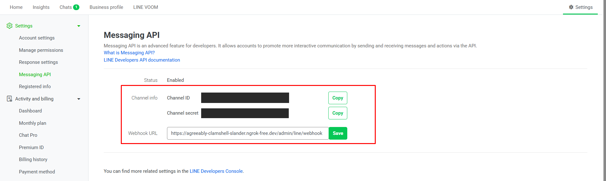

### Comprobar los datos del canal
Compruebe y anote los 3 valores siguientes, que se configuran en Exment.

| Valor | Dónde se comprueba | Para qué sirve |
| --- | --- | --- |
| Secreto del canal (Channel secret) | "Configuración" → "Messaging API" de LINE Official Account Manager, o la pestaña "Configuración básica del canal" de la [consola de LINE Developers](https://developers.line.biz/console/) | Verificar la firma de los datos que llegan de LINE (Webhook) |
| Token de acceso del canal (de larga duración) | Elija el canal en la consola de LINE Developers y pulse [Emitir] en "Token de acceso del canal" de la pestaña "Configuración de Messaging API" | Enviar mensajes |
| Basic ID | Junto al nombre de la cuenta en LINE Official Account Manager, o "Basic ID del bot" en la pestaña "Configuración de Messaging API" de la consola de LINE Developers. Es un ID que empieza por "@" | Crear el código QR para vincular la cuenta |

Nota: guarde el secreto del canal y el token de acceso del canal de forma que no los conozcan terceros.

### Configuración de respuestas
- En "Configuración" → "Configuración de respuestas" de LINE Official Account Manager, active "Webhook".
- Si tiene configurados mensajes de respuesta automática, se recomienda detenerlos. Exment responde a los mensajes de texto que llegan de los usuarios. Si los mensajes de respuesta automática siguen activos, se envían además de la respuesta de Exment.

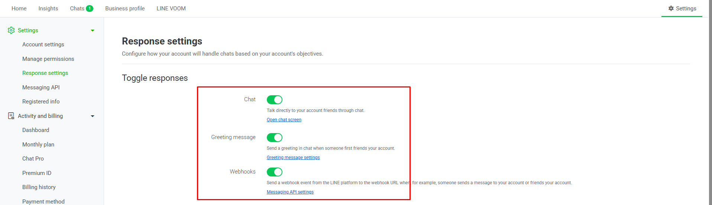

## Configuración del sistema
Introduzca en Exment los 3 valores comprobados.

**(1) Abrir la configuración detallada de la configuración del sistema**

Pulse "Configuración de administración" → "Configuración del sistema" en el menú de la izquierda y cambie a [Configuración detallada] con el botón de arriba a la derecha.  
También se puede abrir con la URL siguiente.

~~~
http(s)://(URL de Exment)/system?advanced=1
~~~

> Nota: la URL corresponde a la configuración estándar sin "/admin" (sitios instalados por primera vez con v7.2.1 o posterior). Si `ADMIN_ROUTE_PREFIX` de `.env` tiene un valor (en los sitios instalados con versiones anteriores es "admin"), añada ese valor después de la URL del sitio (ejemplo: `http(s)://(URL de Exment)/admin/system?advanced=1`). Para más detalles, consulte [Cambiar o eliminar el "admin" incluido en la URL](/es/additional_prefix).

**(2) Rellenar "Configuración de LINE"**

En "Configuración de LINE", rellene los campos siguientes y pulse [Guardar].

| Campo | Contenido |
| --- | --- |
| Token de acceso del canal | Escriba el token de acceso del canal (de larga duración) emitido en la consola de LINE Developers. |
| Secreto del canal | Escriba el secreto del canal. |
| Basic ID de la cuenta oficial de LINE | Escriba el Basic ID, empezando por "@". |
| URL del webhook | Se muestra la URL del Webhook que hay que registrar en LINE. No se puede escribir. |

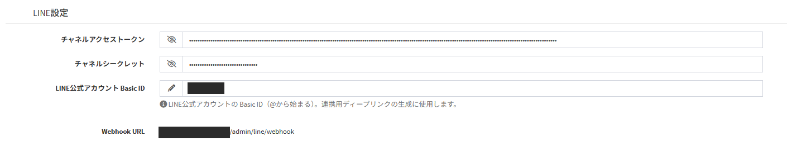

- El token de acceso del canal y el secreto del canal se muestran ocultos después de guardar.
- Estos valores también se pueden configurar en el archivo ".env". Si están en los dos sitios, tiene prioridad el valor guardado en la pantalla de configuración del sistema. Para más detalles, consulte [Valores de configuración](/es/line?id=Valores-de-configuración).

## Configuración del Webhook
El Webhook es el mecanismo con el que LINE avisa a Exment de lo que ocurre en LINE. Cuando un usuario envía el código de vinculación o pulsa un botón de la tarjeta de notificación, ese contenido se envía a Exment.

1. Elija el canal en la consola de LINE Developers y abra la pestaña "Configuración de Messaging API".
2. Pulse [Editar] en "Webhook URL", pegue la URL del Webhook que aparece en "Configuración de LINE" de la configuración del sistema y pulse [Actualizar].
3. Active "Usar Webhook".
4. Pulse [Verificar] y compruebe que aparece "Correcto".

La URL del Webhook tiene el formato siguiente.

~~~
https://(URL de Exment)/line/webhook
~~~

- La URL del Webhook también se puede configurar en "Configuración" → "Messaging API" de LINE Official Account Manager.
- Como URL del Webhook solo se puede registrar una URL que empiece por "https://" y tenga un certificado SSL válido.
- La [configuración del filtro de IP](/es/additional_ip_filter) de Exment no se aplica a la URL del Webhook. Si limita el acceso con un cortafuegos o similar, configúrelo para que los servidores de LINE puedan acceder.

## Vinculación de la cuenta de LINE
Cada usuario que va a recibir notificaciones en LINE vincula por sí mismo su cuenta de LINE con su usuario de Exment.  
**A los usuarios que no han vinculado su cuenta de LINE no se les envían notificaciones por LINE.** Antes de usar las notificaciones por LINE, pida a los usuarios que hagan la vinculación.

### Vincular
**(1) Abrir la pantalla "Vinculación con LINE"**

Inicie sesión en Exment, abra el menú de usuario (su nombre), arriba a la derecha, y pulse [Vinculación con LINE].

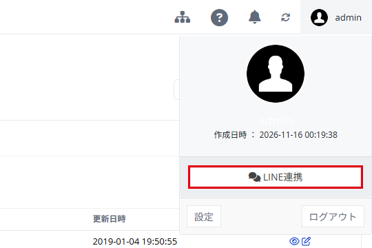

También se puede abrir con la URL siguiente.

~~~
http(s)://(URL de Exment)/line/link
~~~

- Desde v7.1.0, "Vinculación con LINE" no aparece en el menú de la izquierda, sino en el menú de usuario, arriba a la derecha. Solo aparece cuando el Basic ID de la cuenta oficial de LINE está configurado en la [configuración del sistema](/es/line?id=Configuración-del-sistema).
- En v7.0 se abre desde "Vinculación con LINE", en lo más alto del menú de la izquierda (al actualizar a v7.1.0, este menú situado en lo más alto se elimina. Los menús que usted haya movido se conservan).

**(2) Mostrar el código QR**

Pulse [Generar código QR]. Aparece el código QR de vinculación.

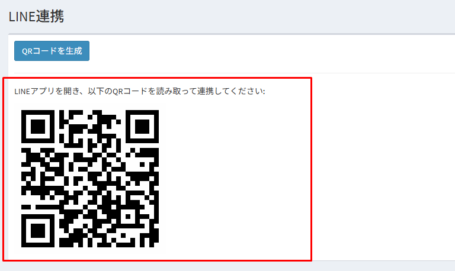

**(3) Leerlo con la aplicación LINE y enviar**

- Lea el código QR con la aplicación LINE del teléfono.  
Se abre la conversación con la cuenta oficial de LINE, con "LINK (código de vinculación)" ya escrito.  
Nota: si no ha añadido la cuenta oficial de LINE como amigo, añádala siguiendo las indicaciones de la pantalla.

- Envíe el mensaje tal cual. Si llega la respuesta "¡La cuenta de LINE se ha vinculado correctamente!", la vinculación ha terminado.

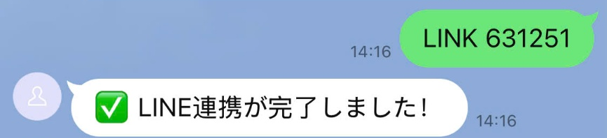

**(4) Comprobar que se ha vinculado**

Al volver a abrir la pantalla "Vinculación con LINE", aparece "Cuenta de LINE vinculada".

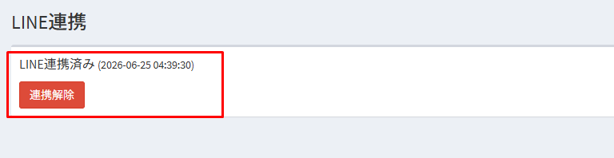

**Si no se consigue vincular**

- **Caducidad del código de vinculación**: el código de vinculación caduca a los 10 minutos con la configuración inicial. Si ha caducado, pulse otra vez [Generar código QR].
- **Una cuenta de LINE solo se puede vincular con un usuario**. Si se envía un código de vinculación desde una cuenta de LINE ya vinculada, se responde "Esta cuenta de LINE ya está vinculada a otra cuenta. Para cambiarla, desvincúlela primero en la web." Sin embargo, si el usuario vinculado está eliminado, la vinculación anterior se deshace automáticamente y se puede vincular con otro usuario.
- **Número de códigos incorrectos**: con la configuración inicial, se pueden enviar códigos de vinculación incorrectos hasta 5 veces. Si se falla 5 veces en los 10 minutos (configuración inicial) siguientes al primer código incorrecto, no se puede vincular hasta que pasen esos 10 minutos. Durante ese tiempo, aunque se envíe el código de vinculación correcto, se responde "El código de vinculación no es válido o ha caducado. Compruébelo e inténtelo de nuevo."

### Desvincular
En la pantalla "Vinculación con LINE", pulse [Desvincular].  
Si cambia de teléfono o de cuenta de LINE, desvincule y vuelva a vincular.

## Plantilla LINE Flex
Es la plantilla que decide el contenido de la tarjeta cuando la notificación por LINE se envía en forma de tarjeta (Flex Message).  
Si no se elige una plantilla en la configuración de la notificación, se envía un mensaje de texto (no hace falta plantilla).

### Crear una plantilla
**(1) Abrir la pantalla de lista**

Acceda a la URL siguiente y abra la pantalla de lista de datos de "LINE Flexテンプレート" (plantilla LINE Flex).  
Para añadirla al menú de la izquierda, añádala en [Menú](/es/menu) eligiendo el tipo de menú "Tabla".

~~~
http(s)://(URL de Exment)/data/line_flex_template
~~~

**(2) Crear la plantilla**

Pulse [Nuevo], rellene los campos siguientes y guarde.

| Campo | Contenido |
| --- | --- |
| Flexキー (clave Flex) | Es la clave que identifica la plantilla (ejemplo: ot_request). No use "safety_check", porque la usa la [comprobación de seguridad](/es/safety_check). |
| テンプレート名 (nombre de la plantilla) | Es el nombre de la plantilla. Aparece en las opciones de "Plantilla LINE Flex" de la configuración de la notificación. |
| タイトル (título) | Es el encabezado de la tarjeta. Se pueden usar variables. Si está en blanco, se muestra el título del dato. |
| 本文項目 (elementos del cuerpo) | Son los elementos que se muestran en el cuerpo de la tarjeta. Escriba 1 elemento por línea, con el formato "nombre mostrado = valor". |
| 説明 (descripción) | Es la descripción de la plantilla. No se muestra en LINE. |

- Al crear una plantilla, "タイトル" (título) y "本文項目" (elementos del cuerpo) llevan valores iniciales pensados para las notificaciones de ejecución del flujo de trabajo (estado, nombre de la acción, etc.). Si la va a usar para notificaciones de creación o actualización de datos, por ejemplo, cambie el contenido.
- La plantilla "Comprobación de seguridad" (clave Flex "safety_check") se crea automáticamente al instalar la [comprobación de seguridad](/es/safety_check). No la elija en "Plantilla LINE Flex" de la configuración de la notificación. Tampoco la edite ni la elimine.

### Cómo escribir los elementos del cuerpo
Escriba 1 elemento por línea. A la izquierda de "=" va el nombre mostrado y a la derecha, el valor. En el valor se pueden usar variables.  
Este es un ejemplo de tarjeta de solicitud de horas extra.

~~~
Solicitante = ${created_user}
Aprobador = ${value:approver}
Proyecto = ${value:project}
Fecha de las horas extra = ${value:ot_date}
Horas extra = ${value:ot_hours}
Motivo = ${value:reason}
~~~

- Las líneas cuyo valor queda vacío no se muestran en la tarjeta.
- Si "本文項目" (elementos del cuerpo) está en blanco, en las notificaciones de ejecución del flujo de trabajo se muestran los elementos estándar, como el estado y el nombre de la acción.

### Variables disponibles
Se pueden usar las [variables de parámetros](/es/params). Las variables principales son las siguientes.

| Variable | Contenido |
| --- | --- |
| ${value} | Título del dato |
| ${value:(nombre de la columna)} | Valor de una columna del dato (ejemplo: ${value:approver}) |
| ${created_user} | Nombre del usuario que creó el dato |
| ${table_view_name} | Nombre visible de la tabla |
| ${workflow:status_name} | Nombre del estado después de ejecutar la acción (*1) |
| ${workflow:status_from_name} | Nombre del estado antes de ejecutar la acción (*1) |
| ${workflow:action_name} | Nombre de la acción ejecutada (*1) |
| ${workflow:action_user} | Usuario que ejecutó la acción (*1) |
| ${workflow:comment} | Comentario escrito al ejecutar la acción (*1) |
| ${notify_target_column_key} | Nombre de la columna de "Columna de fecha de destino" (*2) |
| ${notify_target_column_value} | Valor de "Columna de fecha de destino" (*2) |

(*1) Solo se puede usar en las notificaciones con el disparador "Flujo de trabajo".  
(*2) Solo se puede usar en las notificaciones con el disparador "Paso del tiempo".

### Botones de la tarjeta
Los botones de la tarjeta se añaden automáticamente, sin configurarlos en la plantilla.

| Botón | Condición para que aparezca |
| --- | --- |
| Acciones del flujo de trabajo ("Aprobar", "Rechazar", etc.) | Aparece cuando se cumplen todas las condiciones siguientes. • El dato tiene un flujo de trabajo configurado y hay una acción que el destinatario puede ejecutar • El destinatario todavía no ha ejecutado esa acción • El "Comentario" de la acción no es "Obligatorio" • Después de ejecutar la acción no hace falta elegir al siguiente usuario de trabajo (en el estado siguiente no hay ninguna acción cuyos usuarios ejecutores sean "Los selecciona el usuario que ejecutó la acción anterior"). Nota: solo se evalúan las acciones cuya "Condición para avanzar al siguiente estado" es "1 o más personas ejecutan". Para las demás acciones, consulte [Configuración del flujo de trabajo](/es/line?id=Configuración-del-flujo-de-trabajo). |
| Ver detalles | Aparece cuando la URL de Exment es "https://". Al pulsarlo, se abre la pantalla de detalles del dato. |

Para más detalles, consulte [Ejecutar acciones del flujo de trabajo desde LINE](/es/line?id=Ejecutar-acciones-del-flujo-de-trabajo-desde-LINE).

## Configuración de la notificación por LINE
En "Configuración de acciones de notificación" de la pantalla de configuración de la [notificación](/es/notify), configure los campos siguientes.  
Para saber cómo abrir la pantalla de configuración de la notificación, consulte [Notificación](/es/notify).

| Campo | Contenido |
| --- | --- |
| Acción de notificación | Elija "LINE". |
| Destinatarios de la notificación | Elija los usuarios a los que se envía la notificación (obligatorio). Se pueden elegir columnas de "Usuario" (aparecen como "Columna personalizada: (nombre de la columna)"), "Usuario especificado", "Organización especificada", "Creador", etc. |
| Plantilla LINE Flex | Para enviar en forma de tarjeta, elija una [plantilla LINE Flex](/es/line?id=Plantilla-LINE-Flex). Si está en blanco, se envía como texto. |

- Si se envía como texto, el mensaje se crea a partir del asunto y del cuerpo de la "Plantilla de notificación".
- Si se elige "Organización especificada", se envía a todos los usuarios que pertenecen a la organización.
- No se envía a los destinatarios que no han vinculado su cuenta de LINE. En ese caso no se produce un error y tampoco se anota en el [historial de envíos de LINE](/es/line?id=Historial-de-envíos-de-LINE).
- La notificación por LINE se envía justo después de terminar el proceso (guardar el dato, etc.). No usa la [ejecución diferida de las notificaciones](/es/additional_queue) (cola).
- Si el envío falla, no se reenvía automáticamente. El resultado del envío se puede consultar en el [historial de envíos de LINE](/es/line?id=Historial-de-envíos-de-LINE).

### Ejemplo 1: notificar al crear o actualizar datos
- Disparador de la notificación: "Creación/actualización de datos"
- Configuración de condiciones de notificación: marcar "Creación" y "Actualización"
- Acción de notificación: "LINE"
- Destinatarios de la notificación: "Columna personalizada: Responsable"
- Plantilla LINE Flex: la plantilla creada

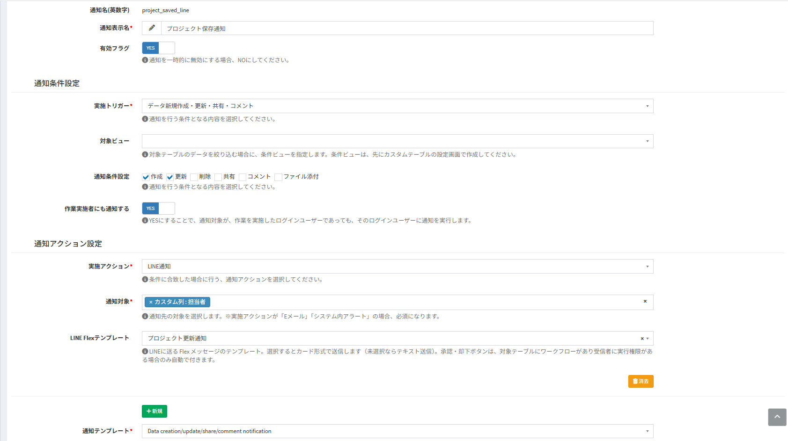

Cuando se guarda un dato, llega a LINE una tarjeta como la siguiente.

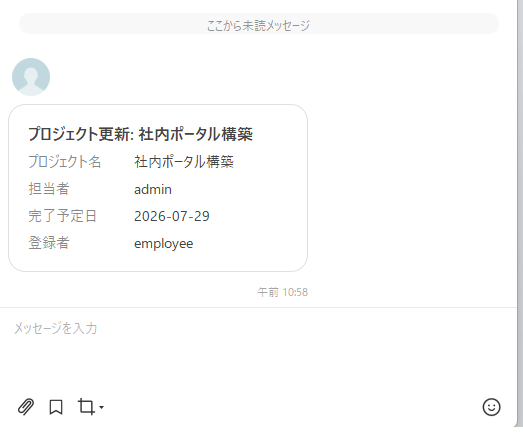

Nota: con la configuración inicial, no se notifica al propio usuario que guardó el dato. Para notificarse también a uno mismo, ponga "Notificar también al ejecutor" en SÍ.

### Ejemplo 2: notificar a los miembros de una organización
En "Destinatarios de la notificación", elija "Organización especificada" y, en "Organizaciones de destino", elija la organización.  
Se envía a los usuarios de la organización que han vinculado su cuenta de LINE.

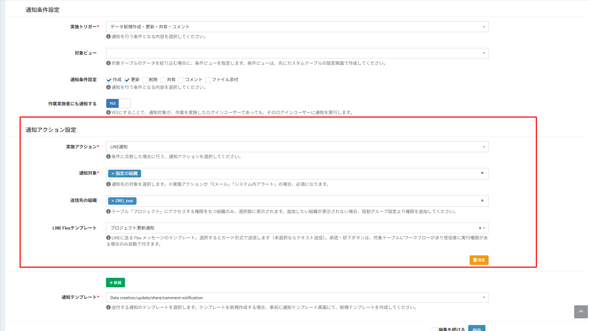

Nota: en las opciones solo aparecen las organizaciones que tienen permiso de acceso a esa tabla.

### Ejemplo 3: recordatorio el día antes de la fecha límite
- Disparador de la notificación: "Paso del tiempo"
- Columna de fecha de destino: la columna de fecha de referencia (ejemplo: fecha prevista de finalización)
- Día de notificación: "1"
- Antes o después: "Antes"
- Hora de notificación: la hora a la que se envía la notificación (0 a 23)
- Acción de notificación: "LINE"

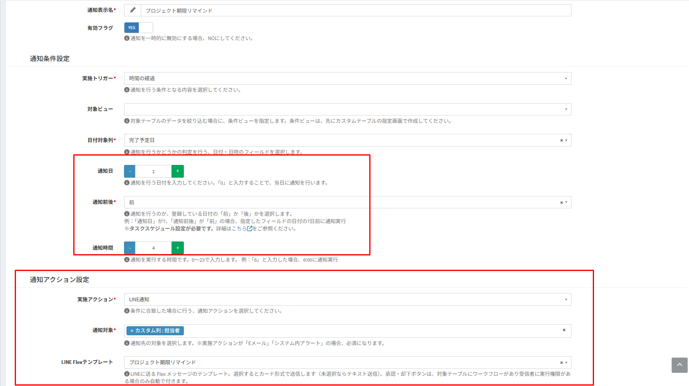

A la hora indicada llega una tarjeta como la siguiente.

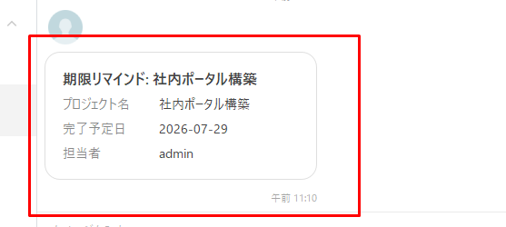

- Para ejecutar las notificaciones de "Paso del tiempo" hace falta configurar la [programación de tareas](/es/additional_task_schedule). La notificación se ejecuta en el minuto 00 de la hora indicada en "Hora de notificación".
- Si quiere ejecutarla enseguida para comprobar la configuración, ejecute el comando siguiente. La notificación se ejecuta sea cual sea la "Hora de notificación".

~~~
php artisan exment:notify --name=(Nombre de la notificación (alfanumérico))
~~~

- Para que el mismo recordatorio no se envíe duplicado, por ejemplo al ejecutar el comando varias veces, configure el valor "LINE_DEDUPE_MINUTES". Para más detalles, consulte [Valores de configuración](/es/line?id=Valores-de-configuración).

## Ejecutar acciones del flujo de trabajo desde LINE
Desde los botones de la tarjeta de notificación recibida en LINE se pueden ejecutar acciones del flujo de trabajo.  
Aquí se explica con el ejemplo de un aprobador que aprueba por LINE una solicitud de horas extra. Para la forma de configurar el flujo de trabajo, consulte [Configuración del flujo de trabajo](/es/workflow_setting).

Hay que hacer 3 cosas.

1. Configurar la acción del flujo de trabajo para que se pueda ejecutar desde LINE ([Configuración del flujo de trabajo](/es/line?id=Configuración-del-flujo-de-trabajo))
2. Configurar el envío de la notificación por LINE al aprobador ("Configuración de la notificación", más abajo)
3. Pulsar el botón de la tarjeta recibida ("Aprobar desde LINE", más abajo)

### Configuración del flujo de trabajo
En "Configuración de acciones" de la configuración del flujo de trabajo, configure así la acción que se ejecutará desde LINE.

- Usuarios ejecutores: el usuario que ejecuta la acción (ejemplo: con "Establecer de antemano", la columna "Aprobador" de la tabla)
- Comentario: "Opcional" o "No usar"

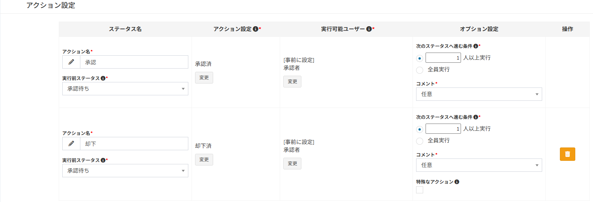

**Acciones que no se pueden ejecutar desde LINE**

Ejecute las acciones siguientes desde las pantallas de Exment.

- **Acciones cuyo "Comentario" es "Obligatorio"**: el botón no aparece en la tarjeta de LINE. El motivo es que hay que escribir un comentario.
- **Acciones tras las que hay que elegir al siguiente usuario de trabajo** (cuando en el estado siguiente hay una acción cuyos usuarios ejecutores son "Los selecciona el usuario que ejecutó la acción anterior"): según la "Condición para avanzar al siguiente estado", ocurre lo siguiente.

| "Condición para avanzar al siguiente estado" | Tarjeta de LINE |
| --- | --- |
| "1 o más personas ejecutan" | El botón no aparece. |
| 2 o más personas, o "Todos ejecutan" | El botón aparece. Las ejecuciones que no hacen avanzar el estado (ejemplo: la 1.ª y la 2.ª persona cuando aprueban 3) se pueden hacer desde LINE. Si se pulsa el botón en la ejecución que hace avanzar el estado (ejemplo: la 3.ª persona), la acción no se ejecuta y se responde "Esta acción requiere seleccionar los usuarios del siguiente paso. Procésela en la web." |

### Configuración de la notificación
Haga la configuración de notificación que envía la notificación por LINE al aprobador. **Elija siempre una "Plantilla LINE Flex"**. Si se envía como texto, los botones no aparecen.

- **Para notificar al crear el dato**: en la configuración de notificación de la tabla, configure el disparador de la notificación "Creación/actualización de datos", la condición de notificación "Creación", los destinatarios de la notificación "Columna personalizada: Aprobador" y la acción de notificación "LINE".
- **Para notificar al siguiente usuario de trabajo al ejecutar una acción**: en la configuración de notificación del flujo de trabajo, configure la acción de notificación "LINE" y los destinatarios de la notificación "Usuario del siguiente paso".

### Aprobar desde LINE
**(1)** El solicitante elige al aprobador y crea el dato de la solicitud de horas extra.

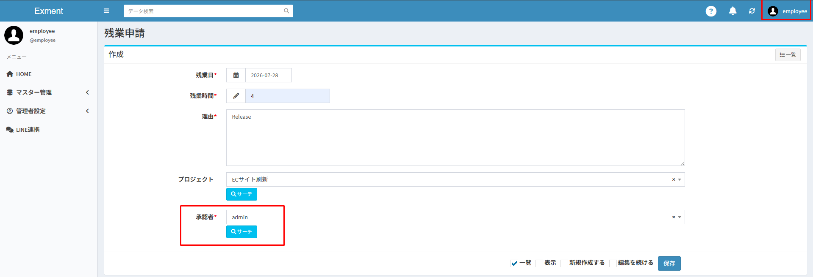

**(2)** Al LINE del aprobador llega una tarjeta con los botones "Aprobar" y "Rechazar".  
Al pulsar un botón, la acción se ejecuta y llega la respuesta "Procesado: Aprobar".

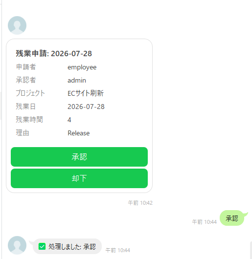

**(3)** Se actualiza el estado del dato de Exment.

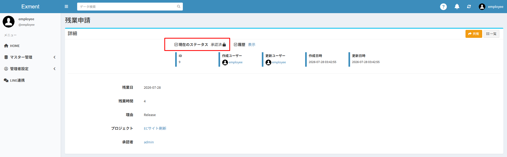

La acción se ejecuta como el usuario que vinculó la cuenta de LINE. En el momento de pulsar el botón se vuelve a comprobar si ese usuario puede ejecutar la acción.

Cuando no se ha podido ejecutar, se responde lo siguiente.

| Respuesta | Motivo |
| --- | --- |
| "Esta acción no está disponible o ya se ha procesado." | La acción no se puede ejecutar; por ejemplo, porque otro usuario ya la ha procesado o porque la misma acción ya se ha ejecutado. |
| "Esta acción requiere seleccionar los usuarios del siguiente paso. Procésela en la web." | Hace falta elegir al siguiente usuario de trabajo. Ejecútela desde las pantallas de Exment. |
| "Esta acción requiere un comentario. Procésela en la web." | Después de enviar la tarjeta, el "Comentario" de la acción se ha cambiado a "Obligatorio". |
| "Esta cuenta no tiene el inicio de sesión activado." | Los usuarios que no están configurados como usuarios de inicio de sesión no pueden ejecutar acciones desde LINE. |

## Historial de envíos de LINE
Los mensajes enviados por las notificaciones por LINE y por la [comprobación de seguridad](/es/safety_check) se anotan en la tabla "LINE送信履歴" (historial de envíos de LINE), tanto si se enviaron bien como si fallaron.  
Las respuestas a operaciones del usuario ("¡La cuenta de LINE se ha vinculado correctamente!", "Procesado: Aprobar", etc.) no se anotan.  
La lista se puede ver accediendo a la URL siguiente.

~~~
http(s)://(URL de Exment)/data/line_send_log
~~~

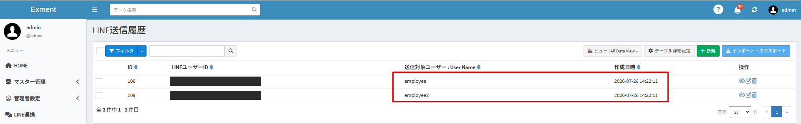

| Columna | Contenido |
| --- | --- |
| LINEユーザーID (ID de usuario de LINE) | Es el ID de usuario de LINE del destinatario. |
| メッセージ種別 (tipo de mensaje) | Es "text" (texto) o "flex" (tarjeta). |
| 送信Flexテンプレート (plantilla Flex enviada) | Es la plantilla LINE Flex usada para enviar la tarjeta. |
| 件名 (asunto) | Es el asunto del mensaje. En una tarjeta, es el título. |
| 本文 (cuerpo) | Son los datos del mensaje enviado a LINE (formato JSON). En una tarjeta, se anota todo el contenido del Flex Message. |
| 送信対象ユーザー (usuario destinatario) | Es el usuario de Exment destinatario. |
| 送信日時 (fecha y hora de envío) | Es la fecha y hora en que se envió el mensaje. |
| 送信結果 (resultado del envío) | Es "success" (correcto) o "failed" (fallido). |
| エラー内容 (contenido del error) | Es el motivo cuando el envío falla (ejemplo: "HTTP 400 …"). |

- Como no se envía a los usuarios que no han vinculado su cuenta de LINE, tampoco se anota en el historial. Si una notificación no llega, compruebe primero la vinculación de la cuenta de LINE.
- Las columnas que se muestran en la lista se pueden cambiar con una [vista personalizada](/es/view).

## Valores de configuración
En el archivo ".env" se pueden cambiar los valores siguientes. Para más detalles, consulte la [lista de valores de configuración](/es/config).

| Clave de configuración | Valor predeterminado | Contenido |
| --- | --- | --- |
| LINE_CHANNEL_ACCESS_TOKEN | (ninguno) | Es el token de acceso del canal. Tiene prioridad el valor guardado en la pantalla de configuración del sistema. |
| LINE_CHANNEL_SECRET | (ninguno) | Es el secreto del canal. Tiene prioridad el valor guardado en la pantalla de configuración del sistema. |
| LINE_OA_BASIC_ID | (ninguno) | Es el Basic ID. Tiene prioridad el valor guardado en la pantalla de configuración del sistema. |
| LINE_DEDUPE_MINUTES | 0 | En las notificaciones por LINE de "Paso del tiempo", después de enviar a un usuario un mensaje de LINE sobre un dato, no se le vuelve a enviar sobre el mismo dato durante este tiempo (minutos). También cuentan los mensajes enviados por otras configuraciones de notificación y los mensajes cuyo envío falló. Si es 0, esta función está desactivada. |
| LINE_LINK_CODE_TTL_MINUTES | 10 | Es la caducidad del código de vinculación (minutos). |
| LINE_LINK_MAX_ATTEMPTS | 5 | Es el número de veces que se puede enviar un código de vinculación incorrecto. Si se supera, no se puede vincular durante cierto tiempo. |
| LINE_LINK_ATTEMPT_DECAY_MINUTES | 10 | Es el tiempo (minutos) durante el que se cuentan los envíos de códigos de vinculación incorrectos. Si, dentro de este tiempo desde el primer código incorrecto, se falla el número de veces de "LINE_LINK_MAX_ATTEMPTS", no se puede vincular hasta que pase este tiempo. |
| LINE_HTTP_TIMEOUT | 10 | Es el tiempo de espera (segundos) en la comunicación con los servidores de LINE. |
| LINE_API_BASE | https://api.line.me | Es la URL de LINE Messaging API. Normalmente no la cambie. |

Nota: las notificaciones que no se envían por "LINE_DEDUPE_MINUTES" no se anotan en el historial de envíos de LINE. En "storage/logs/laravel.log" se anota "LINE reminder skipped by dedupe".

## Si no funciona bien
| Síntoma | Causas principales | Qué hacer |
| --- | --- | --- |
| [Verificar] del Webhook no da resultado correcto | • La URL del Webhook no es "https://", o el certificado SSL no es válido • No se puede acceder a Exment desde Internet • El secreto del canal no es correcto | Compruebe la URL del Webhook, la configuración de publicación del servidor y "Secreto del canal" de la configuración del sistema. |
| Se envía el código de vinculación, pero no llega respuesta | • "Usar Webhook" está desactivado • La URL del Webhook no es correcta | Compruebe la [configuración del Webhook](/es/line?id=Configuración-del-Webhook). |
| Al pulsar [Generar código QR] aparece "No se ha configurado el ID básico de la cuenta oficial de LINE. Configúrelo en Configuración: Sistema > Configuración del sistema." | El Basic ID no está configurado | Escriba "Basic ID de la cuenta oficial de LINE" en la configuración del sistema. |
| Se responde "El código de vinculación no es válido o ha caducado. Compruébelo e inténtelo de nuevo." | • El código de vinculación ha caducado o es incorrecto • Se han enviado seguidos códigos de vinculación incorrectos y, de momento, no se puede vincular | Pulse [Generar código QR] y lea el nuevo código QR. Si de momento no se puede vincular, espere un tiempo (10 minutos con la configuración inicial) antes de enviarlo. |
| Se responde "Esta cuenta de LINE ya está vinculada a otra cuenta. Para cambiarla, desvincúlela primero en la web." | Esa cuenta de LINE ya está vinculada con un usuario de Exment | Inicie sesión en Exment con el usuario vinculado, pulse [Desvincular] en la pantalla "Vinculación con LINE" y vuelva a vincular. |
| Se responde "Para vincular su cuenta, envíe LINK seguido de su código de vinculación: LINK &lt;code&gt;." | Un usuario que no ha vinculado su cuenta de LINE ha enviado un mensaje que no es el código de vinculación | Lea el código QR y vincule la cuenta con los pasos de [Vinculación de la cuenta de LINE](/es/line?id=Vinculación-de-la-cuenta-de-LINE). |
| Se responde "Comando no válido." | Un usuario que ha vinculado su cuenta de LINE ha enviado un mensaje que no es el código de vinculación | No es una anomalía. Exment no responde a los mensajes que no son el código de vinculación. Para la respuesta adicional de la comprobación de seguridad, consulte [Comprobación de seguridad del personal](/es/safety_check). |
| La notificación por LINE no llega y tampoco hay nada en el historial de envíos de LINE | El usuario destinatario no ha vinculado su cuenta de LINE | Pida al usuario que haga la [vinculación de la cuenta de LINE](/es/line?id=Vinculación-de-la-cuenta-de-LINE). |
| El resultado del envío en el historial de envíos de LINE es "failed" | • El token de acceso del canal no es correcto o no es válido • El usuario ha bloqueado la cuenta oficial de LINE • Se ha alcanzado el límite mensual de envíos | Mire "エラー内容" (contenido del error). Si ha vuelto a emitir el token de acceso del canal, escríbalo otra vez en la configuración del sistema. |
| En la tarjeta no aparecen los botones "Aprobar" y "Rechazar" | • El "Comentario" de la acción es "Obligatorio" • Es una acción cuya "Condición para avanzar al siguiente estado" es "1 o más personas ejecutan" y, después de ejecutarla, hay que elegir al siguiente usuario de trabajo (en el estado siguiente hay una acción "Los selecciona el usuario que ejecutó la acción anterior") • El destinatario no puede ejecutar esa acción, o ya la ha ejecutado • El dato ya está procesado • No se ha elegido una plantilla LINE Flex | Revise [Ejecutar acciones del flujo de trabajo desde LINE](/es/line?id=Ejecutar-acciones-del-flujo-de-trabajo-desde-LINE). |
| No se envía la notificación por LINE de "Paso del tiempo" | • La programación de tareas no funciona • La "Hora de notificación" no coincide con la hora del servidor • No se ha enviado por "LINE_DEDUPE_MINUTES" | Compruebe la [programación de tareas](/es/additional_task_schedule). También puede ejecutar la notificación con "php artisan exment:notify" para comprobarlo. |
| No aparece el botón "Ver detalles" | La URL de Exment no es "https://" | Use Exment con una URL "https://". |
