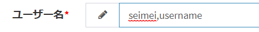
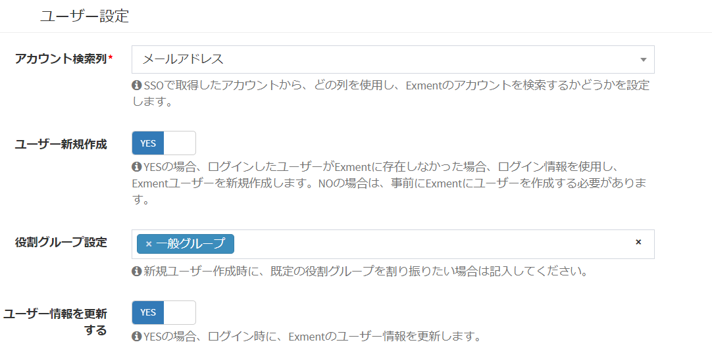
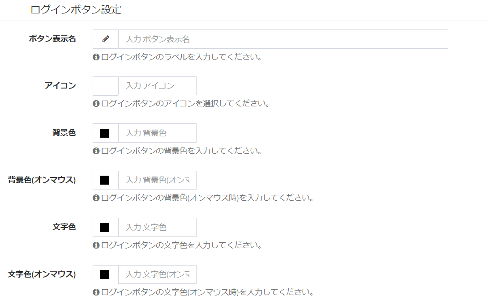
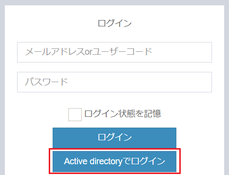

# Inicio de sesión único (LDAP)
Aquí se explica cómo configurar el inicio de sesión único (SSO) con LDAP.  
En Exment se puede añadir el inicio de sesión único en la [Configuración de inicio de sesión](/es/login_setting). Al añadirlo, se puede iniciar sesión con el ID y la contraseña del proveedor (aquí, el servidor LDAP), sin tener que gestionar una contraseña de inicio de sesión propia de Exment.

La configuración se hace en este orden, en 2 partes.

1. **Preparación del servidor** (instalar la extensión de PHP y la biblioteca) … «Configuración del servidor y del proveedor»
2. **Configuración en pantalla** (añadir el proveedor en la pantalla de configuración de inicio de sesión) … «Configuración en pantalla»

#### Notas
- **Los pasos de este manual están pensados para personas que conocen bien LDAP. Para saber cómo configurar cada proveedor, consulte la documentación correspondiente.**


## Configuración del servidor y del proveedor
Antes de añadir el proveedor en la pantalla de configuración de inicio de sesión, hay que ejecutar comandos en el servidor para instalar la extensión.

### En Windows

1. Abra el archivo php.ini.  
※ La ubicación del archivo php.ini cambia según la instalación del servidor.

2. Añada la siguiente línea.

```
extension=ldap
```

3. Reinicie PHP.

4. Ejecute el siguiente comando.

```
composer require directorytree/ldaprecord
```
※ Es la biblioteca que se usa desde Exment v7.0.0. Si usa Exment v6.x o anterior, ejecute en su lugar «composer require adldap2/adldap2-laravel».  


### En Linux (CentOS)

> Como hace falta añadir un paquete, puede que no se pueda instalar en servidores de alquiler y similares.

1. Ejecute el siguiente comando para instalar el paquete.  
※ Antes, termine la actualización de epel y la instalación de rpm que se hacen, por ejemplo, en [Creación del entorno en Linux](/es/install_linux).

```
sudo dnf install php-ldap
```

2. Abra el archivo php.ini.  
※ La ubicación del archivo php.ini cambia según la instalación del servidor.

3. Añada la siguiente línea.

```
extension=ldap.so
```


4. Ejecute los siguientes comandos.

```
composer require directorytree/ldaprecord
sudo service httpd restart
```
※ Es la biblioteca que se usa desde Exment v7.0.0. Si usa Exment v6.x o anterior, ejecute en su lugar «composer require adldap2/adldap2-laravel».  


## Configuración en pantalla
Cuando termine la configuración del servidor, añada el proveedor en la [pantalla de configuración de inicio de sesión](/es/login_setting).

1. Abra la pantalla de configuración del sistema con una cuenta de administrador.  
Abra la pantalla de configuración de inicio de sesión con el botón «Configuración de inicio de sesión», arriba a la derecha de la página.  
  

2. Pulse el botón Nuevo y cree una configuración de inicio de sesión. Los campos que hay que rellenar son los siguientes.

- **Nombre de LDAP** : escríbalo con caracteres alfanuméricos y sin que se repita con otros.

### Configuración de LDAP
Escriba la configuración de LDAP.  
(Con Active Directory)
  

(Con openLDAP)
  

### Configuración de asignación
Hay que hacer corresponder los nombres de campo que devuelve el proveedor con los nombres de campo de la tabla «Usuario» de Exment.  

  

Escriba el nombre de campo que devuelve el proveedor.

  

Hay 3 formas de escribirlo.

| Forma de escribir | Cuándo se usa | Ejemplo |
|---|---|---|
| Escribir el nombre de campo tal cual | Se usa 1 campo tal cual | |
| Escribir varios separados por comas | Hay varios candidatos y se usa, en orden desde el primero, el que tiene valor | seimei,username |
| Escribir varios con la forma ${nombre de campo} | Se combinan varios campos | ${last_name} ${first_name} |

#### Escribir el nombre de campo tal cual
Escriba tal cual el nombre de campo que devuelve el proveedor.
  

#### Escribir varios nombres de campo separados por comas
Si hay varios candidatos para el campo que quiere usar, escriba los nombres de campo que devuelve el proveedor separados por comas.  
Se busca el valor en orden desde el primero y, si hay valor, se usa ese valor.  
(Ejemplo: se prefiere usar el campo de nombre completo «seimei», pero en el proveedor no es obligatorio. Entonces, si «seimei» tiene valor se usa ese valor y, si no, se usa «username» como nombre de usuario → se escribe seimei,username)
  

#### Escribir varios nombres de campo con la forma ${nombre de campo}
Es la forma de escribir cuando quiere combinar varios datos de usuario que devuelve el proveedor y usarlos como datos de usuario de Exment. Escriba varios campos con la forma ${nombre de campo}.  
(Ejemplo: el proveedor no tiene el campo «nombre completo», pero tiene los campos «apellido (last_name)» y «nombre (first_name)». Se combinan como «apellido nombre» → se escribe ${last_name} ${first_name})
  


### Configuración de usuario
Aquí se configura cómo se trata al usuario que inicia sesión.

  

#### Columna de búsqueda de cuenta
Configure qué columna de la cuenta obtenida por SSO se usa para buscar la cuenta de Exment.

#### Crear usuario
- Si es YES: cuando el usuario que inicia sesión no existe en Exment, se crea un usuario nuevo de Exment con la información de inicio de sesión.
- Si es NO: hay que crear antes el usuario en Exment. Cuando el usuario que inicia sesión no existe en Exment, se muestra un error.

#### Configuración del grupo de roles
Si es YES, al crear un usuario nuevo de Exment se le puede vincular a un grupo de roles.  

#### Actualizar datos del usuario
Si es YES, al iniciar sesión otra vez se actualizan los datos del usuario, como el nombre de usuario.


- Cuando los datos se han guardado 1 vez o más, se muestran el botón «Habilitar» y el botón «Prueba de inicio de sesión».

- Si pone el indicador de activo en YES, en la pantalla de inicio de sesión se muestra el botón para la autenticación SSO.  

(Con Active Directory)

  

(Con openLDAP)

  


### Configuración del botón de inicio de sesión
Aquí se configura el botón de inicio de sesión que se muestra en la pantalla de inicio de sesión.  

  


### Habilitación y prueba de inicio de sesión
- Cuando los datos se han guardado 1 vez o más, se muestran el botón «Habilitar» y el botón «Prueba de inicio de sesión».

  

#### Habilitación
- Al habilitarlo, en la pantalla de inicio de sesión se muestra el botón para la autenticación SSO.  
※ Si no quiere mostrar el botón normal «Iniciar sesión», ponga «Mostrar inicio de sesión predeterminado» en «NO» en la [Configuración de inicio de sesión](/es/login_setting).  
  


#### Prueba de inicio de sesión
- Al hacer clic en el botón «Prueba de inicio de sesión», puede probar el inicio de sesión con la información configurada. Puede probarlo aunque la configuración de inicio de sesión no esté habilitada.  

  


- Al hacer clic en el botón «Iniciar sesión», puede probar si la configuración es correcta.  
El resultado se muestra en el elemento «Resultado».

  

  
  
[←Volver a Configuración de inicio de sesión](/es/login_setting)
