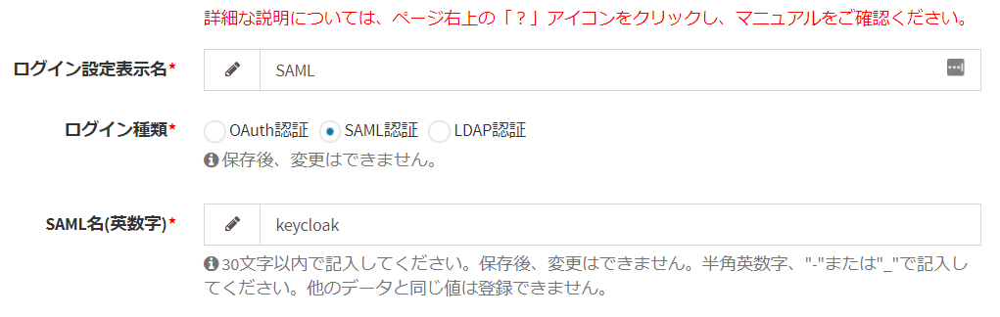
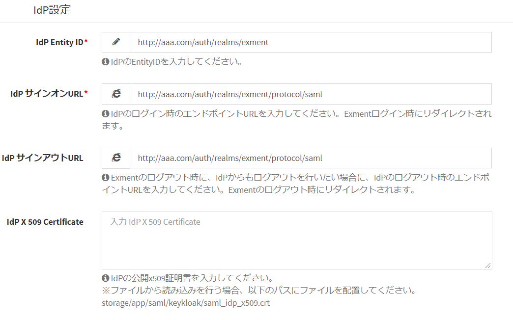
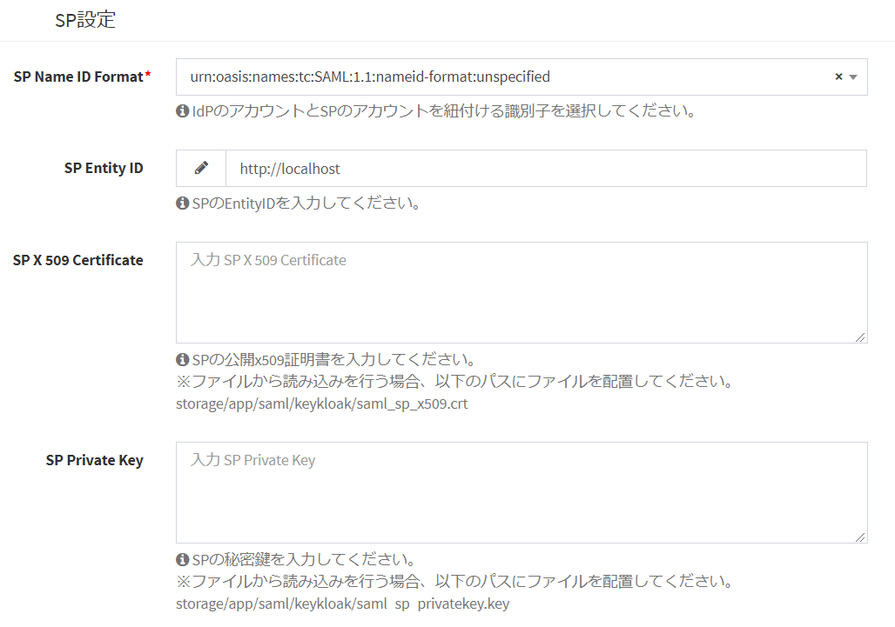
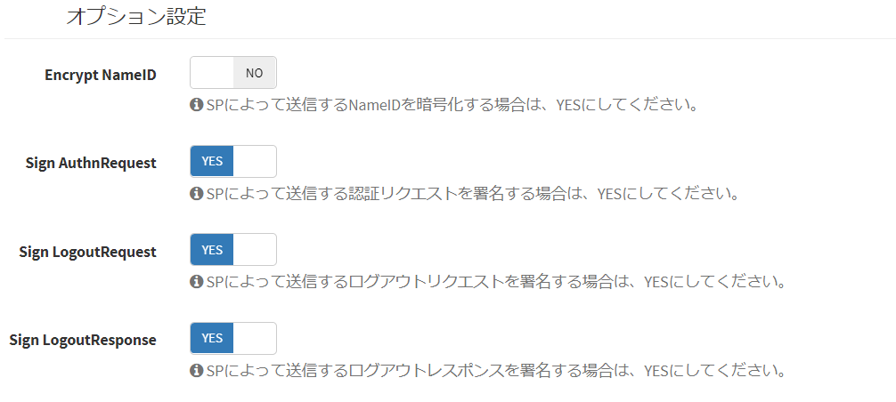
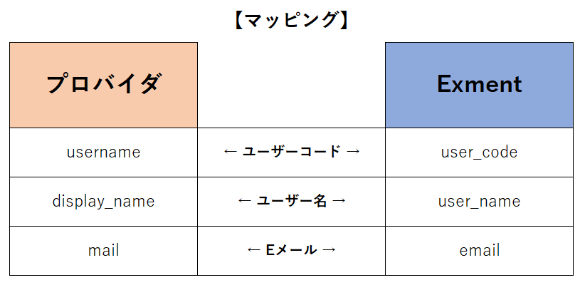
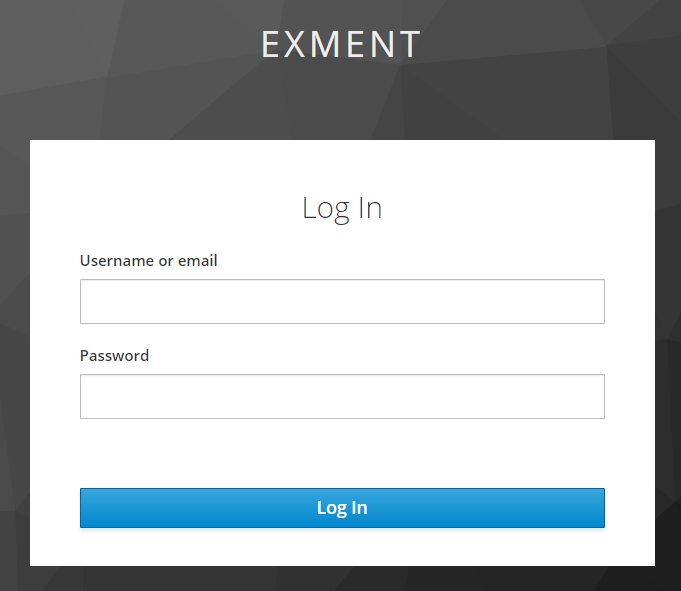
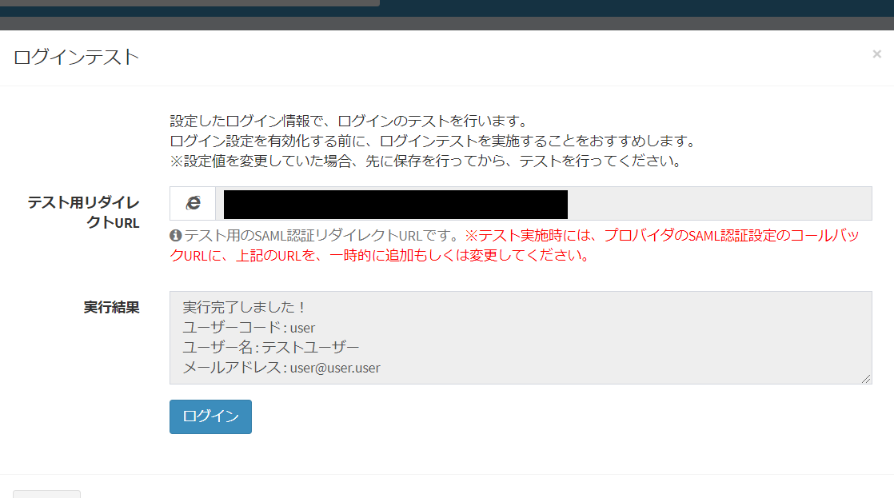

# Inicio de sesión único (SAML)
Aquí se explica cómo configurar el inicio de sesión único (SSO) con SAML.  
En Exment se puede añadir el inicio de sesión único en la [Configuración de inicio de sesión](/es/login_setting). Al añadirlo, se puede iniciar sesión con el ID y la contraseña del proveedor (el servicio que se encarga del inicio de sesión), sin tener que gestionar una contraseña de inicio de sesión propia de Exment.

La configuración se hace en este orden, en 2 partes.

1. **Preparación del servidor y del proveedor** (instalar la biblioteca y crear una aplicación en el proveedor) … «Configuración del servidor y del proveedor»
2. **Configuración en pantalla** (añadir el proveedor en la pantalla de configuración de inicio de sesión) … «Configuración en pantalla»

#### Notas
- **Los pasos de este manual están pensados para personas que conocen bien SAML. Para saber cómo configurar cada proveedor, consulte la documentación correspondiente.**
- En este manual y en las páginas de Exment se escribe «SAML», pero en realidad se usa SAML2.

## Configuración del servidor y del proveedor
Antes de añadir el proveedor en la pantalla de configuración de inicio de sesión, hay que ejecutar comandos en el servidor para instalar la extensión.

1. Ejecute el siguiente comando en el directorio raíz de Exment.

~~~
composer require aacotroneo/laravel-saml2
~~~

2. En cada proveedor de SAML, cree una aplicación para Exment.  
※ La callback URL es la siguiente.  
http(s)://(URL de Exment)/saml/login/(nombre de SAML que añadirá después)/acs  

> ※La URL es la de la configuración estándar, sin «/admin» (sitios instalados de nuevo con v7.2.1 o posterior). Si `ADMIN_ROUTE_PREFIX` de `.env` tiene un valor (en los sitios instalados con versiones anteriores es «admin»), añada ese valor después de la URL del sitio (ejemplo: `http(s)://(URL de Exment)/admin/saml/login/(nombre de SAML que añadirá después)/acs`). Para más detalles, consulte [Cambiar o quitar el «admin» de la URL](/es/additional_prefix).

3. Haga la [Configuración en pantalla](/es/login_saml?id=Configuración-en-pantalla).

## Configuración en pantalla
Cuando termine la configuración del servidor, añada el proveedor en la [pantalla de configuración de inicio de sesión](/es/login_setting).

1. Abra la pantalla de configuración del sistema con una cuenta de administrador.  
Abra la pantalla de configuración de inicio de sesión con el botón «Configuración de inicio de sesión», arriba a la derecha de la página.  
  

2. Pulse el botón Nuevo y cree una configuración de inicio de sesión. Los campos que hay que rellenar son los siguientes.

- **Nombre de SAML** : es el nombre del proveedor que se usa en la URL de callback y en otros sitios. Escríbalo con caracteres alfanuméricos y sin que se repita con otros.

  

### Configuración del IdP
Escriba la configuración del IdP.
  

### Configuración del SP
Escriba la configuración del SP.
  

### Ajustes de opciones
Escriba los ajustes de opciones.
  

### Configuración de asignación
Hay que hacer corresponder los nombres de campo que devuelve el proveedor con los nombres de campo de la tabla «Usuario» de Exment.  

  

Escriba el nombre de campo que devuelve el proveedor.

  

Hay 3 formas de escribirlo.

| Forma de escribir | Cuándo se usa | Ejemplo |
|---|---|---|
| Escribir el nombre de campo tal cual | Se usa 1 campo tal cual | |
| Escribir varios separados por comas | Hay varios candidatos y se usa, en orden desde el primero, el que tiene valor | seimei,username |
| Escribir varios con la forma ${nombre de campo} | Se combinan varios campos | ${last_name} ${first_name} |

#### Escribir el nombre de campo tal cual
Escriba tal cual el nombre de campo que devuelve el proveedor.
  

#### Escribir varios nombres de campo separados por comas
Si hay varios candidatos para el campo que quiere usar, escriba los nombres de campo que devuelve el proveedor separados por comas.  
Se busca el valor en orden desde el primero y, si hay valor, se usa ese valor.  
(Ejemplo: se prefiere usar el campo de nombre completo «seimei», pero en el proveedor no es obligatorio. Entonces, si «seimei» tiene valor se usa ese valor y, si no, se usa «username» como nombre de usuario → se escribe seimei,username)
  

#### Escribir varios nombres de campo con la forma ${nombre de campo}
Es la forma de escribir cuando quiere combinar varios datos de usuario que devuelve el proveedor y usarlos como datos de usuario de Exment. Escriba varios campos con la forma ${nombre de campo}.  
(Ejemplo: el proveedor no tiene el campo «nombre completo», pero tiene los campos «apellido (last_name)» y «nombre (first_name)». Se combinan como «apellido nombre» → se escribe ${last_name} ${first_name})
  

### Configuración de usuario
Aquí se configura cómo se trata al usuario que inicia sesión.

  

#### Columna de búsqueda de cuenta
Configure qué columna de la cuenta obtenida por SSO se usa para buscar la cuenta de Exment.

#### Crear usuario
- Si es YES: cuando el usuario que inicia sesión no existe en Exment, se crea un usuario nuevo de Exment con la información de inicio de sesión.
- Si es NO: hay que crear antes el usuario en Exment. Cuando el usuario que inicia sesión no existe en Exment, se muestra un error.

#### Configuración del grupo de roles
Si es YES, al crear un usuario nuevo de Exment se le puede vincular a un grupo de roles.  

#### Actualizar datos del usuario
Si es YES, al iniciar sesión otra vez se actualizan los datos del usuario, como el nombre de usuario.

- Cuando los datos se han guardado 1 vez o más, se muestran el botón «Habilitar» y el botón «Prueba de inicio de sesión».

- Si pone el indicador de activo en YES, en la pantalla de inicio de sesión se muestra el botón para la autenticación SSO.  
※ Normalmente también se muestra, junto a él, el formulario de inicio de sesión predeterminado, en el que se escriben el ID de usuario y la contraseña. En la «Configuración de SSO» de la [Configuración del sistema](/es/system_setting) también se puede dejar de mostrar, como en la imagen.  

### Configuración del botón de inicio de sesión
Aquí se configura el botón de inicio de sesión que se muestra en la pantalla de inicio de sesión.  

  

### Habilitación y prueba de inicio de sesión
- Cuando los datos se han guardado 1 vez o más, se muestran el botón «Habilitar» y el botón «Prueba de inicio de sesión».

  

#### Habilitación
- Al habilitarlo, en la pantalla de inicio de sesión se muestra el botón para la autenticación SSO.  
  

#### Prueba de inicio de sesión
- Al hacer clic en el botón «Prueba de inicio de sesión», puede probar el inicio de sesión con la información configurada. Puede probarlo aunque la configuración de inicio de sesión no esté habilitada.  
**En ese caso, añada temporalmente la URL que aparece en «URL de redirección para pruebas» a la URL de callback de la configuración de autenticación SAML del proveedor, o cámbiela por ella.**

  

- Al hacer clic en el botón «Iniciar sesión», puede probar si la configuración es correcta.  
El resultado se muestra en el elemento «Resultado».

  

  
  
  
[←Volver a Configuración de inicio de sesión](/es/login_setting)
