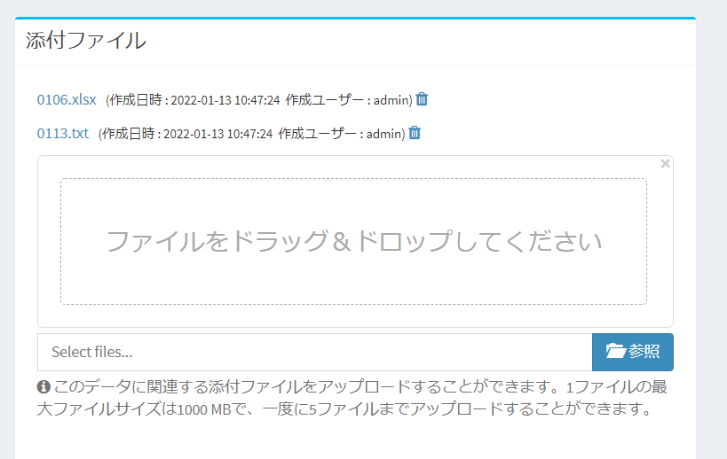

# Plantilla de notificación
En esta página se configuran los modelos (plantillas de notificación) del asunto, el cuerpo, etc. de los correos y las notificaciones que envía Exment.  
Las plantillas creadas se eligen y se usan en la [configuración de notificaciones](/es/notify), etc.  

> Desde la v3.6.0, el nombre cambió de "plantilla de correo" a "plantilla de notificación".  
En las versiones instaladas antes de la v3.6.0, el nombre de algunas pantallas sigue siendo "plantilla de correo".

## Cómo gestionarlas
### Mostrar la página
- En el menú de la izquierda, elija "Plantilla de correo" (la plantilla de notificación).  
O bien abra la siguiente URL.  
http(s)://(URL de Exment)/data/mail_template  
Así se muestra la pantalla de plantillas de notificación.  
  

> ※La URL corresponde a la configuración estándar, sin "/admin" (sitios instalados de nuevo con la v7.2.1 o posterior). Si `ADMIN_ROUTE_PREFIX` del archivo `.env` tiene un valor (en los sitios instalados con una versión anterior es "admin"), añada ese valor después de la URL del sitio (ejemplo: `http(s)://(URL de Exment)/admin/data/mail_template`). Para más detalles, vea [Cambiar o quitar el "admin" de la URL](/es/additional_prefix).

### Añadir una plantilla nueva
1. En la pantalla "Plantilla de correo", haga clic en el botón [Nuevo], arriba a la derecha de la página.

2. Se muestra la pantalla para añadir una plantilla de notificación nueva.

3. Introduzca los datos necesarios.  

### Guardar
Cuando haya escrito la configuración, haga clic en [Guardar].

### Editar
Para editar una plantilla, haga clic en el enlace [Editar] de su fila.  

### Eliminar
Si quiere eliminar una plantilla, haga clic en el enlace [Eliminar] de su fila.  

**※Pero las plantillas ya usadas en la pantalla de notificaciones no se pueden eliminar.**

## Archivos adjuntos y adjuntos personalizados
Al notificar por correo, se pueden enviar adjuntos los archivos puestos en la plantilla de notificación.  
※Ahora solo vale para las notificaciones por correo.  
  

#### Archivos adjuntos
Los archivos registrados aquí se envían como adjuntos fijos en cada notificación por correo.

#### Adjuntos personalizados
Si pone parámetros aquí, en la notificación por correo se envían los siguientes tipos de archivos registrados en cada dato.  

■Columnas personalizadas de los tipos "Archivo" e "Imagen"  
Parámetro: ${file:nombre de la columna personalizada}  

■Columnas "Archivo" e "Imagen" del dato elegido en una columna personalizada "Selección (desde tabla)"  
Parámetro: ${file:select_table:nombre de la columna personalizada de selección.nombre de la columna de archivo de la tabla de referencia}  
Ejemplo: para adjuntar el archivo de la columna "contract_file" del cliente elegido en la columna "customer" (que consulta la tabla de clientes)  
${file:select_table:customer.contract_file}  
※Si no hay ningún dato elegido o la columna no existe, no se adjunta nada.
  
■Archivos adjuntos registrados en la pantalla de detalle del dato (el lugar de la imagen de abajo)  
Parámetro: ${documents}  
  

## Reglas de las variables
En "Asunto del correo", "Cuerpo del correo" y "Nombre visible del remitente" se pueden usar variables.  
Con las variables puede poner en el asunto y en el cuerpo los datos registrados, el nombre del sistema, etc.  

### Lista de variables
Para las variables de parámetros, consulte la siguiente página.  
[Variables de parámetros](/es/params)
