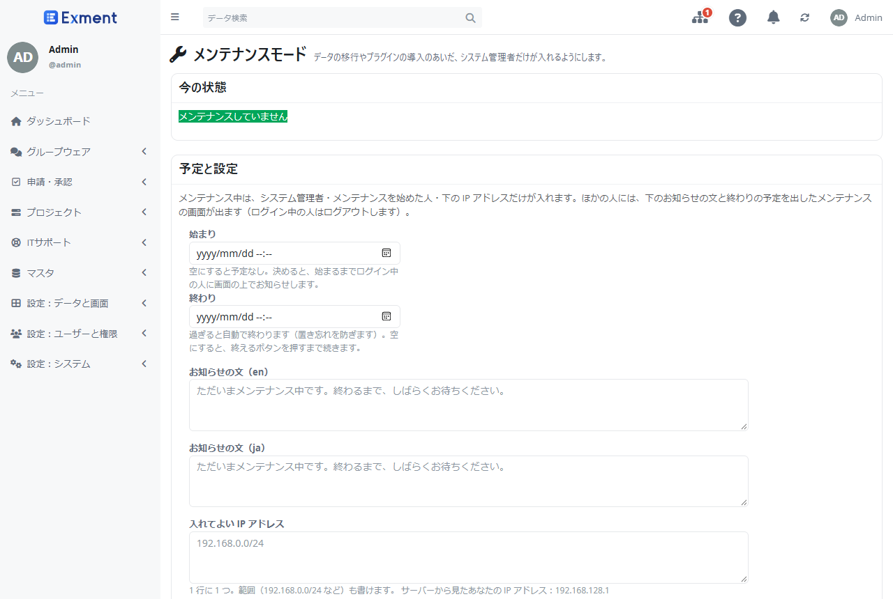

# Modo de mantenimiento
Mientras migra datos o instala plugins, hace que solo los administradores del sistema puedan entrar en el sitio. Se cambia en «Configuración: sistema» → «Modo de mantenimiento» (la URL es `/maintenance`).

※Esta pantalla se puede usar en Exment v7.2.1 o posterior.  
※Solo el administrador del sistema puede usar esta pantalla. En «Gestión de funciones», ponga «Modo de mantenimiento» en «usar».

## Qué se puede hacer durante el mantenimiento
- Solo pueden entrar **los administradores del sistema, la persona que inició el mantenimiento y las «Direcciones IP que pueden entrar»**.
- A los demás les aparece la pantalla de mantenimiento, con el «Mensaje» y el fin previsto (HTTP 503). A las personas con la sesión iniciada se les cierra la sesión.
- El inicio, el fin y los cambios quedan en el registro de operaciones.

## Configuración
| Campo | Contenido |
|---|---|
| Inicio | Si se deja vacío, no hay programación (para empezar enseguida, use «Iniciar el mantenimiento ahora»). Si se decide, hasta que empiece se avisa en la parte superior de la pantalla a las personas con la sesión iniciada |
| Fin | Cuando pasa esa hora, termina automáticamente (evita que se quede olvidado). Si se deja vacío, continúa hasta que pulse el botón de finalizar |
| Mensaje (ja, en) | Es el texto que se muestra en la pantalla de mantenimiento |
| Direcciones IP que pueden entrar | Una por línea. También se puede escribir un rango (como `192.168.0.0/24`). En la pantalla aparece su dirección IP tal como la ve el servidor |
| API (OAuth, claves de API) | Elija entre «Solo administradores del sistema», «Detener» y «No detener» |
| Detener las páginas accesibles desde fuera | Detiene los formularios públicos, los enlaces para compartir, las respuestas de la comprobación de seguridad del personal y las aprobaciones y respuestas por LINE |
| Detener las tareas programadas | Detiene las programaciones y los lotes de los plugins. Cuando termina el mantenimiento, se ejecutan una sola vez (las tareas con una hora fijada, como la copia de seguridad automática, esperan hasta la próxima vez que llegue esa hora) |
| Detener la cola | Detiene los procesos en segundo plano, como los correos. Cuando termina, continúan desde donde se quedaron |

## Comandos
Cuando no se puede abrir la pantalla, o para cambiarlo desde los trabajos del servidor, también puede usar comandos.

~~~
php artisan exment:maintenance status
php artisan exment:maintenance on --until="2026-12-01 09:00" --message="En mantenimiento" --allow-ip=192.168.0.0/24
php artisan exment:maintenance off
~~~

`php artisan down` (el que se usa en la actualización desde la pantalla y en la restauración) es distinto de esto y sigue funcionando igual.

## Temas relacionados
- [Gestión de funciones](/es/feature)
- [Copia de seguridad](/es/backup)
