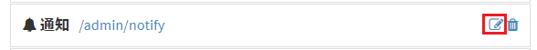

# Menú
En esta página se añaden, se reordenan, se editan y se eliminan los elementos del menú que aparece a la izquierda de la pantalla.

| Lo que quiere hacer | Dónde mirar |
|---|---|
| Añadir un elemento al menú | Añadir un menú nuevo |
| Cambiar el orden del menú | Reordenar |
| Mostrar un nodo principal solo a las personas de ciertos grupos de roles | Grupos de roles que lo ven |
| Después de actualizar, poner el menú en el orden estándar de la v7.2.1 | Ordenar en el orden estándar |

## Resumen
Al iniciar sesión, el menú se muestra a la izquierda de la pantalla.  
En el menú se pueden añadir elementos que abren "páginas preparadas por el sistema", "páginas de plugins", "páginas de cada tabla" y "cualquier URL".  
※Solo se muestran los elementos de menú de las páginas que puede ver el usuario que ha iniciado sesión.


※Desde la v7.1.0, "Comprobación de seguridad del personal", "Configuración de inicio de sesión", "Configuración de API" y el registro de rendimiento del sistema, que usa el administrador del sistema, se muestran dentro de "Configuración de administración". "Vinculación con LINE" no se muestra en el menú de la izquierda, sino en el menú de usuario de arriba a la derecha ([Vinculación con LINE](/es/line)). Si se actualiza desde la v7.0, los menús solo se mueven cuando están en el nivel más alto. Los menús que usted movió se quedan como están.


### El orden del menú desde la v7.2.1
Desde la v7.2.1, el menú de la izquierda se agrupa por áreas de trabajo (nodos principales). El orden es el mismo que el del [mapa de funciones](https://exment.net/en/feature-map/).

```
Panel
Groupware ▸ Archivos compartidos y correo (Groupware)
Solicitudes y aprobaciones ▸ Tareas pendientes, Solicitud de aprobación (ringi), Reembolso de gastos … (plantilla incluida "Paquete de solicitudes")
Proyectos ▸ Gestión de proyectos (plugin oficial)
Soporte de TI ▸ Soporte de TI (plugin oficial)
Maestros ▸ Información básica, Organización, Usuario, Avisos
Configuración: datos y pantallas ▸ Tabla personalizada, Studio, Menú, Flujo de trabajo, Plantilla de correo, Notificación, Estilos de celda predefinidos, Plantilla
Configuración: usuarios y permisos ▸ Usuarios con acceso, Grupo de roles, Configuración de inicio de sesión, Configuración de API, Registro de operaciones
Configuración: sistema ▸ Configuración del sistema, Gestión de funciones, Plugin, Copia de seguridad, Optimización, Modo de mantenimiento
```

- Los sitios instalados de nuevo quedan con esta forma.
- En los sitios actualizados desde la v7.1 o anterior, solo se mueven los menús que están como los dejó Exment (cuando el contenido de Configuración de administración sigue en el orden de Exment, cuando "Gestión de maestros" sigue en el tercer lugar desde arriba, cuando Archivos compartidos sigue en el nivel más alto). Los menús que usted movió, los nombres que puso y los menús de plugins se quedan como están. En los sitios que tienen otros menús dentro de Configuración de administración, Configuración de administración no se divide.
- Los plugins oficiales (gestión de proyectos, soporte de TI, Groupware) y las plantillas incluidas ponen sus menús debajo de su área (si el área no existe, la crean). Solo se mueven los menús que están en el nivel más alto.
- Las áreas que no tienen dentro ningún menú que se pueda mostrar no se muestran (los menús de las funciones desactivadas en [Gestión de funciones](/es/feature) no se muestran).

#### Ordenar en el orden estándar
Los sitios en los que el orden no cambió al actualizar (sitios con el menú reordenado, sitios con otros menús dentro de Configuración de administración) se pueden poner en la forma de arriba con [Ordenar en el orden estándar] de la pantalla "Menú".
- Al pulsarlo, aparece la lista de qué menú se mueve y a dónde. Revísela y después pulse [Ordenar].
- Solo se mueven los menús de Exment y de los plugins oficiales. Los menús creados por usted, los menús de tablas y los demás menús se quedan en su lugar y en su orden (los que estaban dentro de Configuración de administración, al final de "Configuración: sistema"). No se elimina ningún menú.
- Los nombres "INICIO", "Gestión de maestros" y "Configuración de administración" solo se cambian a "Panel", "Maestros" y "Configuración: sistema" cuando siguen con el nombre que puso Exment.
- Se guarda el menú de antes de ordenar, así que se puede volver atrás con [Deshacer], en la misma pantalla.
- Solo lo puede usar el administrador del sistema.


## Gestión del menú
Cómo añadir, reordenar, editar y eliminar menús.  

### Mostrar la pantalla de lista
En el menú de la izquierda, haga clic en "Menú".  
O bien abra la siguiente URL.  
Así se muestra la pantalla de configuración del menú.  
http(s)://(URL de Exment)/auth/menu  
Se muestra la lista de los menús registrados ahora en el sistema.


> ※La URL corresponde a la configuración estándar, sin "/admin" (sitios instalados de nuevo con la v7.2.1 o posterior). Si `ADMIN_ROUTE_PREFIX` del archivo `.env` tiene un valor (en los sitios instalados con una versión anterior es "admin"), añada ese valor después de la URL del sitio (ejemplo: `http(s)://(URL de Exment)/admin/auth/menu`). Para más detalles, vea [Cambiar o quitar el "admin" de la URL](/es/additional_prefix).

### Añadir un menú nuevo
En la pantalla de lista de "Menú", rellene los datos necesarios en el cuadro "Nuevo", a la derecha de la página.  


#### Padre
Elija el elemento que será el padre del menú que añade. Para añadir un menú en el nivel más alto, elija "ROOT".


#### Tipo de menú
Elija el tipo del menú que añade entre los siguientes.
- <span class="heading_smaller_than_h5">Menú del sistema</span>  
Elíjalo para añadir un elemento de menú preparado por Exment.  

- <span class="heading_smaller_than_h5">Plugin</span>  
Elíjalo para mostrar en el menú un plugin subido por los usuarios.  

- <span class="heading_smaller_than_h5">Datos de tabla</span>  
Elíjalo para mostrar en el menú la pantalla de lista de los datos de una tabla personalizada.  

- <span class="heading_smaller_than_h5">Nodo principal</span>  
Elíjalo para mostrar debajo de ese menú una lista de niveles inferiores.  

- <span class="heading_smaller_than_h5">URL personalizada</span>  
Elíjalo para añadir al menú cualquier URL.


#### Destino
Elija el elemento del menú que añade. Los elementos que se muestran cambian según el "Tipo de menú".
- Si el tipo de menú es "Menú del sistema": se muestra la lista de las páginas preparadas por Exment.


- Si el tipo de menú es "Plugin": se muestra la lista de los plugins subidos por los usuarios.
- Si el tipo de menú es "Datos de tabla": se muestra la lista de las tablas personalizadas.


- Si el tipo de menú es "Nodo principal" o "URL personalizada": no se puede elegir.


#### URI
Es la URI que se abre al hacer clic.
- Si el tipo de menú es "Menú del sistema", "Plugin", "Datos de tabla" o "Nodo principal": solo se muestra. No hace falta escribirla.  


- Si el tipo de menú es "URL personalizada": escriba la URI que se abre al hacer clic.  
※La URL de la página que se abre de verdad es la siguiente.
http(s)://(URL de Exment)/(URI escrita)


> En los sitios cuya primera instalación se hizo con una versión anterior a la v3.0.2, el máximo de caracteres que se podía registrar en la URI estaba puesto en menos de 50. Para registrar una URI con más caracteres, siga [Corrección de error: la URL del menú admite hasta 50 caracteres](/patch/menu_uri_length) (inglés).


#### Nombre del menú
Escriba el nombre del menú con letras y números de ancho medio. No se puede usar el mismo nombre que otro menú.  
Es un elemento que no se muestra en la pantalla.
- Si el tipo de menú es "Menú del sistema", "Plugin" o "Datos de tabla": se rellena automáticamente al elegir "Destino".  
※Si el mismo elemento de menú ya está registrado, el nombre se repite y no se puede guardar. Cambie el valor.


- Si el tipo de menú es "Nodo principal" o "URL personalizada": escriba las letras y los números de ancho medio que quiera, sin repetir otro valor.  


#### Nombre visible del menú
Escriba el nombre que se muestra en el menú de la izquierda.  
※Si el tipo de menú es "Menú del sistema", "Plugin" o "Datos de tabla", se rellena automáticamente al elegir "Destino".  

#### Icono
Escriba el icono que se muestra en el menú de la izquierda.  
※Si el tipo de menú es "Menú del sistema", "Plugin" o "Datos de tabla", se rellena automáticamente al elegir "Destino".  

#### Grupos de roles que lo ven
(Desde la v7.2.1. Solo cuando el tipo de menú es "Nodo principal")  
Este nodo principal, con los menús que tiene dentro, se muestra solo a las personas de los grupos de roles elegidos. Si está vacío, se muestra a todos como hasta ahora (los menús de dentro se muestran según sus propios permisos). Al administrador del sistema se le muestra siempre.  
Por ejemplo, puede mostrar "Solicitudes y aprobaciones" solo a los solicitantes y a los aprobadores, y el área "Contabilidad" solo a los responsables de contabilidad.  
※Solo separa lo que se muestra; los permisos no cambian. Las tablas y las pantallas de dentro se abren según sus propios permisos.  
※Al exportarlo a una plantilla, los grupos de roles se escriben por su nombre. Si el sitio que la importa tiene un grupo de roles con el mismo nombre, se enlaza con él.

### Guardar
Cuando haya escrito la configuración, haga clic en [Enviar].  
※Después de guardar, los elementos aparecen en el menú de la izquierda al volver a cargar el navegador o al entrar otra vez en Exment.

### Reordenar
El orden de los elementos de menú guardados se puede cambiar en la pantalla de lista.

1. Arrastre y suelte los elementos para cambiar el orden.
2. Cuando termine, haga clic en [Guardar].
  


### Editar
Para editar un menú, haga clic en el enlace [Editar] de su fila.  


### Eliminar
Para eliminar un menú, haga clic en el enlace [Eliminar] de su fila.  


> En los sitios instalados antes de la v7.2.1, **Registro de operaciones** no se muestra entre los elementos del menú. Si lo necesita, configúrelo desde la lista. En los sitios instalados de nuevo con la v7.2.1 o posterior, se muestra en "Configuración: usuarios y permisos".