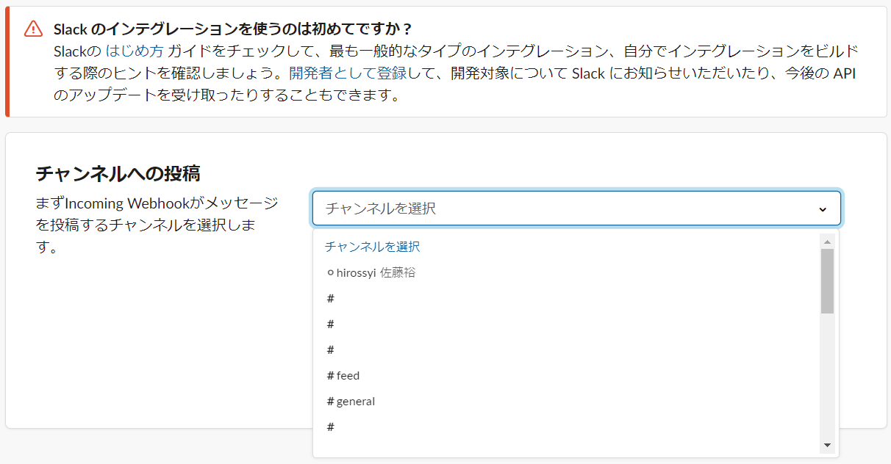

# Configuración para enviar notificaciones a un Webhook
Para enviar notificaciones a Slack o a Microsoft Teams, hace falta una «URL de Webhook». La URL de Webhook es una URL especial para recibir notificaciones.  
En esta página se explica cómo obtener la URL de Webhook y cómo configurar Slack para mencionar a una persona concreta.

| Qué quiere hacer | Dónde mirar |
|---|---|
| Notificar a Slack | [Cómo obtener la URL en Slack](/es/notify_webhook?id=Cómo-obtener-la-URL-en-Slack) |
| Notificar a Microsoft Teams | [Cómo obtener la URL en Microsoft Teams](/es/notify_webhook?id=Cómo-obtener-la-URL-en-Microsoft-Teams) |
| Mencionar a un usuario en las notificaciones de Slack | [Cómo configurar el ID de Slack](/es/notify_webhook?id=Cómo-configurar-el-ID-de-Slack) |

## Cómo obtener la URL en Slack
1. Abra la siguiente URL.  
https://slack.com/services/new/incoming-webhook  

2. Elija el canal de destino de las notificaciones.  
Después, haga clic en «Añadir integración con Incoming Webhook».  
  

3. Se crea la URL de Webhook. Cópiela.  
  

4. Pegue la URL de Webhook copiada en la configuración de notificaciones de Exment.

## Cómo obtener la URL en Microsoft Teams
1. Abra Teams y haga clic en «Administrar equipo» del equipo al que quiere notificar.  
  

2. Haga clic en la pestaña «Aplicaciones».  

3. Haga clic en la pestaña «Más aplicaciones».  

4. Haga clic en «Incoming Webhook».  

5. Haga clic en «Instalar».  

6. Elija el canal al que se notificará. Después, haga clic en «Configurar».  

7. Escriba el nombre que se usará en las notificaciones y haga clic en «Crear».  

8. Se crea la URL del Webhook. Copie la URL y haga clic en «Listo».  

9. Pegue la URL de Webhook copiada en la configuración de notificaciones de Exment.

## Cómo configurar el ID de Slack
Esta configuración sirve para mencionar a una persona concreta en Slack (una mención es una llamada dirigida a esa persona).  
Cree una columna para guardar el ID de Slack de cada usuario y elija esa columna en la configuración del sistema. Hágalo solo 1 vez, al principio.

1. En la configuración de [tablas personalizadas](/es/table), haga clic en el enlace «Configuración de columnas personalizadas» de la tabla «Usuario».  
 

2. En la configuración de [columnas personalizadas](/es/column) de la tabla de usuarios, añada la siguiente columna personalizada.
    - Nombre de la columna (alfanumérico), Nombre visible de la columna: el nombre que quiera
    - Tipo de columna: «Texto de una línea»

     

3. En «Configuración detallada» de la pantalla de [Configuración del sistema](/es/system_setting), elija en «Columna del ID de Slack (usuario)» la columna del ID de Slack que acaba de añadir.  
 

4. En la pantalla de edición de los datos de usuario, escriba el ID de Slack de cada usuario. Cuando se notifique a ese usuario, se añadirá la mención.  
※ Para saber cómo comprobar el ID de usuario en la pantalla de Slack, consulte [esta página](https://auto-worker.com/blog/?p=27).  
 

Con esto, desde la pantalla de configuración de notificaciones se puede mencionar el ID de Slack escrito en los datos de usuario.  
En la pantalla de configuración de notificaciones, los destinatarios se muestran de otra forma, como sigue. (Arriba: sin la configuración del ID de Slack. Abajo: con la configuración.)

 
 

