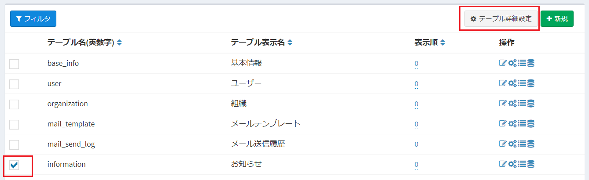

# Configuración de actualización masiva
Es la configuración para reescribir de una vez los valores de los datos cuando se produce un desencadenante decidido de antemano, como "al hacer clic en un botón" o "al crear un dato nuevo".  
Por ejemplo, se puede usar así.  

- Mostrar un botón "Completar" en la pantalla de detalles de datos de la tabla "Información de tareas" y, al hacer clic, poner en completado el valor de la columna personalizada "Estado".
- Al actualizar un dato, poner automáticamente el usuario con sesión iniciada como valor de la columna personalizada "Responsable".

El flujo de configuración es el siguiente.

1. Abrir la pantalla de configuración de actualización masiva ("Pantalla de configuración")
2. Desde [Nuevo], decidir cuándo (el momento de la actualización), qué columna y qué valor, y guardar ("Añadir" y "Detalle de los campos")
3. La actualización se hace en el momento decidido ("Ejecución de la actualización")

> En las versiones anteriores a v3.5.0, esta función se llamaba "Actualización masiva de datos". Desde v3.5.0 se ampliaron sus funciones.  
Si quiere actualizar con condiciones o contenidos más complejos, cree un [plugin (botón)](/es/plugin_quickstart_button) o un [plugin (evento)](/es/plugin_quickstart_event).

## Tipos de momento de la actualización

- ##### Al pulsar el botón en la página de lista (registros marcados)

  

Se añade un botón a la pantalla de lista de datos.  
Al marcar las casillas de la lista y hacer clic en el botón, los datos marcados se actualizan con el contenido configurado.

- ##### Al pulsar el botón en el detalle de los datos

  

Aparece un botón en la pantalla de detalles de datos.  
Al hacer clic en el botón, el dato se actualiza con el contenido configurado.

- ##### Al crear datos nuevos
Cuando un usuario crea un dato nuevo desde la pantalla, la API, una importación, etc., el dato se actualiza con el contenido configurado.

- ##### Al actualizar datos
Cuando un usuario actualiza un dato desde la pantalla, la API, una importación, etc., el dato se actualiza además con el contenido configurado.

## Pantalla de configuración
1. En la lista de tablas personalizadas, marque una sola tabla (la que quiere configurar) y haga clic en "Configuración detallada de la tabla", arriba a la derecha.  

  

- O bien elija en el menú la tabla que quiere configurar y, del mismo modo, haga clic en "Configuración detallada de la tabla", arriba a la derecha.  
Nota: esa tabla debe estar añadida al menú de antemano.  

  

2. Después, abra "Configuración de actualización masiva" de esa tabla personalizada.

  

3. Aparece la pantalla de configuración de actualización masiva.

  

## Añadir
1. En la pantalla "Configuración de actualización masiva", haga clic en el botón [Nuevo], arriba a la derecha de la página.

2. Aparece la pantalla para añadir una configuración de actualización masiva. Introduzca los datos necesarios.

  

## Guardar
Cuando haya introducido la configuración, haga clic en [Enviar].

## Editar
Para editar una configuración de actualización masiva, haga clic en el enlace [Editar] de su fila.  

## Eliminar
Para eliminar una configuración de actualización masiva, haga clic en el enlace [Eliminar] de su fila.  

## Detalle de los campos

### Configuración básica

  

- ##### Nombre del proceso
Es el nombre de esta configuración de actualización masiva.

- ##### Momento de la actualización
Elija cuándo se actualizan los datos.  
Consulte "Tipos de momento de la actualización", en la parte superior de esta página, y elija.

- ##### Etiqueta del botón
Es el texto que aparece en el botón de la pantalla.  
Nota: solo aparece cuando "Momento de la actualización" es "Al pulsar el botón en la página de lista (registros marcados)" o "Al pulsar el botón en el detalle de los datos".

- ##### Icono del botón
Es el icono que aparece en el botón de la pantalla.  
Nota: solo aparece cuando "Momento de la actualización" es "Al pulsar el botón en el detalle de los datos".

- ##### Clase HTML del botón
Es la clase HTML que se añade al botón de la pantalla.  
Nota: solo aparece cuando "Momento de la actualización" es "Al pulsar el botón en el detalle de los datos".

- ##### Mostrar el botón en datos bloqueados por el flujo de trabajo
Normalmente, en los datos cuyo estado del flujo de trabajo es "datos no editables" no se muestra el botón en la pantalla de detalles de datos.  
Con YES, el botón también se muestra en esos datos. El valor predeterminado es NO.  
El botón solo aparece para los usuarios con permiso para editar ese dato.  
Nota: solo aparece cuando "Momento de la actualización" es "Al pulsar el botón en el detalle de los datos".

- ##### Activo
Para detener temporalmente una configuración de actualización masiva, o para guardar de momento una configuración a medio hacer, ponga "Activo" en NO.  

### Configuración de columnas a actualizar

  

Configure las columnas que se actualizan y los valores de actualización.  

- ##### Columna de destino
Elija la columna que se actualiza.  

- ##### Tipo de actualización
Cuando el tipo de la columna personalizada de destino es "Fecha", "Hora", "Fecha y hora", "Usuario" u "Organización", se puede elegir entre "Valor fijo" y "Valor del sistema".  
En los demás casos, solo "Valor fijo".

- ##### Valor de actualización
    - Si el tipo de actualización es "Valor fijo", introduzca el valor que quiere poner.
    - Si el tipo de actualización es "Valor del sistema", aparecen las siguientes opciones según el tipo de la columna personalizada de destino.

| Tipo de la columna personalizada de destino | Opciones |
|---|---|
| "Fecha", "Hora", "Fecha y hora" | "Fecha y hora de ejecución" |
| "Usuario" | "Usuario con sesión iniciada", "Creado por" |
| "Organización" | "Organizaciones a las que pertenece" |

### Condiciones de actualización

  

Indique las condiciones de los datos en los que se puede ejecutar esta configuración de actualización. La actualización solo se puede ejecutar cuando se cumplen las condiciones.  
Nota: si no se configura ninguna condición, la actualización se puede ejecutar en todos los datos.  

### Configuración del cuadro de diálogo de entrada

  

Al ejecutar la actualización se muestra un cuadro de diálogo para poder introducir a mano el valor de actualización de la columna de destino.  
Nota: solo se puede elegir cuando "Momento de la actualización" es "Al pulsar el botón en la página de lista (registros marcados)" o "Al pulsar el botón en el detalle de los datos".

## Ejecución de la actualización
Cuando termina la configuración, la actualización se hace en el momento decidido en la opción "Momento de la actualización".  

### Contenido de la actualización
- El valor del dato pasa a ser el decidido en la opción "Configuración de columnas a actualizar".  
Pero si el tipo de actualización es "Valor del sistema", el valor es el siguiente.  

    - Si el valor de actualización es "Fecha y hora de ejecución", se pone la fecha y hora en que se ejecutó esa actualización
    - Si el valor de actualización es "Usuario con sesión iniciada", se pone el ID del usuario con sesión iniciada que ejecutó esa actualización
    - Si el valor de actualización es "Creado por", se pone el ID del usuario que creó ese dato
    - Si el valor de actualización es "Organizaciones a las que pertenece", se pone el ID de la organización a la que pertenece el usuario con sesión iniciada que ejecutó esa actualización  
    Nota: si el usuario con sesión iniciada pertenece a varias organizaciones y la columna que se actualiza no tiene la opción "Permitir selección múltiple", en el dato se guarda la primera organización.

- Si en la opción "Configuración del cuadro de diálogo de entrada" se ha elegido una columna de la tabla de destino, aparece un cuadro de diálogo para introducir el valor de actualización.  

  

    
### Condiciones de actualización
- En los datos que no cumplen las condiciones configuradas en "Condiciones de actualización" no se puede ejecutar la actualización.  
- Cuando "Momento de la actualización" es "Al pulsar el botón en la página de lista (registros marcados)", si se marcan datos que no cumplen las condiciones y se hace clic en el botón de actualización, aparece un error. En ese caso, tampoco se actualizan los demás datos que sí cumplían las condiciones.
