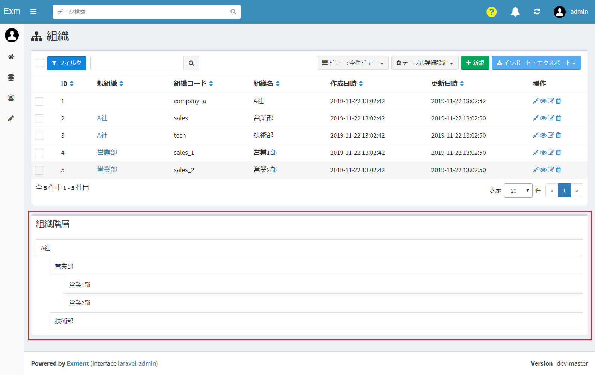

# Organización
En esta página se explica cómo registrar y gestionar en Exment las "organizaciones", como los departamentos y las secciones de una empresa.  
Si registra las organizaciones, puede decidir por organización los permisos, los formularios, los flujos de trabajo y el uso compartido de los datos.

> Antes de configurar las organizaciones, le recomendamos leer la página [Resumen de roles y permisos en Exment](/es/permission).

El contenido de esta página es el siguiente.

| Lo que quiere saber | Dónde mirar |
|---|---|
| Registrar, corregir o eliminar una organización | Gestión de organizaciones |
| Dónde se usan las organizaciones registradas | Dónde se usan las organizaciones |
| Hasta dónde se incluyen las organizaciones superiores e inferiores | Sobre la jerarquía de organizaciones |

## Gestión de organizaciones
Cómo registrar, editar y eliminar organizaciones.

### Mostrar la pantalla de lista
En el menú de la izquierda, haga clic en "Organización".  
O bien abra la siguiente URL.  
Así se muestra la pantalla de gestión de organizaciones.  
http(s)://(URL de Exment)/data/organization  
Se muestra la lista de las organizaciones registradas ahora en el sistema.
  

> ※La URL corresponde a la configuración estándar, sin "/admin" (sitios instalados de nuevo con la v7.2.1 o posterior). Si `ADMIN_ROUTE_PREFIX` del archivo `.env` tiene un valor (en los sitios instalados con una versión anterior es "admin"), añada ese valor después de la URL del sitio (ejemplo: `http(s)://(URL de Exment)/admin/data/organization`). Para más detalles, vea [Cambiar o quitar el "admin" de la URL](/es/additional_prefix).
  
※Si pone "EXMENT_SHOW_ORGANIZATION_TREE=true" en los [valores de configuración](/es/config), se muestra la jerarquía.

### Añadir una organización nueva
1. En la pantalla de lista de "Organización", haga clic en el botón [Nuevo], arriba a la derecha de la página.
2. Se muestra la pantalla de alta. Introduzca los datos necesarios.  
※En el elemento "Organización superior", elija el nivel superior de esa organización.

### Guardar
Cuando termine de introducir los datos, haga clic en [Enviar].

### Editar
Para corregir una organización, haga clic en el enlace [Editar] de su fila.  

### Eliminar
Para eliminar una organización, haga clic en el enlace [Eliminar] de su fila.  

## Dónde se usan las organizaciones
Las organizaciones registradas se pueden usar en los siguientes lugares.

| Lugar | Lo que se puede hacer |
|---|---|
| Grupo de roles | Decide si los usuarios que pertenecen a la organización pueden acceder a una página |
| Cambio entre varios formularios | Hace que los usuarios que pertenecen a la organización usen el formulario indicado |
| Flujo de trabajo | Los usuarios que pertenecen a la organización pueden ejecutar las acciones del flujo de trabajo |
| Uso compartido de datos personalizados | Los usuarios que pertenecen a la organización pueden editar y ver los datos compartidos |

#### Grupo de roles 
En un grupo de roles se puede poner una organización.

- Con este ajuste se controla si los usuarios que pertenecen a la organización pueden o no acceder a una página.  
En estas imágenes, la de arriba es el caso en que el usuario puede acceder, y la de abajo, el caso en que no puede.

#### Cambio entre varios formularios 
En las condiciones para cambiar entre varios formularios se puede poner una organización.  
Si el usuario que ha iniciado sesión pertenece a esa organización, se usa el formulario.

#### Flujo de trabajo 
En el ajuste de usuarios de trabajo del flujo de trabajo se puede poner una organización.  
Si el usuario que ha iniciado sesión pertenece a esa organización, puede ejecutar las acciones del flujo de trabajo.

#### Uso compartido de datos personalizados 
Como destino del uso compartido de un dato personalizado se puede poner una organización.  
Si el usuario que ha iniciado sesión pertenece a esa organización, recibe el permiso sobre el dato personalizado y puede editarlo y verlo.

## Sobre la jerarquía de organizaciones
En Exment, las organizaciones pueden tener una jerarquía de niveles superiores e inferiores, como en la figura de abajo.

### (Para usuarios avanzados) Tipos de jerarquía
Cuando las organizaciones tienen jerarquía, se elige entre los 4 tipos siguientes hasta dónde llegan "los usuarios que pertenecen a la organización".  
Aquí, como ejemplo, se explica tomando como base el "**Departamento de Ventas**".

| Tipo | Organizaciones incluidas | Ejemplo (con el Departamento de Ventas como base) |
|---|---|---|
| Organización a la que pertenece el usuario | Solo la organización indicada | Director de Ventas |
| Incluye las organizaciones de nivel superior | La organización indicada y sus organizaciones de nivel superior | Director de Ventas, Presidente de la empresa A |
| Incluye las organizaciones de nivel inferior | La organización indicada y sus organizaciones de nivel inferior | Director de Ventas, Usuario A de Ventas 1, Usuario B de Ventas 2 |
| Incluye las organizaciones de nivel superior e inferior | La organización indicada y sus organizaciones de nivel superior e inferior | Director de Ventas, Presidente de la empresa A, Usuario A de Ventas 1, Usuario B de Ventas 2 |

#### Organización a la que pertenece el usuario

Solo los usuarios que pertenecen a la propia organización indicada.  
En el ejemplo, al Departamento de Ventas solo pertenece el "Director de Ventas".

#### Incluye las organizaciones de nivel superior

La organización indicada y sus organizaciones de nivel superior.  
En el ejemplo, corresponden el "Director de Ventas", que pertenece al Departamento de Ventas, y el "Presidente de la empresa A", que pertenece a la "Empresa A", su nivel superior.

#### Incluye las organizaciones de nivel inferior

La organización indicada y sus organizaciones de nivel inferior.  
En el ejemplo, corresponden el "Director de Ventas", que pertenece al Departamento de Ventas, y el "Usuario A de Ventas 1" y el "Usuario B de Ventas 2", que pertenecen a "Ventas 1" y "Ventas 2", sus niveles inferiores.

#### Incluye las organizaciones de nivel superior e inferior

La organización indicada y sus organizaciones de nivel superior e inferior.  
En el ejemplo, corresponden el "Director de Ventas", que pertenece al Departamento de Ventas; el "Presidente de la empresa A", que pertenece a la "Empresa A", su nivel superior; y el "Usuario A de Ventas 1" y el "Usuario B de Ventas 2", que pertenecen a "Ventas 1" y "Ventas 2", sus niveles inferiores.

<h4 id="kaisou_syurui">(Para usuarios avanzados) Configurar el tipo de jerarquía</h4>

Hasta dónde se incluye la jerarquía se configura en "Configuración del sistema" > "Configuración de organizaciones".

- La jerarquía solo se puede configurar para "Grupo de roles" y "Uso compartido de datos personalizados".
- En "Configuración de condiciones de visualización del formulario" y "Flujo de trabajo", solo cuenta la organización a la que pertenece el usuario.

### Configuración del uso compartido de datos
Con la [configuración del uso compartido de datos personalizados](/es/data_details), otras organizaciones también pueden acceder a ese dato.

#### Alcance al compartir datos personalizados
- Si comparte un dato con una organización, pueden acceder los usuarios que pertenecen a esa organización.
- Que puedan acceder o no los usuarios de las organizaciones superiores e inferiores depende de "Configurar el tipo de jerarquía > Jerarquía de organizaciones (datos)", explicado arriba.
- Las organizaciones de otra rama no pueden acceder.

<h4 id="kyouyu_jidou">(Para usuarios avanzados) Uso compartido automático al guardar datos</h4>

Al crear un dato personalizado nuevo, el dato creado recibe automáticamente una configuración de uso compartido.

- De forma estándar, la configuración de uso compartido se añade solo para el "usuario con acceso".
- Si cambia el ajuste, la configuración de uso compartido se añade también para la organización a la que pertenece el usuario con acceso.
- Este ajuste se hace en "Configuración del sistema" > "Configuración de organizaciones".

El contenido de cada ajuste es el siguiente.

##### (1) Solo el usuario con acceso
Al crear un dato personalizado nuevo, se comparte solo con el usuario con acceso.  
- **Ejemplo**: cuando el "Usuario A de Ventas 1" crea un dato nuevo, solo puede acceder el usuario "Usuario A de Ventas 1".  

##### (2) El usuario con acceso y su organización
Al crear un dato personalizado nuevo, se comparte con el usuario con acceso y con **la organización a la que pertenece**.  
- **Ejemplo**: cuando el "Usuario A de Ventas 1" crea un dato nuevo, se comparte con el usuario "Usuario A de Ventas 1" y con la organización "Ventas 1".  
→ Como resultado, también puede acceder el usuario "Usuario B de Ventas 1", que pertenece a la organización "Ventas 1".

