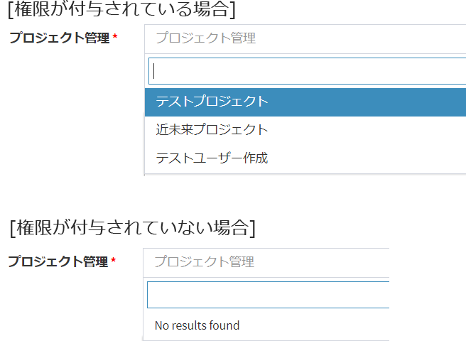

# Resumen de roles y permisos
Esta página explica en líneas generales los roles y permisos de Exment.  
Los permisos son una idea importante: sirven para que solo los usuarios decididos puedan actuar (hacer acciones) sobre determinados datos y páginas.

- Con la configuración inicial, un usuario recién añadido no puede usar casi ninguna función aunque inicie sesión.  
- El administrador del sistema tiene que configurar los roles y permisos adecuados para los usuarios añadidos.

Los permisos se gestionan en las 3 unidades siguientes. Para más detalles, consulte "Unidades de gestión de permisos", más abajo.

| Unidad | Qué se puede decidir (ejemplos) | Dónde se configura |
|---|---|---|
| (1) Todo el sistema | Cambiar el nombre del sitio, gestionar los usuarios con acceso | "Administrador del sistema" en la [Configuración del sistema](/es/system_setting), "permisos de sistema" en [Grupo de roles](/es/role_group) |
| (2) Por tabla | Cambiar la configuración de esa tabla, editar y ver los datos de la tabla | [Configuración de la tabla](/es/table), "permisos de tabla" en [Grupo de roles](/es/role_group) |
| (3) Por dato | Editar y ver solo determinados datos | "Compartir" en la [pantalla de detalle de datos](/es/data_details), etc. |  

## Usar o no los permisos
Si no va a usar la configuración de permisos, cambie "Usar la gestión de permisos" a No en la [Configuración del sistema](/es/system_setting).  
Si no se usa, todos los usuarios pueden hacer todas las acciones.  

## Diferencias según se tenga o no permiso (ejemplos)
Según se tenga o no permiso, cambian las acciones que puede hacer el usuario y lo que aparece en la pantalla.

##### ■Solo aparecen los menús con permiso
→En el menú del usuario con sesión iniciada aparecen solo los elementos sobre los que tiene permiso.  

##### ■Se produce un error de acceso  
→Al intentar abrir una página sin permiso, se produce un error de acceso.

##### ■No aparecen elementos en las opciones del formulario de datos  
→Si la columna es de tipo "Selección (desde tabla)" y no se tiene permiso sobre la tabla de referencia, las opciones no aparecen.  

## Unidades de gestión de permisos
En Exment, los permisos se gestionan principalmente en las 3 unidades siguientes.

- Todo el sistema
- Por tabla
- Por dato

### Esquema general

### (1) Todo el sistema

Son los permisos para actuar sobre la configuración del sistema de Exment.  
Por ejemplo, acciones como las siguientes.  

- Cambiar el nombre del sitio.
- Gestionar los usuarios con acceso.
- Crear, editar, ver, etc. todas las tablas.

#### Cómo se configuran los permisos

##### Configuración del administrador del sistema
En la [Configuración del sistema](/es/system_setting) se puede añadir y cambiar el "Administrador del sistema". El "Administrador del sistema" puede hacer todas las acciones del sistema.

##### Otras configuraciones del sistema
Los usuarios que no son administradores del sistema también pueden actuar sobre todo el sistema si se les asigna un [grupo de roles](/es/role_group).  
Los permisos para las acciones del sistema se añaden y cambian como "permisos de sistema" en [Grupo de roles](/es/role_group).

### (2) Por tabla

Son los permisos de las tablas creadas en Exment.  
Los permisos se configuran para cada tabla. Según lo configurado, cambian las acciones que puede hacer cada usuario.  
Un usuario sin ningún permiso sobre una tabla no puede abrir ninguna página de esa tabla.  
  
Por ejemplo, acciones como las siguientes.  

- Cambiar la configuración de esa tabla, como añadir columnas.
- Poder editar todos los datos de la tabla.
- Poder ver todos los datos de la tabla y editar los datos de los que uno es responsable.
- Poder ver los datos de la tabla de los que uno es responsable.

#### Cómo se configuran los permisos

##### Configuración para todos los usuarios a la vez
Se dan permisos de edición, de visualización, etc. a todos los usuarios, sin importar el rol, la organización, etc. Se aplica a todos los datos de la tabla. Se puede cambiar en la [Configuración de la tabla](/es/table).

##### Otras configuraciones de la tabla
Para dar permisos distintos a cada usuario, se usan los [grupos de roles](/es/role_group).  
Los permisos para las acciones de la tabla se añaden y cambian como "permisos de tabla" en [Grupo de roles](/es/role_group).

### (3) Por dato

Son los permisos de cada dato.  
Al dar permisos por dato, se pueden hacer usos detallados, como "no quiero mostrar todos los datos, sino solo determinados datos".  
Por ejemplo, acciones como las siguientes.

- Editar determinados datos.
- Ver determinados datos.

#### Cómo se configuran los permisos

##### Comportamiento básico al crear un dato
Cuando un usuario guarda un dato, ese usuario recibe automáticamente el permiso de edición de ese dato. (El usuario no tiene que hacer nada.)

##### Al crear un dato, añadir también permisos a la organización del creador
El dato se puede compartir automáticamente no solo con el usuario que lo creó, sino también con la organización a la que pertenece ese usuario.  

- Ejemplo: los datos creados por un usuario del departamento de ventas se comparten automáticamente con todos los del departamento de ventas

Para saber cómo se configura, consulte [Configuración de organizaciones](/es/organization).

##### Añadir permisos a mano más tarde (compartir)
Los datos ya creados se pueden compartir con otros usuarios. El permiso se elige entre ver y editar.  
Elija "Compartir" en la [pantalla de detalle de datos](/es/data_details).

  

##### Al crear o actualizar un dato, añadir también permisos a los usuarios y organizaciones puestos en una columna
En Exment se pueden añadir columnas personalizadas de tipo "Usuario" y "Organización".  
Al crear o actualizar un dato desde la pantalla o la API, el dato se puede compartir automáticamente con los usuarios y organizaciones que están en esas columnas "Usuario" y "Organización".  

- Ejemplo: al usuario puesto en la columna "Responsable" de la tabla "Gestión de tareas" se le da automáticamente el permiso de edición de ese dato al guardarlo

Para saber cómo se configura, consulte "Configuración de uso compartido automático de datos" en [Configuración de la tabla](/es/table).

#### Velocidad de visualización en tablas con muchos datos
Para un usuario que ve los datos por permisos por dato (datos compartidos), cada vez que se abre la pantalla de lista se comprueba dato por dato "qué datos puede ver". Por eso, si **los datos que ve por datos compartidos son muchísimos** (ejemplo: decenas de miles), la visualización tarda, sobre todo en **la lista sin filtros**.  
(Ejemplo de medición con v7.1.0: en una tabla de 90 000 datos, para un usuario que ve los 90 000 por datos compartidos, la lista sin filtros tarda unos 1.3 segundos. Para un usuario con permiso para ver todos los datos, unos 0.4 segundos.)

A los usuarios a los que quiere mostrar **todos** los datos de una tabla, deles "Ver todos los datos" (o "Editar todos los datos") en los "permisos de tabla" de [Grupo de roles](/es/role_group), en lugar de compartir datos. Ya no hace falta comprobar los datos uno por uno y la visualización es más rápida.

Nota: al dar "Ver todos los datos", se pueden ver **todos los datos de esa tabla, incluidos los que se añadan en adelante**. Si quiere mostrar solo una parte de los datos, siga usando los datos compartidos, como hasta ahora.

## Configuración de organizaciones y usuarios
Es un resumen de la configuración de organizaciones y usuarios de Exment.  

#### Usar o no las organizaciones
Si no va a usar la configuración de organizaciones, cambie "Usar la gestión de organizaciones" a No en la [Configuración del sistema](/es/system_setting).

#### Configuración de la jerarquía de organizaciones
En Exment, las organizaciones se pueden gestionar por jerarquía.  

Al hacer una [Configuración de roles](/es/role_group) o compartir datos con una organización, se puede indicar si se incluyen "padres e hijos", "padres" o "hijos" de la jerarquía de organizaciones.  
Para saber cómo se configura, consulte [Configuración de organizaciones](/es/organization).

#### Alcance de la obtención de información de usuarios y organizaciones de otras organizaciones
Cuando Exment se usa como un portal interno de la empresa, no es un gran problema que otros usuarios vean "qué usuarios lo usan" o "qué organizaciones y empresas están registradas".

Pero cuando Exment lo usan también usuarios de fuera de la empresa, puede ser un problema que se pueda obtener y ver la información de usuarios de otras empresas.

  
Con la [configuración para portales externos](/es/multiuser) se puede limitar la obtención y la visualización de la información de usuarios de otras empresas.

## Páginas relacionadas
- [Configuración del sistema](/es/system_setting)
- [Configuración de roles](/es/role_group)
- [Pantalla de detalle de datos](/es/data_details)
- [Configuración de organizaciones](/es/organization)
- [Configuración para portales externos](/es/multiuser)
