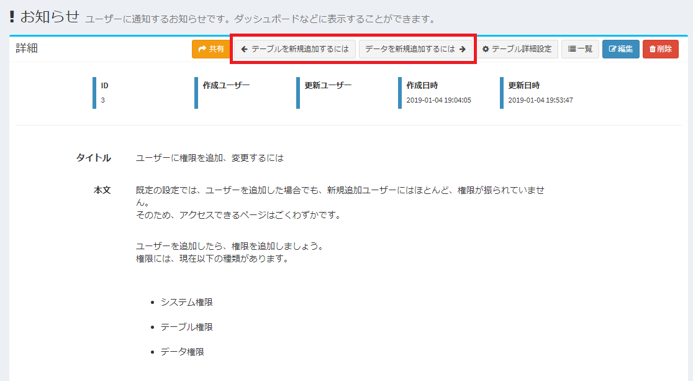
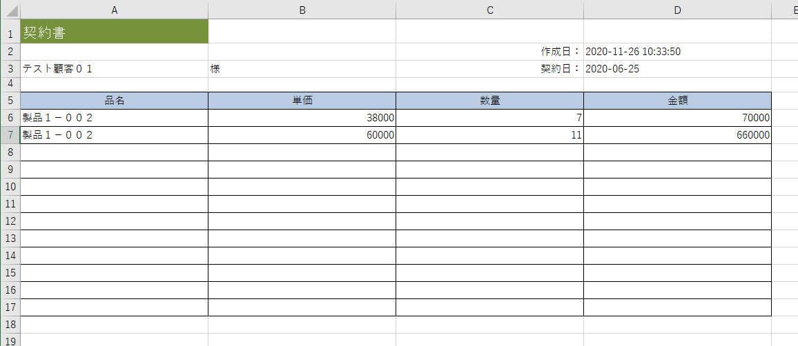

# Plugin
Un plugin es un programa que añade funciones a Exment.
En esta página se explican los tipos de plugin y cómo cargarlos, configurarlos, eliminarlos y darles permisos.

- Si quiere saber enseguida cómo instalarlos, vea "[Cómo administrarlos](/es/plugin?id=Cómo-administrarlos)".
- Para los plugins oficiales creados por Exceed One, vea [Plugins oficiales](/es/plugin_official).
- Si va a crear un plugin usted mismo, vea [Cómo crear un plugin](/es/plugin_quickstart).

## Qué es un plugin
Cuando las funciones estándar de Exment no bastan para el trabajo, se puede cargar un programa (archivo zip) desde la pantalla para añadir funciones. Eso es un "plugin".  
Actualmente hay los tipos de plugin siguientes.    

- [Botón](/es/plugin?id=Botón)
- [Evento](/es/plugin?id=Evento)
- [Página](/es/plugin?id=Página)
- [Panel](/es/plugin?id=Panel)
- [Vista](/es/plugin?id=Vista)
- [Página CRUD](/es/plugin?id=Página-CRUD)
- [Lote](/es/plugin?id=Lote)
- [API](/es/plugin?id=API)
- [Validación](/es/plugin?id=Validación)
- [Script](/es/plugin?id=Script)
- [Estilo](/es/plugin?id=Estilo)
- [Importación](/es/plugin?id=Importación)
- [Exportación](/es/plugin?id=Exportación)
- [Salida de documentos](/es/plugin?id=Salida-de-documentos)
- [Docurain (salida en PDF)](/es/plugin?id=docurain)
- [Disparador (no recomendado)](/es/plugin?id=Disparador)

#### Botón
Se puede añadir un botón a la pantalla de lista o a la pantalla de formulario de Exment y ejecutar un proceso al pulsarlo.  
Nota: para la forma de implementarlo, vea [aquí](/es/plugin_quickstart_button).  
  
El botón se puede mostrar en los 4 lugares siguientes.    
##### Botón de menú en la vista de lista
Añade un botón en la parte superior de la pantalla de lista de datos y lanza un evento al pulsarlo.

##### Botón de menú en el detalle de datos
Añade un botón en la parte superior de la pantalla de detalles del dato y lanza un evento al pulsarlo.

##### Botón de menú del formulario (al crear)
Añade un botón en la parte superior de la pantalla de creación de datos y lanza un evento al pulsarlo.

##### Botón de menú del formulario (al editar)
Añade un botón en la parte superior de la pantalla de actualización de datos y lanza un evento al pulsarlo.

   

#### Evento
Se ejecuta cuando se hace una operación concreta en las pantallas de Exment y puede hacer procesos como actualizar valores.  
Nota: para la forma de implementarlo, vea [aquí](/es/plugin_quickstart_event).  
  
Las operaciones concretas son las siguientes.    

- ##### Antes de cargar la pantalla  
El proceso se inicia al principio de la carga de la página. (No va antes de todos los procesos)  

- ##### Antes de guardar  
El proceso se inicia justo antes de guardar el dato.  

- ##### Después de guardar  
El proceso se inicia después de guardar el dato.  

- ##### Después de eliminar  
El proceso se inicia después de eliminar el dato.  

- ##### Antes de la acción del flujo de trabajo  
El proceso se inicia justo antes de ejecutar el flujo de trabajo.  

- ##### Después de la acción del flujo de trabajo  
El proceso se inicia después de ejecutar el flujo de trabajo.  

- ##### Antes de la notificación  
El proceso se inicia justo antes de ejecutar la notificación.  

- ##### Después de la notificación  
El proceso se inicia después de ejecutar la notificación.  

#### Página
Se puede crear una pantalla nueva en Exment.  
Úselo cuando quiera una página totalmente distinta de las funciones estándar.  
Nota: para la forma de implementarlo, vea [aquí](/es/plugin_quickstart_page).    

   

#### Panel
Se puede crear una pantalla nueva en el panel de Exment.  
Úselo cuando quiera usar una página propia como elemento del panel. 
Nota: para la forma de implementarlo, vea [aquí](/es/plugin_quickstart_dashboard).

   

#### Vista
Se puede crear y añadir un diseño nuevo o una función propia a la pantalla de lista de datos personalizados de Exment.  
Úselo cuando quiera una función totalmente distinta de las vistas estándar: lista, resumen y calendario.  
Nota: para la forma de implementarlo, vea [aquí](/es/plugin_quickstart_view).  

   

#### Página CRUD
Crea una página nueva con casi la misma estructura de pantallas que la lista, los detalles, la creación, la actualización y la eliminación de Exment.  
Permite administrar datos externos en las pantallas de Exment sin importarlos a Exment. También admite varios endpoints.    
Nota: para la forma de implementarlo, vea [aquí](/es/plugin_quickstart_crud).  

   

#### Lote
Se puede usar cuando se quiere ejecutar automáticamente un proceso periódico.  
También se puede usar para ejecutar de una vez un proceso concreto, como la actualización en bloque de estados.    
Nota: para la forma de implementarlo, vea [aquí](/es/plugin_quickstart_batch).

#### API
Se puede crear una API nueva en Exment.  
Úselo para añadir funciones que no existen en la [referencia de la API](https://exment.net/reference/ja/webapi.html) (japonés).  
Nota: para la forma de implementarlo, vea [aquí](/es/plugin_quickstart_api).

#### Script
Se puede ejecutar un script propio (javascript).  
Actualmente se admite al mostrar la pantalla de lista de datos, la pantalla de detalles del dato, la pantalla de creación de datos y la pantalla de actualización.  
Nota: para la forma de implementarlo, vea [aquí](/es/plugin_quickstart_script).

   

#### Estilo
Se puede configurar un estilo propio (hoja de estilos, css) y cambiar el diseño.  
Nota: para la forma de implementarlo, vea [aquí](/es/plugin_quickstart_style).

   

#### Validación
Se puede usar cuando se quiere implementar una validación propia (comprobación de los valores introducidos) de una tabla personalizada.  
Úselo para implementar comprobaciones complejas o comprobaciones de la relación entre campos.    
Nota: para la forma de implementarlo, vea [aquí](/es/plugin_quickstart_validate).

   

#### Importación
Se puede usar cuando se quiere implementar un proceso propio de importación de datos personalizados.  
Úselo para importar archivos de un formato original o para implementar conversiones especiales.  
Nota: para la forma de implementarlo, vea [aquí](/es/plugin_quickstart_import).

   

#### Exportación
Se puede usar cuando se quiere implementar una exportación propia de la lista de datos personalizados.  
Úselo para exportar archivos de un formato original o para implementar conversiones especiales.  
Además de Excel, también se puede exportar en otros formatos.  
Nota: para la forma de implementarlo, vea [aquí](/es/plugin_quickstart_export).

   

#### Salida de documentos
Se pueden crear documentos propios, como presupuestos o formularios impresos.  
La plantilla de origen está en formato Excel y la salida también es en formato Excel.    
Nota: para la forma de implementarlo, vea [aquí](/es/plugin_quickstart_document).
Nota: para la salida en formato PDF, considere el [plugin Docurain](/es/plugin_quickstart_docurain).  

   

<h4 id="docurain"><a href="#/es/plugin?id=docurain" data-id="Docurain (salida en PDF)" class="anchor">Docurain (salida en PDF)</a></h4>

Hace la salida en PDF con **Docurain**, un motor de informes en la nube que permite desarrollar informes solo con Excel y json.  
La plantilla de origen está en formato Excel y la salida es en formato PDF.    
Nota: para la forma de implementarlo, vea [aquí](/es/plugin_quickstart_docurain).

#### Disparador
Nota: no se recomienda desde v3.2.0.  
A partir de ahora, impleméntelo con "Botón" o "Evento".

## Plugins oficiales
Son los plugins oficiales, creados y mantenidos por Exceed One. Se pueden descargar de [exceedone/exment-plugins](https://github.com/exceedone/exment-plugins) en GitHub.  
Para la forma de instalarlos, vea [Plugins oficiales](/es/plugin_official).

| Plugin | Qué permite hacer |
| --- | --- |
| [Gestión de proyectos](/es/plugin_pm) | Gestión de proyectos e incidencias (tickets). Árbol de incidencias, hitos, tablero, diagrama de Gantt, Wiki, comentarios, notificaciones, etc. |
| [Mesa de soporte](/es/plugin_support_desk) | Mesa de ayuda. Gestiona con tickets las solicitudes por correo, formulario de recepción y teléfono, y comparte el avance con el cliente sin iniciar sesión |
| [Groupware](/es/plugin_groupware) | Correo web, y abrir y editar en el navegador los archivos de Office de Archivos compartidos |

## Cómo administrarlos
### Mostrar la página
- Elija "Plugin" en el menú de la izquierda.  
O acceda a la URL siguiente.  
http(s)://(URL de Exment)/plugin  
Aparece la pantalla de plugins.    
  

> Nota: la URL corresponde a la configuración estándar sin "/admin" (sitios instalados por primera vez con v7.2.1 o posterior). Si `ADMIN_ROUTE_PREFIX` de `.env` tiene un valor (en los sitios instalados con versiones anteriores es "admin"), añada ese valor después de la URL del sitio (ejemplo: `http(s)://(URL de Exment)/admin/plugin`). Para más detalles, consulte [Cambiar o eliminar el "admin" incluido en la URL](/es/additional_prefix).

### Carga de plugins
1. Pulse [Seleccionar archivo] y elija el archivo zip del plugin.
2. Pulse [Subir].
3. Al terminar, los datos del plugin aparecen en la lista de la parte inferior de la página.

    

### Configuración de plugins
Aquí se cambian datos como la activación o desactivación del plugin, sus disparadores o la URI de la página.  
En la lista, pulse el enlace [Editar] de la fila del plugin que quiere cambiar.  
  

Aparece la página de configuración del plugin.    
  

### Campos de configuración

##### Activo
Cambia si ese plugin se usa en el sistema o no.  
Con SÍ, queda activado. Con NO, queda desactivado y no se ejecuta en el sistema.    
Nota: al cargar un plugin, el valor predeterminado es SÍ. Sin embargo, si el tipo de plugin es "Lote", al cargarlo el valor predeterminado es NO.

##### Tabla de destino
Indica la tabla personalizada sobre la que se ejecuta el plugin.  
El plugin se ejecuta cuando se muestra una página de la tabla configurada.  

##### Disparador de ejecución
Configura con qué operación se ejecuta el plugin.
El plugin se ejecuta cuando se hace la operación configurada.    

##### Etiqueta
Configura el texto que se muestra en el botón cuando se muestra el "Botón de menú en la vista de lista" o el "Botón de menú del formulario".

##### Icono del botón
Configura el icono que se muestra en el botón cuando se muestra el "Botón de menú en la vista de lista" o el "Botón de menú del formulario".

##### Clase del botón
Configura la class que se añade al HTML del botón cuando se muestra el "Botón de menú en la vista de lista" o el "Botón de menú del formulario".

## Eliminar un plugin
Para eliminar un plugin, pulse el enlace [Eliminar] de la fila de ese plugin en la pantalla de lista.  
  
Nota: con [Eliminar] se eliminan los propios archivos del plugin.  
Si solo quiere detenerlo temporalmente, no lo elimine: ponga "Activo" en NO.    

## Gestión de roles y permisos

Con los permisos se puede separar a los usuarios y organizaciones que pueden cambiar la configuración de un plugin de los que pueden usarlo.  
Por ejemplo, se pueden hacer configuraciones como las siguientes.

- Solo un departamento o unos superiores concretos pueden acceder a la página del plugin
- Solo un departamento o unos superiores concretos pueden hacer la salida de documentos

### Cómo gestionarlos

#### Gestión con grupos de roles
- Acceda a la página de [grupos de roles](/es/role_group).  
- En el apartado de configuración de permisos de plugins, configure los permisos del plugin que quiere gestionar.  

  

##### Lista de permisos
- **Gestionar configuración**: en los plugins que tienen configuración, se puede cambiar la configuración de este plugin.  
Nota: no se puede eliminar ni cargar el plugin. Para eliminarlo, añada "Gestionar plugins".
- **Acceso**: se puede usar realmente el plugin o acceder a su página. Lo que se controla depende del tipo de plugin.    
    - **Botón, Salida de documentos**: se controla si el botón se muestra o no en la pantalla.
    - **Página, Panel**: cambia si se puede acceder a la página o no.
    - **API**: cambia si se puede ejecutar la API o no. (Si no se puede acceder, se produce un error 403.)
    - **Importación, Exportación**: se controla si se puede ejecutar la importación o la exportación de datos.
    - **Los demás**: no se pueden controlar con grupos de roles. Se ejecutan para todos los usuarios.
    
#### Gestión individual del plugin
Es la forma de dejar que todos los usuarios usen ese plugin sin usar grupos de roles.

- Abra la pantalla de edición del plugin.

- Ponga "Disponible para todos los usuarios" en SÍ y guarde.    
(El campo solo aparece cuando el tipo de plugin es Botón, Salida de documentos, Página, Panel, API, Importación o Exportación.)

  

- Sea cual sea la configuración de los grupos de roles, todos los usuarios pueden usar ese plugin y acceder a él.  

> Por compatibilidad con versiones anteriores, en los plugins cargados con versiones anteriores a v3.2.0 este "Disponible para todos los usuarios" está en SÍ.  
En los plugins cargados con v3.2.0 o posterior, el valor predeterminado es NO.

## Otros
Para la forma de desarrollar plugins, vea [Cómo crear un plugin](/es/plugin_quickstart).
