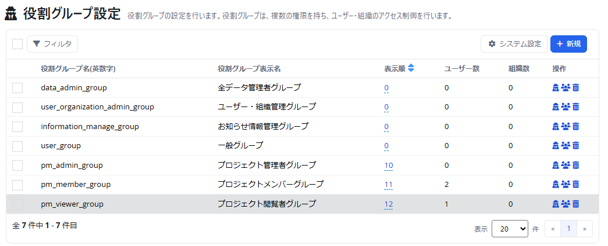

# Gestión de proyectos (plugin oficial)

"Gestión de proyectos" (「プロジェクト管理」) es un **plugin oficial** de Exment, creado, probado y mantenido por Exceed One.  
Permite gestionar proyectos y tickets (incidencias) sobre las tablas de Exment. Es gratuito.

- Código fuente y explicación: [exceedone/exment-plugins (project-management)](https://github.com/exceedone/exment-plugins/tree/main/project-management)
- Licencia: GPL-3.0 (la misma que Exment)
- Página de presentación: [Gestión de proyectos (exment.net)](https://exment.net/en/project-management/) (inglés)
- Nombre que aparece en la lista de plugins: Exment Plugin PM（プロジェクト管理）. El nombre del zip y el nombre interno es `ExmentPM` (`PmPortal` hasta 1.2.0, `ExmentPluginPM` en 1.3.0).


?> Las pantallas de este plugin están solo en japonés. En esta página, los textos de la pantalla se escriben en japonés con su significado entre paréntesis; por ejemplo, 「設定」 (configuración).

## Qué permite hacer

| Función | Contenido |
| --- | --- |
| Proyectos | Cada proyecto reúne sus incidencias, su tablero, su diagrama de Gantt, su Wiki y sus archivos. Hay 3 tipos de miembros: administradores, miembros y lectores (se usan los grupos de roles de Exment). |
| Incidencias | Lista (filtros y filtros rápidos), árbol de incidencias madre e hijas, edición directa en la lista, actualización en bloque y archivos adjuntos. El cuerpo se escribe en Markdown y también se pueden pegar imágenes. Después de guardar, la lista y los detalles se vuelven a dibujar en el momento, sin recargar toda la página (desde 1.6.5). |
| Roles de una incidencia | Además del responsable, se pueden indicar el responsable secundario, el administrador y el revisor, y la dificultad (fácil, normal, difícil). En los detalles de la incidencia también aparece quien la abrió. El responsable secundario, el administrador y el revisor reciben los avisos de actualización igual que el responsable (desde 1.6.0). |
| Hitos | Gestión de las incidencias por hito y gráfico de trabajo pendiente (burndown). |
| Tablero y diagrama de Gantt | Muestra las incidencias en un tablero por estado o en un diagrama de Gantt. |
| Wiki y archivos | Los documentos del proyecto se comparten con la Wiki y con archivos. |
| Word, Excel y PowerPoint | Con 「表示」 (ver) en los archivos de las incidencias, los comentarios, la Wiki y el proyecto, se abren dentro de la pantalla sin descargarlos. Quien puede editar también puede editarlos y guardarlos ahí mismo (desde 1.7.0 y 1.7.1. Hacen falta [Groupware](https://github.com/exceedone/exment-plugins/tree/main/groupware) 0.4.0 o posterior y un navegador que admita WebGPU). Si no está instalado, se descargan como hasta ahora. |
| Comentarios | Se pueden escribir comentarios en las incidencias. Se puede indicar a qué usuarios avisar (mención) o pedir una comprobación (revisión). |
| Leído / no leído | Se ve quién ha leído una incidencia. Las incidencias que usted todavía no ha visto aparecen con color en la lista. |
| Notificaciones | Avisos con la campana de la pantalla, y correo al registrar una incidencia o un comentario o con el botón 「メールで知らせる」 (avisar por correo). El correo se envía con la configuración de correo de Exment. |
| Configuración | Desde ⚙ 設定 (configuración) se hacen la configuración del portal y la actualización de la estructura de datos. Los administradores del sistema pueden usar 「データ移行」 (migración de datos): exporta los proyectos a un ZIP con sus comentarios, su historial de cambios y sus archivos adjuntos, y los importa en otro Exment (primero solo se comprueba y después se escribe). En las incidencias importadas también aparecen la clave, la URL y el autor de la incidencia de origen, y los atributos personalizados (desde 1.5.0). |

## Requisitos
- Exment 7.0 o superior (PHP 8.2 o superior)
- Para usar la función de avisar por correo, hace falta la configuración del envío de correo de Exment ([Configuración del envío de correo](/es/mailsend_setting)). Si solo se usan los avisos de la campana, no hace falta ninguna configuración.
- Las pantallas están solo en japonés.

## Instalación
Nota: desde Exment v7.2.1, Gestión de proyectos llega junto con Exment. No hace falta descargar ni cargar nada: pulse "Usar (instalar)" en "Plugins oficiales gratuitos" de "Configuración de administración" → "Gestión de funciones". Después, pase a "[3. Configuración inicial](/es/plugin_pm?id=3.-Configuración-inicial)". Justo después de instalarlo desde la gestión de funciones, todavía no hay 「プロジェクト管理」 en el menú de la izquierda (aparece después de la configuración inicial). Para más detalles, vea [Plugins oficiales](/es/plugin_official).


### 1. Descarga
Descargue el zip más reciente desde [Releases](https://github.com/exceedone/exment-plugins/releases) de GitHub. No lo descomprima.

- La versión más reciente es `ExmentPM-(versión).zip`, dentro de "ExmentPM-v(versión)" en [Releases](https://github.com/exceedone/exment-plugins/releases).

Nota: no use el botón verde "Code → Download ZIP". Es el zip de todo el repositorio y Exment no puede leerlo.

Nota: si usa Exment SaaS (`*.exments.com`), no hace falta descargar nada. Vea [En Exment SaaS](/es/plugin_pm?id=En-Exment-SaaS).

### 2. Carga
- Inicie sesión en Exment como administrador del sistema.
- Abra "Configuración de administración" → "Plugin", elija el zip descargado en "Carga de plugins" y pulse "Subir". Para más detalles, consulte [Plugin](/es/plugin).


- Si "ExmentPM" aparece en la lista de abajo, la carga ha terminado. En este momento todavía no existen ni las tablas ni los menús.

### 3. Configuración inicial
- Como administrador del sistema, abra `/plugins/exment_pm` (en un sitio cuya URL lleva "/admin", `/admin/plugins/exment_pm`).
- Aparece la pantalla 「初期セットアップ」 (configuración inicial). Compruebe la lista de tablas que se van a crear y pulse 「テーブルを作成する」 (crear las tablas).


- Si ya existe una tabla con el mismo nombre, aparece en rojo. Si escribe 「テーブル名の接頭辞」 (prefijo del nombre de las tablas; ejemplo: `pm2_`), las tablas se crean con otro nombre. Los nombres que se ven en la pantalla no cambian.
- Al terminar, se abre el panel de Gestión de proyectos. En el menú de la izquierda se añade una entrada 「プロジェクト管理」 (desde 1.4.1). Normalmente se abre desde ahí.
- En la configuración inicial también se crea lo siguiente.
    - Grupos de roles: プロジェクト管理者グループ (grupo de administradores de proyectos), プロジェクトメンバーグループ (grupo de miembros de proyectos) y プロジェクト閲覧者グループ (grupo de lectores de proyectos)
    - Notificación: 課題の登録・更新通知 (aviso de registro y actualización de incidencias; campana)
    - Prioridades (至急 urgente, 高 alta, 中 media, 低 baja) y motivos de cierre (対応済み resuelta, 対応しない no se atenderá, 無効 no válida, 重複 duplicada, 再現しない no se reproduce, 保留 en espera)

Nota: la configuración inicial solo la puede hacer el administrador del sistema.  
Nota: no se crean proyectos ni incidencias de ejemplo.

## Primeros ajustes

La primera vez que se usa, configure en este orden.

1. Añadir a las personas que lo usan a los grupos de roles
2. Crear un proyecto
3. Añadir miembros al proyecto
4. Ajustar los estados, los tipos, etc. al proyecto (también se pueden usar tal cual)
5. Comprobar las notificaciones

### 1. Añadir a las personas que lo usan a los grupos de roles
Las personas que usan Gestión de proyectos tienen que estar en alguno de sus grupos de roles. A quien no está, no le aparece 「プロジェクト管理」 en el menú y, al abrirlo, ve 「権限がありません。」 (no tiene permiso). Los administradores del sistema pueden usarlo sin estar en ningún grupo.

En "Configuración de administración" → "Grupo de roles", añada usuarios u organizaciones a los grupos siguientes, creados en la configuración inicial. Para más detalles, vea [Grupos de roles](/es/role_group).

| Grupo de roles | Nombre (alfanumérico) | Qué permite hacer |
| --- | --- | --- |
| プロジェクト管理者グループ (grupo de administradores de proyectos) | `pm_admin_group` | Puede ver y modificar todos los proyectos e incidencias. También puede modificar las listas de estados, tipos, prioridades, etc. |
| プロジェクトメンバーグループ (grupo de miembros de proyectos) | `pm_member_group` | Puede añadir y editar incidencias en los proyectos en los que participa. |
| プロジェクト閲覧者グループ (grupo de lectores de proyectos) | `pm_viewer_group` | Solo puede ver los proyectos en los que participa. |



Nota: con solo añadir a alguien a un grupo de roles, no ve los proyectos. Haga también "3. Añadir miembros al proyecto".

### 2. Crear un proyecto
- En el panel de Gestión de proyectos, pulse 「＋プロジェクトの追加」 (añadir un proyecto). También está en el menú 「プロジェクト」 (proyectos) de la parte superior de la pantalla.
- Escriba 「プロジェクト名」 (nombre del proyecto) y 「プロジェクトキー」 (clave del proyecto), y pulse 「作成する」 (crear).
    - La clave del proyecto se pone delante del número de las incidencias (ejemplo: con `WEB`, `WEB-1`). Empieza por una letra mayúscula, solo admite letras mayúsculas, números y `_`, y tiene 32 caracteres como máximo.
    - Si elige 「親プロジェクト」 (proyecto padre), los proyectos se pueden organizar en niveles.


- Al crearlo, se abre la pestaña 「設定」 (configuración) de ese proyecto. Quien lo crea pasa a ser el jefe de proyecto (el responsable).

Nota: pueden crear proyectos las personas que pueden añadir datos a la tabla de proyectos (administradores del sistema, grupo de administradores de proyectos, etc.).

### 3. Añadir miembros al proyecto
En la pestaña 「設定」 (configuración) del proyecto → 「参加ユーザー」 (usuarios participantes), decida quién participa y pulse 「保存する」 (guardar).

| Campo | Contenido |
| --- | --- |
| プロジェクトマネージャ (jefe de proyecto) | Es el responsable del proyecto. Puede añadir y editar incidencias y cambiar la configuración del proyecto. |
| メンバー（編集） (miembros, edición) | Pueden añadir y editar incidencias. |
| 参照メンバー（閲覧） (miembros de consulta, lectura) | Solo pueden ver. |
| メンバー組織（編集）・参照組織（閲覧） (organizaciones miembro, edición / organizaciones de consulta, lectura) | Si se añade una organización (equipo), todas las personas de esa organización participan con el mismo permiso. |


- Las personas quitadas de la lista ya no pueden abrir ese proyecto (incluidas sus incidencias y su Wiki) desde el momento en que se guarda.
- Los administradores del sistema y las personas del grupo de administradores de proyectos pueden abrir todos los proyectos aunque no estén en esta lista.
- Pueden cambiar la configuración del proyecto el jefe de proyecto y las personas del grupo de administradores de proyectos (y los administradores del sistema).

### 4. Listas de estados, tipos, etc. (maestros)
Las listas de opciones que se eligen en las incidencias se pueden usar tal cual. Se pueden ajustar al proyecto los nombres, los colores y el orden.

| Lista | Se decide | Dónde se cambia | Valores iniciales |
| --- | --- | --- | --- |
| 状態 (estado) | Por proyecto | 「設定」 → 「状態」 del proyecto | 未対応 (sin atender), 処理中 (en curso), レビュー中 (en revisión), 処理済み (resuelta), 完了 (cerrada) |
| 種別 (tipo) | Por proyecto | 「設定」 → 「種別」 del proyecto | タスク (tarea), バグ (error), 要望 (petición), 改善 (mejora), その他 (otros) |
| カテゴリー (categoría) | Por proyecto | 「設定」 → 「カテゴリー」 del proyecto | (ninguno) |
| マイルストーン (hito) | Por proyecto | 「設定」 → 「マイルストーン」 del proyecto | (ninguno) |
| 優先度 (prioridad) | Común a todos los proyectos | ⚙ プロジェクト管理の設定 → 「課題の選択肢」 (opciones de las incidencias) | 至急 (urgente), 高 (alta), 中 (media), 低 (baja) |
| 完了理由 (motivo de cierre) | Común a todos los proyectos | ⚙ プロジェクト管理の設定 → 「課題の選択肢」 (opciones de las incidencias) | 対応済み (resuelta), 対応しない (no se atenderá), 無効 (no válida), 重複 (duplicada), 再現しない (no se reproduce), 保留 (en espera) |

- Si marca 「完了扱い」 (se trata como cerrada) en un estado, las incidencias de ese estado cuentan como "cerradas" en el gráfico de trabajo pendiente y al decidir si están fuera de plazo.
- Las filas que están en uso no se pueden eliminar.


**⚙ プロジェクト管理の設定** (configuración de Gestión de proyectos) se abre desde 「⚙ 設定」, arriba a la derecha de la pantalla de Gestión de proyectos. Es la pantalla de la configuración común a todos los proyectos y solo la pueden abrir los administradores del sistema (a los demás no les aparece 「⚙ 設定」).


### 5. Notificaciones
Hay 2 tipos de notificación: la campana de arriba a la derecha de la pantalla y el correo.

**Campana (llega sin hacer nada)**
- Cuando una incidencia se registra o se actualiza, o recibe un comentario, llega al responsable, a las personas de 「お知らせ先」 (a quién avisar) y a quien creó la incidencia. No llega a la persona que hizo el cambio.
- También llega a las personas elegidas en 「お知らせしたい人」 (personas a las que avisar) al escribir un comentario y a quienes siguen la incidencia (「ウォッチ」).
- Si en un comentario escribe `@` seguido del nombre de un miembro, llega a esa persona (mención).
- Si marca 「確認を依頼する」 (pedir comprobación), a las personas elegidas les llega un aviso con 「【確認依頼】」 (petición de comprobación). Cuando la otra persona pulsa 「確認しました」 (comprobado), llega a quien escribió el comentario.
- No llega a las personas que no tienen permiso para ver la incidencia.


**Correo (se elige al enviar)**  
El correo no se envía automáticamente. Se envía de una de estas dos formas.
- Marque 「メールでも知らせる」 (avisar también por correo) al registrar una incidencia o un comentario. A las personas que reciben la campana se les envía el mismo contenido también por correo.
- En la pantalla de la incidencia, con 「…その他」 (otros) → 「メールで知らせる」 (avisar por correo), elija a quién enviarlo y pulse 「送信」 (enviar). Solo se envía a las personas que tienen permiso para ver la incidencia. Lleva un extracto del cuerpo y el enlace a la incidencia.


- El correo se envía con la configuración del envío de correo de Exment. Haga antes la [configuración del envío de correo](/es/mailsend_setting).
- Si un usuario no tiene dirección de correo electrónico, no se le envía.
- La notificación de campana 「課題の登録・更新通知」 se puede ver en la pantalla de [configuración de notificaciones](/es/notify) de Exment.

### 6. Integración con IA y Git (solo si se usan)
Las dos están desactivadas al principio. Gestión de proyectos se usa con normalidad sin ellas.

**Relleno automático con IA**  
En la pantalla de la incidencia aparece el botón 「AI で自動入力」 (rellenar automáticamente con IA). Al pulsarlo, la IA rellena 「種別」 (tipo), 「カテゴリー」 (categoría) y 「優先度」 (prioridad) si están vacíos. Antes de guardar, una persona puede comprobarlos y corregirlos.
- La IA usa TypeSafe (un servicio externo). El asunto y los detalles de la incidencia se envían a los servidores de TypeSafe. Las direcciones de correo electrónico y los números de teléfono se ocultan antes de enviar.
- El administrador del sistema escribe la clave de API en 「AI 自動入力（TypeSafe）」, en la pantalla de configuración de "Configuración de administración" → "Plugin" → "Exment Plugin PM" (si existe la variable de entorno `TYPESAFE_KEY` del servidor, se usa esa).
- En 「設定」 → 「AI 自動入力」 del proyecto, marque 「AI 自動入力を使う」 (usar el relleno automático con IA) y guarde. Con 「接続テスト」 (prueba de conexión) se puede comprobar si conecta.
- Si activa 「担当者も自動入力する」 (rellenar también el responsable), también se rellena el responsable si está vacío. El responsable no lo elige la IA, sino una regla (el responsable predeterminado de la categoría y, si no lo hay, el miembro con menos incidencias sin cerrar).


**Repositorio Git**  
Para cada proyecto se pide la creación de un repositorio Git (Gitea o Forgejo) y se deja listo para usar.
- El administrador del servidor configura el destino de conexión del servidor Git en las variables de entorno del servidor (`PMPORTAL_GIT_PROVIDER`, `PMPORTAL_GIT_API_URL`, `PMPORTAL_GIT_API_TOKEN`, etc.). No se puede configurar desde la pantalla.
- En 「設定」 → 「Git リポジトリ」 del proyecto, pulse 「Git を有効にする」 (activar Git); el jefe de proyecto escribe 「リポジトリ名」 (nombre del repositorio) y pulsa 「リポジトリの作成をリクエスト」 (solicitar la creación del repositorio). Si el servidor Git no está configurado, se queda en 「作成待ち」 (pendiente de creación).
- Cuando el repositorio está creado, cada persona pulsa 「HTTP クローン用パスワードを発行」 (emitir contraseña para clonar por HTTP) y recibe su contraseña. La contraseña se muestra una sola vez.


## Cómo se usa
Esta sección describe las pantallas de 1.7.17. Al abrir un proyecto, aparecen las pestañas 「ホーム」 (inicio), 「ボード」 (tablero), 「課題」 (incidencias), 「ガントチャート」 (diagrama de Gantt), 「バーンダウン」 (burndown), 「Wiki」, 「ファイル」 (archivos) y 「設定」 (configuración). La Wiki, los archivos, los gráficos (diagrama de Gantt y burndown) y las incidencias madre e hijas se pueden desactivar en 「設定」 → 「利用する機能」 (funciones que se usan) del proyecto. Al desactivarlos solo se oculta la pestaña; los datos no se eliminan.

### Incidencias
**La lista (pestaña 「課題」)**
- La fila de arriba filtra por estado (「すべて」 todas, 「完了以外」 no cerradas y cada estado del proyecto, con su número).
- Los filtros rápidos de debajo reducen la lista a 期限切れ (fuera de plazo), 今日・明日 (hoy y mañana), 自分が作成 (creadas por mí), ウォッチ中 (en seguimiento), 未読 (no leídas) y 確認待ち (pendientes de comprobación).
- También se puede filtrar por palabra clave, responsable, tipo, hito, categoría, leídas o no leídas, prioridad y 「自分の課題」 (mis incidencias). Con 「検索条件を保存」 (guardar las condiciones de búsqueda), la lista se abre la próxima vez con las mismas condiciones. En 「保存した条件」 (condiciones guardadas) también se pueden guardar con un nombre.
- 「CSV」 descarga todas las incidencias filtradas.
- Si selecciona filas, puede cambiarlas a la vez (「一括更新」 actualización en bloque). También se puede editar directamente en la lista.
- Las incidencias cerradas hace 30 días o más se ocultan de la lista (archivado). Con 「表示する」 (mostrar) aparecen.

**Crear una incidencia**
- Se crea desde 「課題の追加」 (añadir incidencia), arriba. La clave de la incidencia es la clave del proyecto y un número (por ejemplo, `WEB-1`).

**Cuerpo, comentarios y archivos adjuntos**
- El cuerpo y los comentarios se escriben con 「テキスト整形のルール」 (regla de formato del texto) del proyecto: Markdown o Backlog記法 (notación de Backlog). Al principio es Markdown. Hay botones para títulos, negrita, listas, listas de comprobación, tablas, enlaces, etc., y 「プレビュー」 (vista previa).
- Una imagen pegada con `Ctrl+V` se adjunta tal cual. Los archivos se adjuntan arrastrándolos o con 「ファイルを添付」 (adjuntar archivo).
- Los comentarios se escriben desde 「コメントを追加」 (añadir comentario), en la parte de abajo de la pantalla de la incidencia. Junto con el comentario, también se pueden cambiar campos con 「状態を変更」 (cambiar el estado) y 「課題を変更」 (cambiar la incidencia). `Ctrl+Enter` lo registra.
- Con `@` se elige un miembro, con `#` una incidencia y con `~` un archivo adjunto.
- 「コメント・変更履歴」 (comentarios e historial de cambios) se puede cambiar a 「コメントのみ」 (solo comentarios).

### Incidencias madre e hijas
- En la edición de la incidencia, pulse 「親課題を設定」 (indicar la incidencia madre) y busque por clave o asunto. También se puede crear desde 「子課題を追加」 (añadir incidencia hija) en la pantalla de la incidencia.
- En la pantalla de la incidencia madre aparece el cuadro 「子課題」 (incidencias hijas), con cuántas están cerradas. 「ツリー」 (árbol) de la lista también las muestra como madre e hijas.
- La incidencia madre tiene que ser del mismo proyecto.
- En 1.7.17 solo hay un nivel. Una incidencia hija no puede ser madre de otra incidencia, y una incidencia que tiene hijas no puede ser hija de otra.
- Una incidencia con hijas no se puede eliminar ni mover a otro proyecto. Quite antes la madre de las hijas.
- Si se desactiva 「親子課題」 (incidencias madre e hijas) en el proyecto, no se puede indicar la madre.

### Tablero, diagrama de Gantt, hitos y burndown
- **Tablero**: las incidencias en una columna por estado. Al arrastrar una tarjeta, cambia el estado. Las columnas salen de la lista de estados del proyecto. Usa la [vista kanban](/es/view_kanban) de Exment.
- **Diagrama de Gantt**: una barra desde la fecha de inicio hasta la fecha de vencimiento. El color es el estado y el avance es el porcentaje de progreso; se agrupa por hito. Usa la [vista de diagrama de Gantt](/es/view_gantt) de Exment.
- El tablero y el diagrama de Gantt usan las vistas de la tabla de incidencias que crea la configuración inicial (「カンバン（状態別）」 kanban por estado y 「ガントチャート」 diagrama de Gantt). Si se elimina la vista, la pestaña explica cómo crearla.
- **Hitos**: se crean en 「設定」 → 「マイルストーン」 (hitos) del proyecto y se ponen en las incidencias. En 「ホーム」 aparecen los días que quedan para cada hito.
- **Burndown**: al elegir un hito, se muestra el número de incidencias pendientes con una línea del plan, una línea real y una previsión. También se muestra si con el ritmo actual se llega al vencimiento. No aparece si ninguna incidencia tiene ese hito. Se cuentan como cerradas las incidencias en un estado con 「完了扱い」 (se trata como cerrada).

### Notificaciones
- Para las reglas de la campana y del correo, vea "5. Notificaciones" más arriba. La campana llega sin hacer nada; el correo se envía con 「メールでも知らせる」 o 「メールで知らせる」.
- 1.7.17 no envía los avisos de las incidencias a Teams. Gestión de proyectos tampoco usa "[Notificar al chat personal de Teams](/es/notify_teams)" de Exment (Exment 7.2.6 o posterior).

### Archivos y Wiki
- **Archivos**: los archivos adjuntos de las incidencias, la Wiki y el proyecto en una sola lista (nombre, actualizado por, fecha de actualización, ubicación). Los archivos que se arrastran aquí se guardan como archivos adjuntos del proyecto.
- Los archivos de Word, Excel y PowerPoint se abren con 「表示」 (ver) si está instalado [Groupware](https://github.com/exceedone/exment-plugins/tree/main/groupware) (vea la tabla de "Qué permite hacer").
- **Wiki**: las páginas del proyecto se crean con 「追加」 (añadir). Una página con página madre aparece debajo de ella, en forma de árbol, en la lista de la izquierda. Tienen 「編集」 (editar), 「履歴」 (historial) y 「添付」 (archivos adjuntos), y también se les pueden poner etiquetas.

### Importar desde Backlog (ExmentPMBacklog)
Otro plugin, "Exment Plugin PM Backlog 連携" (`ExmentPMBacklog`, 0.2.0), importa cada cierto intervalo las incidencias de un proyecto de Backlog en un proyecto de Gestión de proyectos. Backlog es el original, y va en un solo sentido, de Backlog a Exment (los cambios hechos en Exment se sobrescriben con el contenido de Backlog).

- Requisitos: Gestión de proyectos (ExmentPM) 1.7.7 o posterior. Para ejecutarlo cada cierto intervalo hace falta la [programación de tareas](/es/additional_task_schedule).
- Instalación: cargue el zip de "ExmentPMBacklog-v(versión)" de [Releases](https://github.com/exceedone/exment-plugins/releases) en "Configuración de administración" → "Plugin".
- Dónde se empieza: `/plugins/exment_pm_backlog` (「Backlog 連携」 integración con Backlog). Solo lo pueden usar los administradores del sistema.
    1. En 「つながりを追加」 (añadir una conexión), escriba la URL del espacio de Backlog, la clave de API, la clave del proyecto, el proyecto de Exment donde se importa y el intervalo (5 minutos o más; al principio, 30 minutos). La clave de API se guarda cifrada y no se muestra en la pantalla.
    2. En 「割り付け」 (correspondencia), haga coincidir los estados, los tipos, las prioridades, las categorías, los hitos, los motivos de cierre y los usuarios de Backlog con los de Exment. También está 「読み直して、足りない状態・種別・カテゴリー・マイルストーンを作る」 (volver a leer y crear los estados, tipos, categorías e hitos que faltan). Los usuarios se hacen coincidir por la dirección de correo; los que no coinciden se eligen en la pantalla.
    3. Pruebe con 「今すぐ同期」 (sincronizar ahora; hasta 100 incidencias cada vez) y, si está bien, active 「決まった間隔で自動に取り込む」 (importar automáticamente cada cierto intervalo).
- Qué se importa: las incidencias (asunto, detalles, estado, tipo, prioridad, categoría, hito, responsable, fecha de inicio, fecha de vencimiento, horas previstas y reales, motivo de cierre, incidencia madre, atributos personalizados), los comentarios y los archivos adjuntos (hasta 20MB). La fecha de creación, la fecha de actualización y el autor son los de Backlog. El autor de Backlog y otros datos también se guardan en 「移行元」 (origen) de la incidencia.
- La importación no envía avisos.
- Si el responsable no existe en Exment o no es miembro del proyecto, el campo se deja vacío y el nombre se guarda en 「移行元の担当者」 (responsable en el origen).
- Las incidencias eliminadas en Backlog no se eliminan de Exment; se deja un comentario.
- Cuando la sincronización empieza a fallar y cuando vuelve a funcionar, se avisa a los administradores del sistema con la campana.

## Actualización
- Descargue el zip de la versión nueva y cárguelo con los mismos pasos que en la instalación. El plugin se sustituye y los datos se conservan.
- Como administrador del sistema, abra 「⚙ 設定」 de Gestión de proyectos y mire 「データ構造の更新」 (actualización de la estructura de datos). Cuando hace falta una actualización, solo a los administradores les aparece 「データ構造の更新があります」 (hay una actualización de la estructura de datos) en la parte superior de la pantalla (desde 1.6.4). Al pulsarlo, se abre la pantalla de configuración.
    - Si dice 「すでに最新の構造です。」 (la estructura ya es la más reciente), no hay que hacer nada.
    - Si dice 「データ構造の更新が必要です。」 (hace falta actualizar la estructura de datos), haga una copia de seguridad de la base de datos y después pulse 「更新を実行する」 (ejecutar la actualización). Esta actualización no se puede deshacer.


Nota: en Exment SaaS, vea también [En Exment SaaS](/es/plugin_pm?id=En-Exment-SaaS).

### Al pasar a 1.4.0 (si tiene instalado PmPortal o ExmentPluginPM)
En 1.4.0, el nombre interno cambió a `ExmentPM` y la dirección, a `/plugins/exment_pm`. En un Exment que ya tiene instalado PmPortal (hasta 1.2.0) o ExmentPluginPM (1.3.0), si se carga el zip tal cual, se detiene con el mensaje de que el UUID existe pero el nombre del plugin no es correcto. Haga una sola vez los pasos de ["Migración a ExmentPM" del README](https://github.com/exceedone/exment-plugins/blob/main/project-management/README.md#moving-to-exmentpm-from-pmportal-or-exmentpluginpm--exmentpm-への移行). Los enlaces y los marcadores a la dirección antigua (`/plugins/pm_portal/...`) dejan de poder abrirse.

Nota: en Exment SaaS lo hace todo el operador del servicio, así que los usuarios no tienen que hacer nada.

Nota: desde v1.2.0, la función de migración de datos está dentro de este plugin. Si con una versión anterior había instalado aparte el plugin de migración de datos, puede eliminarlo en "Configuración de administración" → "Plugin" después de actualizar.

## Migración desde otro Exment
Un proyecto se puede pasar a otro Exment con sus incidencias, su Wiki, sus comentarios, su historial de cambios y sus archivos adjuntos.  
Se usa 「データ移行」 (migración de datos) de 「⚙ プロジェクト管理の設定」, tanto en el origen como en el destino. **Solo los administradores del sistema** pueden usarla.


### Antes de empezar
- Instale este plugin tanto en el origen como en el destino y termine la configuración inicial. Si es posible, use la misma versión en los dos.
- En el destino, las tablas de proyectos, incidencias, Wiki, hitos, categorías, etc. deben estar **vacías** (porque los números se conservan tal cual). Está pensado para pasar los datos a un Exment recién preparado.
- Cree antes los usuarios en el destino.
- Solo se admiten las bases de datos MySQL y MariaDB.
- Haga una copia de seguridad de la base de datos del destino.

### 1. Exportación (se ejecuta en el origen)
- Marque los proyectos que quiere pasar. En los proyectos con padre e hijos, elija también el padre.
- Al pulsar 「ZIP を書き出す」 (exportar a ZIP), se descarga `pm-migrate-fecha-hora.zip`.
- Las contraseñas de Git y los registros de la IA no se exportan.

### 2. Importación (se ejecuta en el destino)
1. En 「移行ファイル(ZIP)」 (archivo de migración, ZIP), elija el ZIP exportado.
2. En 「ユーザー対応表」 (tabla de correspondencia de usuarios), escriba en qué usuario del destino se convierte cada usuario del origen. Una persona por línea, con la forma `código de usuario antiguo=código de usuario nuevo`. La línea `*=código de usuario` se usa para todas las personas no escritas.
    ```
    yamada=t.yamada
    sato=h.sato
    *=admin
    ```
    Aquí se sustituyen el responsable, los miembros, quien escribió los comentarios, quien hizo los cambios del historial, etc. Si escribe un código de usuario que no existe en el destino, se produce un error.
3. En 「マスター（ステータス・課題種別・優先度・完了理由）」 (maestros: estados, tipos de incidencia, prioridades y motivos de cierre), elija qué se hace cuando en el destino hay filas con otro contenido.
    - Detenerse si en el destino hay filas con otro contenido (valor inicial)
    - Eliminar las filas del destino y sustituirlas por el contenido del origen
4. Pulse 「確認のみ（書き込まない）」 (solo comprobar, sin escribir). Aparecen el número de datos que se van a escribir y los errores y avisos.
5. Si no hay problemas, marque 「移行先のデータベースのバックアップを取り、…確認しました」 (he hecho una copia de seguridad de la base de datos del destino y … lo he comprobado) y pulse 「実行（書き込む）」 (ejecutar, escribir).
    - Si hay errores, no se escribe.
    - Si falla a mitad, se cancela todo.

Nota: los `@nombre de usuario` escritos dentro de los comentarios no se reescriben.  
Nota: los permisos de las organizaciones no se pasan. Compruebe 「参加ユーザー」 (usuarios participantes) del proyecto en el destino.

## En Exment SaaS
En Exment SaaS (`*.exments.com`) no hace falta descargar ni cargar el zip.

1. El administrador del sistema del inquilino pulsa "Usar (instalar)" en Gestión de proyectos, dentro de "Plugins oficiales gratuitos" de "Configuración de administración" → "[Gestión de funciones](/es/feature)". La instalación y la configuración inicial (crear las tablas) se hacen automáticamente.
2. Abra 「プロジェクト管理」 en el menú de la izquierda (`/plugins/exment_pm`). Lo demás es igual que en [Primeros ajustes](/es/plugin_pm?id=Primeros-ajustes).

- La dirección es `https://(nombre del inquilino).exments.com/plugins/exment_pm` (no lleva `/admin`).
- El paso a una versión nueva lo hace el operador del servicio. Al hacerlo, el operador también actualiza la estructura de datos, así que el administrador del inquilino no tiene que pulsar 「更新を実行する」 (ejecutar la actualización).

## Preguntas frecuentes y puntos donde es fácil tropezar

### 「プロジェクト管理」 no aparece en el menú o aparece 「権限がありません。」
Ese usuario no está en ningún grupo de roles de Gestión de proyectos. El administrador del sistema debe añadirlo, en "Configuración de administración" → "Grupo de roles", al grupo de administradores de proyectos, al grupo de miembros de proyectos o al grupo de lectores de proyectos ([Añadir a las personas que lo usan a los grupos de roles](/es/plugin_pm?id=1.-Añadir-a-las-personas-que-lo-usan-a-los-grupos-de-roles)).

### La pantalla se abre, pero no aparece el proyecto
El usuario no está en 「参加ユーザー」 (usuarios participantes) de ese proyecto. El jefe de proyecto o el administrador del sistema debe añadirlo en 「設定」 → 「参加ユーザー」 y guardar.

### Hay dos 「プロジェクト管理」 en el menú
Al instalar por primera vez una versión hasta 1.4.0, también se creaba una carpeta 「プロジェクト管理」 para abrir las tablas internas (proyectos, incidencias, hitos y categorías). Si actualiza a 1.4.1 y pulsa 「データ構造の更新」 (actualización de la estructura de datos), esa carpeta y los menús creados por el plugin se quitan (los menús añadidos por el administrador se conservan). Las pantallas de las tablas y los datos se conservan tal cual.

### No se encuentra 「⚙ 設定」
「⚙ 設定」 (la configuración de Gestión de proyectos) solo aparece a los administradores del sistema. La configuración de cada proyecto se hace en la pestaña 「設定」 del proyecto.

### Después de actualizar, la pantalla se ve mal o no aparecen las funciones nuevas
Compruebe 「⚙ 設定」 → 「データ構造の更新」. Si aparece 「データ構造の更新が必要です。」 (hace falta actualizar la estructura de datos), haga una copia de seguridad y después pulse 「更新を実行する」 (ejecutar la actualización). Desde 1.6.4, cuando hace falta una actualización, solo a los administradores les aparece 「データ構造の更新があります」 en la parte superior de la pantalla.

### El correo no llega
- El correo no se envía automáticamente. Marque 「メールでも知らせる」 (avisar también por correo) o envíelo con 「メールで知らせる」 (avisar por correo).
- Compruebe que la [configuración del envío de correo](/es/mailsend_setting) de Exment esté hecha y que el usuario destinatario tenga dirección de correo electrónico.

### En la configuración inicial, las tablas aparecen en rojo
Ya existen tablas con el mismo nombre. Escriba 「テーブル名の接頭辞」 (prefijo del nombre de las tablas) y créelas con otro nombre.

### Al pasar a 1.4.0, los enlaces anteriores no se abren
En 1.4.0, la dirección cambió de `/plugins/pm_portal` a `/plugins/exment_pm` (en un sitio cuya URL lleva "/admin", de `/admin/plugins/pm_portal` a `/admin/plugins/exment_pm`). Los enlaces y los marcadores a la dirección antigua dan "404 not found". El menú, la campana y los correos que se envían a partir de ahora ya usan la dirección nueva. Los enlaces escritos en el cuerpo de las incidencias, en los comentarios y en la Wiki se pueden reescribir con `tools/rewrite-old-links.php` del [README](https://github.com/exceedone/exment-plugins/blob/main/project-management/README.md).

### El nombre del plugin es distinto (PmPortal, ExmentPluginPM)
Es el mismo plugin. El nombre cambió así: PmPortal (hasta 1.2.0) → ExmentPluginPM (1.3.0) → ExmentPM (desde 1.4.0). Para pasar a 1.4.0 un Exment que lo tiene instalado con el nombre antiguo, vea [Al pasar a 1.4.0](/es/plugin_pm?id=Al-pasar-a-1.4.0-(si-tiene-instalado-PmPortal-o-ExmentPluginPM)).

## Temas relacionados
- [Plugin](/es/plugin)
- [Grupos de roles](/es/role_group)
- [Configuración del envío de correo](/es/mailsend_setting)
- [Notificación](/es/notify)
- [README (GitHub)](https://github.com/exceedone/exment-plugins/blob/main/project-management/README.md)
