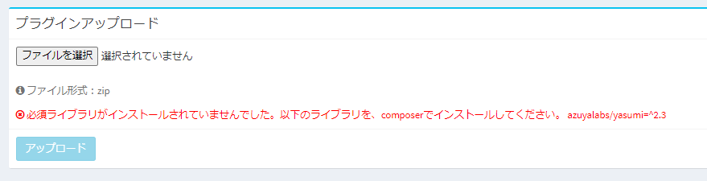

# Cómo crear un plugin
## Introducción
Esta página es para quienes desarrollan plugins. Reúne los enlaces a la forma de crear cada tipo de plugin, y las reglas y configuraciones especiales comunes a todos los tipos.  
Para las funciones de los plugins y su gestión (la carga, etc.), consulte [Plugin](/es/plugin).  

El flujo básico es el siguiente (para más detalles, consulte la página de cada tipo).

1. Crear el archivo de configuración "config.json"
2. Crear los archivos del programa, como el archivo PHP ("Plugin.php")
3. Comprimirlos en un zip y cargarlo desde la pantalla de Exment  

Nota: las clases de la biblioteca de la pantalla de administración están escritas con el espacio de nombres de Exment v7.0.0 o posterior ("ExmentAdminCore\Admin").  
Si usa v6.x o anterior, léalo como "Encore\Admin". Para más detalles, consulte [esta página](/update/v7_0_0) (inglés).

## Enlaces a la forma de crearlo
Elija el tipo de plugin que quiere crear.

- [Botón](/es/plugin_quickstart_button)
- [Evento](/es/plugin_quickstart_event)
- [Página](/es/plugin_quickstart_page)
- [Panel](/es/plugin_quickstart_dashboard)
- [Vista](/es/plugin_quickstart_view)
- [Página CRUD](/es/plugin_quickstart_crud)
- [Lote](/es/plugin_quickstart_batch)
- [API](/es/plugin_quickstart_api)
- [Validación](/es/plugin_quickstart_validate)
- [Script](/es/plugin_quickstart_script)
- [Estilo](/es/plugin_quickstart_style)
- [Importación](/es/plugin_quickstart_import)
- [Exportación](/es/plugin_quickstart_export)
- [Documento](/es/plugin_quickstart_document)
- [Docurain (salida en PDF)](/es/plugin_quickstart_docurain)
- [Disparador (no recomendado)](/es/plugin_quickstart_trigger)


## Namespace del nombre del plugin
Ponga el namespace del plugin según la siguiente regla.
- El namespace debe ser **App\Plugins\\(nombre del plugin en Pascal case)** .
    - Ejemplo: nombre del plugin: testplugin → App\Plugins\\Testplugin
    - Ejemplo: nombre del plugin: customer_list → App\Plugins\\CustomerList
    - Ejemplo: nombre del plugin: get-user → App\Plugins\\GetUser


## Otras configuraciones especiales
Además de la forma básica de crear un plugin, hay configuraciones especiales que se usan solo cuando hacen falta.

- [Añadir una configuración propia a la pantalla de configuración del plugin](/es/plugin_quickstart?id=Añadir-una-configuración-propia-a-la-pantalla-de-configuración-del-plugin)
- [Cubrir varios tipos de plugin con un solo plugin](/es/plugin_quickstart?id=Cubrir-varios-tipos-de-plugin-con-un-solo-plugin)
- [Comprobar las bibliotecas obligatorias al instalar](/es/plugin_quickstart?id=Comprobar-las-bibliotecas-obligatorias-al-instalar)
- [Instalar una plantilla al instalar](/es/plugin_quickstart?id=Instalar-una-plantilla-al-instalar)


### Añadir una configuración propia a la pantalla de configuración del plugin

Se usa cuando quiere añadir a la pantalla de configuración del plugin elementos de configuración propios del plugin.  
Ejemplo: configurar desde la pantalla la clave de acceso necesaria para ejecutar YouTube Data API    


- Escriba el archivo Plugin.php de la siguiente manera.

~~~ php
<?php

// (1)
namespace App\Plugins\YouTubeSearch;

use ExmentAdminCore\Admin\Widgets\Box;
use Exceedone\Exment\Model\CustomTable;
use Exceedone\Exment\Services\Plugin\PluginXXXXBase;
use GuzzleHttp\Client;

class Plugin extends PluginXXXXBase
{
    // (1)
    protected $useCustomOption = true;

    /**
     * (2) Opciones que se configuran en la pantalla de edición del plugin
     *
     * @param $form
     * @return void
     */
    public function setCustomOptionForm(&$form)
    {
        $form->text('access_key', 'Clave de acceso')
            ->help('Escriba la clave de acceso de YouTube.');
    }
}
~~~

- (1) Añada "protected $useCustomOption = true;".
- (2) La función "public function setCustomOptionForm(&$form)" define los elementos que se muestran en la pantalla de configuración del plugin.  
Nota: para usar la configuración personalizada, añada "protected $useCustomOption = true;".  
Nota: para obtener el valor configurado, use la función "$this->plugin->getCustomOption('nombre del parámetro')".

### Cubrir varios tipos de plugin con un solo plugin
Normalmente, un archivo de plugin cubre un solo tipo de plugin.  
Por eso, si quiere usar, por ejemplo, los tipos "Página" y "Panel", tiene que crear 2 archivos de plugin.  
Pero, si lo escribe de la siguiente manera, puede reunir varios tipos de plugin en un solo archivo de plugin.    

#### Modificar config.json
Modifique plugin_type en config.json de la siguiente manera.

~~~
// Extracto de config.json
"plugin_type": "dashboard,page"
~~~

En el valor de plugin_type, escriba varios tipos separados por comas.


#### Modificar el archivo php
Nota: si el tipo de plugin es "Script" o "Estilo", este paso no es necesario.  
  
- Cambie el nombre del archivo, que con 1 tipo era "Plugin.php", a "Plugin(tipo de plugin con la primera letra en mayúscula).php".
    - PluginButton.php
    - PluginEvent.php
    - PluginPage.php
    - PluginDocument.php
    - PluginBatch.php
    - PluginDashboard.php
    - etc....

- Modifique una parte de esos archivos para que el nombre de la clase sea igual al nombre del archivo.

~~~ php
<?php

// Cambio del nombre de la clase (en el caso de un evento)
class PluginEvent extends PluginEventBase
{
~~~


#### (Opcional) Crear el archivo php de configuración
- Si quiere usar la configuración propia descrita en "[Añadir una configuración propia a la pantalla de configuración del plugin](/es/plugin_quickstart?id=Añadir-una-configuración-propia-a-la-pantalla-de-configuración-del-plugin)", cree el archivo "PluginSetting.php".  

~~~ php
// Nombre del archivo: PluginSetting.php
<?php

namespace App\Plugins\PageMulti;

use Exceedone\Exment\Services\Plugin\PluginSettingBase;
use Exceedone\Exment\Model\CustomTable;

// Nombre de la clase: PluginSetting
class PluginSetting extends PluginSettingBase
{
    protected $useCustomOption = true;
    
    /**
     * @param [type] $form
     * @return void
     */
    public function setCustomOptionForm(&$form)
    {
        $form->text('text', 'Texto')
            ->help('Muestra el texto.');
    }
}
~~~


#### Comprimir en zip
Comprima en un zip estos archivos, que son la composición mínima.  
El nombre del archivo zip debe ser "(plugin_name).zip".  
- XXXX.zip
    - config.json
    - PluginDashboard.php
    - PluginPage.php
    - PluginSetting.php (opcional)
    - (otros archivos PHP, archivos de imagen, etc. que hagan falta)

### Plugins de ejemplo
[Mostrar tanto la página como el panel](https://exment.net/downloads/sample/plugin/PageMulti.zip)  


### Comprobar las bibliotecas obligatorias al instalar
Al instalar el plugin, se puede comprobar si las bibliotecas necesarias están en el servidor.  
Si el plugin depende de bibliotecas que se instalan con composer u otra herramienta, comprobarlo antes evita errores al ejecutar el plugin.    

#### Especificación
- Escriba en config.json el nombre de la clase de la biblioteca que quiere comprobar (una que se instala con composer).  
Escriba también en config.json el nombre de composer que el usuario debe instalar si la clase no existe.  

- Si la clase no existe al instalar el plugin, la instalación del plugin da error.  
En ese momento, la pantalla muestra el nombre de composer que hay que instalar.


#### Modificar config.json
Añada "requirement" a config.json, con opciones como las siguientes.

~~~
// Extracto de config.json
"requirement": [
    {
        "class": "(nombre de la clase que se comprueba)",
        "composer": "(nombre de composer que el usuario debe instalar si la clase no existe)"
    },
    {
        "class": "(nombre de la clase que se comprueba)",
        "composer": "(nombre de composer que el usuario debe instalar si la clase no existe)"
    }
]
~~~

#### Ejemplo
Aquí suponemos que el plugin usa la biblioteca "[azuyalabs/yasumi](https://github.com/azuyalabs/yasumi)", que obtiene de una vez los días festivos de Japón.

~~~
// Extracto de config.json
"requirement": [
    {
        "class": "\\Yasumi\\Yasumi",
        "composer": "azuyalabs/yasumi=^2.3"
    }
]
~~~

Con esta configuración, si la clase "\Yasumi\Yasumi" no está en el servidor, se muestra un error al instalar el plugin.



### Instalar una plantilla al instalar
Al instalar el plugin, se puede instalar también una [plantilla](/es/template).  
Así se instalan a la vez las funciones del plugin y la configuración de tablas, etc. que hace falta.    

#### Modificar config.json
Añada "templates": true a config.json.

~~~
// Extracto de config.json
"templates": true
~~~

#### Colocar los archivos de la plantilla
1. Cree la carpeta "templates" en la carpeta del plugin.

2. Exporte la [plantilla](/es/template).  

3. Descomprima el archivo zip exportado y muévalo a la carpeta "templates" de la carpeta del plugin que ha creado.

Con esto, los archivos de la plantilla se instalan automáticamente al instalar el plugin.

#### Otras notas
- Aunque elimine el plugin, las plantillas instaladas con esta función no se eliminan.


### (No recomendado) Usar archivos PHP que no pertenecen a una clase
Normalmente, los procesos de PHP se escriben dentro de una clase, pero a veces se escriben solo funciones, sin usar clases.  
Por ejemplo, un contenido como el siguiente.

``` php
<?php
namespace App\Plugins\TestPluginGlobalFunction;

function testPluginGlobalFunction(){
    return true;
}
```

A partir de la versión v4.1.0, los plugins se cargan con [spl_autoload_register](https://www.php.net/manual/es/function.spl-autoload-register.php).  
Parece que esta función admite class, trait e interface, pero no admite funciones que no pertenecen a una clase.  
Por eso hay que escribirlo de una forma distinta de la normal. Haga lo siguiente.  

#### Llamar a require_once
Ejecute require_once en el constructor, en la función execute, etc. de la clase que hace la llamada.

``` php
<?php
namespace App\Plugins\TestPluginGlobalFunction;

use Exceedone\Exment\Services\Plugin\PluginBatchBase;

class Plugin extends PluginBatchBase
{
    /**
     * execute
     */
    public function execute()
    {
        // Hace require_once de function.php de la misma carpeta y de function.php de la carpeta Dir1
        require_once dirname(__FILE__).'/function.php';
        require_once dirname(__FILE__).'/Dir1/function.php';

        // Ejecuta
        testPluginGlobalFunction();
        Dir1\testPluginGlobalFunctionDir1();
    }
}

```


#### Recomendado: implementar una función static que pertenezca a una clase
Si quiere llamar de forma static a una función definida en otra clase, impleméntela, siempre que sea posible, como una función static de una clase.


``` php
<?php
namespace App\Plugins\TestPluginGlobalFunction;

// Donde se define la función
class StaticFunction
{
    // Se define en la clase como una función static
    public static function testPluginStaticFunction(){
        return true;
    }
}

```

``` php
<?php
namespace App\Plugins\TestPluginGlobalFunction;

use Exceedone\Exment\Services\Plugin\PluginBatchBase;

// Donde se llama a la función
class Plugin extends PluginBatchBase
{
    /**
     * execute
     */
    public function execute()
    {
        // Se llama como una función static
        StaticFunction::testPluginStaticFunction();
        Dir1\StaticFunction::testPluginStaticFunctionDir1();
    }
}

```
