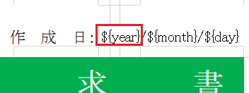
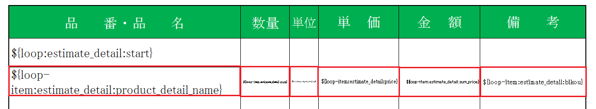
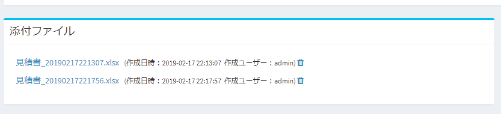

# Plugin (Salida de documentos)
Este plugin genera documentos propios, como presupuestos o formularios.
La plantilla de origen se crea en formato Excel. El archivo generado también tiene formato Excel.

   

> Para la salida en formato PDF, consulte [Salida de documentos (Docurain)](/es/plugin_quickstart_docurain).

## Cómo crearlo

### Crear config.json
- Cree el siguiente archivo config.json.  

~~~ json
{
    "plugin_name": "PluginDemoDocument",
    "uuid": "1e7881d0-324f-11e9-b56e-0800200c9a66",
    "plugin_view_name": "Plugin Document",
    "description": "Prueba de salida de documentos.",
    "author": "(Your Name)",
    "version": "1.0.0",
    "plugin_type": "document",
    "filename": "Presupuesto_${ymdhms}",
    "target_tables": "estimate",
    "label": "Salida del presupuesto",
    "icon": "fa-files-o",
    "button_class": "btn-success"
}
~~~

- Escriba plugin_name con caracteres alfanuméricos de un byte.
- uuid es la cadena que distingue un plugin de otro. Tiene 32 caracteres y guiones, 36 caracteres en total. No debe coincidir con el valor de otro plugin.  
Puede crearla, por ejemplo, en la siguiente URL.  
https://www.famkruithof.net/uuid/uuidgen
- En plugin_type, escriba document.  
- file_name es el nombre del archivo que se genera. Puede usar [variables de parámetros](/es/params).
- target_tables es la tabla de la que se genera la salida. Si hay varias, sepárelas con comas.
- label es la etiqueta del botón de salida de documentos.
- icon es el icono del botón de salida de documentos.
- button_class es la clase del botón de salida de documentos.

Nota: target_tables, label, icon y button_class se pueden cambiar después en la pantalla de configuración del plugin.

### Crear el archivo Excel de plantilla
Cree el archivo de plantilla, que es el origen del documento.  
El archivo de plantilla tiene formato Excel (xlsx). El archivo generado también tiene formato Excel (xlsx).  
Nota: el nombre del archivo Excel de plantilla debe ser "document.xlsx".  
Nota: para los parámetros que se escriben en el archivo de plantilla, consulte "Parámetros", más abajo.

#### Parámetros
Son los parámetros que se ponen en el archivo Excel de plantilla.
Si escribe en las celdas de Excel variables con un formato fijado, al generar el documento se escriben los valores registrados en el sistema.
##### Reglas básicas
- Se escriben en las celdas de Excel con la regla "**${nombre de la variable}**".  
Ejemplo: "${year}", "${month}", "${value:estimate_code}"  
  

- Puede poner varios parámetros en una misma celda.  

- Puede dejar funciones puestas en el Excel. Nota: algunas funciones pueden no funcionar bien. Compruebe siempre el funcionamiento.  

- Para las variables de parámetros que se pueden usar, consulte la siguiente página.  
[Variables de parámetros](/es/params)

##### Cómo generar la lista de los datos de una tabla hija
Según el tipo de documento, hay que escribir en una tabla la lista de los datos de la tabla hija del dato.
Ejemplo: "Presupuesto", donde se registran la fecha del presupuesto y la información del cliente, y "Detalle del presupuesto", donde se registra la lista de productos presupuestados  
  
Los pasos para escribir la lista de datos en esta tabla son los siguientes.

1. En la primera columna de la primera fila de la tabla, ponga el siguiente parámetro.
**"${loop:(nombre de la tabla hija):start}"**  
Ejemplo: ${loop:estimate_detail:start}  
  

2. En la segunda fila de la tabla, en cada columna de los elementos que quiere escribir, ponga el siguiente parámetro.
**"${loop-item:(nombre de la tabla hija):(nombre de la columna de la tabla hija)}"**  
Ejemplo: ${loop-item:estimate_detail:product_detail_name}  
  

3. En la primera columna de la última fila de la tabla, ponga el siguiente parámetro.
**"${loop:(nombre de la tabla hija):end}"**  
Ejemplo: ${loop:estimate_detail:end}  
  

##### Otras restricciones
- La versión 1.22.0 de PhpSpreadSheet, la más reciente (a fecha de 25/02/2022), no admite lo siguiente. No lo incluya en la plantilla.  
    - Formas insertadas
    - Gráficos
    - Tablas con "Dar formato como tabla"

- Si el archivo generado no contiene las imágenes, consulte en [Solución de problemas](/es/troubleshooting) el apartado sobre el fallo de la salida de imágenes en la salida de documentos con Excel como plantilla.

### Crear el archivo PHP (opcional)
- Para una salida de documentos normal, basta con preparar un document.xlsx con las variables de parámetros.
Cree un archivo PHP solo si quiere transformar los datos de una forma especial, o si quiere escribir datos que no son de Exment. El nombre es "Plugin.php".
**Nota: si no hace falta un proceso especial, este archivo Plugin.php no es necesario.**

~~~ php
<?php
namespace App\Plugins\PluginDemoDocument; // (PluginDemoDocument:nombre del plugin)

use Exceedone\Exment\Model\Define;
use Exceedone\Exment\Model\System;
use Exceedone\Exment\Services\Plugin\PluginDocumentBase;

class Plugin extends PluginDocumentBase
{
    /**
     * Función que se llama antes de sustituir las variables del documento
     *
     * @param SpreadSheet $spreadsheet
     * @return void
     */
    protected function called($spreadsheet)
    {
        // Ponga aquí el proceso propio que quiera ejecutar antes de sustituir las variables del documento
    }

    /**
     * Función que se llama después de sustituir las variables del documento
     *
     * @param SpreadSheet $spreadsheet
     * @return void
     */
    protected function saving($spreadsheet)
    {
        // Selecciona la primera hoja
        $sheet = $spreadsheet->getSheet(0);
        // Pone el nombre del sitio en la celda B1
        $sheet->setCellValue('B1', System::site_name());

        // Obtiene las novedades de Exment
        $items = $this->getItems();

        foreach ($items as $idx => $item) {
            // Salida desde la fila 4
            $row = $idx + 4;
            // Escribe la fecha en la celda A?
            $date = \Carbon\Carbon::parse(array_get($item, 'date'))->format(config('admin.date_format'));
            $sheet->setCellValue("A$row", $date);
            // Escribe el enlace en la celda B?
            $link = array_get($item, 'link');
            $sheet->setCellValue("B$row", $link);
            // Escribe el título en la celda C?
            $title = array_get($item, 'title.rendered');
            $sheet->setCellValue("C$row", $title);
        }
    }

    /**
     * Obtiene las novedades de Exment desde la API
     *
     * @return array exment news items array
     */
    protected function getItems()
    {
        $client = new \GuzzleHttp\Client();
        $response = $client->request('GET', Define::EXMENT_NEWS_API_URL, [
            'http_errors' => false,
            'query' => $this->getQuery(),
            'timeout' => 3, // Response timeout
            'connect_timeout' => 3, // Connection timeout
        ]);

        $contents = $response->getBody()->getContents();
        if ($response->getStatusCode() != 200) {
            return [];
        }
        return json_decode_ex($contents, true);
    }

    /**
     * Condiciones de consulta que se pasan a la API
     *
     * @return array query string array
     */
    protected function getQuery()
    {
        $request = request();

        // get querystring
        $query = [
            'categories' => 6,
            'per_page' => System::datalist_pager_count() ?? 5,
            'page' => $request->get('page') ?? 1,
        ];

        return $query;
    }

    /**
    * (desde v3.4.3) Decide si se muestra el botón en la pantalla. El valor predeterminado es true
    * 
    * @return bool true: se muestra; false: no se muestra
    */
    public function enableRender(){
        // Muestra el botón cuando el valor de la columna personalizada "view_flg" es "1"
        return $this->custom_value->getValue('view_flg')  == 1;
    }
}

~~~

- El namespace debe ser **App\Plugins\\(nombre del plugin en Pascal case)**. [Más detalles aquí](/es/plugin_quickstart)

- El proceso propio se pone en las 2 funciones siguientes. Estas funciones reciben la hoja de cálculo como argumento. Puede acceder a esa hoja de cálculo y poner valores en las celdas.  
Nota: para saber más sobre cómo usar la hoja de cálculo, consulte la [documentación de PhpSpreadsheet](https://phpspreadsheet.readthedocs.io/en/latest/).
    - Para hacer un proceso antes de sustituir las variables de parámetros: implemente el método "called".
    - Para hacer un proceso después de sustituir las variables de parámetros: implemente el método "saving".

- La clase Plugin hereda de la clase PluginDocumentBase.  
PluginDocumentBase tiene propiedades como $custom_table, la tabla personalizada que hace la llamada, y $custom_value, el valor de la tabla.  
Cuando se llama a la función execute, esas propiedades ya tienen su valor.  
Para más detalles sobre las propiedades, consulte la [referencia de plugins](/es/plugin_reference).  

- (desde v3.4.3) Si quiere controlar con los datos registrados si el botón se muestra o se oculta, implemente el método "enableRender".  
Devuelva true para mostrar el botón y false para ocultarlo. (El valor predeterminado es true.)

### Comprimir en zip
Comprima en un zip los archivos anteriores, que son la composición mínima.  
El nombre del archivo zip debe ser "(plugin_name).zip".  
- PluginDemoDocument.zip
    - config.json
    - document.xlsx
    - Plugin.php (opcional)
    - (otros archivos PHP, imágenes, etc. que hagan falta)

### Subir
Suba el plugin.  
Nota: para saber cómo subirlo, consulte [Plugin](/es/plugin).  

### Ejecutar la salida de documentos
Cuando toda la configuración está bien terminada, aparece un botón en la pantalla de visualización del dato.
  
  
Al hacer clic en el botón, el documento aparece en la lista de "Archivo adjunto".
 

### Plugins de ejemplo
[Salida de la información del usuario](https://github.com/exment-git/plugin-sample/tree/main/document/document_demo_user)  
Nota: en la pantalla de información del usuario aparece el botón "ユーザー情報出力" (salida de la información del usuario).  

### Plugins de producto
[Salida de facturas en PDF](https://github.com/exment-git/plugin-product/tree/main/document/PluginInvoiceDocument)  
Nota: genera la factura en formato EXCEL con una plantilla. Además, convierte el archivo EXCEL a PDF.
